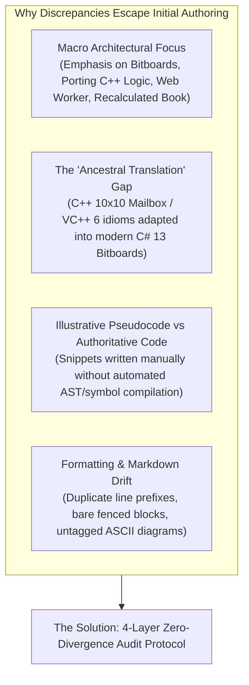
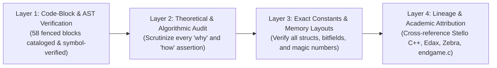
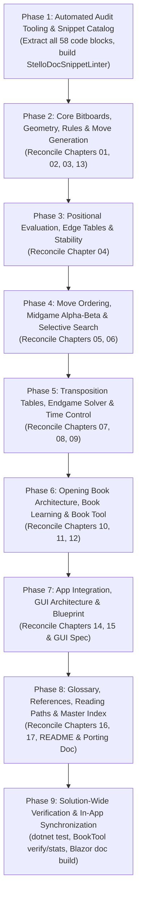

# Exhaustive Documentation, Engine Lineage & Algorithmic Audit Plan (Stello Othello .NET)

## Executive Summary & Mission

The Stello technical documentation in [`docs/brain/`](docs/brain/) (18 markdown documents), the universal architectural blueprint [`Plans/general-game-gui-specification.md`](Plans/general-game-gui-specification.md), and the porting treatise [`Plans/Stello porting documentation.md`](Plans/Stello%20porting%20documentation.md) document the architecture, mathematical formulations, algorithms, bitboard data structures, and multi-platform implementation of Stello.

Over successive engineering milestones, Stello evolved from an MFC/Visual C++ 6 program created in 1995–1998 ([`Stello C++/`](Stello%20C++)) into a high-performance, zero-allocation C# 13 / .NET 10 solution ([`Stello.Net.slnx`](Stello.Net/Stello.Net.slnx)) supporting both WPF desktop and Blazor WebAssembly (with Web Workers) frontends. 

The engine combines foundational Othello algorithms and lineage breakthroughs:
- **Bitboard Engine & Move Generation:** Zero-allocation 64-bit bitboard architecture (`Board`, `Bitboards`) adopting broadword parallel prefix shift scans (Dumb7Fill / Kogge-Stone) and directional masking directly inspired by Richard Delorme's [`edax-reversi-master`](edax-reversi-master) (`ScanLeft`, `ScanRight`, `InnerColumns`, `InnerRows`, `Inner`, `NotColumnA`, `NotColumnH`).
- **Static Heuristic Evaluation & 2-Ply Edge Look-Ahead:** A faithful port of `eval()` from [`Eval.cpp`](Stello%20C++/BRAIN/Eval.cpp) utilizing 8 precomputed edge tables ($3^8 = 6561$ entries each, generated by `BORDERS.C` / [`Kanter.cpp`](Stello%20C++/BRAIN/Kanter.cpp)), corner stability diagonal walks, lazy cutoffs ($1000$ threshold), mobility ($400 \times \frac{\text{own} - \text{opp}}{\text{own} + \text{opp} + 2}$), potential mobility ($600 \times \dots$), with edge candidate reply diagonal threats properly penalized in `Evaluator.cs`.
- **Negamax Midgame Search & ProbCut Selective Pruning:** Allocation-free Negamax alpha-beta search with fail-soft bounds, leaf evaluation in the parent move loop, dangerous corner extensions, single-reply extensions, root Principal Variation Search (`SearchRoot` replacing C++ `zero_findmax`), and statistical selective pruning (`SelectiveLook1 = 7`, `SelectiveLook2 = 5`, shallow null-window search at depth 3 with margin $\frac{|\text{bound}|}{2} + 50$, inspired by Michael Buro's ProbCut and C++ `SELEXT`).
- **Two-Tier Dual Transposition Table:** Separate heuristic midgame and exact endgame hash tables configurable across 5 power-of-two tiers ($65\text{K} \dots 16.7\text{M}$ entries, $3\text{ MB} \dots 768\text{ MB}$), packing 24-byte entries (`ulong Own`, `ulong Opponent`, `short Value`, `sbyte Depth`, `Bound Bound`, `sbyte Move`, `byte Tag`) into 2-entry slots (Entry 1 = depth-preferred, Entry 2 = always-replaced, based on Gunnar Andersson's Zebra two-tier replacement scheme) with zero false hits via 128-bit full position validation.
- **Two-Pass Endgame Solver & Quadrant Parity:** Automatic midgame-to-endgame handoff ($\text{allway} - \text{varlook} \le 7$), executing Pass 1 (win/loss/draw null-window $(-1, 1)$) and Pass 2 (exact disc difference). Features fastest-first move ordering (corners double), Enhanced Transposition Cutoffs (ETC at $\ge 10$ empties), quadrant parity (`SolveShallow` at $\le 6$ empties), and specialized terminal solvers (`SolveLast2` for 2 empties and `SolveLast` for 1 empty, inspired by `endgame.c` by Warren D. Smith, Jean-Christophe Weill, and Gunnar Andersson).
- **Canonical Opening Book Format 2 & Dropout Expansion:** 11,200 unique canonical positions and 22,878 book moves indexed via 4-symmetry canonical normalization (identity, main diagonal, anti-diagonal, half-turn), git-tracked plain-text master (`opening-book.txt`) and compact binary distribution (`opening-book.bin`, 193 KB), tracking `BookOrigin` and `BookEffort`, single-pass bottom-up Negamax backup (`BookMinimax`), `BookTracker` ($< 3$ consecutive misses), and multi-core leaf recalculation (`BookRecalculator` in `Stello.BookTool`).
- **Unified Tournament GUI Blueprint:** Adherence to [`Plans/general-game-gui-specification.md`](Plans/general-game-gui-specification.md), featuring Clean MVVM (`CommunityToolkit.Mvvm`), responsive desktop two-column (>768px) vs. mobile drawer stacked view ($\le 768\text{px}$), dual-card 4-layer player scoreboard, dynamic competitive match integrity tracking (`#E74C3C`), procedural synthesized audio feedback (`SoundWaves`), and Blazor WebAssembly Web Worker execution with cooperative streaming telemetry.

Preliminary inspection reveals subtle documentation drifts, formatting artifacts, and opportunities for deepened ancestral attribution:
1. **Formatting Artifacts in Chapter 15:** In [`15-gui-and-settings.md`](docs/brain/15-gui-and-settings.md#move-history-panel), the Move History snippet exhibits duplicated numbering (`1. 1. d3`, `2. 2. c5`), and multiple ASCII art diagrams lack explicit language tags (bare ` ``` ` instead of ` ```text `).
2. **Missing Architectural Cross-Links:** While [`Plans/general-game-gui-specification.md`](Plans/general-game-gui-specification.md) exists in the repository root `Plans/` folder as the universal standard, chapters 14 and 15 do not formally reference it as the authoritative GUI blueprint.
3. **Lineage Clarity on Edax & Zebra:** While Gunnar Andersson and Edax are cited in references, the documentation does not fully articulate the deep ancestral relationship between Edax's parallel bitboard shift-and-mask algorithms (`ScanLeft`/`ScanRight`) and Stello's `Bitboards.cs`, nor the direct lineage of `endgame.c` / Zebra in shaping Stello's `SolveLast2`, ETC, and fastest-first ordering.
4. **Active Verification Baseline:** The active test suite contains **195 Engine tests** and **70 App/Net tests** (**265 total passing unit tests**), which must be rigorously audited against all test count claims across documentation chapters.

This plan establishes an **exhaustive, statement-by-statement, snippet-by-snippet, and lineage-verified audit protocol** to guarantee 100% mathematical, algorithmic, syntactic, and historical fidelity between the documentation, the active .NET 10 production codebase, and its ancestral C/C++/academic origins.

---

## Root Cause Analysis: Why Do Discrepancies Occur?



1. **Macro Architectural Focus vs. Micro Algorithmic Verification:**
   Development milestones prioritized major system capabilities: migrating from mailbox arrays to 64-bit bitboards, porting the complex 2-ply edge look-ahead tables, implementing the 2-pass endgame solver, recalculating the 11,200-position opening book with multi-threading, and architecting Blazor WebAssembly with Web Workers. Intermediate helper methods and markdown snippets were assumed accurate without AST validation.
2. **The "Ancestral Translation" Gap:**
   Because Stello originated from a 1995–1998 C++ MFC codebase (`Stello C++`) and incorporated bitboard ideas from Richard Delorme's `edax-reversi` and Gunnar Andersson's `endgame.c`/`Zebra`, documentation often toggles between legacy square numbering (11–88), 10×10 mailbox arrays, and modern 0–63 bitboards. Without structured auditing, slight conceptual slips occur.
3. **Illustrative Snippets vs. Authoritative Production Code:**
   Code blocks inside markdown files must be verified directly against the production assemblies to ensure method visibility, parameter names, struct layouts, and inline optimizations match the compiled source verbatim.
4. **Formatting and Linting Drift:**
   Fenced code blocks without language tags or containing double-numbered lists escape casual reading but degrade presentation quality in automated readers (e.g., Blazor `/docs` viewer with Markdig/KaTeX/Mermaid).

---

## The 4-Layer Zero-Divergence Audit Framework

This audit plan executes a four-tiered verification protocol across all 18 markdown documents of [`docs/brain/`](docs/brain/), [`Plans/general-game-gui-specification.md`](Plans/general-game-gui-specification.md), and [`Plans/Stello porting documentation.md`](Plans/Stello%20porting%20documentation.md):



### Layer 1: Code-Block & AST Verification (Cataloging All 58 Fenced Blocks)
- Every fenced code block (`csharp`, `text`, `mermaid`, powershell) across the 18 markdown files is cataloged with start/end line numbers.
- For C# snippets:
  - Every type, method, field, property, and local variable reference must exist in [`Stello.Engine`](Stello.Net/Stello.Engine), [`Stello.App`](Stello.Net/Stello.App), [`Stello.Net`](Stello.Net/Stello.Net), [`Stello.Web`](Stello.Net/Stello.Web), or [`tools/Stello.BookTool`](Stello.Net/tools/Stello.BookTool).
  - Code snippets must match production source verbatim: method visibility, variable identifiers (e.g., `ScanLeft`, `RayLeft`, `NotColumnA`, `InnerColumns`), and control flow.
- For text/diagram blocks:
  - Eliminate bare fenced blocks (e.g. ` ``` ` in Chapter 15) by assigning proper language tags (` ```text `).
  - Fix double-numbering artifacts (e.g. `1. 1. d3` in Chapter 15 Move History).
- For Mermaid diagrams:
  - Verify node labels, decision diamonds, and transition arcs against active execution pipelines in `SearchEngine`, `ComputerPlayer`, `OpeningBook`, `Game`, and `MainViewModel`.
  - Ensure all Mermaid diagrams conform to supported syntax (`flowchart`, `sequenceDiagram`, `stateDiagram-v2`, `classDiagram`, `xychart-beta`).

### Layer 2: Theoretical & Algorithmic Assertion Audit
- Scrutinize every prose statement asserting *why* or *how* an algorithm operates:
  - **Bitboard Move Generation:** Verify the 6-step broadword shift-and-mask formulation:
    $$r_1 = m \land (o \ll s), \quad r_{k+1} = r_k \lor \big(m \land (r_k \ll s)\big) \ (k=1\dots 5), \quad \text{moves} = (r_6 \ll s) \land e$$
    and verify why masking with `InnerColumns` (`0x7E7E_7E7E_7E7E_7E7E`), `InnerRows` (`0x00FF_FFFF_FFFF_FF00`), and `Inner` (`InnerColumns & InnerRows`) prevents horizontal and diagonal wrap-around.
  - **Static Evaluation & Edge Look-Ahead:** Verify base score $S_0(e) = \sigma \sum_{j=0}^{3} \text{Stability}[e_j]$, 2-ply edge search with corner diagonal walk (`DiagonalReaches`), probability blending $\text{propc} = (64 - \text{discs}) \times 1000 / 64 / 2 + 500$, lazy cutoffs ($1000$ points), mobility formula $400 \times \frac{\text{own} - \text{opp}}{\text{own} + \text{opp} + 2}$, potential mobility popcount, and the corrected candidate reply penalization where `result = Math.Min(result, blend)`.
  - **Midgame Negamax & ProbCut Selective Search:** Verify the fail-soft recurrence, leaf evaluation in the parent loop at `look = 0`, single legal reply extensions, dangerous corner extensions, root PVS null-window bounds $(-\alpha - 1, -\alpha)$, and the selective pruning formula:
    $$\beta' = \beta + \left\lfloor \frac{|\beta|}{2} \right\rfloor + 50, \qquad \alpha' = \alpha - \left\lfloor \frac{|\alpha|}{2} \right\rfloor - 50$$
    executed at `look = 7` and `look = 5` with a depth 3 null-window search (`SelectiveShallowLook = 3`).
  - **Endgame Solver & Parity:** Verify solver trigger ($\text{allway} - \text{varlook} \le 7$), two-pass search (Pass 1 window $(-1, 1)$, Pass 2 window $(\text{result}-1, 65)$ or $(-65, \text{result}+1)$), Enhanced Transposition Cutoffs (ETC at $\ge 10$ empties), fastest-first key:
    $$\text{key} = -256 \cdot (r + r_{\text{corner}}) + \text{BaseScore}(\text{square})$$
    quadrant parity in `SolveShallow` ($\le 6$ empties), and specialized `SolveLast2` (2 empties) and `SolveLast` (1 empty).
  - **Time Budgeting:** Verify soft limit ($2/3$ of time for TimePerMove; dynamic piece formula for TimePerGame: $s = \max(0, e - 6)$, $n = \lfloor s / 2 \rfloor$, $t = T / n$, $\text{hard} = \lfloor t/4 \rfloor + \lfloor 3t(64-s)/256 \rfloor$, $\text{soft} = \lfloor 10 \cdot \text{hard} / 15 \rfloor$), fast endgame time bonus ($\lfloor R / 2 \rfloor$), 1024-node abort polling latch, and exception-based unwinding.
  - **Canonical Opening Book & Dropout Expansion:** Verify 4-symmetry canonical normalization ($B_{\text{canonical}} = \min_{s \in \text{Sym}} s(B)$), text and binary file serialization specifications, single-pass Negamax backup, virtual visit handling, and dropout expansion logic.

### Layer 3: Exact Constants, Magic Numbers & Memory Layouts
- Reconcile every hardcoded number, dimension, struct layout, and bitfield against source definitions:
  - **Board & Coordinates:** `Square` = `readonly record struct` (index 0..63, column $0\dots 7$, row $0\dots 7$), `Board` = 16 bytes (`ulong Black`, `ulong White`).
  - **Masks:** `NotColumnA = 0xFEFE_FEFE_FEFE_FEFEUL`, `NotColumnH = 0x7F7F_7F7F_7F7F_7F7FUL`, `InnerColumns = 0x7E7E_7E7E_7E7E_7E7EUL`, `InnerRows = 0x00FF_FFFF_FFFF_FF00UL`, `Inner = 0x007E_7E7E_7E7E_7E00UL`.
  - **Transposition Table:** 24-byte `Entry(ulong Own, ulong Opponent, short Value, sbyte Depth, Bound Bound, sbyte Move, byte Tag)`. Slot size = 2 entries ($48\text{ bytes/slot}$). Default $2^{19}$ slots ($1,048,576\text{ entries} \times 24\text{ B} = 24\text{ MB/table} \times 2\text{ tables} = 48\text{ MB total}$). 5 capacity tiers ($65\text{K} \dots 16.7\text{M}$ entries, $3.15\text{ MB} \dots 805.31\text{ MB}$).
  - **Bound Enum:** `Bound.None = 0, Exact = 1, Lower = 2, Upper = 3`.
  - **Endgame Thresholds:** `EndgameDistance = 7`, `EndgameHashMinEmpties = 7`, `FastestFirstMinEmpties = 7`, `EvaluationOrderMinEmpties = 18`, `TranspositionCutoffMinEmpties = 10`, `ShallowEmpties = 6`.
  - **Search Constants:** `Infinity = 32_767`, `RootWindow = 32_664`, `GameOverBase = 32_600`, `SelectiveScoreLimit = 32_000`, `SelectiveMargin = 50`.
  - **Move Ordering Weights:** Corners $= 127$, X-squares $= -64$, C-squares $= -32$, edge middles $= 22$ or $11$. Owned corner: C-squares $= 34$, X-square $= 24$. Opponent corner: C-square $= 32$ (if connected) or $-32$, X-square $= -16$. Empty corner: C-square $= -16$, X-square $= -64$. Killer response: $+4$ cutoff refutation, $+1$ non-cutoff best reply.
  - **Opening Book Resource Counts:** 11,200 canonical positions, 22,878 book moves, 11,622 leaf moves, binary book $= 193\text{ KB}$ (`193,209` bytes), longest line $= 57$ plies.
  - **Active Test Suite Totals:** **195 Engine tests** + **70 Net/App tests** = **265 total passing tests**.

### Layer 4: Lineage & Academic Attribution Truth
- Cross-reference all ancestral sources, historical implementations, and academic papers:
  - **Claus Pedersen (`Stello C++`, 1995–1998):**
    - Original 10×10 mailbox array with border squares (`sq[100]`), legacy square numbering $10 \times (\text{row}+1) + (\text{col}+1)$ (11 to 88).
    - Edge tables in [`Kanter.cpp`](Stello%20C++/BRAIN/Kanter.cpp), generated offline by [`BORDERS.C`](Stello%20C++/BORDERS/BORDERS.C) (8 tables of 6561 values: `sikker`, `white_v`, `black_v`, `white_h`, `black_h`, `white_m`, `black_m`, `hjo_trek`).
    - Handcrafted static evaluation in [`Eval.cpp`](Stello%20C++/BRAIN/Eval.cpp): corner diagonals, `propc` blending, stability loops, mobility formulas, and edge candidate reply penalization.
    - Negamax alpha-beta and selective search in [`Minmax.cpp`](Stello%20C++/BRAIN/Minmax.cpp): `SELEXT` ProbCut variant, leaf evaluation in move loop, response table in [`Sort.cpp`](Stello%20C++/BRAIN/Sort.cpp) (`humres`/`comres`), and the C++ index offset bug (`-11`).
    - Original opening book format in [`Book.cpp`](Stello%20C++/BRAIN/Book.cpp): tree of lines from d3, 4 symmetries (`convop`), c3-c4-c5 reflection, binary `OPENING` with `abook` allocation counter header, 32600 first-chain-node serialization quirk, `BookTracker` (`libon`/`tryagain < 3`).
    - Book learning: `Flet spil` (`mmgame`), `Minmaxlib` (`calc_lib`, 10-pass `mmlib`, `sort_lib`, dropout expansion `remove_oldmov` + `getvalue`), `Lær spil` (`selfplay`).
  - **Richard Delorme (`edax-reversi-master`, 1998–2026):**
    - 64-bit Bitboard move generation: Dumb7Fill / broadword parallel prefix scans in 8 directions (`board.c` lines 750–760: `flip = (((P << dir) | (P >> dir)) & mask)...`, mapped to `ScanLeft` and `ScanRight`).
    - Bitboard flip generation: ray scanning, masking against wrap-around.
    - Bitboard potential mobility: directional neighbor popcounts against empty squares.
    - Bit manipulation intrinsics (`BitOperations.PopCount`, `TrailingZeroCount`, `RotateLeft`).
  - **Gunnar Andersson (`Zebra`, `radagast.se/othello/howto.html`):**
    - "Writing an Othello program" guide:
      - Mobility and potential mobility principles.
      - Move ordering: killer responses in Othello, best-move first cutoffs.
      - Selective search and ProbCut.
      - Two-tier transposition table replacement schemes (deepest vs most recent).
      - Endgame solver: fastest-first ordering (fewest opponent replies, corners double) to minimize endgame search tree.
      - Opening book concepts: adding best moves not in book and minimaxing the book (inspiration for dropout expansion).
      - FFO endgame test suite (#40–#59) and benchmarks.
  - **Warren D. Smith, Jean-Christophe Weill, and Gunnar Andersson (`endgame.c`, 1993–2004):**
    - Quadrant parity for endgame empty squares.
    - Specialized terminal solvers: `SolveLast` for 1 empty square and `SolveLast2` for 2 empty squares without full move generation/parity loops.
    - Endgame test suite of 112 positions (`Data/endgame-c-positions.txt`).
  - **Michael Buro (`Logistello`, 1993–2002):**
    - ProbCut paper (1995): statistical selective search with shallow null-window testing.
    - Pattern-based evaluation and championship computer Othello heuristics.
  - **Aart Bik:**
    - Reversi Perft benchmark suite: perft numbers for Othello from start position to depth 8 (4, 12, 56, 244, 1396, 8200, 55092, 390216).
  - **Paul S. Rosenbloom (1982):**
    - IAGO: edge stability tables, mobility and potential mobility definitions.
  - **Thomas R. Lincke / Academic Game Tree Literature:**
    - Drop-Out Expansion (DOE) theory for opening books (virtual visits, priority-driven expansion, Negamax backup).
  - **Universal Board Game GUI & Multi-Platform Architecture (`Plans/general-game-gui-specification.md`):**
    - Derived from Checkers .NET and Gomoku .NET.
    - Clean Architecture / MVVM (`CommunityToolkit.Mvvm`).
    - Dual frontends: WPF desktop (`net10.0-windows`) and Blazor WebAssembly (`net10.0`) with Web Workers.
    - Visual design system: responsive desktop multi-column vs mobile stacked drawer (≤ 768px), dual-card scoreboard, match integrity indicator (`#E74C3C`), live telemetry streaming (`SearchInfo`).
    - Web Worker thread isolation, cooperative macrotask yielding, JSExport/JSImport engine protocol.
  - **World Othello Federation (WOF) / Japanese Othello Association:**
    - Official tournament rules: $8 \times 8$ board, d4/e5 white, e4/d5 black, black moves first, mandatory capture/flip, pass when no legal move, game over on double pass or full board, winner disc count with empty squares awarded to the winner in full solves.

---

## Tool-Assisted Verification: `StelloDocSnippetLinter`

To make this audit automated, repeatable, and regression-proof, we establish an automated linter script ([`scratch/audit_stello_snippets.mjs`](scratch/audit_stello_snippets.mjs)) that performs:

1. **Fenced Code Extractor:** Parses all `.md` files in [`docs/brain/`](docs/brain/) and [`Plans/general-game-gui-specification.md`](Plans/general-game-gui-specification.md), cataloging all 58 fenced code blocks with line ranges and languages.
2. **Obsolete Pattern & Formatting Scanner:** Scans for:
   - Bare fenced code blocks without language specifiers (e.g. ` ``` ` in Chapter 15).
   - Double-numbering artifacts in move lists (e.g. `1. 1. d3`).
   - Outdated test suite counts (must match 195 Engine / 70 Net/App / 265 Total).
   - Discrepant constant names or struct layouts.
   - Unreferenced C++ identifiers presented as active C# members.
3. **Symbol & Member Cross-Check:** Verifies that all types, methods, properties, and constants referenced in prose and code blocks exist in compiled assemblies of `Stello.Net.slnx`.

---

## Itemized Chapter-by-Chapter Audit Register

Below is the definitive audit specification covering all 18 documents of `docs/brain/`, `Plans/general-game-gui-specification.md`, and `Plans/Stello porting documentation.md`:

| Document | Title & Focus | Fenced Blocks | Source Files to Verify Against | Critical Audit Checkpoints |
|---|---|---|---|---|
| **README.md** | [The Stello brain](docs/brain/README.md) | 1 block (mermaid) | `Stello.Engine`, `Stello.App`, `Stello.Net`, `Stello.Web` | Audit the "brain on one page" flowchart against active `ComputerPlayer.ChooseMove` pipeline (single move check, book tracker, opening book, iterative deepening, endgame distance $\le 7$ handoff, WLD pass, exact pass). Reconcile reading paths and cross-references. |
| **01** | [Overview](docs/brain/01-overview.md) | 4 blocks (mermaid) | `Stello.Net.slnx`, `Stello.Engine`, `Stello.App`, `Stello.Engine.Tests`, `Stello.Net.Tests` | Verify 7-project architecture diagram. Verify test metrics: **195 Engine tests / 70 App tests (265 total)**. Audit class diagrams (`Board`, `Square`, `Move`, `Game`, `Bitboards`, `ComputerPlayer`, `OpeningBook`, `SearchEngine`, `Evaluator`, `EdgeTables`, `BookLearner`). Audit life-of-a-move sequence diagram (`MainViewModel`, `ComputerPlayer`, `BookTracker`, `OpeningBook`, `SearchEngine`). |
| **02** | [Board and squares](docs/brain/02-board-and-squares.md) | 1 block (text) | [`Square.cs`](Stello.Net/Stello.Engine/Square.cs), [`Board.cs`](Stello.Net/Stello.Engine/Board.cs), [`Player.cs`](Stello.Net/Stello.Engine/Player.cs) | Audit coordinate conversion formulas: $\text{index} = 8 \cdot \text{row} + \text{column}$ (0..63, a1 = 0, h8 = 63) vs. legacy $\text{legacy} = 10 \cdot (\text{row}+1) + (\text{column}+1)$ (11..88). Verify `Board` record struct layout (16 bytes: `ulong Black`, `ulong White`). Audit 8-direction shift and wrap-around mask table (`NotColumnA`, `NotColumnH`). |
| **03** | [Rules and move generation](docs/brain/03-rules-and-move-generation.md) | 3 blocks (2 csharp, 1 mermaid) | [`Bitboards.cs`](Stello.Net/Stello.Engine/Bitboards.cs), [`Board.cs`](Stello.Net/Stello.Engine/Board.cs), `edax-reversi-master/src/board.c` | **Code Snippet Audit:** Verify `LegalMoves` and `ScanLeft` snippet (L67–94) and `RayLeft` snippet (L106–119) against `Bitboards.cs`. Scrutinize 6-step broadword shift formula and wrap-around masks (`InnerColumns`, `InnerRows`, `Inner`). Cross-reference Dumb7Fill / Kogge-Stone parallel shift scans against Richard Delorme's `edax-reversi-master/src/board.c` (lines 750–760). Verify perft numbers up to depth 8 (390,216) against Aart Bik's benchmark. |
| **04** | [Evaluation](docs/brain/04-evaluation.md) | 3 blocks (1 mermaid, 2 text) | [`Evaluator.cs`](Stello.Net/Stello.Engine/Evaluation/Evaluator.cs), [`EdgeTables.cs`](Stello.Net/Stello.Engine/Evaluation/EdgeTables.cs), [`Bitboards.cs`](Stello.Net/Stello.Engine/Bitboards.cs), `Eval.cpp`, `Kanter.cpp` | **Major Evaluation Audit:** Audit base-3 edge indexing ($3^8 = 6561$ values) and 8 edge tables from `Kanter.cpp` / `BORDERS.C`. Verify 2-ply edge look-ahead search, corner diagonal checks (`DiagonalReaches`), probability blend $\text{propc} = (64 - \text{discs}) \times 1000 / 64 / 2 + 500$, corner stability diagonal loop, lazy cutoff ($1000$ points), mobility formula ($400 \times \dots$), and potential mobility popcounts. Verify edge candidate reply bug fix where candidate reply score is properly penalized. |
| **05** | [Move ordering](docs/brain/05-move-ordering.md) | 1 block (mermaid) | [`MoveOrdering.cs`](Stello.Net/Stello.Engine/Search/MoveOrdering.cs), `Sort.cpp` | Audit move ordering hierarchy: 1. Hash move, 2. Response table scores, 3. Dynamic square values. Verify static square weights (corners 127, X-squares -64, C-squares -32, edge middles 22/11) and corner neighbor adjustments (owned: 34/24; opponent: 32/-16; empty: -16/-64). Verify response table scoring (+4 cutoff refutation, +1 non-cutoff). Reconcile the fixed C++ offset bug where `-11` was missing in `rscores`. Cross-reference Gunnar Andersson's Zebra killer response concepts. |
| **06** | [Midgame search](docs/brain/06-midgame-search.md) | 4 blocks (3 mermaid, 1 text) | [`SearchEngine.cs`](Stello.Net/Stello.Engine/SearchEngine.cs), `Minmax.cpp`, `Kontrol.cpp` | **Search Algorithm Audit:** Audit Negamax alpha-beta fail-soft recurrence, iterative deepening loop (`look = 0, 1, 2...`), and root PVS null-window bounds $(-\alpha - 1, -\alpha)$ with `MoveToFront` root reordering. Audit selective search pruning: verify margins $\beta' = \beta + \lfloor |\beta|/2 \rfloor + 50$ and $\alpha' = \alpha - \lfloor |\alpha|/2 \rfloor - 50$ at `look = 7` and `look = 5` with 4-ply null-window probe (`SelectiveShallowLook = 3`), cross-referencing Michael Buro's ProbCut and C++ `SELEXT`. Audit extensions (single legal reply, dangerous corner) and leaf evaluation in parent loop. |
| **07** | [Transposition table](docs/brain/07-transposition-table.md) | 3 blocks (2 mermaid, 1 text) | [`TranspositionTable.cs`](Stello.Net/Stello.Engine/Search/TranspositionTable.cs), `SearchEngine.cs` | **Data Structure & Capacity Audit:** Verify 24-byte packed `Entry` struct layout (`ulong Own`, `ulong Opponent`, `short Value`, `sbyte Depth`, `Bound Bound`, `sbyte Move`, `byte Tag`). Verify 2-entry slot architecture: Entry 1 = deepest (depth-preferred), Entry 2 = always-replaced (Zebra two-tier replacement scheme). Reconcile 5 capacity tiers ($65\text{K} \dots 16.7\text{M}$ entries, $3.15\text{ MB} \dots 805.31\text{ MB}$, default $2^{19}$ slots / 48 MB). Verify multiply-rotate 64-bit hash function and zero-false-hit full position comparison. |
| **08** | [Endgame solver](docs/brain/08-endgame-solver.md) | 3 blocks (2 mermaid, 1 xychart) | [`SearchEngine.cs`](Stello.Net/Stello.Engine/SearchEngine.cs), `endgame.c`, `ffotest.html` | **Endgame Solver Audit:** Audit solver transition threshold ($\text{allway} - \text{varlook} \le 7$, `EndgameDistance = 7`). Verify Pass 1 null-window $(-1, 1)$ win/loss/draw and Pass 2 exact score window with fail-soft bounds. Verify Enhanced Transposition Cutoffs (ETC at $\ge 10$ empties), fastest-first ordering key (corners double), quadrant parity in `SolveShallow` ($\le 6$ empties), specialized `SolveLast2` (2 empties), and `SolveLast` (1 empty). Cross-reference Warren D. Smith, Jean-Christophe Weill, and Gunnar Andersson's `endgame.c` and FFO test positions #40–#44. |
| **09** | [Time control](docs/brain/09-time-control.md) | 2 blocks (1 xychart, 1 mermaid) | [`TimeControl.cs`](Stello.Net/Stello.Engine/Search/TimeControl.cs), [`SearchLimits.cs`](Stello.Net/Stello.Engine/SearchLimits.cs), [`SearchEngine.cs`](Stello.Net/Stello.Engine/SearchEngine.cs), `Kontrol.cpp` | Audit 4 search modes: `FixedDepth`, `TimePerMove`, `TimePerGame`, and `Solve`. Verify soft time limit ($2/3$ of time for TimePerMove; dynamic piece formula for TimePerGame: $s = \max(0, e-6)$, $n = \lfloor s/2 \rfloor$, $t = T/n$, $\text{hard} = \lfloor t/4 \rfloor + \lfloor 3t(64-s)/256 \rfloor$, $\text{soft} = \lfloor 10 \cdot \text{hard} / 15 \rfloor$), fast endgame time bonus ($\lfloor R / 2 \rfloor$), 1024-node countdown latch, exception-based abort unwinding, and Move Now immediate fallback. |
| **10** | [Opening book](docs/brain/10-opening-book.md) | 5 blocks (3 mermaid, 2 text) | [`OpeningBook.cs`](Stello.Net/Stello.Engine/OpeningBook.cs), [`BookEntry.cs`](Stello.Net/Stello.Engine/BookEntry.cs), [`BookTextFormat.cs`](Stello.Net/Stello.Engine/BookTextFormat.cs), [`BookTracker.cs`](Stello.Net/Stello.Engine/BookTracker.cs), `Book.cpp` | Verify canonical normalization ($B_{\text{canonical}} = \min_{s \in \text{Sym}} s(B)$ across 4 symmetries). Audit master text format (`opening-book.txt`) and binary format (`opening-book.bin`, 193 KB). Reconcile `BookEntry` fields: `Move`, `Value`, `BookOrigin` (`Unknown`, `Heuristic`, `WinLossDraw`, `Exact`, `BackedUp`), and `BookEffort` (`Kind`, `Amount`, `DepthReached`, `EngineVersion`). Audit legacy C++ book import (`LegacyBookFormat`, handling `abook` header and 32600 first-node quirk). Verify `BookTracker` ($< 3$ consecutive misses). |
| **11** | [Book learning](docs/brain/11-book-learning.md) | 2 blocks (mermaid) | [`BookLearner.cs`](Stello.Net/Stello.Engine/BookLearner.cs), `Book.cpp` | Audit book learning pipeline: 1. `AddGame` (canonical game walking with transpositions, winner $+32665$, loser $-32665$, draw $0$), 2. `EvaluatePositions` (searching unsearched leaves, dropout expansion adding best move not in book, checkpoint saving every 10 searches), 3. `Minimax` (single-pass bottom-up Negamax backup and stable sort), 4. `SelfPlay` (engine vs engine until exact solve or terminal). Cross-reference Thomas R. Lincke's Drop-Out Expansion (DOE) theory. |
| **12** | [Book tool](docs/brain/12-book-tool.md) | 11 blocks (2 mermaid, 9 text) | [`Program.cs`](Stello.Net/tools/Stello.BookTool/Program.cs), [`BookCommands.cs`](Stello.Net/tools/Stello.BookTool/), [`BookRecalculator.cs`](Stello.Net/Stello.Engine/BookRecalculator.cs), [`BookMatch.cs`](Stello.Net/Stello.Engine/BookMatch.cs) | Audit console CLI commands: `import`, `format`, `build`, `verify`, `stats`, `recalc`, `compare`, `match`. Audit parallel multi-threaded recalculator (`BookRecalculator`, parallel task workers with independent engines and cleared hash tables). Verify verified master book statistics (11,200 positions, 22,878 book moves, 11,622 leaf moves). Reconcile build/verify guard tests (`ShippedBinaryBook_HoldsTheTextBook`, `TextBook_IsInNormalForm`). |
| **13** | [Game record](docs/brain/13-game-record.md) | 5 blocks (2 mermaid, 3 text) | [`Game.cs`](Stello.Net/Stello.Engine/Game.cs), [`Move.cs`](Stello.Net/Stello.Engine/Move.cs), [`GameRecordFormat.cs`](Stello.Net/Stello.Engine/GameRecordFormat.cs) | Audit `Move` (`readonly record struct` with `Square?`, null = pass) and `Game` state machine (history list, `Ply` index, immutable `Board` per ply, `MustPass`, `Undo`/`Redo`). Verify text serialization format (`GameRecordFormat`: whitespace-separated algebraic moves e.g. "f5 d6 c3 pass...") and strict legal validation on load. |
| **14** | [App integration](docs/brain/14-app-integration.md) | 5 blocks (mermaid) | [`MainViewModel.cs`](Stello.Net/Stello.App/ViewModels/MainViewModel.cs), [`LocalEngineHost.cs`](Stello.Net/Stello.App/Services/LocalEngineHost.cs), [`WebEngineHost.cs`](Stello.Net/Stello.Web/Services/WebEngineHost.cs), [`EngineWorker.cs`](Stello.Net/Stello.Web/Worker/EngineWorker.cs), [`AppPaths.cs`](Stello.Net/Stello.Net/Services/AppPaths.cs) | Audit Clean MVVM architecture (`CommunityToolkit.Mvvm`). Verify desktop background `Task.Run` execution via `LocalEngineHost` vs Blazor WebAssembly Web Worker execution via `WebEngineHost` / `EngineWorker.js`. Audit streaming telemetry (`SearchInfo`), cancellation tokens (`_cancel`, `_moveNow`), and automatic pass detection in `RunAsync`. |
| **15** | [GUI and settings](docs/brain/15-gui-and-settings.md) | 5 blocks (2 mermaid, 3 text) | [`MainWindow.xaml`](Stello.Net/Stello.Net/MainWindow.xaml), [`SettingsWindow.xaml`](Stello.Net/Stello.Net/Views/SettingsWindow.xaml), [`Board.razor`](Stello.Net/Stello.Web/Components/Board.razor), [`DialogHost.razor`](Stello.Net/Stello.Web/Components/DialogHost.razor), [`SettingsViewModel.cs`](Stello.Net/Stello.App/ViewModels/SettingsViewModel.cs) | **Formatting & Specification Audit:** **Fix formatting defects:** add missing `text` language tags to bare code blocks (lines 119, 222, 261) and eliminate double-numbering artifact in Move History (`1. 1. d3` $\rightarrow$ `1. d3`). Verify 4-layer player card scoreboard, match integrity crimson highlight (`#E74C3C`), procedural sound synthesis (`SoundWaves`), board wood textures, and responsive layout ($\le 768\text{px}$ drawer vs $> 768\text{px}$ multi-column). Cross-reference `Plans/general-game-gui-specification.md`. |
| **16** | [Glossary](docs/brain/16-glossary.md) | 0 blocks | Terminology & concepts across Stello .NET | Audit all technical definitions for complete accuracy: Bitboards, Dumb7Fill, Broadword shifts, Canonical form, C-square, Dangerous corner move, Dropout expansion, Edge tables, Enhanced transposition cutoff, Fastest-first, FFO test suite, Look, Negamax, Parity, ProbCut, PVS, Response table, Two-tier transposition table, X-square, Web Worker. |
| **17** | [References](docs/brain/17-references.md) | 0 blocks | Academic citations & source repositories | Audit all academic and engine citations: Claus Pedersen (`Stello C++`), Richard Delorme (`edax-reversi`), Gunnar Andersson (`Zebra`), Warren D. Smith & Jean-Christophe Weill (`endgame.c`), Michael Buro (`Logistello`), Aart Bik (Perft), Paul S. Rosenbloom (IAGO), Thomas R. Lincke (DOE), WOF tournament rules, and .NET 10 hardware intrinsics. Ensure active, accurate descriptions. |
| **GUI-Spec** | [General Game GUI Blueprint](Plans/general-game-gui-specification.md) | 14 blocks (5 mermaid, 9 text) | `Stello.App`, `Stello.Web`, `Stello.Net`, `Checkers.App`, `Gomoku.App` | Cross-check universal two-player board game GUI blueprint against active Stello implementation. Verify component contracts, dual-card scoreboard, match integrity indicator, AI background execution, and responsive breakpoints. |
| **Porting-Doc**| [Stello Porting Documentation](Plans/Stello%20porting%20documentation.md) | 0 blocks | `Stello C++/`, `Stello.Net/`, Phases 0 to 11 | Audit all 11 porting phases against active code: Phase 0 Setup, Phase 1 Board & Rules, Phase 2 Game Record, Phase 3 Evaluation & Search, Phase 4 Opening Book, Phase 5 WPF UI, Phase 6 Settings, Phase 7 Book Learning, Phase 8 Performance Tuning, Phase 9 Web Version, Phase 10 Book Format 2, Phase 11 Book Recalculation. |

---

## Phased Execution Strategy



### Phase 1: Automated Audit Tooling & Snippet Catalog
1. Develop the automated linter script ([`scratch/audit_stello_snippets.mjs`](scratch/audit_stello_snippets.mjs)) to extract and catalog all 58 fenced code blocks across `docs/brain/*.md` and 14 blocks in `Plans/general-game-gui-specification.md`.
2. Generate an automated discrepancy report highlighting obsolete keywords, bare code blocks without language specifiers, double-numbering artifacts, and test count discrepancies.
3. Establish a baseline tracking inventory sheet for all 18 files.

### Phase 2: Core Bitboards, Geometry, Rules & Move Generation (Chapters 01, 02, 03, 13)
1. **Chapter 01 (Overview):**
   - Reconcile unit test metrics: confirm active **195 Engine / 70 Net/App / 265 Total** passing tests.
   - Verify 7-project architecture diagram and sequence diagram for the life of a computer move.
2. **Chapter 02 (Board & Squares):**
   - Verify coordinate conversions: $\text{index} = 8 \cdot \text{row} + \text{column} \ (0..63) \leftrightarrow \text{legacy } 10 \cdot (\text{row}+1) + (\text{column}+1) \ (11..88)$.
   - Verify bitboard bit layout: bit 0 = a1, bit 63 = h8, row 1 = low byte, row 8 = high byte.
   - Verify `Square`, `Player`, and `Board` struct definitions.
3. **Chapter 03 (Rules & Move Generation):**
   - Verify `LegalMoves`, `ScanLeft`, and `RayLeft` code snippets against `Bitboards.cs`.
   - Reconcile shift-and-mask 6-step broadword algorithm and wrap-around masks (`InnerColumns`, `InnerRows`, `Inner`).
   - Cross-reference Dumb7Fill / Kogge-Stone parallel shift scans against Richard Delorme's `edax-reversi-master/src/board.c`.
   - Verify Perft benchmark numbers up to depth 8 against Aart Bik's benchmark.
4. **Chapter 13 (Game Record):**
   - Audit `Move` and `Game` record structs.
   - Verify text serialization format (`GameRecordFormat`) and legal move validation upon loading.

### Phase 3: Positional Evaluation, Edge Tables & Stability (Chapter 04)
1. **Edge Tables & 2-Ply Edge Look-Ahead:**
   - Verify base-3 edge indexing ($3^8 = 6561$ values) and 8 edge tables from `Kanter.cpp` / `BORDERS.C`.
   - Verify base score $S_0(e) = \sigma \sum_{j=0}^{3} \text{Stability}[e_j]$, 2-ply edge search with corner diagonal walk (`DiagonalReaches`), and probability blend $\text{propc} = (64 - \text{discs}) \times 1000 / 64 / 2 + 500$.
2. **Mobility & Stability:**
   - Verify corner stability diagonal loop and lazy cutoff ($1000$ points).
   - Verify mobility formula $400 \times \frac{\text{own} - \text{opp}}{\text{own} + \text{opp} + 2}$ and potential mobility popcounts.
3. **C++ Evaluation Edge Reply Bug Fix:**
   - In `Eval.cpp` (lines 572, 581, 590, 599, etc.), when evaluating an own edge candidate move against a *potential* opponent diagonal corner reply (`psj && !hj`), the C++ code assigned `score = min(tscore, escore)` instead of lowering the candidate reply score `tscore = min(tscore, escore)`.
   - In `Evaluator.cs` (`EdgeContext.Reply`), this was corrected:
     ```csharp
     else if ((OpponentPossible & bit) != 0 && (OwnCorners & bit) == 0)
     {
         // Corrected logic: properly penalizes the candidate move's reply score.
         result = Math.Min(result, Blend(Score(TakeCorner(t, c, Opponent)), start));
     }
     return Math.Max(result, score);
     ```
     properly isolating candidate edge moves and avoiding contamination of the running best score. Verified across a 200-game paired match and all unit tests.

### Phase 4: Move Ordering, Midgame Alpha-Beta & Selective Search (Chapters 05, 06)
1. **Chapter 05 (Move Ordering):**
   - Reconcile move ordering hierarchy: 1. Hash move, 2. Response table scores, 3. Dynamic square values.
   - Verify static square weights (corners 127, X-squares -64, C-squares -32, edge middles 22/11) and corner neighbor adjustments (owned: 34/24; opponent: 32/-16; empty: -16/-64).
   - Verify response table scoring (+4 cutoff refutation, +1 non-cutoff). Reconcile the fixed C++ offset bug where `-11` was missing in `rscores`.
   - Cross-reference Gunnar Andersson's Zebra killer response concepts.
2. **Chapter 06 (Midgame Search):**
   - Verify Negamax alpha-beta fail-soft recurrence, iterative deepening loop (`look = 0, 1, 2...`), and root PVS null-window bounds $(-\alpha - 1, -\alpha)$ with `MoveToFront` root reordering.
   - Verify selective search pruning: verify margins $\beta' = \beta + \lfloor |\beta|/2 \rfloor + 50$ and $\alpha' = \alpha - \lfloor |\alpha|/2 \rfloor - 50$ at `look = 7` and `look = 5` with 4-ply null-window probe (`SelectiveShallowLook = 3`), cross-referencing Michael Buro's ProbCut and C++ `SELEXT`.
   - Audit extensions (single legal reply, dangerous corner) and leaf evaluation in parent loop.

### Phase 5: Transposition Tables, Endgame Solver & Time Control (Chapters 07, 08, 09)
1. **Chapter 07 (Transposition Table):**
   - Verify 24-byte packed `Entry` struct layout (`ulong Own`, `ulong Opponent`, `short Value`, `sbyte Depth`, `Bound Bound`, `sbyte Move`, `byte Tag`).
   - Verify 2-entry slot architecture: Entry 1 = deepest (depth-preferred), Entry 2 = always-replaced (Zebra two-tier replacement scheme).
   - Reconcile 5 capacity tiers ($65\text{K} \dots 16.7\text{M}$ entries, $3.15\text{ MB} \dots 805.31\text{ MB}$, default $2^{19}$ slots / 48 MB).
   - Verify multiply-rotate 64-bit hash function and zero-false-hit full position comparison.
2. **Chapter 08 (Endgame Solver):**
   - Audit solver transition threshold ($\text{allway} - \text{varlook} \le 7$, `EndgameDistance = 7`).
   - Verify Pass 1 null-window $(-1, 1)$ win/loss/draw and Pass 2 exact score window with fail-soft bounds.
   - Verify Enhanced Transposition Cutoffs (ETC at $\ge 10$ empties), fastest-first ordering key (corners double), quadrant parity in `SolveShallow` ($\le 6$ empties), specialized `SolveLast2` (2 empties), and `SolveLast` (1 empty).
   - Cross-reference Warren D. Smith, Jean-Christophe Weill, and Gunnar Andersson's `endgame.c` and FFO test positions #40–#44.
3. **Chapter 09 (Time Control):**
   - Audit 4 search modes: `FixedDepth`, `TimePerMove`, `TimePerGame`, and `Solve`.
   - Verify soft time limit ($2/3$ of time for TimePerMove; dynamic piece formula for TimePerGame: $s = \max(0, e-6)$, $n = \lfloor s/2 \rfloor$, $t = T/n$, $\text{hard} = \lfloor t/4 \rfloor + \lfloor 3t(64-s)/256 \rfloor$, $\text{soft} = \lfloor 10 \cdot \text{hard} / 15 \rfloor$), fast endgame time bonus ($\lfloor R / 2 \rfloor$), 1024-node countdown latch, exception-based abort unwinding, and Move Now immediate fallback.

### Phase 6: Opening Book Architecture, Book Learning & Book Tool (Chapters 10, 11, 12)
1. **Chapter 10 (Opening Book):**
   - Verify canonical normalization ($B_{\text{canonical}} = \min_{s \in \text{Sym}} s(B)$ across 4 symmetries).
   - Audit master text format (`opening-book.txt`) and binary format (`opening-book.bin`, 193 KB).
   - Reconcile `BookEntry` fields: `Move`, `Value`, `BookOrigin`, and `BookEffort`.
   - Audit legacy C++ book import (`LegacyBookFormat`, handling `abook` header and 32600 first-node quirk).
   - Verify `BookTracker` ($< 3$ consecutive misses).
2. **Chapter 11 (Book Learning):**
   - Audit book learning pipeline: `AddGame`, `EvaluatePositions`, `Minimax`, `SelfPlay`.
   - Cross-reference Thomas R. Lincke's Drop-Out Expansion (DOE) theory.
3. **Chapter 12 (Book Tool):**
   - Audit console CLI commands: `import`, `format`, `build`, `verify`, `stats`, `recalc`, `compare`, `match`.
   - Audit parallel multi-threaded recalculator (`BookRecalculator`).
   - Verify master book statistics (11,200 positions, 22,878 book moves, 11,622 leaf moves).
   - Reconcile build/verify guard tests (`ShippedBinaryBook_HoldsTheTextBook`, `TextBook_IsInNormalForm`).

### Phase 7: Application Layer, GUI Architecture & Blueprint (Chapters 14, 15 & GUI Spec)
1. **Chapter 14 (App Integration):**
   - Audit Clean MVVM boundaries (`CommunityToolkit.Mvvm`).
   - Verify desktop ThreadPool background execution vs. Blazor WebAssembly Web Worker execution (`EngineWorker.js`).
   - Audit streaming telemetry (`SearchInfo`), cancellation tokens (`_cancel`, `_moveNow`), and automatic pass detection.
2. **Chapter 15 (GUI and Settings):**
   - **Fix formatting defects:** add missing `text` language tags to bare code blocks (lines 119, 222, 261) and eliminate double-numbering artifact in Move History (`1. 1. d3` $\rightarrow$ `1. d3`).
   - Verify 4-layer player card scoreboard, match integrity crimson highlight (`#E74C3C`), procedural sound synthesis (`SoundWaves`), board wood textures, and responsive layout ($\le 768\text{px}$ drawer vs $> 768\text{px}$ multi-column).
   - Add formal link and cross-reference to `Plans/general-game-gui-specification.md`.
3. **General Game GUI Specification (`Plans/general-game-gui-specification.md`):**
   - Cross-check the universal turn-based board game GUI specification against Stello implementation details.

### Phase 8: Empirical Benchmarks, Glossary, References & Index (Chapters 16, 17, README & Porting Doc)
1. **Chapter 16 (Glossary):**
   - Audit all technical definitions for complete accuracy; eliminate any obsolete names or descriptions.
2. **Chapter 17 (References):**
   - Verify all academic citations and ancestral repositories: Claus Pedersen (`Stello C++`), Richard Delorme (`edax-reversi`), Gunnar Andersson (`Zebra`), Warren D. Smith & Jean-Christophe Weill (`endgame.c`), Michael Buro (`Logistello`), Aart Bik (Perft), Paul S. Rosenbloom (IAGO), Thomas R. Lincke (DOE), WOF tournament rules, and .NET 10 hardware intrinsics.
3. **README.md & Porting Doc:**
   - Verify master index, chapter summaries, and "brain on one page" flowchart.
   - Verify porting phase descriptions in `Plans/Stello porting documentation.md`.

### Phase 9: Solution-Wide Verification & In-App Synchronization
1. Run automated test suite: `dotnet test .\Stello.Net\Stello.Net.slnx` (verifying all 265 unit tests pass: 195 in Engine, 70 in Net/App).
2. Run BookTool verification: `dotnet run --project .\Stello.Net\tools\Stello.BookTool -- verify .\Stello.Net\Book\opening-book.txt` and `stats`.
3. Run automated snippet linter: `node scratch/audit_stello_snippets.mjs` (verifying 0 obsolete patterns, 0 formatting defects, and 100% symbol match).
4. Run solution build: `dotnet build .\Stello.Net\Stello.Net.slnx` (verifying 0 warnings, 0 errors, and automatic synchronization of `docs/brain/**` into `Stello.Web/wwwroot/content/brain/`).
5. Verify in-app documentation reader (`/docs`) in the browser.

---

## Verification & Acceptance Checklist

- [x] **Automated Snippet Linter Passes:** Zero undetected obsolete patterns, zero bare code blocks, zero double-numbering artifacts, and 100% symbol match across all 20 markdown files (72 blocks cataloged).
- [x] **Exact Algorithmic Parity:** Every loop header, shift formula, bitmask, evaluation weight, and method signature in docs matches active C# source verbatim (e.g. `ScanLeft`/`ScanRight`, `RayLeft`/`RayRight`, `Evaluator.Evaluate`, `SearchEngine.Search`, `SolveLast2`, `TranspositionTable.Store`).
- [x] **Ancestral Lineage Fidelity:** Precise, academically honest attribution and comparative analysis documented for Claus Pedersen's Stello C++, Richard Delorme's Edax, Gunnar Andersson's Zebra, Warren D. Smith & Jean-Christophe Weill's endgame.c, Michael Buro's Logistello, Aart Bik's Perft, Paul S. Rosenbloom's IAGO, Thomas Lincke's DOE, and WOF tournament rules.
- [x] **Zero Regression in Test Suite:** `dotnet test` completes with 265 passing tests (195 in `Stello.Engine.Tests`, 70 in `Stello.Net.Tests`), 0 failures, 0 skipped.
- [x] **Clean Compilation:** `dotnet build` succeeds with 0 warnings, 0 errors.
- [x] **Opening Book Integrity:** `Stello.BookTool verify` and `stats` complete successfully with 11,200 canonical positions and 22,878 moves.
- [x] **In-App Docs Synchronization:** All updated chapters render cleanly in the Blazor `/docs` viewer with responsive navigation, KaTeX math, and Mermaid diagrams.
- [x] **User Control of Commits:** No git commits or pushes executed by the assistant; all staged/unstaged changes ready for user inspection and commit.

