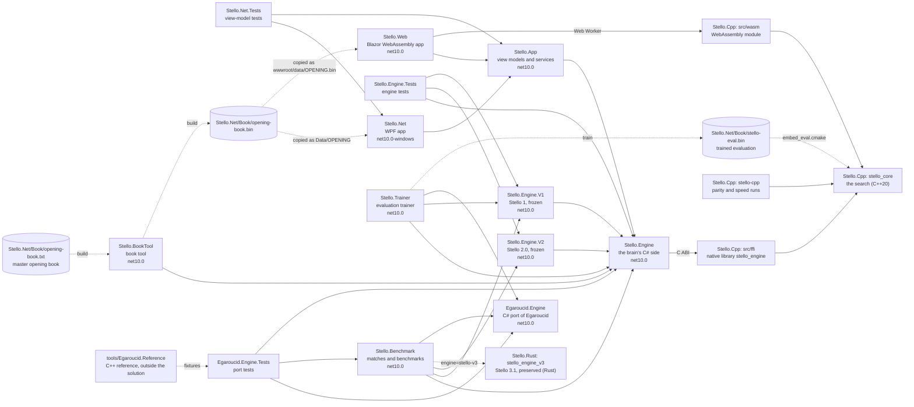
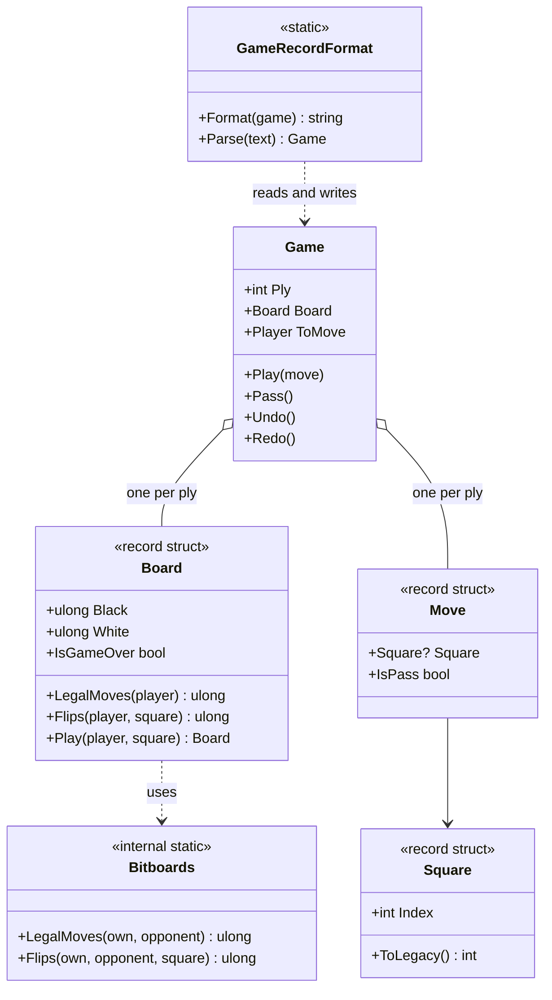
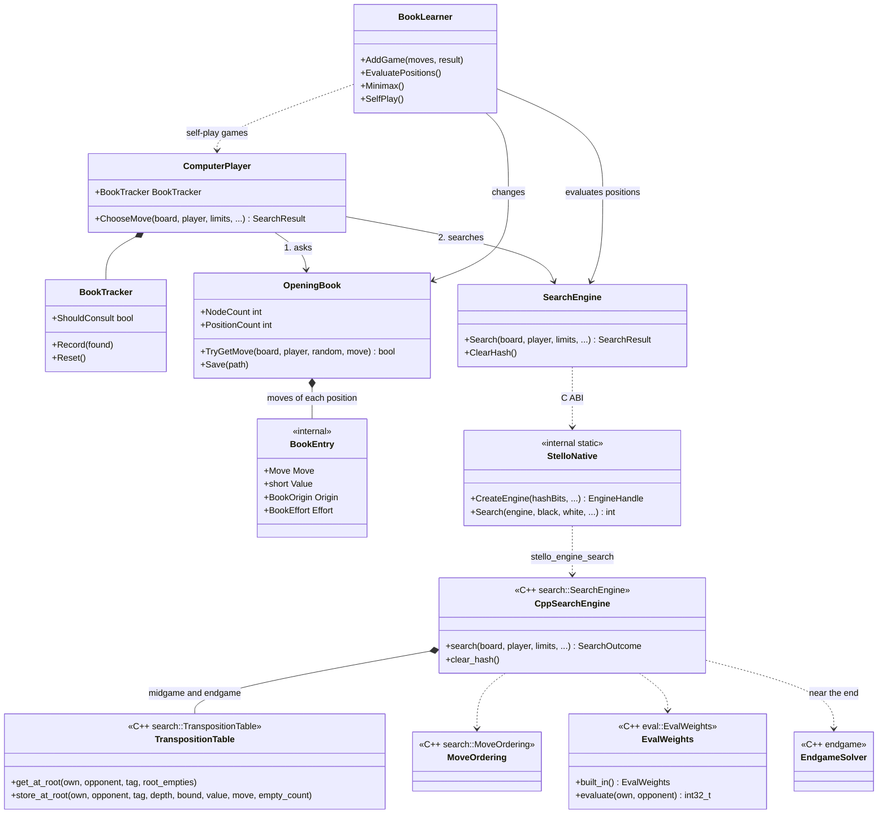
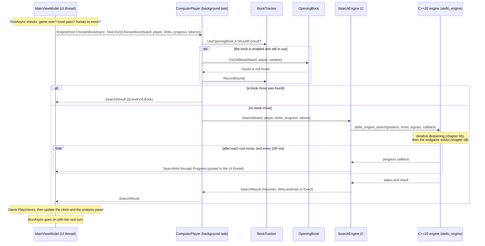

# 01 – Overview

[Back to the index](README.md)

This chapter shows the big picture: the projects, the main types, and what happens when the computer makes one move. The later chapters go into each part.

## The projects

The solution [Stello.Net.slnx](../Stello.Net/Stello.Net.slnx) has thirteen .NET projects. Since Stello 4.0 the search core is written in C++20 in [Stello.Cpp](../Stello.Cpp), which the .NET builds compile natively with CMake and Clang and for the browser with Emscripten ([chapter 14](14-app-integration.md), [chapter 28](28-stello-4-0-the-engine-in-cpp.md)); the earlier Rust workspace [Stello.Rust](../Stello.Rust) is preserved for head-to-head matches (`engine=stello-v3`). Chapters 02–09 describe the shared algorithm across the C++20 core and its 1-to-1 Rust predecessor. The arrows show which project uses which; the apps and the test projects also use the engine's types directly. The projects for comparing engines (the frozen Stello 1 and Stello 2.0, the preserved Rust 3.1 library, the Egaroucid port and the port's tests) and the evaluation trainer are used only by the tools and tests, never by the apps ([chapter 18](18-the-egaroucid-port.md), [chapter 20](20-phases-0-2-the-evaluation.md), [chapter 25](25-phases-0-4-the-engine-in-rust.md) and [chapter 28](28-stello-4-0-the-engine-in-cpp.md)).

| Project | Contents |
|---|---|
| [Stello.Engine](../Stello.Net/Stello.Engine) | The C# side of Stello 4.0: rules, game record, the opening book, book learning and the book tool's searches, and `SearchEngine`, a thin wrapper that calls the C++20 search through its C ABI ([Native/StelloNative.cs](../Stello.Net/Stello.Engine/Native/StelloNative.cs)). It also keeps the C# pattern evaluation (`Evaluation/`) for the trainer and the tools, and `SearchOptions`. Its build runs CMake + Clang and copies the native library to every project that references it (chapter 14). No UI code, and no dependencies outside .NET apart from that library. |
| [Stello.Cpp](../Stello.Cpp) | The C++20 engine workspace (GPL-3.0-only, version 4.0.0): `stello_core` (`src/core`, `src/eval`, `src/search`, `src/endgame` — board, rules, zero-dependency RFC 1951/1952 gzip weight loader, evaluation, midgame search, endgame solver, seqlock TT, time control, and parallel search with thread pool, Lazy SMP and YBWC; chapters 03–09); `stello_engine` (`src/ffi`), the C ABI shared library that `Stello.Engine` calls; `stello_wasm` (`src/wasm`), the Emscripten WebAssembly targets built twice (single-threaded and `-pthread` on shared memory); and `stello-cpp` (`src/cli`), the command-line tool for parity and speed runs without .NET. |
| [Stello.Rust](../Stello.Rust) | The preserved Rust 3.1.0 workspace (GPL-3.0-only, four crates: `stello-core`, `stello-ffi`, `stello-wasm`, `stello-cli`). Kept as the 3.1 reference, testable side by side with 4.0 through `stello_engine_v3` (`engine=stello-v3`). |
| [Stello.App](../Stello.Net/Stello.App) | The view models ([CommunityToolkit.Mvvm](https://learn.microsoft.com/dotnet/communitytoolkit/mvvm/)), the settings, and the interfaces for the engine host, dialogs, files and storage, shared by both apps (chapters 14 and 15). |
| [Stello.Net](../Stello.Net/Stello.Net) | The WPF desktop app: windows, dialogs, and files in `%AppData%\Stello`. It runs the engine on a background task. |
| [Stello.Web](../Stello.Net/Stello.Web) | The web app (Blazor WebAssembly): the same game in the browser. It plays the book moves on the page and runs the search, the C++20 engine compiled to WebAssembly with Emscripten, in a Web Worker; with more than 1 thread, the engine's other threads are more Web Workers on the same memory. Its menus, panels, dialogs and documentation viewer come from the shared [GameShell](https://github.com/cjp-dev/GameShell) library, a git submodule in `external/GameShell` (clone with `--recurse-submodules`). |
| [Stello.Engine.Tests](../Stello.Net/Stello.Engine.Tests) | xUnit tests of the engine: perft, patterns and folded weights, search and endgame solver (FFO positions) through the wrapper, the wrapper itself, book, book learning, book recalculation, the benchmark positions, strict current-engine signatures, and the evaluation and recorded searches of the frozen Stello 1 and 2.0 engines. C++ has its own `ctest` suite across 5 CMake presets, and WASM has its Node suite (`node --test`). |
| [Stello.Net.Tests](../Stello.Net/Stello.Net.Tests) | xUnit tests of the view models, with fake dialogs, settings and book storage. |
| [Stello.BookTool](../Stello.Net/tools/Stello.BookTool) | Console tool for the master opening book: `import`, `format`, `build`, `verify`, `stats`, `recalc` (search the leaves again), `compare` and `match` (chapter 12). |
| [Stello.Benchmark](../Stello.Net/tools/Stello.Benchmark) | Console tool that measures the engine: `match` between engine settings or engines, the FFO endgame benchmark `solve-bench`, the midgame benchmark `mid-bench`, which also checks that a change kept the search unchanged, `eval-compare` and `mid-quality` for the evaluation and the move quality, and the commands that write their position files ([chapter 17](17-measuring-the-engine.md)). Match sides can be the current Stello C++ 4.0 engine (`engine=stello`), the preserved Rust 3.1 engine (`engine=stello-v3`), a separately loaded native Stello library (`engine=stello-lib`), the frozen Stello 2.0 (`engine=stello-v2`) or Stello 1, or the Egaroucid port ([chapter 19](19-stello-1-against-egaroucid.md)). |
| [Stello.Engine.V2](../Stello.Net/Stello.Engine.V2) | Stello 2.0's C# engine, frozen as it was released on 2 November 2026: `SearchEngine` with the endgame solver, `Search/`, `Evaluation/` (with its own embedded `stello-eval.bin`) and `ComputerPlayer`, on `Stello.Engine`'s board, limits and book. Its recorded 2.0 signatures are checked node for node, and matches use it as `engine=stello-v2` (`V2MatchPlayer`). It remains a reference, not a parity requirement for later Rust fixes. Tools and tests only ([chapter 25](25-phases-0-4-the-engine-in-rust.md)). |
| [Stello.Engine.V1](../Stello.Net/Stello.Engine.V1) | The frozen baseline of the 2.0 work: the engine before Stello 2.0 (its search, evaluation, move ordering, time control and `ComputerPlayer`, on `Stello.Engine`'s board and rules), unchanged so that matches and benchmarks always compare against the same engine (`engine=stello-v1`). Tools and tests only; see the [Stello 1 documentation](stello-1/01-overview.md). |
| [Stello.Trainer](../Stello.Net/tools/Stello.Trainer) | Console tool that trains the pattern evaluation from Egaroucid's training data (not in the repository): `convert`, `train`, `report` and `size` (chapter 04), `mpc`, which fits Multi-ProbCut's error model for the midgame search (chapter 06), and `mpc-end`, which fits one for a selective endgame search that the engine does not use ([chapter 23](23-phase-5-the-search.md)). |
| [Egaroucid.Engine](../Stello.Net/Egaroucid.Engine) | A C# port of the Egaroucid engine (© Takuto Yamana, GPL-3.0-or-later), exact node for node on 1 thread, for comparing engines ([chapter 18](18-the-egaroucid-port.md)). Tools and tests only. |
| [Egaroucid.Engine.Tests](../Stello.Net/Egaroucid.Engine.Tests) | xUnit tests that compare the port with the C++ original, and the match adapter. Skipped when Egaroucid's resources are missing ([chapter 18](18-the-egaroucid-port.md)). |
| [tools/Egaroucid.Reference](../Stello.Net/tools/Egaroucid.Reference) | Not a .NET project: the C++ reference harness that builds the original Egaroucid and writes the port's test fixtures ([chapter 18](18-the-egaroucid-port.md)). |

The trained evaluation is [Stello.Net/Book/stello-eval.bin](../Stello.Net/Book/stello-eval.bin) (0.99 MB). CMake embeds it at build time ([embed_eval.cmake](../Stello.Cpp/cmake/embed_eval.cmake)) and `eval/gzip.cpp` inflates it once per process inside [weights.cpp](../Stello.Cpp/src/eval/weights.cpp), so the native library and WebAssembly module carry it with no external runtime file or third-party gzip crate (chapter 04). `Stello.Engine` does not embed it; the trainer and the benchmark tool, which use the C# evaluation, copy it to their `Data` folder, and `Stello.Engine.V2` embeds its own copy. The master opening book is the text file [Stello.Net/Book/opening-book.txt](../Stello.Net/Book/opening-book.txt). The book tool builds [opening-book.bin](../Stello.Net/Book/opening-book.bin) from it, which the WPF app links as `Data/OPENING` and the web app copies to `wwwroot/data/OPENING.bin` when it is built. The engine tests use both files, and the C++ file [Stello C++/OPENING](../Stello%20C++/OPENING) to test the import (chapter 10). The benchmark tool copies the evaluation and the book next to itself, together with [opening-book-stello1.txt](../Stello.Net/Book/opening-book-stello1.txt), the book a Stello 1 side plays from.

## The engine at a glance

The C# types of `Stello.Engine` fall into six groups; the search behind `SearchEngine` is the C++20 core, listed after them (mapping 1-to-1 to the preserved Rust workspace). "Internal" types are only visible inside the engine and the projects it names in `InternalsVisibleTo` (the tests, the tools, `Stello.Engine.V1` and `Stello.Engine.V2`).

| Group | Type | Visibility | Role |
|---|---|---|---|
| Board and rules | [`Board`](../Stello.Net/Stello.Engine/Board.cs) | public | An immutable position: two 64-bit bitboards, one per colour. |
| | [`Square`](../Stello.Net/Stello.Engine/Square.cs) | public | A square 0–63 (a1 = 0, h8 = 63), with text ("f5") and legacy conversions. |
| | [`Player`](../Stello.Net/Stello.Engine/Player.cs) | public | `Black` or `White`. |
| | [`Bitboards`](../Stello.Net/Stello.Engine/Bitboards.cs) | internal | Legal moves, flips and potential mobility on raw 64-bit masks, for the apps, the book and the tools (the search has its own in C++). |
| Game record | [`Move`](../Stello.Net/Stello.Engine/Move.cs) | public | A square or a pass. |
| | [`Game`](../Stello.Net/Stello.Engine/Game.cs) | public | The moves and positions of a game, with undo and redo. |
| | [`GameRecordFormat`](../Stello.Net/Stello.Engine/GameRecordFormat.cs) | public | Reads and writes a game as a text move list. |
| Evaluation (C#, for the trainer and the tools) | [`PatternShape`, `PatternSet`](../Stello.Net/Stello.Engine/Evaluation/Patterns.cs) | internal | The patterns of squares, their places on the board and their base-3 indices. |
| | [`Symmetry`](../Stello.Net/Stello.Engine/Evaluation/Symmetry.cs) | internal | The 8 symmetries of the board on bitboards. |
| | [`EvalWeights`](../Stello.Net/Stello.Engine/Evaluation/EvalWeights.cs) | internal | The trained weights per stage, the file format, and the evaluation of a position; the same values as the C++ evaluation. |
| Search | [`SearchEngine`](../Stello.Net/Stello.Engine/SearchEngine.cs) | public | The wrapper over the C++20 search: it owns a native engine (its hash tables) through a `SafeHandle`, turns the tokens into stop signals and the callbacks into progress reports. |
| | [`StelloNative`](../Stello.Net/Stello.Engine/Native/StelloNative.cs) | internal | The C ABI of the native library `stello_engine` (`[LibraryImport]`), its handles and structs. |
| | [`SearchOptions`](../Stello.Net/Stello.Engine/Search/SearchOptions.cs) | internal | Switches for experiments (another evaluation, the soft time share, Multi-ProbCut off or another t), passed to the native engine; the apps use `Default`. |
| | [`SearchLimits`](../Stello.Net/Stello.Engine/SearchLimits.cs) | public | Fixed depth, time per move, time per game, or solve; opening book toggle and transposition table capacity. |
| | [`SearchResult`, `SearchInfo`, `ScoreKind`](../Stello.Net/Stello.Engine/SearchResult.cs) | public | The result of a search, progress reports, and what kind of score it is. |
| Opening book | [`OpeningBook`](../Stello.Net/Stello.Engine/OpeningBook.cs) | public | Loads, saves and looks up the book. |
| | [`BookEntry`, `BookOrigin`, `BookEffort`](../Stello.Net/Stello.Engine/BookEntry.cs) | internal | One book move, with its value, where the value comes from, and how hard it was searched for. |
| | [`BookTextFormat`, `BookBinaryFormat`, `LegacyBookFormat`](../Stello.Net/Stello.Engine/BookTextFormat.cs) | internal | The text book, the binary book, and the import of the C++ book. |
| | [`BookTracker`](../Stello.Net/Stello.Engine/BookTracker.cs) | public | Decides when to stop asking the book. |
| | [`ComputerPlayer`](../Stello.Net/Stello.Engine/ComputerPlayer.cs) | public | Chooses the computer's move: the book first, then the search. |
| | [`BookLearner`](../Stello.Net/Stello.Engine/BookLearner.cs) | public | Adds games to the book, evaluates it, and plays self-play games. |
| | [`BookRecalculator`](../Stello.Net/Stello.Engine/BookRecalculator.cs), [`BookMinimax`](../Stello.Net/Stello.Engine/BookMinimax.cs), [`BookComparison`](../Stello.Net/Stello.Engine/BookComparison.cs), [`BookMatch`](../Stello.Net/Stello.Engine/BookMatch.cs) | internal | The book tool's work: searching the leaves again, backing the values up, comparing two books and playing them against each other (chapter 12). |

The C++20 core, [Stello.Cpp/src](../Stello.Cpp/src), has these modules (matching the modules in [stello-core](../Stello.Rust/stello-core/src) 1-to-1):

| Module | Role |
|---|---|
| [`core/board`](../Stello.Cpp/src/core/board.hpp), [`core/square`](../Stello.Cpp/src/core/square.hpp), [`core/bits`](../Stello.Cpp/src/core/bits.hpp) | `Board`, `Player`, `Square`, `Move`, and the legal moves and flips (chapter 03). |
| [`eval/`](../Stello.Cpp/src/eval/eval.hpp) (`gzip`, `patterns`, `patterns_bmi2`, `symmetry`, `weights`) | Self-contained RFC 1951/1952 weight decompression, `PatternSet`, the symmetries, `EvalWeights` with the embedded file, and `pattern_score` (chapter 04). |
| [`core/cpu`](../Stello.Cpp/src/core/cpu.hpp) | Chooses the processor's fast path (BMI2 `pext`) at run time, or the portable code (chapter 04). |
| [`search/engine`](../Stello.Cpp/src/search/engine.hpp), [`search/pool`](../Stello.Cpp/src/search/pool.hpp), [`search/ybwc`](../Stello.Cpp/src/search/ybwc.hpp) | `SearchEngine` (hash tables and response table), `Searcher` (one running search): iterative deepening PVS with Multi-ProbCut, solver root, scoped worker pool, Lazy SMP and YBWC, stop signals (`SearchSignals`, `StopSignal`), exception/result abort boundary, and the clock (chapters 06 and 09). |
| [`search/ordering`](../Stello.Cpp/src/search/ordering.hpp) | Sorts moves near the leaves by hash move, response table and square values (chapter 05). |
| [`search/table`](../Stello.Cpp/src/search/table.hpp) | The 64-byte seqlocked transposition table: remembers results for positions already searched (chapter 07). |
| [`search/time`](../Stello.Cpp/src/search/time.hpp), [`search/limits`](../Stello.Cpp/src/search/limits.hpp), [`search/options`](../Stello.Cpp/src/search/options.hpp) | The soft and hard time limits; limits, results and progress reports; the switches of `SearchOptions` (chapters 06 and 09). |
| [`endgame/`](../Stello.Cpp/src/endgame/search.cpp) (`search`, `last`, `bits`, `stable`, `local`) | The endgame solver (`last4`–`last1` and deep solver layers), its own legal moves and scalar `flips()`, parity and stability thresholds, stable discs and the local table (chapter 08). |

### Board and game types

A `Board` is only 16 bytes, so a game simply keeps a copy of the board after every move. `Board` uses `Bitboards` for the rules.

### The brain types

`ComputerPlayer` is the entry point for choosing a move. It asks the book first and searches if the book has no move. `BookLearner` uses the same parts to improve the book.

## The life of one computer move

This sequence shows what happens from the moment it is the computer's turn until its move is on the board. The view model runs on the UI thread; `ComputerPlayer` and `SearchEngine` run on a background task, so the window stays responsive while the computer thinks. This is the desktop app, where `LocalEngineHost` starts the task, and `SearchEngine` calls the C++20 engine in the native library on the same thread. With more than 1 thread (the Threads setting, chapter 15), that thread is the search's main thread, and the engine's own worker threads help it (chapter 06). In the web app the book step runs on the page and the search in a Web Worker, in the C++20 engine compiled to WebAssembly via Emscripten (chapter 14).

The code for this is `MainViewModel.RunAsync` and `MainViewModel.ComputerMoveAsync` in [MainViewModel.cs](../Stello.Net/Stello.App/ViewModels/MainViewModel.cs), `LocalEngineHost.ChooseMoveAsync` in [LocalEngineHost.cs](../Stello.Net/Stello.App/Services/LocalEngineHost.cs), [`ComputerPlayer.ChooseMove`](../Stello.Net/Stello.Engine/ComputerPlayer.cs), [`SearchEngine.Search`](../Stello.Net/Stello.Engine/SearchEngine.cs), and in C++ `stello_engine_search` in [stello_ffi.cpp](../Stello.Cpp/src/ffi/stello_ffi.cpp#L232) and `SearchEngine::search` in [engine.cpp](../Stello.Cpp/src/search/engine.cpp). If the table size in the settings differs from the engine's (`SearchLimits.HashBits`), the host first creates a new engine of that size (chapter 07).

Inside C++ [`SearchEngine::search`](../Stello.Cpp/src/search/engine.cpp), a move is found in these steps:

1. **No search when there is no choice.** Without a legal move the result is a pass; with exactly one legal move it is played at once (`ScoreKind.None`).
2. **Preparation.** The response table is cleared, the root moves are ordered by their square values (chapter 05), and `time::for_midgame` gives the soft and the hard time limit (chapter 09).
3. **Midgame iterations.** Depth 1, 2, 3, … plies, each a principal variation search with the hash table (chapter 07), Multi-ProbCut, enhanced transposition cutoffs and move ordering; the leaves are scored by the pattern evaluation in 1/100 disc (chapters 04 and 06). After each iteration the search stops if the depth or the soft time limit is reached. With more than 1 thread, half of the other threads run Lazy SMP helpers a few plies ahead into the shared hash tables, and the rest take over the younger brothers of nodes (YBWC; [chapter 06](06-midgame-search.md#threads)).
4. **The endgame solver.** When the next iteration would end with 7 or fewer empty squares on the board, the solver takes over: first win/loss/draw, then, if there is time, the exact disc difference (chapter 08). With more than 1 thread, all the other threads take part through YBWC.
5. **The result.** If the hard limit or Move Now stops the search, the best move found so far is returned; cancel returns an error instead, which the C# wrapper throws as `OperationCanceledException`.

Two tokens control a running search:

- **cancel**: used by New Game, Open, Back and the other commands that change the game. The search stops and nothing is played.
- **move now**: used by the "Move Now" command. The search stops and the best move found so far is played.

## Design principles

- **Immutable boards.** `Board` is a 16-byte value. Making a move returns a new board, so the search needs no "undo move" code and the game record can store every position.
- **Bitboards.** Each colour is one 64-bit number with one bit per square. Legal moves and flips are computed for all squares at once with shifts and masks.
- **No global state.** All state is in objects: the search engine owns its hash tables and move-ordering tables, the book owns its positions. Several engines can run side by side, on different threads. The only globals are read-only: the C++ engine builds the stable-disc tables and inflates the built-in evaluation once per process, and checks the processor once.
- **The engine does not know the UI.** It reports progress through `IProgress<SearchInfo>` and is stopped with cancellation tokens; inside, the C++ engine reports through a callback and reads two atomic stop flags. This is why it can be tested without a window.
- **A synchronous engine.** `SearchEngine.Search` runs to the end on the calling thread, and so does the C++ search it calls. The app decides where it runs (a background task, or the browser's Web Worker); the tests call it directly. With more than 1 thread, the engine keeps a pool of its own worker threads, but the calling thread stays the main thread: it reports the progress and returns the result.
- **Threads change nothing on 1 thread.** With 1 thread no worker is started, and the search is node for node the single-threaded one. With more, the shared hash table makes the search depend on timing, so its node counts vary from run to run; the solver's scores are still exact ([chapter 26](26-phases-5-9-threads.md)).
- **One engine, two languages.** The search runs in C++20 for speed, and everything around it (the book, the game record, the apps and the tools) stays in C#. The boundary is narrow: a position, the limits and the stop signals go in, progress reports and a result come out, through a C ABI on the desktop and standalone WebAssembly in the browser. An exception never crosses it (`stello_ffi.cpp` catches every exception at the C boundary and converts it to `STELLO_INTERNAL_ERROR`). Stello 4.0's C++ port matches Stello 3.1 node for node ([chapter 28](28-stello-4-0-the-engine-in-cpp.md)).
- **Two ancestors.** The frame of the midgame search (iterative deepening, the hash table heights, the response table, the root reordering), the time control and the book come from the C++ original, with modern data structures ([Stello porting documentation.md](../Plans/Stello%20porting%20documentation.md)). The pattern evaluation, the endgame solver, Multi-ProbCut and the evaluation ordering follow Egaroucid, with the weights and error models trained and fitted for Stello itself. Stello 3.0 ported all of it from C# to Rust, and Stello 4.0 ported Stello 3.1 1-to-1 into C++20.
- **Measured, not assumed.** Changes are checked by engine matches or benchmarks ([chapter 16](16-the-goal-and-the-plan.md)). The frozen engines in `Stello.Engine.V1`, `Stello.Engine.V2`, and the preserved Rust 3.1 library (`engine=stello-v3`) give fixed references to measure against.

## Some numbers

| Item | Value |
|---|---|
| Size of a `Board` | 16 bytes (two `ulong`; two `uint64_t` in C++) |
| Pattern evaluation | 15 patterns in 62 places, 10 stages, 233,676 weights per stage; file 0.99 MB (decompressed 4.67 MB) |
| Scores | 1/100 disc for the side to move; a finished game ±(32 600 + disc difference); the solver in whole discs |
| Hash tables | 2 tables (midgame, endgame), shared by all threads, configurable from 65K to 16.7M entries per table ($4\text{ MB}$ to $1{,}024\text{ MB}$ total), default $2^{19}$ slots of 64 bytes, each with 2 entries of 24 bytes and a sequence lock ($64\text{ MB}$ total) |
| Master opening book | 11 200 positions, 22 878 book moves, all leaves searched for 60 s (`OpeningBook.EngineVersion` 4); binary file 193 KB |
| Speed (Ryzen 7 7800X3D, 1 thread) | `.NET` FFI `mid-bench --depth 14`: 2.79 s (`10.70M nps`, +4.3% vs Rust 3.1); FFO #40–49 solved in 22.70 s (`49.15M nps`, +5.3% vs Rust 3.1; [findings, phase 5](../Plans/Stello%204.0%20C++%20findings.md#step-53--net-integration-stello-v3-preservation--ffi-comparison)) |
| Speed (Ryzen 7 7800X3D, 8 threads) | `.NET` FFI FFO #40–49 solved in 6.14 s (`260.1M nps`, 3.70× faster than 1t; +3.0% wall / +3.8% M nps vs Rust 3.1); 5.31 s with 16 threads |
| Threads | 1–256 per search (`SearchLimits.Threads`); the apps' Automatic is the cores − 1 on the desktop and `navigator.hardwareConcurrency` in the browser (chapter 15) |
| WebAssembly module | Single-threaded `1,174,429` bytes (`1,048,704` with brotli); threaded `-pthread` `1,203,076` bytes (`1,058,234` with brotli) ([chapter 28](28-stello-4-0-the-engine-in-cpp.md#package-sizes-and-browser-worker-benchmarks)) |
| Tests | Gate P7 passes `43/43` C++ tests (`ctest` across all 5 presets + exceptions `OFF`, `stello-cpp 4.0.0`), `497` `Stello.Engine.Tests`, `97` `Egaroucid.Engine.Tests` (`8` skipped for optional tagged 3.0), `116` `Stello.Net.Tests`, and `15` Node WASM tests with 0 warnings ([findings, phase 7](../Plans/Stello%204.0%20C++%20findings.md#phase-7-documentation--stello-40-release-done-2026-11-09)) |

---

Previous: [Index](README.md) · Next: [02 Board and squares](02-board-and-squares.md)
