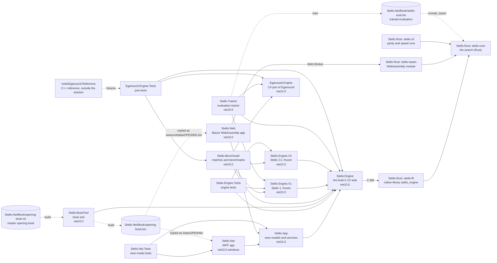
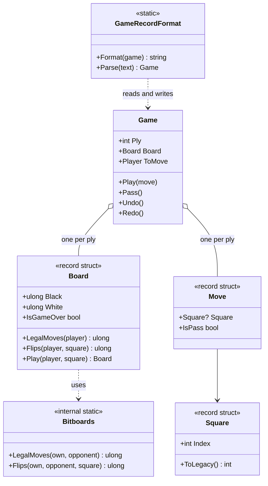
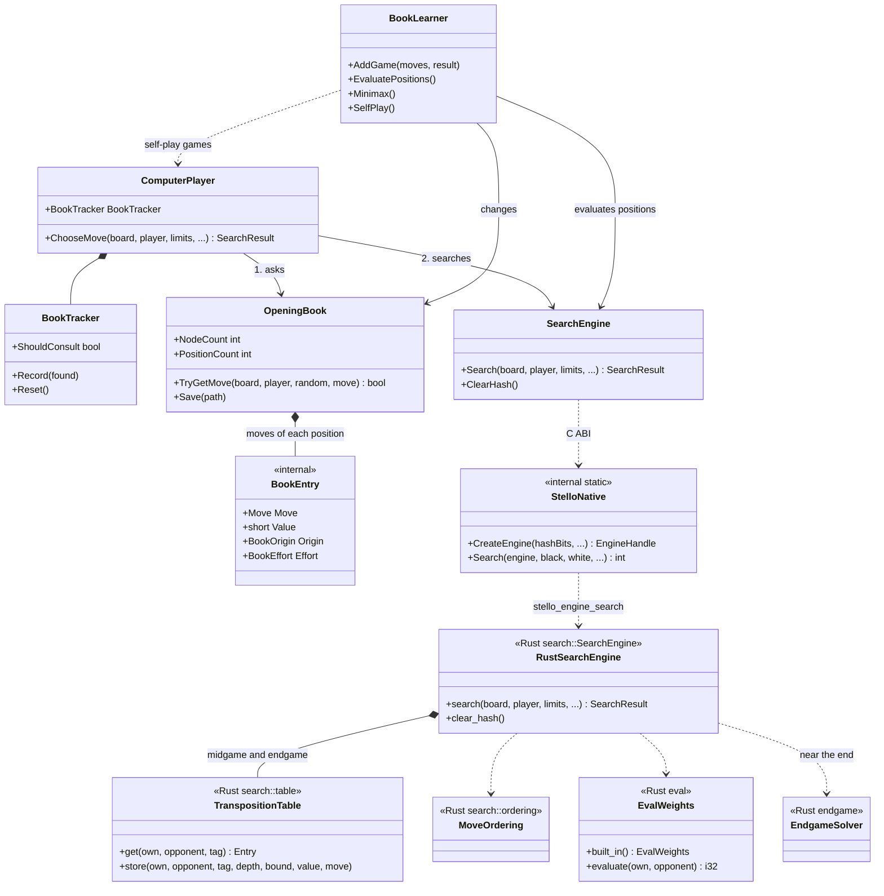

# 01 – Overview

[Back to the index](README.md)

This chapter shows the big picture: the projects, the main types, and what happens when the computer makes one move. The later chapters go into each part.

## The projects

The solution [Stello.Net.slnx](../Stello.Net/Stello.Net.slnx) has thirteen .NET projects. Since Stello 3.0 the search itself is written in Rust, in the Cargo workspace [Stello.Rust](../Stello.Rust) next to it, which the .NET builds compile with Cargo (chapter 14). The arrows show which project uses which; the apps and the test projects also use the engine's types directly. The projects for comparing engines (the frozen Stello 1 and Stello 2.0, the Egaroucid port and the port's tests) and the evaluation trainer are used only by the tools and tests, never by the apps ([chapter 18](18-the-egaroucid-port.md), [chapter 20](20-phases-0-2-the-evaluation.md) and [chapter 25](25-phases-0-4-the-engine-in-rust.md)).

| Project | Contents |
|---|---|
| [Stello.Engine](../Stello.Net/Stello.Engine) | The C# side of Stello 3.0: rules, game record, the opening book, book learning and the book tool's searches, and `SearchEngine`, a thin wrapper that calls the Rust search through its C ABI ([Native/StelloNative.cs](../Stello.Net/Stello.Engine/Native/StelloNative.cs)). It also keeps the C# pattern evaluation (`Evaluation/`) for the trainer and the tools, and `SearchOptions`. Its build runs Cargo and copies the native library to every project that references it (chapter 14). No UI code, and no dependencies outside .NET apart from that library. |
| [Stello.Rust](../Stello.Rust) | The Rust workspace (GPL-3.0-only, version 3.0.0), four crates: [stello-core](../Stello.Rust/stello-core), the engine itself (board and rules, the pattern evaluation with the trained weights built in, the midgame search, the endgame solver, the hash tables and the time control; chapters 03–09); [stello-ffi](../Stello.Rust/stello-ffi), the C ABI library `stello_engine` that `Stello.Engine` calls; [stello-wasm](../Stello.Rust/stello-wasm), the wasm-bindgen package that the web app's worker runs; and [stello-cli](../Stello.Rust/stello-cli), the command-line tool `stello` for parity and speed runs without .NET (`perft`, `eval-split`, `solve-bench`, `mid-bench`). |
| [Stello.App](../Stello.Net/Stello.App) | The view models ([CommunityToolkit.Mvvm](https://learn.microsoft.com/dotnet/communitytoolkit/mvvm/)), the settings, and the interfaces for the engine host, dialogs, files and storage, shared by both apps (chapters 14 and 15). |
| [Stello.Net](../Stello.Net/Stello.Net) | The WPF desktop app: windows, dialogs, and files in `%AppData%\Stello`. It runs the engine on a background task. |
| [Stello.Web](../Stello.Net/Stello.Web) | The web app (Blazor WebAssembly): the same game in the browser. It plays the book moves on the page and runs the search, the Rust engine compiled to WebAssembly, in a Web Worker. Its menus, panels, dialogs and documentation viewer come from the shared [GameShell](https://github.com/cjp-dev/GameShell) library, a git submodule in `external/GameShell` (clone with `--recurse-submodules`). |
| [Stello.Engine.Tests](../Stello.Net/Stello.Engine.Tests) | xUnit tests of the engine: perft, patterns and folded weights, search and endgame solver (FFO positions) through the wrapper, the wrapper itself, book, book learning, book recalculation, the benchmark positions, the recorded searches of Stello 2.0 for both the frozen C# engine and the Rust engine, and the evaluation and recorded searches of the frozen Stello 1. The Rust crates have their own tests (`cargo test`, chapters 03–09). |
| [Stello.Net.Tests](../Stello.Net/Stello.Net.Tests) | xUnit tests of the view models, with fake dialogs, settings and book storage. |
| [Stello.BookTool](../Stello.Net/tools/Stello.BookTool) | Console tool for the master opening book: `import`, `format`, `build`, `verify`, `stats`, `recalc` (search the leaves again), `compare` and `match` (chapter 12). |
| [Stello.Benchmark](../Stello.Net/tools/Stello.Benchmark) | Console tool that measures the engine: `match` between engine settings or engines, the FFO endgame benchmark `solve-bench`, the midgame benchmark `mid-bench`, which also checks that a change kept the search unchanged, `eval-compare` and `mid-quality` for the evaluation and the move quality, and the commands that write their position files ([chapter 17](17-measuring-the-engine.md)). Its sides can be Stello 3.0, the frozen Stello 2.0 (`engine=stello-v2`) or Stello 1, or the Egaroucid port ([chapter 19](19-stello-1-against-egaroucid.md)). It also writes the parity fixtures of the Rust engine (`parity-data`, [chapter 25](25-phases-0-4-the-engine-in-rust.md)). |
| [Stello.Engine.V2](../Stello.Net/Stello.Engine.V2) | Stello 2.0's C# engine, frozen as it was released on 2 November 2026: `SearchEngine` with the endgame solver, `Search/`, `Evaluation/` (with its own embedded `stello-eval.bin`) and `ComputerPlayer`, on `Stello.Engine`'s board, limits and book. The Rust engine is checked against it node for node, and matches use it as `engine=stello-v2` (`V2MatchPlayer`). Tools and tests only ([chapter 25](25-phases-0-4-the-engine-in-rust.md)). |
| [Stello.Engine.V1](../Stello.Net/Stello.Engine.V1) | The frozen baseline of the 2.0 work: the engine before Stello 2.0 (its search, evaluation, move ordering, time control and `ComputerPlayer`, on `Stello.Engine`'s board and rules), unchanged so that matches and benchmarks always compare against the same engine (`engine=stello-v1`). Tools and tests only; see the [Stello 1 documentation](stello-1/01-overview.md). |
| [Stello.Trainer](../Stello.Net/tools/Stello.Trainer) | Console tool that trains the pattern evaluation from Egaroucid's training data (not in the repository): `convert`, `train`, `report` and `size` (chapter 04), `mpc`, which fits Multi-ProbCut's error model for the midgame search (chapter 06), and `mpc-end`, which fits one for a selective endgame search that the engine does not use ([chapter 23](23-phase-5-the-search.md)). |
| [Egaroucid.Engine](../Stello.Net/Egaroucid.Engine) | A C# port of the Egaroucid engine (© Takuto Yamana, GPL-3.0-or-later), exact node for node on 1 thread, for comparing engines ([chapter 18](18-the-egaroucid-port.md)). Tools and tests only. |
| [Egaroucid.Engine.Tests](../Stello.Net/Egaroucid.Engine.Tests) | xUnit tests that compare the port with the C++ original, and the match adapter. Skipped when Egaroucid's resources are missing ([chapter 18](18-the-egaroucid-port.md)). |
| [tools/Egaroucid.Reference](../Stello.Net/tools/Egaroucid.Reference) | Not a .NET project: the C++ reference harness that builds the original Egaroucid and writes the port's test fixtures ([chapter 18](18-the-egaroucid-port.md)). |

The trained evaluation is [Stello.Net/Book/stello-eval.bin](../Stello.Net/Book/stello-eval.bin) (0.99 MB). The Rust engine embeds it (`include_bytes!` in [weights.rs](../Stello.Rust/stello-core/src/eval/weights.rs)), so the native library and the WebAssembly module carry it and the apps need no extra file (chapter 04). `Stello.Engine` does not embed it; the trainer and the benchmark tool, which use the C# evaluation, copy it to their `Data` folder, and `Stello.Engine.V2` embeds its own copy. The master opening book is the text file [Stello.Net/Book/opening-book.txt](../Stello.Net/Book/opening-book.txt). The book tool builds [opening-book.bin](../Stello.Net/Book/opening-book.bin) from it, which the WPF app links as `Data/OPENING` and the web app copies to `wwwroot/data/OPENING.bin` when it is built. The engine tests use both files, and the C++ file [Stello C++/OPENING](../Stello%20C++/OPENING) to test the import (chapter 10). The benchmark tool copies the evaluation and the book next to itself, together with [opening-book-stello1.txt](../Stello.Net/Book/opening-book-stello1.txt), the book a Stello 1 side plays from.

## The engine at a glance

The C# types of `Stello.Engine` fall into six groups; the search behind `SearchEngine` is the Rust core, listed after them. "Internal" types are only visible inside the engine and the projects it names in `InternalsVisibleTo` (the tests, the tools, `Stello.Engine.V1` and `Stello.Engine.V2`).

| Group | Type | Visibility | Role |
|---|---|---|---|
| Board and rules | [`Board`](../Stello.Net/Stello.Engine/Board.cs) | public | An immutable position: two 64-bit bitboards, one per colour. |
| | [`Square`](../Stello.Net/Stello.Engine/Square.cs) | public | A square 0–63 (a1 = 0, h8 = 63), with text ("f5") and legacy conversions. |
| | [`Player`](../Stello.Net/Stello.Engine/Player.cs) | public | `Black` or `White`. |
| | [`Bitboards`](../Stello.Net/Stello.Engine/Bitboards.cs) | internal | Legal moves, flips and potential mobility on raw 64-bit masks, for the apps, the book and the tools (the search has its own in Rust). |
| Game record | [`Move`](../Stello.Net/Stello.Engine/Move.cs) | public | A square or a pass. |
| | [`Game`](../Stello.Net/Stello.Engine/Game.cs) | public | The moves and positions of a game, with undo and redo. |
| | [`GameRecordFormat`](../Stello.Net/Stello.Engine/GameRecordFormat.cs) | public | Reads and writes a game as a text move list. |
| Evaluation (C#, for the trainer and the tools) | [`PatternShape`, `PatternSet`](../Stello.Net/Stello.Engine/Evaluation/Patterns.cs) | internal | The patterns of squares, their places on the board and their base-3 indices. |
| | [`Symmetry`](../Stello.Net/Stello.Engine/Evaluation/Symmetry.cs) | internal | The 8 symmetries of the board on bitboards. |
| | [`EvalWeights`](../Stello.Net/Stello.Engine/Evaluation/EvalWeights.cs) | internal | The trained weights per stage, the file format, and the evaluation of a position; the same values as the Rust evaluation. |
| Search | [`SearchEngine`](../Stello.Net/Stello.Engine/SearchEngine.cs) | public | The wrapper over the Rust search: it owns a Rust engine (its hash tables) through a `SafeHandle`, turns the tokens into stop signals and the callbacks into progress reports. |
| | [`StelloNative`](../Stello.Net/Stello.Engine/Native/StelloNative.cs) | internal | The C ABI of the native library `stello_engine` (`[LibraryImport]`), its handles and structs. |
| | [`SearchOptions`](../Stello.Net/Stello.Engine/Search/SearchOptions.cs) | internal | Switches for experiments (another evaluation, the soft time share, Multi-ProbCut off or another t), passed to the Rust engine; the apps use `Default`. |
| | [`SearchLimits`](../Stello.Net/Stello.Engine/SearchLimits.cs) | public | Fixed depth, time per move, time per game, or solve; opening book toggle and transposition table capacity. |
| | [`SearchResult`, `SearchInfo`, `ScoreKind`](../Stello.Net/Stello.Engine/SearchResult.cs) | public | The result of a search, progress reports, and what kind of score it is. |
| Opening book | [`OpeningBook`](../Stello.Net/Stello.Engine/OpeningBook.cs) | public | Loads, saves and looks up the book. |
| | [`BookEntry`, `BookOrigin`, `BookEffort`](../Stello.Net/Stello.Engine/BookEntry.cs) | internal | One book move, with its value, where the value comes from, and how hard it was searched for. |
| | [`BookTextFormat`, `BookBinaryFormat`, `LegacyBookFormat`](../Stello.Net/Stello.Engine/BookTextFormat.cs) | internal | The text book, the binary book, and the import of the C++ book. |
| | [`BookTracker`](../Stello.Net/Stello.Engine/BookTracker.cs) | public | Decides when to stop asking the book. |
| | [`ComputerPlayer`](../Stello.Net/Stello.Engine/ComputerPlayer.cs) | public | Chooses the computer's move: the book first, then the search. |
| | [`BookLearner`](../Stello.Net/Stello.Engine/BookLearner.cs) | public | Adds games to the book, evaluates it, and plays self-play games. |
| | [`BookRecalculator`](../Stello.Net/Stello.Engine/BookRecalculator.cs), [`BookMinimax`](../Stello.Net/Stello.Engine/BookMinimax.cs), [`BookComparison`](../Stello.Net/Stello.Engine/BookComparison.cs), [`BookMatch`](../Stello.Net/Stello.Engine/BookMatch.cs) | internal | The book tool's work: searching the leaves again, backing the values up, comparing two books and playing them against each other (chapter 12). |

The Rust core, [stello-core](../Stello.Rust/stello-core/src), has these modules. Each names its C# 2.0 original in its comments; the originals are kept in `Stello.Engine.V2`.

| Module | Role |
|---|---|
| [`board`](../Stello.Rust/stello-core/src/board.rs), [`square`](../Stello.Rust/stello-core/src/square.rs), [`bits`](../Stello.Rust/stello-core/src/bits.rs) | `Board`, `Player`, `Square`, `Move`, and the legal moves and flips (chapter 03). |
| [`eval`](../Stello.Rust/stello-core/src/eval/mod.rs) | The pattern evaluation: `PatternSet`, the symmetries, `EvalWeights` with the built-in file, and the search's scale `pattern_score` (chapter 04). |
| [`cpu`](../Stello.Rust/stello-core/src/cpu.rs) | Chooses the processor's fast path (BMI2 `pext`) at run time, or the portable code (chapter 04). |
| [`search::engine`](../Stello.Rust/stello-core/src/search/engine.rs) | `SearchEngine` (kept between searches: the hash tables and the response table) and `Searcher` (one running search): iterative deepening principal variation search with Multi-ProbCut, the root of the solver, the stop signals (`SearchSignals`, `StopSignal`) and the clock (chapters 06 and 09). |
| [`search::ordering`](../Stello.Rust/stello-core/src/search/ordering.rs) | Sorts moves near the leaves by hash move, response table and square values (chapter 05). |
| [`search::table`](../Stello.Rust/stello-core/src/search/table.rs) | The transposition table: remembers results for positions already searched (chapter 07). |
| [`search::time`](../Stello.Rust/stello-core/src/search/time.rs), [`search::limits`](../Stello.Rust/stello-core/src/search/limits.rs), [`search::options`](../Stello.Rust/stello-core/src/search/options.rs) | The soft and the hard time limit; the limits, results and progress reports; the switches of `SearchOptions` (chapters 06 and 09). |
| [`endgame`](../Stello.Rust/stello-core/src/endgame/mod.rs) | The endgame solver (`search`, `last`), its own legal moves and flips, parity and stability thresholds (`bits`), the stable discs (`stable`) and the local table (`local`) (chapter 08). |

### Board and game types

A `Board` is only 16 bytes, so a game simply keeps a copy of the board after every move. `Board` uses `Bitboards` for the rules.

### The brain types

`ComputerPlayer` is the entry point for choosing a move. It asks the book first and searches if the book has no move. `BookLearner` uses the same parts to improve the book.

## The life of one computer move

This sequence shows what happens from the moment it is the computer's turn until its move is on the board. The view model runs on the UI thread; `ComputerPlayer` and `SearchEngine` run on a background task, so the window stays responsive while the computer thinks. This is the desktop app, where `LocalEngineHost` starts the task, and `SearchEngine` calls the Rust engine in the native library on the same thread. In the web app the book step runs on the page and the search in a Web Worker, in the Rust engine compiled to WebAssembly (chapter 14).

The code for this is `MainViewModel.RunAsync` and `MainViewModel.ComputerMoveAsync` in [MainViewModel.cs](../Stello.Net/Stello.App/ViewModels/MainViewModel.cs), `LocalEngineHost.ChooseMoveAsync` in [LocalEngineHost.cs](../Stello.Net/Stello.App/Services/LocalEngineHost.cs), [`ComputerPlayer.ChooseMove`](../Stello.Net/Stello.Engine/ComputerPlayer.cs), [`SearchEngine.Search`](../Stello.Net/Stello.Engine/SearchEngine.cs), and in Rust `stello_engine_search` in [stello-ffi](../Stello.Rust/stello-ffi/src/lib.rs) and `SearchEngine::search` and `Searcher::run` in [engine.rs](../Stello.Rust/stello-core/src/search/engine.rs). If the table size in the settings differs from the engine's (`SearchLimits.HashBits`), the host first creates a new engine of that size (chapter 07).

Inside the Rust `SearchEngine::search`, a move is found in these steps:

1. **No search when there is no choice.** Without a legal move the result is a pass; with exactly one legal move it is played at once (`ScoreKind.None`).
2. **Preparation.** The response table is cleared, the root moves are ordered by their square values (chapter 05), and `time::for_midgame` gives the soft and the hard time limit (chapter 09).
3. **Midgame iterations.** Depth 1, 2, 3, … plies, each a principal variation search with the hash table (chapter 07), Multi-ProbCut, enhanced transposition cutoffs and move ordering; the leaves are scored by the pattern evaluation in 1/100 disc (chapters 04 and 06). After each iteration the search stops if the depth or the soft time limit is reached.
4. **The endgame solver.** When the next iteration would end with 7 or fewer empty squares on the board, the solver takes over: first win/loss/draw, then, if there is time, the exact disc difference (chapter 08).
5. **The result.** If the hard limit or Move Now stops the search, the best move found so far is returned; cancel returns an error instead, which the C# wrapper throws as `OperationCanceledException`.

Two tokens control a running search:

- **cancel**: used by New Game, Open, Back and the other commands that change the game. The search stops and nothing is played.
- **move now**: used by the "Move Now" command. The search stops and the best move found so far is played.

## Design principles

- **Immutable boards.** `Board` is a 16-byte value. Making a move returns a new board, so the search needs no "undo move" code and the game record can store every position.
- **Bitboards.** Each colour is one 64-bit number with one bit per square. Legal moves and flips are computed for all squares at once with shifts and masks.
- **No global state.** All state is in objects: the search engine owns its hash tables and move-ordering tables, the book owns its positions. Several engines can run side by side, on different threads. The only globals are read-only: the Rust engine builds the stable-disc tables and decodes the built-in evaluation once per process, and checks the processor once.
- **The engine does not know the UI.** It reports progress through `IProgress<SearchInfo>` and is stopped with cancellation tokens; inside, the Rust engine reports through a callback and reads two atomic stop flags. This is why it can be tested without a window.
- **A synchronous engine.** `SearchEngine.Search` runs to the end on the calling thread, and so does the Rust search it calls. The app decides where it runs (a background task, or the browser's Web Worker); the tests call it directly.
- **One engine, two languages.** The search runs in Rust for speed, and everything around it (the book, the game record, the apps and the tools) stays in C#. The boundary is narrow: a position, the limits and the stop signals go in, progress reports and a result come out, through a C ABI on the desktop and wasm-bindgen in the browser. A panic cannot cross it (`panic = "abort"`). The Rust engine searches node for node like the C# engine of Stello 2.0 ([chapter 25](25-phases-0-4-the-engine-in-rust.md)).
- **Two ancestors.** The frame of the midgame search (iterative deepening, the hash table heights, the response table, the root reordering), the time control and the book come from the C++ original, with modern data structures ([Stello porting documentation.md](../Plans/Stello%20porting%20documentation.md)). The pattern evaluation, the endgame solver, Multi-ProbCut and the evaluation ordering follow Egaroucid, with the weights and error models trained and fitted for Stello itself. Stello 3.0 ported all of it from C# to Rust without changing a node.
- **Measured, not assumed.** A change is kept only when engine matches or benchmarks show a gain ([chapter 16](16-the-goal-and-the-plan.md)). The frozen engines in `Stello.Engine.V1` and `Stello.Engine.V2` are checked by recorded searches, so there is always the same engine to measure against; the Rust engine must match Stello 2.0's recorded searches too.

## Some numbers

| Item | Value |
|---|---|
| Size of a `Board` | 16 bytes (two `ulong`; two `u64` in Rust) |
| Pattern evaluation | 15 patterns in 62 places, 10 stages, 233,676 weights per stage; file 0.99 MB |
| Scores | 1/100 disc for the side to move; a finished game ±(32 600 + disc difference); the solver in whole discs |
| Hash tables | 2 tables (midgame, endgame), configurable from 65K to 16.7M entries per table ($3\text{ MB}$ to $768\text{ MB}$ total), default $2^{19}$ slots of 2 entries of 24 bytes ($48\text{ MB}$ total) |
| Master opening book | 11 200 positions, 22 878 book moves, all leaves searched for 60 s by the Stello 2.0 search (`OpeningBook.EngineVersion` 4); binary file 193 KB |
| Speed (one thread) | about 10 M nodes/s over whole games at 500 ms per move ([3.0 against 2.0](../Plans/benchmark-results/match_v3p2-vs-v2-500ms.md)); FFO #40–49 solved in 26.1 s ([v3p2-solve-bench-40-49.json](../Plans/benchmark-results/v3p2-solve-bench-40-49.json)) |
| WebAssembly module | 1,194,262 bytes with the evaluation, 1,065,123 with brotli ([findings, phase 3](../Plans/making-stello-3-findings.md#phase-3-the-web-app-on-rust-2026-11-02-458c50a)) |
| Tests | engine 484 and Egaroucid port 34 ([findings, gate P3](../Plans/making-stello-3-findings.md#gate-p3-release-aot-publish-in-headless-chromium-served-with-coopcoep-and-brotli)); 85 app test cases in `Stello.Net.Tests` (68 facts and 17 theory rows, which run only on Windows); 51 Rust tests (`cargo test`) and 9 Node tests of the WebAssembly package |

---

Previous: [Index](README.md) · Next: [02 Board and squares](02-board-and-squares.md)
