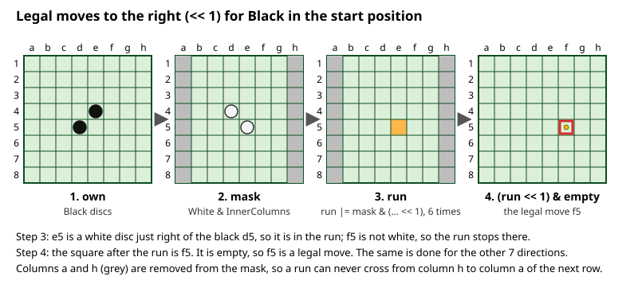
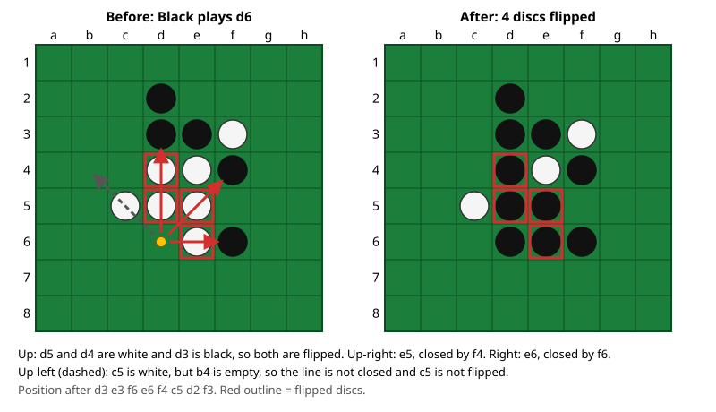
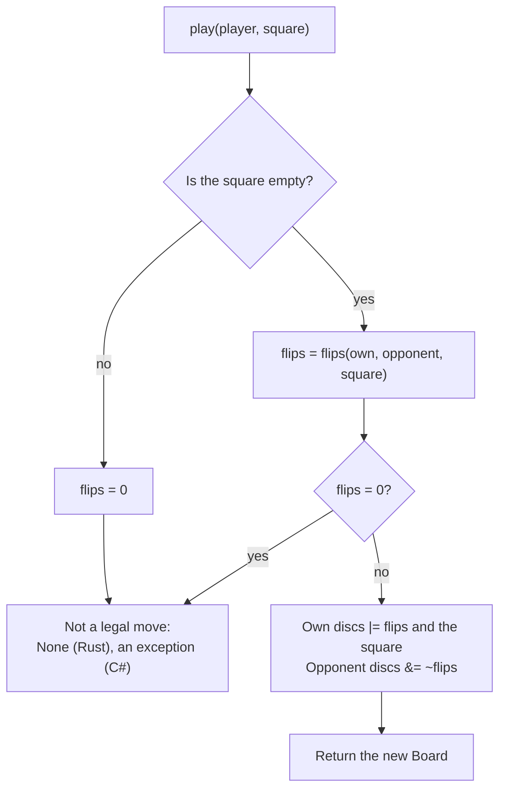

# 03 – Rules and move generation

[Back to the index](README.md)

## In short

A move is legal when it flips at least one opponent disc: the new disc and another disc of the same colour must enclose an unbroken line of opponent discs, horizontally, vertically or diagonally. The engine finds **all** legal moves of a player at once with bitboard shifts, eight directions at a time, without looping over squares. Flipping is done for one move at a time, along the eight lines from the new disc. A player without a legal move must pass; when neither player can move, the game is over.

## Data structures

The rules exist twice, with identical results, because the search runs in Rust and the rest of Stello in C#:

- **In the Rust engine** (`Stello.Rust/stello-core`), the module `bits` works on raw bitboards and `Board` wraps it for the search. The endgame solver has its own move generator in `endgame::bits` (below and chapter 08); its flips are the ones every part of the Rust engine uses.
- **In C#** (`Stello.Engine`), the internal static class `Bitboards` works on raw bitboards and `Board` wraps it for the apps, the game record, the opening book and the tools.

| Constant (Rust / C#) | Value | Squares |
|---|---|---|
| `NOT_COLUMN_A` / `NotColumnA` | `0xFEFE_FEFE_FEFE_FEFE` | all except column a |
| `NOT_COLUMN_H` / `NotColumnH` | `0x7F7F_7F7F_7F7F_7F7F` | all except column h |
| `INNER_COLUMNS` / `InnerColumns` | `0x7E7E_7E7E_7E7E_7E7E` | columns b–g |
| `INNER_ROWS` / `InnerRows` | `0x00FF_FFFF_FFFF_FF00` | rows 2–7 |
| `INNER` / `Inner` | `INNER_COLUMNS & INNER_ROWS` | b2–g7 |

| Function (Rust / C#) | Returns |
|---|---|
| `bits::legal_moves(own, opponent)` / `Bitboards.LegalMoves` | A bitboard of all legal moves for `own` |
| `bits::flips(own, opponent, square)` / `Bitboards.Flips` | A bitboard of the discs flipped by a move on `square`; 0 if none. The Rust function is `endgame::bits::flips` |
| `bits::potential_mobility(own, opponent)` / `Bitboards.PotentialMobility` | The number of (empty square, direction) pairs next to an opponent disc. Only the frozen baseline in `Stello.Engine.V1` uses it; the Rust copy exists for the parity tests (the move ordering counts potential mobility with `endgame::bits::potential_mobility`, chapter 05) |
| `Board::legal_moves(player)`, `has_legal_move`, `is_legal` / `Board.LegalMoves`, `HasLegalMove`, `IsLegal` | The same for a `Board` and a `Player` |
| `Board::flips(player, square)` / `Board.Flips` | 0 if the square is occupied, otherwise the flips |
| `Board::play(player, square)` / `Board.Play` | The new board; `None` in Rust, an exception in C#, if the move flips nothing |
| `Board::play_flips(player, square, flips)` | The new board with flips the caller already has; the search's way to play a move |
| `Board::is_game_over()` / `Board.IsGameOver` | True when neither player has a legal move |

The directions and their shifts are explained in [chapter 02](02-board-and-squares.md#bits-and-directions).

## Algorithm

### Legal moves: shift and mask

Think of one direction, "to the right". A legal move to the right of an own disc is an empty square that has one or more opponent discs between it and the own disc. The engine finds these for all own discs at the same time:

1. Shift the own discs one step: the result are the squares just right of an own disc. Keep only those that hold an opponent disc. This is the start of a *run*.
2. Shift the run one more step and again keep only opponent discs; add them to the run. Repeat. After six steps the run holds every opponent disc that is part of an unbroken line starting next to an own disc.
3. Shift the run one last step. The empty squares in the result are the legal moves in this direction.

Six steps are enough because a line on an 8-square row holds at most 6 opponent discs between the two ends. The same is done for all eight directions, and the results are combined with OR.

With $o$ = own discs, $m$ = the masked opponent discs, $e$ = empty squares and $s$ the shift of one direction:

$$
\begin{aligned}
r_1 &= m \land (o \ll s) \\
r_{k+1} &= r_k \lor \big(m \land (r_k \ll s)\big), \qquad k = 1, \dots, 5 \\
\text{moves} &= (r_6 \ll s) \land e
\end{aligned}
$$

For the directions to the left and up, $\ll$ is replaced by $\gg$.

**The mask.** The opponent discs are masked before the scan: `InnerColumns` for left and right, `InnerRows` for up and down, and `Inner` for the diagonals. A disc on column a or h can never be enclosed horizontally, because it has no neighbour on one side, so removing it loses nothing. It also stops the wrap-around: a run can never contain a disc on column h, so it can never be shifted from h onto column a of the next row. For up and down the mask is not needed against wrap-around, but it does no harm for the same reason.

This picture shows direction "right" for Black in the start position:



Doing the same to the left finds c4 (d4 is white, left of the black e4), downwards finds e6 and upwards finds d3: together the four legal moves of the start position.

The code for all eight directions, from [bits.rs](../Stello.Rust/stello-core/src/bits.rs) (C#'s [Bitboards.cs](../Stello.Net/Stello.Engine/Bitboards.cs) is the same, line for line):

```rust
pub fn legal_moves(own: u64, opponent: u64) -> u64 {
    let empty = !(own | opponent);
    let horizontal = opponent & INNER_COLUMNS;
    let vertical = opponent & INNER_ROWS;
    let diagonal = opponent & INNER;

    let moves = scan_left(own, horizontal, 1)
        | scan_right(own, horizontal, 1)
        | scan_left(own, vertical, 8)
        | scan_right(own, vertical, 8)
        | scan_left(own, diagonal, 7)
        | scan_right(own, diagonal, 7)
        | scan_left(own, diagonal, 9)
        | scan_right(own, diagonal, 9);

    moves & empty
}

fn scan_left(own: u64, mask: u64, shift: u32) -> u64 {
    let mut run = mask & (own << shift);
    run |= mask & (run << shift);
    run |= mask & (run << shift);
    run |= mask & (run << shift);
    run |= mask & (run << shift);
    run |= mask & (run << shift);
    run << shift
}
```

`scan_right` is the same with `>>`. "Left" in the name means the shift direction (`<<`, towards h8), not the direction on the board. The midgame search and the solver's shallowest nodes (`solve_shallow`, chapter 08) use this function; the rest of the solver uses its own (see the design notes).

### Flips: walking the lines

The simplest way to find the flipped discs of one move is to walk from the new disc in each of the eight directions. This is what C#'s `Bitboards.Flips` does, for the apps and the book:

1. Step to the next square (with the wrap-around mask of the direction).
2. While the square holds an opponent disc, add it to the line and step again.
3. If the walk stops on an own disc, the line is enclosed and all its discs are flipped. If it stops on an empty square or runs off the board, nothing in this direction is flipped.

```csharp
private static ulong RayLeft(ulong own, ulong opponent, ulong bit, int shift, ulong mask)
{
    ulong line = 0;
    ulong next = (bit << shift) & mask;
    while ((next & opponent) != 0)
    {
        line |= next;
        next = (next << shift) & mask;
    }

    return (next & own) != 0 ? line : 0;
}
```

`Flips` calls `RayLeft` and `RayRight` once per direction, with the masks from the table in [chapter 02](02-board-and-squares.md#bits-and-directions), and combines the results.

In this example Black plays d6 and flips in three directions; the fourth line is open and flips nothing:



### Flips with ray masks: the engine

The Rust engine finds the same discs without walking, in [endgame/bits.rs](../Stello.Rust/stello-core/src/endgame/bits.rs) (from Egaroucid; `bits::flips` calls it). A table `RAYS` holds, for each square and direction, the squares from the next one to the edge of the board. On each ray the first square that is not an opponent disc is the *outflank* square; if it holds an own disc, every square of the ray before it is flipped.

- **Rays towards higher bit numbers** (directions 0–3): the outflank square is the lowest set bit of `ray & !opponent`, isolated with `x & -x`; the flipped discs are `(outflank - 1) & ray`.
- **Rays towards lower bit numbers** (directions 4–7): the outflank square is the highest set bit, found without a branch as `top = 1 << 63 >> lzcnt(x | 1)`. If every square of the ray holds an opponent disc, the `| 1` makes `top` square a1, which can then only be on the ray as an opponent disc, so nothing is flipped. A mask of all ones or all zeros (from `top & ray & own != 0`) keeps or drops `ray & (-top << 1)`, the squares above `top`.

```rust
pub fn flips(own: u64, opponent: u64, square: u32) -> u64 {
    let mut flipped = 0;
    let not_opponent = !opponent;
    let rays = &RAYS[square as usize];
    for &ray in &rays[..4] {
        let mut outflank = ray & not_opponent;
        outflank &= outflank.wrapping_neg();
        if outflank & own != 0 {
            flipped |= outflank.wrapping_sub(1) & ray;
        }
    }

    for &ray in &rays[4..] {
        let top = 0x8000_0000_0000_0000u64 >> (ray & not_opponent | 1).leading_zeros();
        let outflanked = 0u64.wrapping_sub((top & ray & own != 0) as u64);
        flipped |= ray & (top.wrapping_neg() << 1) & outflanked;
    }

    flipped
}
```

No loop walks along a line, and the four downward rays have no branch that the processor could mispredict. Both ways give the same flips on every square of every position the tests try.

### Playing a move

`Board::play` (C# `Board.Play`) puts it together:



`play` does not compute the legal moves: a move is legal exactly when it flips at least one disc, so computing the flips is also the legality check.

### Pass and game over

- A player **must pass** when the legal moves are 0 but the opponent can still move. The game record stores the pass as a move ([chapter 13](13-game-record.md)).
- The game is **over** when neither player can move (`Board::is_game_over`, C# `Board.IsGameOver`). This happens when the board is full, when one colour is wiped out, or in rare positions where no empty square can be taken by either side.
- The **winner** has the most discs. The search scores a finished game with the empty squares given to the winner, which is the standard tournament rule ([Reversi – Wikipedia](https://en.wikipedia.org/wiki/Reversi)); see chapter 08.

## Worked example: perft

*Perft* counts the positions reached after exactly *n* plies from the start position, following every legal move. If the move generator or the flips have a bug, the counts are wrong, so perft is a strong test of this whole chapter. A pass counts as one ply, and a finished game counts as one leaf.

| Depth | Positions |
|---|---|
| 1 | 4 |
| 2 | 12 |
| 3 | 56 |
| 4 | 244 |
| 5 | 1 396 |
| 6 | 8 200 |
| 7 | 55 092 |
| 8 | 390 216 |

These are the values in [PerftTests.cs](../Stello.Net/Stello.Engine.Tests/PerftTests.cs), and they match the published numbers on [Aart Bik's Reversi perft page](http://www.aartbik.com/MISC/reversi.html).

## Design notes

- **Two move generators, tested against each other.** The C++ version had many hand-optimised variants of move generation and move making (for the search, the endgame, the evaluation). The Rust engine has two move generators and one flip function:
  - `bits::legal_moves`, described in this chapter, used by `Board`, the midgame search and the solver's shallowest nodes (`solve_shallow`, at most 6 empty squares);
  - `endgame::bits::legal_moves`, used by the rest of the endgame solver, where speed matters most. It follows Egaroucid's `calc_legal`: after the start $r_1$ and one single step, two steps double the run with a precomputed pair mask ($p = m \land (m \ll s)$, then $r \mathrel{|}= p \land (r \ll 2s)$), so four steps instead of six cover a line;
  - `endgame::bits::flips`, the ray-mask flips above, for every move the engine plays.

  C# has the same pair for the frozen 2.0 search (`Bitboards` in `Stello.Engine`, `EndgameBits` in `Stello.Engine.V2`); the apps and the book only need `Bitboards`. All of them give the same legal moves and flips (see the tests).
- **All moves at once, flips one move at a time.** Move generation is needed at every node and for mobility in the evaluation, so it is done without branches for all squares together. Flips are only needed for the move being played: a short loop per direction is enough in the apps, and the engine uses the ray masks, which are faster.
- **Fill technique and Edax lineage.** The six repeated shift-and-mask steps (`ScanLeft`/`ScanRight`) implement the broadword parallel prefix "fill" algorithm (Dumb7Fill) popularized by Richard Delorme's [Edax Reversi](https://github.com/abulmo/edax-reversi) (`board.c`, lines 750–760) and documented on the [Othello page of the Chess Programming Wiki](https://www.chessprogramming.org/Othello). SIMD variants exist; they are candidates for later performance work, not needed for correctness.
- **Legality through flips.** `Board.Play` refuses an illegal move (C# throws, Rust returns `None`), so callers cannot corrupt a position by mistake. The search, which only plays generated moves, computes the flips itself and plays them with `Board::play_flips` or directly on the two bitboards.

## Where in the code

| File | Main members |
|---|---|
| [bits.rs](../Stello.Rust/stello-core/src/bits.rs) | `legal_moves`, `scan_left`, `scan_right`, `flips` (calls the endgame's), `potential_mobility`, the masks |
| [board.rs](../Stello.Rust/stello-core/src/board.rs) | `Board`: `legal_moves`, `has_legal_move`, `is_legal`, `flips`, `play`, `play_flips`, `play_unchecked`, `is_game_over`; `perft` |
| [endgame/bits.rs](../Stello.Rust/stello-core/src/endgame/bits.rs) | The solver's `legal_moves` and the engine's `flips` (from Egaroucid), `RAYS` (`create_rays`) |
| C#: [Bitboards.cs](../Stello.Net/Stello.Engine/Bitboards.cs) | `LegalMoves`, `ScanLeft`, `ScanRight`, `Flips`, `RayLeft`, `RayRight`, `PotentialMobility`, for the apps, the book and the tools |
| C#: [Board.cs](../Stello.Net/Stello.Engine/Board.cs) | `LegalMoves`, `HasLegalMove`, `IsLegal`, `Flips`, `Play`, `IsGameOver` |
| C# 2.0 (frozen): [Endgame/EndgameBits.cs](../Stello.Net/Stello.Engine.V2/Endgame/EndgameBits.cs) | The 2.0 solver's `LegalMoves` and `Flips` |

## Tests

- [BoardTests.cs](../Stello.Net/Stello.Engine.Tests/BoardTests.cs):
  - the four legal moves of each colour in the start position;
  - flips in all eight directions at once, and the longest possible line (six discs);
  - only closed lines are flipped;
  - no wrap-around at the edges (four cases);
  - an illegal move throws;
  - pass, full board and wipe-out.
- [PerftTests.cs](../Stello.Net/Stello.Engine.Tests/PerftTests.cs): perft to depth 8.
- [EndgameBitsTests.cs](../Stello.Net/Stello.Engine.Tests/EndgameBitsTests.cs): the frozen 2.0 solver's `EndgameBits` give the same legal moves and flips as `Bitboards` in 300 random positions.
- [tests/parity.rs](../Stello.Rust/stello-core/tests/parity.rs), against fixtures that `Stello.Benchmark parity-data` writes from the C# code ([tests/data](../Stello.Rust/stello-core/tests/data)):
  - `positions_match_stello_2`: on 6,214 positions from random games, edge cases, positions with a pass and finished games, both Rust move generators and `Board::legal_moves` give C#'s legal moves for both sides; for every legal move (over 30,000) `bits::flips`, `endgame::bits::flips`, `Board::flips` and `Board::play` give C#'s result; every other empty square flips nothing and cannot be played; game over is the same;
  - `perft_matches_stello_2`: perft 1–8 from the start position, and perft 5 from 14 other positions, as counted by C#.
- [board.rs](../Stello.Rust/stello-core/src/board.rs) (unit tests): the start position as text, legal and illegal moves.

## Further reading

- [Edax on GitHub](https://github.com/abulmo/edax-reversi): Richard Delorme's open-source bitboard Othello engine (`board.c` contains the ancestral sequential and parallel bitboard shift-and-mask move generators).
- [Bitboards – Chess Programming Wiki](https://www.chessprogramming.org/Bitboards): shifts, masks and fill algorithms in general.
- [Othello – Chess Programming Wiki](https://www.chessprogramming.org/Othello): the "Bitboards" section describes move generation for Othello.
- [Perft for Reversi – Aart Bik](http://www.aartbik.com/MISC/reversi.html): perft numbers to depth 14 and how passes and finished games are counted.

---

Previous: [02 Board and squares](02-board-and-squares.md) · Next: [04 Evaluation](04-evaluation.md)
