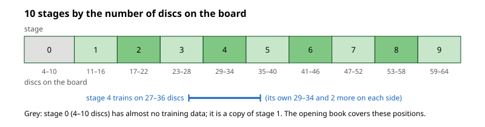
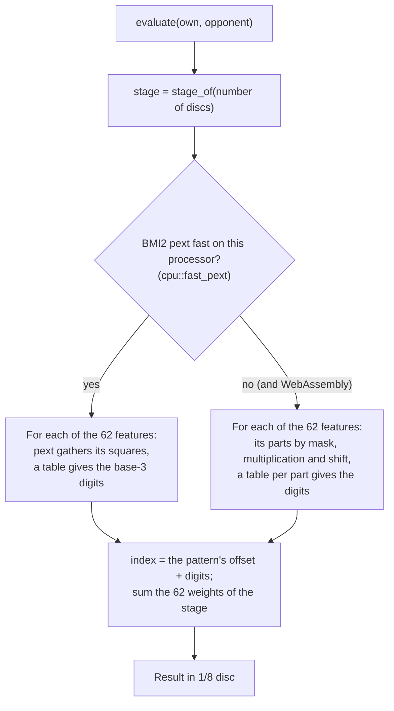

# 04 – Evaluation

[Back to the index](README.md)

## In short

At the leaves of the midgame search the engine cannot look further ahead, so it estimates how good the position is for the side to move. Stello's evaluation is a **pattern evaluation** combined with **legal mobility**. A pattern is a fixed group of squares, such as the second row or the 3 × 3 squares in a corner. For every way its squares can be filled with empty squares, own discs and opponent's discs, the pattern has one trained **weight**: a number of discs. Stello 5.0 uses Egaroucid's **16 patterns** (`egaroucid16`), each in all 4 of its places on the board (64 pattern **features**), plus **96 legal-mobility weights** (48 own + 48 opponent legal-move counts). The evaluation of a position sums the 64 pattern weights plus the two mobility weights in each of **60 single-disc stages** (from 12 discs up), returning the expected final disc difference in 1/16 disc (turned into 1/100 disc in search).

The weights were trained on positions from Egaroucid's training games and are embedded in the C++20 engine as [Stello.Net/Book/stello-eval.bin](../Stello.Net/Book/stello-eval.bin) (`STELLOEV` v3, **8,892,085 bytes** gzip, **38,434,770 bytes** unpacked). During midgame search, C++ maintains `PatternState` incrementally across moves (with 256-bit AVX2 on x86-64-v3 and 128-bit SIMD in WebAssembly), reserving `EvalWeights::evaluate` (C++ [src/eval/](../Stello.Cpp/src/eval) and C# [Stello.Net/Stello.Engine/Evaluation](../Stello.Net/Stello.Engine/Evaluation)) as the reference and for the tools and tests. Stello 1's hand-made evaluation is described in the [Stello 1 documentation](stello-1/04-evaluation.md), and the earlier 15-pattern × 10-stage (`plus15`) model used in Stello 2.0–4.0 is documented in [chapter 20](20-phases-0-2-the-evaluation.md).

## Data structures

### Patterns and indices

A **pattern** (`PatternShape`, the same name in Rust and C#) is a list of up to 10 squares. Each square is empty, own (the side to move) or the opponent's, so a pattern of $n$ squares can be filled in $3^n$ ways. The filling is read as a number in base 3, the **index**:

$$i = \sum_{k=0}^{n-1} d_k \cdot 3^{k}, \qquad d_k = \begin{cases} 0 & \text{empty} \\ 1 & \text{own disc} \\ 2 & \text{opponent's disc} \end{cases}$$

The first square of the list is the lowest digit. For example, the pattern `diagonal4` is d1 c2 b3 a4. With an own disc on d1, c2 empty, an opponent's disc on b3 and an own disc on a4, the digits are 1, 0, 2, 1 and the index is $1 + 0 \cdot 3 + 2 \cdot 9 + 1 \cdot 27 = 46$. `PatternShape::size` is $3^n$, the number of possible indices.

Own and opponent are relative to the side to move, not Black and White. So one table of weights serves both colours.

### Places and symmetries

The board has 8 symmetries: the identity, three rotations and four mirrors. [symmetry.rs](../Stello.Rust/stello-core/src/eval/symmetry.rs) (C#: [Symmetry.cs](../Stello.Net/Stello.Engine/Evaluation/Symmetry.cs)) numbers them 0–7 by three bits, applied in this order:

| Bit | Value | Turn | Example |
|---|---:|---|---|
| 0 | 1 | Mirror the columns (`mirror_columns`) | a1 ↔ h1 |
| 1 | 2 | Mirror the rows (a byte swap) | a1 ↔ a8 |
| 2 | 4 | Mirror in the a1–h8 diagonal (`transpose`) | a2 ↔ b1 |

A pattern is written once, in its **canonical place**. Its other places are the same squares turned by a symmetry. The row a2–h2 also stands for the 7th row and the b and g columns. To read a pattern in another place, `PatternSet::indices` (and C#'s `PatternSet.Indices`) turns the whole position by the symmetry and reads the canonical squares again; the engine's evaluation instead works out once which squares of the untouched position each place reads ([below](#reading-the-features-in-the-engine)). `PatternShape::placements` lists one symmetry for each different set of squares the pattern covers: 4 for most patterns, 2 for the long diagonal a8–h1 (its mirror images are the two long diagonals), and 8 for the 2 × 5 corner, which has no symmetry of its own.

All places of a pattern share **one table of weights**. A **feature** is one pattern in one place, and its weight comes from the pattern's table.

### Folding

Some symmetries map a pattern onto itself in another order: the row a2–h2 read backwards is h2–a2. Then two indices describe the same situation and must have the same weight. An own disc on a2 alone (index 1) and an own disc on h2 alone (index $3^7 = 2187$) are such a pair. **Folding** makes them one weight:

- `PatternShape::fold` gives, for every raw index, the smallest index of its group;
- `PatternShape::representatives` are the indices that are their own fold, in increasing order. Only these are trained and stored.

A row has $(6561 + 81) / 2 = 3321$ representatives: the 81 fillings that read the same backwards, and one of each other pair. Over all 15 patterns, folding cuts 403,461 raw indices to 233,676 weights per stage.

### The patterns

Stello 5.0's built-in pattern set is `PatternSet::egaroucid16` in [eval/patterns.cpp](../Stello.Cpp/src/eval/patterns.cpp) (C#: `PatternSet.Egaroucid16` in [Patterns.cs](../Stello.Net/Stello.Engine/Evaluation/Patterns.cs)): Egaroucid 7.9's 16 patterns, each in 4 symmetric placements (**64 features**, `320,193` folded pattern weights plus `96` mobility weights = `320,289` weights per stage):

| Pattern | Length | Squares (canonical place) | Places | Weights per stage |
|---|---:|---|---:|---:|
| `hv2` | 8 | a2–h2 | 4 | 3,321 |
| `d6+2c+x` | 9 | b1 c1 d2 e3 g2 f4 g5 h6 h7 | 4 | 9,963 |
| `hv3` | 8 | a3–h3 | 4 | 3,321 |
| `d7+2corner` | 9 | a1 b1 c2 d3 e4 f5 g6 h7 h8 | 4 | 9,963 |
| `hv4` | 8 | a4–h4 | 4 | 3,321 |
| `corner9` | 9 | a1–c1, a2–c2, a3–c3 | 4 | 10,206 |
| `d5+2x` | 7 | b2 d1 e2 f3 g4 h5 g7 | 4 | 1,134 |
| `d8+2c` | 10 | a1 b2 c3 d4 e5 f6 g7 h8 a2 b1 | 4 | 39,366 |
| `edge+2x` | 10 | b2 a1–h1 g2 | 4 | 29,646 |
| `triangle` | 10 | a1 b1 c1 d1 a2 b2 c2 a3 b3 a4 | 4 | 29,889 |
| `corner+block` | 10 | a1 c1 d1 e1 f1 h1 c2 d2 e2 f2 | 4 | 29,646 |
| `cross` | 10 | a1 b2 c3 d4 b1 c2 d3 a2 b3 c4 | 4 | 30,618 |
| `edge+y` | 10 | c2 a1–h1 f2 | 4 | 29,646 |
| `narrow-triangle` | 10 | a1 b1 c1 d1 e1 a2 b2 a3 a4 a5 | 4 | 29,889 |
| `fish` | 10 | a1 b1 a2 b2 c2 d2 b3 c3 b4 d4 | 4 | 30,618 |
| `anvil` | 10 | c6 d6 d7 d8 c8 f8 e8 e7 e6 f6 | 4 | 29,646 |
| **Patterns + mobility** | | | **64** (+2) | **320,193** (+96) |

The earlier `plus15` set (Stello 2.0–4.0, 62 features / 233,676 folded weights per stage) and `classic11` (46 features) remain defined alongside `egaroucid16`; the worked examples and stage/pattern diagrams below show the `plus15 × 10` format from those versions.


### Stages

A pattern is worth different amounts at different times in the game. A disc on an edge can be a weakness early and a strength late. So every pattern has its own weights in each **stage**: a range of the number of discs on the board. Stello 5.0 uses **60 single-disc stages** (`--min-discs 12`, `--smooth 0`), so stage $n - 5$ corresponds to exact disc count $n$ without mixing odd and even Othello parities; stages below 12 discs are filled from the 12-disc stage (covered by the opening book, chapter 10). The earlier 10-stage `plus15` layout (`even_stages(10)`) is illustrated below:



`EvalWeights::even_stages(stages)` cuts 4 to 64 discs into equal parts:

$$s(n) = \min\left(\max\left(\left\lfloor \frac{(n - 4) \cdot \text{stages}}{61} \right\rfloor, 0\right), \text{stages} - 1\right)$$

### `EvalWeights`

`EvalWeights` in [eval/weights.hpp](../Stello.Cpp/src/eval/weights.hpp) holds a complete evaluation (C#'s [EvalWeights.cs](../Stello.Net/Stello.Engine/Evaluation/EvalWeights.cs) has the same members in PascalCase):

| Member | Contents |
|---|---|
| `set()` | The `PatternSet` (`egaroucid16` in Stello 5.0) |
| `stages()` | The number of stages (`60` in Stello 5.0) |
| `stage_of(discs)` | The stage of each disc count 0–64 |
| `units_per_disc()` | The unit of the weights: `16` in Stello 5.0 (weights are in 1/16 disc) |
| `has_mobility()` | Whether the 96 legal-mobility weights per stage (`48` own + `48` opponent) are present (`true` in Stello 5.0) |
| `stage_weights(stage)` | One `int16_t` per raw index of every pattern (`PatternSet::offsets`) |
| `stage_mobility_weights(stage)` | `96` `int16_t` weights indexed by clamped legal-move counts |
| `built_in()` | The built-in evaluation, unpacked once per process (`eval/gzip.cpp`) |

## Algorithm

### Evaluating a position

`EvalWeights::evaluate(own, opponent)` takes the bitboards of the side to move and of the opponent:



As a formula, with $f$ running over the features:

$$E(p) = \sum_{f=1}^{62} w_{s(n)}\big[o_f + i_f(p)\big]$$

where $i_f(p)$ is the index of feature $f$ in position $p$, $o_f$ is the offset of its pattern in the table, and $s(n)$ is the stage. `PatternSet::sum_weights` reads each index and adds its weight in one loop. `PatternSet::indices` writes the 62 table positions into a list instead; the tests use it, and C#'s `EvalWeights.Evaluate` adds up what `PatternSet.Indices` writes.

### Reading an index fast

`PatternShape::index(own, opponent)` reads a pattern in its canonical place without a loop over its squares. The constructor (`PatternShape::new`, with `make_parts`) splits the squares into **parts**:

- **One row:** the squares of a row are in one byte of the bitboard. A mask and a shift get them.
- **One diagonal:** if all squares lie on one diagonal, a multiplication by `0x0101_0101_0101_0101` gathers them into the top byte. A diagonal has one square in each column, and each square lands on the bit of its column, so there are no carries.
- **Anything else** is read in parts, one per row. `edge+2x` has two parts: row 1, and b2 + g2 in row 2.

For each part a table `digits` of 256 entries turns the byte into the base-3 digits of its squares. The index is then

$$i = \sum_{\text{parts}} \texttt{digits}[\text{own byte}] + 2 \cdot \texttt{digits}[\text{opponent byte}]$$

The constructor checks for every part that each square lands on its own bit and that no subset of squares makes a carry; otherwise it panics (C# throws). `slow_index` reads the squares one by one, for tests.

### Reading the features in the engine

Reading the canonical squares of a turned position costs the turns: up to 8 symmetries of both bitboards for every evaluation. The engine's evaluation skips them. When a `PatternSet` is made, `Direct::new` works out, for each of the 62 features, which square of the untouched position lands on each square of the pattern, and builds its reading for that set of squares. There are two ways to read it, and both give exactly the indices above:

- **Portable** (`Direct::sum_portable`, the code WebAssembly runs): the feature's squares are split into parts (`direct_groups`), either one part per column or parts of squares that are all in different columns, whichever gives fewer. A part in one row is read with a shift; squares in different columns are gathered into the top byte with one multiplication by `0x0101_0101_0101_0101` (each lands on the bit of its column, without carries); a column is gathered with another multiplier (`line_extraction`, which checks every subset for carries). As before, a 256-entry table per part turns the byte into base-3 digits; features with the same table share it.
- **BMI2** (`Direct::sum_pext`, x86-64 only): one `pext` instruction per side gathers all squares of the feature in board order, and a table of $2^n$ entries for its $n$ squares turns them into the base-3 digits. That is two instructions and two table reads per feature.

`cpu::fast_pext` chooses once, at run time, because the shipped libraries are built for plain x86-64: `pext` is used when the processor has BMI2 and is not an AMD or Hygon processor before family 19h (Zen 3), which run `pext` in microcode at dozens of cycles. `cpu::set_portable_only` keeps the portable code on any processor, for checks (`stello-cli … --cpu portable`). When the two ways were added, the midgame benchmark at depth 10 went from 0.84 s to 0.49 s with `pext`, and to 0.70 s with the portable reading alone ([the speed pass](../Plans/making-stello-3-findings.md#phase-2-part-2-the-speed-pass-2026-11-02-8220705); [chapter 25](25-phases-0-4-the-engine-in-rust.md)).

### Incremental pattern indices in search (`PatternState`)

While `EvalWeights::evaluate` still reads indices from scratch (`Direct::sum_pext` with BMI2 `pext`, or `Direct::sum_portable`), Stello 5.0's midgame search keeps an `alignas(32)` `PatternState` ([patterns.hpp](../Stello.Cpp/src/eval/patterns.hpp#L113)) along the tree instead of recomputing all 64 indices from the bitboards at every leaf:

- `PatternState` holds `black[64]` and `white[64]`, the per-feature indices for all empty squares plus each colour's placed discs (with `white` holding base digits $2$ per disc). From that pair, the local index of every feature for the side to move is `other[f] + 2 * own[f]` — a pass costs zero index work because `black` and `white` simply swap roles.
- Precomputed sparse `(feature, delta)` slices and dense `square_deltas_[64][64]` tables update `PatternState` across a move by adding `delta(placed_square)` and flipping each captured square from the opponent's array to the mover's array.
- At `look == 0` leaves and in `order_by_evaluation` (`Kernel<UseAvx2>::eval_after_move_score` / `sum_weights_after_move`), the engine computes child indices directly from the parent's `PatternState` using 256-bit AVX2 vectors on `x86-64-v3` (`search_v3.cpp`, scalar 4-way unrolled weight loads beating microcoded `vpgatherdd`) or `<wasm_simd128.h>` in WebAssembly (`patterns.cpp`), without copying `Board` or calling `play_flips`, and adds `mobility_bonus(child_stage, opponent_moves, own_moves)` (`legal_moves` popcount clamped to `0..47`).

### Where the weights come from

The weights were trained by [Stello.Trainer](../Stello.Net/tools/Stello.Trainer) on Egaroucid's training games (`10,000,000` positions per single-disc stage from 12 discs up, `--smooth 0 --mobility on --units 16 --min-appear 10` in 1h 20m; [chapter 29](29-stello-5-0-speed-threads-search-and-book.md#phase-5-evaluation)). On the `1,040,276`-position held-out test split, Stello 5.0's `egaroucid16 + mobility × 60` evaluation achieves **4.97 MAE / 6.74 RMSE** (beating `plus15 × 10`'s `5.47 / 7.31` and Egaroucid's `5.05 / 6.90`). The training data is not in the repository; the trained weights are credited in [THIRD-PARTY-NOTICES.md](../THIRD-PARTY-NOTICES.md).

### The file

C#'s `EvalWeights.Write` / `EvalWeights.Read` and C++'s `EvalWeights::read` handle `STELLOEV` formats v2 and **v3** (adding the 96 legal-mobility weights per stage). Inside the gzip stream, all numbers are little-endian:

| Part | Contents |
|---|---|
| Magic & version | `STELLOEV`, u16 version (`3` in Stello 5.0; `2` without mobility) |
| Pattern set & stages | u8 length + ASCII name (`egaroucid16`), u8 stages (`60`), 65 × u8 `stage_of`, u16 `units_per_disc` (`16`) |
| Pattern weights | For each stage: one i16 per representative minus the stage before, split into all low bytes then all high bytes |
| Mobility weights (v3) | For each stage: `96` i16 (`48` own + `48` opponent) delta-encoded in the same low/high byte layout |

Unpacked, [Stello.Net/Book/stello-eval.bin](../Stello.Net/Book/stello-eval.bin) is **38,434,770 bytes** (`90`-byte header + `60 × 2 × 320,289` bytes of folded + mobility weights); compressed with gzip it is **8,892,085 bytes**, embedded into `stello_engine.dll` (`embed_eval.cmake`) and both WebAssembly packages (~`8.95 MB` brotli). `EvalWeights::built_in` inflates it once per process using the self-contained RFC 1951/1952 decompressor in [eval/gzip.cpp](../Stello.Cpp/src/eval/gzip.cpp).

## Worked examples (`plus15` format illustration)

The values below illustrate the `STELLOEV` v2 `plus15 × 10` format from Stello 2.0–4.0 (`Data` / `Stello.Engine.V2`).

### Reading one feature

After the 30 moves `c4 c5 d6 e7 c6 d3 c2 b4 c3 b6 e6 c1 b1 d2 c7 b3 a2 a1 b5 a5 a3 e3 a7 d8 d1 b2 f3 f5 f8 a4` (a random game), Black is to move (X = Black, O = White, row 1 at the top):

```text
OOOX----
OOOX----
OOOOXX--
OOXXO---
OOXXOO--
-OXXO---
X-O-X---
---O-X--
```

Take the feature `edge+2x` in its canonical place (symmetry 0): a1–h1, b2, g2. Own is Black, the side to move. It is read in two parts:

| Part | Squares | Own byte (Black) | Opponent byte (White) | digits[own] + 2 × digits[opponent] |
|---|---|---|---|---:|
| Row 1 | a1–h1 (digits 0–7) | d1: bit 3 | a1, b1, c1: bits 0–2 | $3^3 + 2 \cdot (1 + 3 + 9) = 53$ |
| Row 2 | b2, g2 (digits 8, 9) | none | b2: bit 1 | $0 + 2 \cdot 3^8 = 13{,}122$ |

The index is $53 + 13{,}122 = 13{,}175$. Stage 4 (34 discs) gives this filling the weight −28, that is −3.5 discs: White's corner and its edge are bad for Black.

### A midgame position

The whole evaluation of the same position adds up 62 weights of stage 4. Per pattern, summed over its places:

| Pattern | Places | Sum (1/8 disc) | Discs |
|---|---:|---:|---:|
| `row2`, `row3`, `row4` | 12 | −13 + 17 − 2 = +2 | +0.25 |
| `diagonal4` … `diagonal8` | 18 | 1 − 28 + 3 + 21 − 20 = −23 | −2.88 |
| `edge+2x` | 4 | −53 | −6.63 |
| `corner2x5` | 8 | −108 | −13.50 |
| `corner3x3` | 4 | −54 | −6.75 |
| `triangle` | 4 | −46 | −5.75 |
| `corner+block` | 4 | −36 | −4.50 |
| `cross` | 4 | −24 | −3.00 |
| `edge+y` | 4 | −32 | −4.00 |
| **Total** | **62** | **−374** | **−46.75** |

`pattern_score` gives $-374 \cdot 100 / 8 = -4675$. The evaluation expects Black to lose by about 47 discs. Almost all of it comes from the corner and edge patterns around White's a1. The largest single weight is the `corner2x5` feature turned by symmetry 4 (a1–a5 and b1–b5): all ten squares are White's, index $3^{10} - 1 = 59{,}048$, weight −41 (−5.1 discs).

A 1-ply search evaluates the position after each of Black's 8 moves for White and negates it. The children have 35 discs, so they use the weights of stage 5:

| Black's move | e2 | c8 | f7 | f4 | f6 | b8 | g5 | a6 |
|---|---:|---:|---:|---:|---:|---:|---:|---:|
| Score (1/100 disc) | −3112 | −3925 | −4050 | −4150 | −4187 | −4212 | −4750 | −4762 |

### The same score for symmetric positions

From the start position, Black's four first moves d3, c4, f5 and e6 give positions that are turned copies of each other. The same squares are then read in other places, so the 62 features find the same weights, and all four score the same: +437 for White (35/8 disc). The test `FoldedWeights_GiveTheSameSumForAllSymmetricPositions` checks this property for random positions. The number itself means little: with 5 discs these positions are in stage 0, a copy of stage 1 (11–16 discs), and the opening book plays them anyway.

## Design notes

- **Pattern + mobility, learned not hand-made.** Stello 5.0's evaluation learns both the 64 pattern features of `egaroucid16` and two explicit legal-mobility weights (`48` own + `48` opponent) across 60 single-disc stages so odd and even parities never mix during training, improving test accuracy to `4.97 MAE / 6.74 RMSE` ([chapter 29](29-stello-5-0-speed-threads-search-and-book.md)).
- **Shared weights.** Because all places of a pattern use one table, each weight learns from four times as many examples, and the evaluation is symmetric by construction: a position and its mirror images always get the same score.
- **Side to move, not colour.** The digits are own and opponent's discs, so one table serves Black and White.
- **Incremental `PatternState` in search, `EvalWeights::evaluate` as reference.** Up through Stello 4.0, indices were recomputed from scratch at every node. In Stello 5.0, the midgame search maintains `PatternState` incrementally across moves (`patterns.hpp`, `search_v3.cpp`, WASM `-msimd128`), speeding native midgame nodes per second by +36–39 % and single-threaded WASM by +98–100 %. `EvalWeights::evaluate` (BMI2 `pext` or portable multiplication) remains as the exact reference checked by `parity_incremental_eval`.
- **Size vs accuracy trade-off.** Moving from `plus15 × 10` (`0.99 MB`) to `egaroucid16 + mobility × 60` grows [stello-eval.bin](../Stello.Net/Book/stello-eval.bin) to `8,892,085` bytes (`~8.95 MB` brotli in WebAssembly), gaining `+33` Elo (`+20` from patterns + `+13` from mobility) at 500 ms per move.

## Where in the code

| File | Main members |
|---|---|
| [eval/patterns.hpp](../Stello.Cpp/src/eval/patterns.hpp), [patterns.cpp](../Stello.Cpp/src/eval/patterns.cpp), [patterns_bmi2.cpp](../Stello.Cpp/src/eval/patterns_bmi2.cpp) | `PatternShape`, `PatternSet` (`classic11`, `plus15`, `egaroucid16`), `Direct` (`sum_portable`, `sum_pext`), `PatternState`, incremental `square_deltas_` & WASM `-msimd128` SIMD |
| [search/search_v3.cpp](../Stello.Cpp/src/search/search_v3.cpp), [kernel_impl.hpp](../Stello.Cpp/src/search/kernel_impl.hpp) | 256-bit AVX2 `advance_eval_state`, `build_eval_base`, `eval_after_move_score` |
| [eval/weights.hpp](../Stello.Cpp/src/eval/weights.hpp), [weights.cpp](../Stello.Cpp/src/eval/weights.cpp), [gzip.cpp](../Stello.Cpp/src/eval/gzip.cpp) | `EvalWeights` (`evaluate`, `mobility_bonus`, `stage_of`, `units_per_disc`, `has_mobility`, `built_in`, `read`), `STELLOEV` v2/v3 reader |
| C#: [Patterns.cs](../Stello.Net/Stello.Engine/Evaluation/Patterns.cs), [Symmetry.cs](../Stello.Net/Stello.Engine/Evaluation/Symmetry.cs), [EvalWeights.cs](../Stello.Net/Stello.Engine/Evaluation/EvalWeights.cs) | `PatternSet.Egaroucid16`, `EvalWeights` (`HasMobility`, `Read`/`Write` v3) for `Stello.Trainer` and `Stello.Benchmark` |
| [stello-eval.bin](../Stello.Net/Book/stello-eval.bin) | The built-in Stello 5.0 weights (`8,892,085` B gzip) |
| [Stello.Trainer](../Stello.Net/tools/Stello.Trainer) | The trainer that made the file (`--mobility on`, `--min-discs 12`, `--smooth 0`) |
| Preserved: [Stello.Engine.V2/Evaluation](../Stello.Net/Stello.Engine.V2/Evaluation), [Stello.Rust/stello-core/src/eval](../Stello.Rust/stello-core/src/eval) | Frozen `plus15 × 10` evaluation for `engine=stello-v2` and `engine=stello-v3` |

## Tests

[PatternTests.cs](../Stello.Net/Stello.Engine.Tests/PatternTests.cs), on the C# evaluation:

- symmetries 1, 2 and 4 map the squares as documented, and turning a whole bitboard equals turning it square by square;
- `classic11` has 46 features with the expected places per pattern and the expected folded sizes (3,321 for a row, 59,049 for the 2 × 5 corner, 10,206 for the 3 × 3 corner); `plus15` has 62 features and `egaroucid16` 64;
- for all three sets, `Index` equals `SlowIndex` for random positions in all 8 symmetries;
- with random folded weights, every symmetric copy of a random position gets the same sum;
- writing and reading a file gives the same evaluation, with its stages and units;
- `Read` rejects a file that is not an evaluation file.

The Rust evaluation is checked against the C# one, with fixtures that `Stello.Benchmark parity-data` writes ([tests/data](../Stello.Rust/stello-core/tests/data)):

- [tests/parity.rs](../Stello.Rust/stello-core/tests/parity.rs), `pattern_sets_match_stello_2`: for all three sets the feature counts, raw sizes, the features' symmetries, every shape's size, places and folding, a checksum of the indices of all fixture positions, and a checksum of all built-in weights with their stages and units equal C#'s;
- `positions_match_stello_2`: on 6,214 positions, the stage, `evaluate`, `pattern_score` and the solver's `disc_score`, and the evaluation after every legal move, equal C#'s;
- [eval/patterns.rs](../Stello.Rust/stello-core/src/eval/patterns.rs) (unit tests): the feature counts; `indices` equals `slow_index` on the turned positions for 2,000 positions per set; both `sum_portable` and (on a processor with BMI2) `sum_pext` equal the sum over `indices` with weights that differ for every raw index, on 3,000 positions per set; folds are idempotent;
- [eval/weights.rs](../Stello.Rust/stello-core/src/eval/weights.rs) and [eval/symmetry.rs](../Stello.Rust/stello-core/src/eval/symmetry.rs) (unit tests): the built-in file is `plus15`; bad files are refused; the even stages; the symmetries move squares as documented and are permutations.

Once, when the evaluation was ported, both evaluated the whole test split of the training data, 9,973,199 positions, with identical checksums ([findings](../Plans/making-stello-3-findings.md#parity)). The search and endgame tests ([chapter 06](06-midgame-search.md), [chapter 08](08-endgame-solver.md)) use the built-in evaluation in real searches.

## Further reading

- [Writing an Othello program – Gunnar Andersson](http://radagast.se/othello/howto.html): the section "Position evaluation" describes pattern-based evaluation.
- [Logistello – Michael Buro](https://skatgame.net/mburo/log.html): the program that made trained pattern evaluations standard in Othello, and its papers.
- [Technical explanation – Egaroucid](https://www.egaroucid.nyanyan.dev/en/technology/explanation/): Egaroucid's pattern evaluation, where the four 10-square patterns come from.
- [Training data – Egaroucid](https://www.egaroucid.nyanyan.dev/en/technology/train-data/): the data the weights were trained on.
- [Phases 0–2: the evaluation](20-phases-0-2-the-evaluation.md), [Phase 5: the search](23-phase-5-the-search.md), [Phases 0–4: the engine in Rust](25-phases-0-4-the-engine-in-rust.md), and [Stello 5.0](29-stello-5-0-speed-threads-search-and-book.md).
- [Glossary](30-glossary.md) and [References](31-references.md).

---

Previous: [03 Rules and move generation](03-rules-and-move-generation.md) · Next: [05 Move ordering](05-move-ordering.md)
