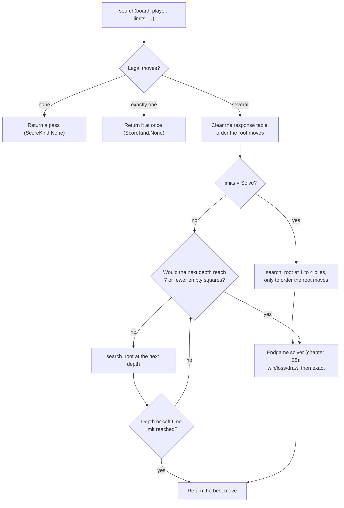
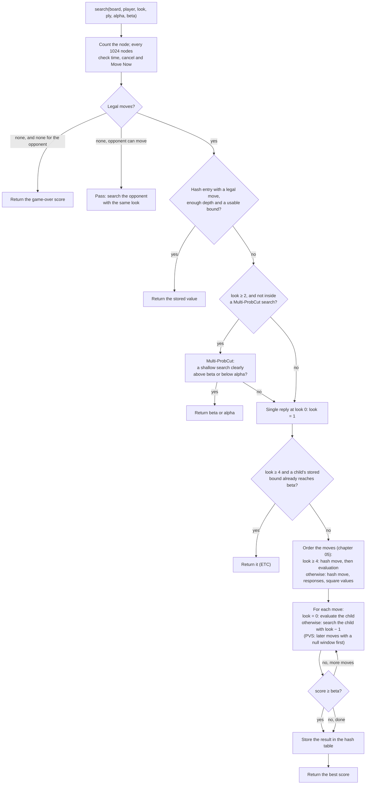
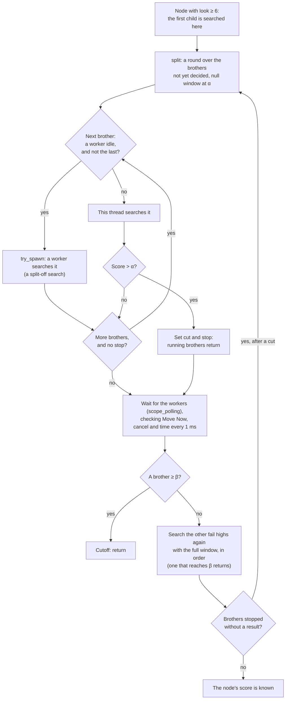
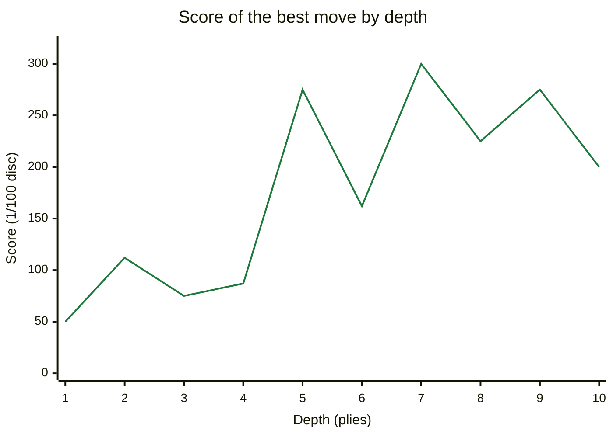

# 06 – Midgame search

[Back to the index](README.md)

## In short

To choose a move, the engine looks ahead: it tries its moves, the opponent's replies, its answers to those, and so on, and evaluates the positions at the end of each line with the pattern evaluation (chapter 04). The best move is the one that leads to the best position when both sides play their best. This is **minimax**; Stello writes it as **negamax** with **alpha-beta pruning**, which skips lines that cannot change the result. The search runs **iteratively deeper**: first 1 ply, then 2, then 3, until the time is used. Every node searches its first move with the full window and the others with a null window (**principal variation search**). It is helped by the hash table and its **enhanced transposition cutoff** (chapter 07), move ordering (chapter 05), an **extension** at the horizon and a **selective search**, Multi-ProbCut, that cuts off positions a shallow search shows to be clearly outside the interesting range, with an error model fitted on Stello's own searches. When the end of the game is near enough, the endgame solver takes over (chapter 08).

With more than 1 thread, the other threads help: half of them run **Lazy SMP** helpers, which search the root a few plies deeper into the shared hash tables, and the rest take over the later moves of a node once its first move has been searched (**YBWC**). With 1 thread the search is exactly the single-threaded one, node for node that of Stello 2.0 ([Threads](#threads)).

## Data structures

`SearchEngine` keeps what lives from search to search; one running search is a `Searcher`, which borrows the engine's tables and holds the counters of that search. An engine runs one search at a time; the app keeps one engine for the whole game, so the hash tables survive from move to move.

| Field of `SearchEngine` | Contents |
|---|---|
| `midgame_table`, `endgame_table` | The two hash tables (chapter 07), shared by all threads of a search |
| `main` | The calling thread's `ThreadState`: the solver's small table of bounds, `EndgameState::local` (chapter 08), and the move ordering with the response table (chapter 05) |
| `pool` | The worker threads for searches with more than 1 thread, and the thread count they were started for ([Threads](#the-thread-pool)) |
| `spawner` | How the pool starts its threads: `std_spawner`, or Web Workers in the threaded web build (`set_spawner`) |
| `options` | The `SearchOptions`: `pattern`, another evaluation instead of the built-in `EvalWeights::built_in()` (chapter 04), and the switches `selective`, `probcut_percent`, `soft_time_percent`, `ybwc` (on by default; `set_ybwc`) and `legacy_endgame_soft` (off by default; `set_legacy_endgame_soft`, chapter 09) |
| `probcut_errors` | Multi-ProbCut's margin $t\,\sigma$ in 1/100 disc for each disc count and depth, or `None` when `selective` is off |
| `clock`, `iteration_done` | The clock (`system_clock`, or the browser's, set with `set_clock`; chapter 09) and the callback after each iteration |

| Field of `Searcher` | Contents |
|---|---|
| `pattern` | The evaluation this search uses |
| `midgame_table`, `endgame_table`, `endgame`, `ordering` | Borrows of the shared tables and of this thread's `ThreadState` |
| `helpers` | The pool and what the other threads need, in a search with more than 1 thread; `None` with 1 thread and in the Lazy SMP helpers |
| `split`, `ybwc` | The split point this search was split off at, if it was (YBWC), and whether it may split its nodes |
| `in_probcut` | True during Multi-ProbCut's shallow search, which is not selective itself |
| `start`, `hard_limit_ms`, `soft_time_percent` | When the search started, the hard time limit, and the soft share of the time (chapter 09) |
| `nodes`, `evaluations` | Counters, reported in `SearchInfo` and `SearchResult` |
| `hash_get_height`, `hash_put_height` | How far from the root the midgame hash table is used |
| `stop`, `progress` | The stop signals (cancel and Move Now, a `StopSignal`) and the progress callback of the running search |
| `report_…`, `last_heartbeat_ms` | The last reported state, repeated as a heartbeat when no report was sent for 100 ms (chapter 09) |

| Constant | Value | Meaning |
|---|---|---|
| `INFINITY` | 32 767 | Larger than any score |
| `ROOT_WINDOW` | 32 664 | The root window is (−32 664, 32 664) |
| `WIN_SCORE` | 32 600 | A finished game scores ±(32 600 + disc difference) |
| `PATTERN_UNITS_PER_DISC` | 100 | Scores are in 1/100 disc |
| `ENDGAME_DISTANCE` | 7 | Switch to the solver when the search would reach 7 or fewer empty squares |
| `SOLVE_ORDERING_LOOKS` | 4 | In solve mode, 4 midgame iterations order the root moves first |
| `EVALUATION_ORDER_MIN_LOOK` | 4 | From `look` = 4 the moves are ordered by evaluation (chapter 05) |
| `MIDGAME_ETC_MIN_LOOK` | 4 | From `look` = 4 the children's hash entries are tried first (ETC, chapter 07) |
| `PROBCUT_MIN_LOOK` | 2 | Multi-ProbCut is tried from `look` = 2, a depth of 3 plies |
| `DEFAULT_PROBCUT_PERCENT` | 100 | Its t × 100: a cut needs the shallow search to be t = 1.0 standard deviations outside the window |
| `PROBCUT_PRE_CHECK_OFFSET` | 400 | 4 discs: the static evaluation must already be within 4 discs of that margin, and at least 1 disc beyond the bound, before the shallow search is tried |
| `PROBCUT_SCORE_LIMIT` | 32 000 | No Multi-ProbCut near won or lost scores |

**Scores** are in 1/100 disc from the point of view of the side to move: `evaluate_leaf` (through `eval::pattern_score`) converts the pattern evaluation's units (1/8 disc in the built-in file) to 1/100 disc and caps it at ±64 discs (±6 400) (chapter 04). A finished game scores ±(32 600 + disc difference), with the empty squares given to the winner, so every won game is better than any evaluation.

**Depth.** The code uses the C++ convention `look`: the remaining depth *after* the current move. A search with `look` = *n* looks *n* + 1 plies ahead, and the leaves are evaluated in the move loop of the node with `look` = 0.

## Algorithm

### Negamax with alpha-beta

In negamax, a position's score for the side to move is the maximum over its moves of the *negated* score of the position after the move (which is from the opponent's point of view):

$$\operatorname{score}(p) = \max_{m\ \in\ \text{moves}(p)} \big( -\operatorname{score}(p \cdot m) \big)$$

where $p \cdot m$ is the position after move $m$, and a position at the depth limit gets its evaluation. Alpha-beta passes a window (α, β) down the tree:

- α is the score the side to move is already sure of from an earlier move; a move that cannot beat α need not be searched exactly.
- β is the most the opponent will allow; as soon as a move reaches β, the opponent will avoid this position, so the other moves need not be searched: a **cutoff**.

A child is searched with the window (−β, −α). Stello's search is **fail-soft**: it returns the best score it found even when that is outside the window, which gives the hash table tighter bounds.

The picture shows a depth-2 search for Black in the midgame test position (the one used in [SearchEngineTests.cs](../Stello.Net/Stello.Engine.Tests/SearchEngineTests.cs)). At this depth none of the search's extras is active: the root searches every move with the full window (`look` ≤ 2), there is no Multi-ProbCut (`look` < 2) and no enhanced transposition cutoff or evaluation ordering (`look` < 4), so it is plain alpha-beta. Each row is a black move with White's replies; the leaves are scored by the pattern evaluation for Black, in 1/100 disc, and White picks the lowest.


With these four root moves in this order and the replies in square order, alpha-beta evaluates 28 leaves instead of the 46 of a full minimax (over all 11 moves, a full minimax evaluates 123). In the real search, the depth-1 iteration has already moved the best move, c6, to the front, so α is 112 from the first move on and the other moves are refuted sooner; the replies are also tried in square-value order, because the response table holds nothing yet for a root move that has not been searched at this depth and the hash table is not read at ply 1 in a depth-2 iteration (chapter 05). The depth-2 iteration then needs only 21 evaluations. Both find c6 with score 112 (+1.12 discs).

### The search as a whole

`SearchEngine::search(board, player, limits, progress, stop, only_moves)`; the C# `SearchEngine.Search(board, player, limits, progress, cancellationToken, moveNowToken, onlyMoves)` that the apps and tools call passes its arguments on to it (chapter 14):



With `only_moves`, only the given moves are searched, even a single one (used by book learning, chapter 11). A single legal move is not searched, unless the limit is `Solve` or `only_moves` is given. In solve mode the midgame iterations at 1 to 4 plies (`SOLVE_ORDERING_LOOKS`, fewer if the position is too near the end) only order the root moves for the solver; their scores are not the result. If the time runs out or "Move Now" is used at any point, the search unwinds and returns the best move found so far (chapter 09).

### Iterative deepening

The loop runs `look` = 0, 1, 2, … as long as $\text{empties} - 1 - \text{look} > 7$, that is, as long as the search ends with more than 7 empty squares on the board. After each iteration it stops if the depth limit (fixed depth) or the soft time limit (the other modes) is reached. Searching depth 1, 2, 3, … sounds wasteful, but each iteration fills the hash table and reorders the root moves for the next one, and the deeper searches are so much bigger that the small ones hardly count. After each iteration the callback set with `set_iteration_done`, if any, gets the depth and the score (the C# wrapper's internal `IterationDone` sets it); the trainer's `mpc` command uses it to record every iteration's score for the Multi-ProbCut fit.

### The root: principal variation search

`search_root` searches every root move:

- The first move with the full window; the other moves, once the search is deeper than 3 plies (`look` > 2), with a **null window** (−α − 1, −α). A null-window search is fast because it only answers "better than α or not?". If a move turns out better, it is searched again with the full window. This is **principal variation search** (PVS), which replaces the C++ `zero_findmax`.
- After each root move, a `SearchInfo` is reported (depth, current move, best move, score, nodes, evaluations, time).
- Each move that becomes the new best is recorded; at the end they are moved to the front of the root list in that order (`move_to_front`), so the next iteration starts with the latest best move (C++ `put_in_front`).

### One node

`Searcher::search(board, player, look, ply, previous_move, alpha, beta)`, which returns the score and the best move:



Some details:

- **Leaves are evaluated in the parent's loop.** When `look` is 0, the positions after each move are evaluated directly with the pattern evaluation (`evaluate_leaf`, chapter 04), for the side to move there, and negated. This saves a function call per leaf, as in C++. Each evaluated leaf counts as a node and an evaluation.
- **Passes** do not use up depth: the opponent is searched with the same `look`.
- **Extension.** A position with only one legal move at the horizon (`look` = 0) is searched one ply deeper (`look` = 1), so a forced reply is not judged by a static evaluation. The result is still stored in the hash table with the original `look`.
- **The response table** is updated after every searched child (chapter 05).
- **Enhanced transposition cutoff** from `look` = 4 (`MIDGAME_ETC_MIN_LOOK`), where the children are within the hash table's read height: the children's hash entries are looked up before the moves are ordered; a child whose stored upper bound already refutes it ends the node ([chapter 07](07-transposition-table.md#use-in-the-midgame-search)).
- **The hash table** is read only at plies ≤ `look` − 1 and written only at plies ≤ `look` of the current iteration, the same heights as in C++; so it is used in the upper part of the tree, where each entry saves the most work. A hash move is only used if it is legal in the position (chapter 07).
- **PVS in every node.** The first move is searched with the full window, the others with a null window and again with the full window if they turn out better, as at the root. A node that already has a null window searches all its moves with it. The measurements behind this choice are in [chapter 23](23-phase-5-the-search.md).

### Selective search

Stello uses **Multi-ProbCut** (Buro), as Egaroucid does ([chapter 18](18-the-egaroucid-port.md)): a shallow search predicts the result of the deep one, and when the prediction is clearly outside the window, the deep search is skipped.

At a node with depth $d$ = `look` + 1 ≥ 3 (`try_probcut` and `probcut_searches`), after the hash table lookup and before the moves are generated into a list:

1. The shallow depth is about half, with the same parity (`probcut_shallow_depth`): $s = 2\lfloor d/4 \rfloor + (d \bmod 2)$, so 3 → 1, 4 → 2, 7 → 3, 10 → 4, 13 → 7.
2. The error margin is $e = \lceil t \cdot \max(0.5,\ \sigma(n, s, d)) \cdot 100 \rceil$ in 1/100 disc, with $t$ = 1.0 (`DEFAULT_PROBCUT_PERCENT`) and $n$ the number of discs on the board. `probcut_errors` computes it once per engine for every disc count and depth.
3. **A cheap test first:** the static evaluation must be at least $\beta + \max(100,\ e - 400)$, that is, within 4 discs of the margin and at least 1 disc above β. Only then does a null-window search to depth $s$ test whether the position scores at least $\beta + e$. If so, the node returns β. The same is done below α: static evaluation at most $\alpha - \max(100,\ e - 400)$, then a test against $\alpha - e$, and the node returns α.
4. The shallow search is an ordinary node search (same ply, same previous move, the same hash table), but Multi-ProbCut is off inside it (`in_probcut`).
5. Near won and lost scores it is not used: the cut above β is only tried when $\beta + e < 32\,000$, the cut below α only when $\alpha - e > -32\,000$ (`PROBCUT_SCORE_LIMIT`).

**The error model** comes from Stello's own searches. The trainer's `mpc` command searched 11,700 test positions (300 per disc count from 14 to 52) without selectivity at every depth up to min(13, empties − 8), and measured the spread of the deep result minus the shallow one. A weighted least-squares fit over those spreads gives, in discs, with $x = n / 64$:

$$\sigma(n, s, d) = 1.887 + 2.954\,x + 0.066\,x^2 - 0.675\,s + 0.278\,d$$

It is off by 10 % on average over the 117 measured cells. Typical values are 2–4 discs: the spread grows with the number of discs and shrinks as the shallow search gets closer to the deep one. For example, at 32 discs and depth 11 (shallow depth 5), σ ≈ 3.06 discs, so $e$ = 307. A node with β = 0 is then cut when the static evaluation is at least +1 disc (here $e - 400$ is negative, so the minimum of 1 disc applies) and the 5-ply null-window search scores at least +3.07 discs. The few positions where the deep search found a forced game end were left out of the fit, just as Multi-ProbCut leaves out such scores.

Because the margin comes from the measured errors, it is wide where the shallow search is unreliable (many discs, a large gap between $s$ and $d$) and narrow where it is reliable. How $t$ = 1.0 was chosen, and what Multi-ProbCut gained over the fixed-margin selective search it replaced, is told in [chapter 23](23-phase-5-the-search.md).

### Game over inside the search

When neither side can move, the node returns $\pm(32600 + d)$, where $d$ is the disc difference with the empty squares given to the winner, and 0 for a draw (`game_over_score`, with `final_score`).

## Threads

With more than 1 thread (`SearchLimits::threads`, set by the Threads setting in the apps, [chapter 15](15-gui-and-settings.md)), the calling thread runs the search described above, and the other threads help it in two ways:

- **Lazy SMP:** some threads search the root on their own, a few plies deeper, and fill the shared hash tables, so the main search finds more results there.
- **YBWC** (Young Brothers Wait Concept): once the first move of a node has been searched, the other moves ("younger brothers") are handed to idle threads and searched at the same time.

In the midgame half of the other threads run Lazy SMP and the rest are free for YBWC. In the solver all of them take part in YBWC ([chapter 08](08-endgame-solver.md#threads-in-the-solver)). Both follow Egaroucid (`ai.hpp` and `ybwc.hpp`), with changes that were measured; the story is in [chapter 26](26-phases-5-9-threads.md).

### The shared tables

All threads of a search share the two hash tables. They read and write them through a shared reference (`&self`), and each slot is guarded by a sequence lock, so a thread never takes half of another thread's write for a valid entry ([chapter 07](07-transposition-table.md#sharing-the-table-between-threads)). What all threads read is collected in a `SearchContext` ([engine.rs](../Stello.Rust/stello-core/src/search/engine.rs#L206)): the evaluation, Multi-ProbCut's errors, the two tables, the clock and the options.

Each thread has a state of its own, a `ThreadState` ([engine.rs](../Stello.Rust/stello-core/src/search/engine.rs#L198)): the solver's local table (chapter 08) and the response killers of the move ordering (chapter 05). The engine keeps the calling thread's state in `main`, and each pool worker keeps its own. The response killers of the workers are cleared at the start of every search, as the main thread's are, because they come from other positions.

- **The result** is the main thread's: its move, score and depth. The other threads only make it come sooner.
- **The counts** are of all threads: a helper adds its nodes to a shared counter at each of its abort checks (`flush_nodes`), and its evaluations when it ends. So the progress reports and the analysis show the nodes per second of all threads.
- **With 1 thread** no pool is used, and the search is exactly the single-threaded one: node for node the same as Stello 2.0 ([`search`](../Stello.Rust/stello-core/src/search/engine.rs#L381)).
- **More threads are not deterministic.** The threads race for the table, so the nodes, and sometimes the move, differ from run to run. Exact scores from the solver are always the same.

### The thread pool

The threads come from a fixed pool, [search/pool.rs](../Stello.Rust/stello-core/src/search/pool.rs), shaped like Egaroucid's `thread_pool.hpp`:

- **Started once.** The engine starts the pool at the first search with N > 1 threads: N − 1 workers, since the calling thread is the Nth. It keeps the pool for the next searches with as many threads. A search with another N ends the old workers first and starts new ones, so there are never more threads than asked for ([engine.rs](../Stello.Rust/stello-core/src/search/engine.rs#L400)).
- **A state per worker.** Each worker has its `ThreadState` behind a mutex, which it holds while it runs a task. `for_each_state` reaches every state between tasks, for example to clear the local tables in `clear_hash`.
- **Scoped tasks.** Tasks run inside a `scope`, as with `std::thread::scope`: the scope returns only when every task it started has finished, also when its body panics. So a task may borrow the position, the tables and the stop flags of the search that started it. A panic in a task is caught, and raised again by the scope.
- **`try_spawn`** hands a task to a worker that is idle right now, or refuses at once when all are busy. Nobody waits for a busy pool. That is what YBWC needs: split only where a thread is free. A counter of idle workers, read without a lock, makes the refusal cheap, because YBWC asks at almost every split while the threads are busy.
- **`scope_polling`** is a scope that calls a check about every millisecond while it waits for its tasks. A thread waiting at a split uses it to see Move Now, cancel and its time limit ([YBWC](#ybwc)).
- **The `Spawner` hook.** The pool starts its threads through a function, `std_spawner` by default (a `std::thread` named `stello-search-<n>`). The threaded web build passes one that runs the workers on Web Workers that share the WebAssembly memory ([chapter 14](14-app-integration.md#threads-in-the-browser)). A worker that cannot be started leaves the pool smaller, and the search simply has fewer helpers.
- **No threads where there are none.** The single-threaded WebAssembly build (without atomics) always searches with 1 thread (`THREADS_AVAILABLE`), and a pool of 0 workers starts nothing and refuses every task.

### Lazy SMP

`lazy_smp_midgame` ([engine.rs](../Stello.Rust/stello-core/src/search/engine.rs#L720)) runs the midgame iterations of the main thread inside one pool scope, and starts the helpers at its beginning:

- **Helper i** (from 0) runs an iterative deepening of its own on the root, **1 + ctz(i + 1)** plies ahead of the main thread, where ctz counts the trailing zero bits. Helpers 0 to 6 are +1, +2, +1, +3, +1, +2 and +1 ahead: most go one ply ahead, fewer go further.
- **Catching up.** The main thread writes the `look` of each iteration into an atomic. A helper starts its next iteration at the main look plus its lead, or one deeper than its last iteration if that is more, so it jumps ahead again when the main thread catches up. It stops at the last midgame depth, below which the solver takes over.
- **Their results are not used.** A helper searches with the main thread's selectivity, and what it finds goes into the shared tables, where the main search finds it as hash moves and cutoffs. Helpers have no time limit and send no progress.
- **Stopping.** When the main thread's iterations end, a drop guard (`StopHelpers`) sets the helpers' flag, which they read as Move Now. Because it is a guard, this happens also when the main search returns early or panics; otherwise the scope would wait for the helpers for ever.
- **How many.** With YBWC on, half of the workers, rounded up, are helpers: 1 of 1, 2 of 3, 4 of 7, 8 of 15 (`lazy_smp_helpers`). The others are left idle for YBWC splits. With YBWC off (`SearchOptions::ybwc`, a switch kept for comparisons) every worker is a helper.
- **Few empty squares.** When the position is too near the end for any midgame iteration, the search goes straight to the solver, and no helper is started.

Egaroucid starts its helpers again at each iteration of the main search, at the main depth + ctz(i + 1), and only up to depth 10, because deeper its main search splits with YBWC. Here that gave nothing. The schemes measured before choosing, time to depth 14 on mid-bench (1 thread: 3.03 s):

| Scheme | 4 threads | 8 threads |
|---|---|---|
| Egaroucid's: per-iteration helpers at depth + ctz(i + 1), main depth ≤ 10 | 2.93–3.14 s (no gain) | |
| The same at all depths | 2.22 s | 2.27 s (1.35×) |
| Deeper-only, or rotated same-depth helpers | about 1.4× | about 1.4× |
| **Helpers with their own iterative deepening ahead (chosen)** | **2.00 s** | **1.83 s** |

With Lazy SMP alone (phase 6, before YBWC), the time to depth, the mean wall time of 3 mid-bench passes over 100 positions:

| Threads | Depth 14 | Speed-up | Nodes/s | Depth 16 | Speed-up |
|---:|---:|---:|---:|---:|---:|
| 1 | 3.22 s | 1.00× | 9.9 M | 8.48 s | 1.00× |
| 2 | 2.57 s | 1.25× | 18.0 M | 6.89 s | 1.23× |
| 4 | 2.10 s | 1.53× | 34.0 M | 5.31 s | 1.60× |
| 8 | 1.94 s | 1.66× | 58.0 M | 4.81 s | 1.76× |
| 16 | 1.97 s | 1.63× | 83.7 M | 5.01 s | 1.69× |

The nodes per second grow almost with the threads, but the time to depth does not: many helper nodes repeat work. Part of the limit is the machine: on this laptop's virtual machine (performance and efficiency cores, and two threads per core), 8 single-threaded searches side by side each run 27 % slower than one alone, and 16 run 75 % slower.

### YBWC

**Where nodes split.** In `Searcher::search` ([engine.rs](../Stello.Rust/stello-core/src/search/engine.rs#L984)), after the first child has been searched, when `look` ≥ 6 (`YBWC_MID_MIN_DEPTH`, Egaroucid's value: the children are searched 6 plies deep or more), the node hands all its other children to `Searcher::split` ([ybwc.rs](../Stello.Rust/stello-core/src/search/ybwc.rs#L140)). This happens at nodes with a full window and at null-window nodes alike. Only the main search and searches split off from it split (`may_split`); the Lazy SMP helpers never do, and with YBWC off nobody does. The solver splits in the same way ([chapter 08](08-endgame-solver.md#threads-in-the-solver)).

**One split.** `split` works in rounds:

1. **Every younger brother gets a null window at α:** "is this move better than the best so far?". That is what PVS asks first anyway.
2. **The brothers are handed out in their order.** Each one goes to an idle worker through `try_spawn` if there is one; otherwise this thread searches it itself. The last brother is always searched here, since this thread would only wait otherwise.
3. **A fail high stops the round.** A brother that scores above α sets the split point's `cut` and `stop` flags. The brothers still running see the stop as Move Now and return early; brothers not yet handed out are not started.
4. **Waiting.** This thread waits for its tasks in `scope_polling`. About every millisecond it checks its own cancel, Move Now and hard time limit, as its abort checks would, and sets the split point's stop if one has come.
5. **The results.** A brother that reached β cuts the node off at once (at a null-window node every fail high does). The other fail highs are searched again here with the full window, in their order, as PVS does. The brothers that were stopped by a fail high get another round, with α raised to the new best score.

If some brothers have no result and no brother failed high, the stop came from above (Move Now, cancel, time, or a cut at a split point higher up), and `split` returns the abort reason, as a search that stops does.



A worker's task also sets cut and stop when its brother fails high, so a fail high on any thread stops the round.

**Split points form a chain.** A split-off search may split again: it has the same helpers, and its nodes from depth 6 split as the main search's do. Each `SplitPoint` ([ybwc.rs](../Stello.Rust/stello-core/src/search/ybwc.rs#L20)) has its two flags and a link to the split point above it. `stopped()` walks up the chain, so a cut high in the tree stops every search split off below it. The split-off search's stop signal is `SplitStop`, which reports Move Now once its split point or one above it is stopped.

**What a split-off search copies** from the thread that split (`TaskSetup`): the hash heights of the iteration, whether it is inside a Multi-ProbCut search, and the start time and hard time limit, so that it stops at the same time as the main search. It reports no progress, and counts its nodes for the main thread.

**Guards.** If this thread's own part of the split returns early (a stop) or panics, a guard (`StopUnlessFinished`) sets the split point's stop, so the scope does not wait for brothers that are no longer needed.

**YBWC and Lazy SMP together.** YBWC alone gains little in this midgame: at depth 14 with 8 threads it made 51,000 tasks of 415 nodes each on average, the workers were busy 26 % of the time, and it took 3.30 s, slower than 1 thread's 3.07 s. Lazy SMP keeps the workers busy, and YBWC uses the ones that are left. The number of helpers was measured at depth 16 (CLI, mean of 3 passes, 1 thread about 8.1–8.5 s):

| Threads | Helpers | Time | Lazy SMP alone |
|---:|---|---:|---:|
| 2 | 0 / 1 | 7.13 / 6.66 s | |
| 4 | 1 / 2 | 5.08 / 4.89 s | 5.49 s |
| 8 | 3 / **4** / 5 | 4.02 / **3.82** / 4.08 s | 4.80 s |
| 16 | 4 / 8 / 12 | 4.92 / 4.96 / 5.26 s | 5.18 s |

Egaroucid's own mix, helpers only up to depth 10 and YBWC deeper, was slower here: 2.79 s at depth 14 with 8 threads, against 1.82 s for Lazy SMP alone. Time to depth 16 with the chosen mix, the mean wall time of 3 mid-bench passes:

| Threads | YBWC + Lazy SMP | Speed-up | Lazy SMP alone |
|---:|---:|---:|---:|
| 1 | 8.13 s | 1.00× | |
| 4 | 4.85 s | 1.68× | 5.28 s |
| 8 | 3.89 s | 2.09× | 4.72 s |
| 16 | 5.39 s | 1.51× | 4.97 s |

At 16 threads this virtual machine is saturated, and the mix is slower than Lazy SMP alone. With 8 threads, YBWC + Lazy SMP beat Lazy SMP alone with 54.4 % at 500 ms and 54.7 % at 2 s per move; the matches are in [chapter 26](26-phases-5-9-threads.md).

## Worked example: iterative deepening

The midgame test position after `f5 d6 c3 d3 c4 f4 c5 b3 c2 e6`, Black to move, searched by a new `SearchEngine` (2^19 slots, the default options) with a fixed depth of 10 (Rust release build, 2 November 2026, on the laptop used for all measurements; times depend on the machine). Stello 3.0 visits the same nodes as Stello 2.0, so the moves, scores and counters are those of 2.0 too; only the times are 3.0's:

```text
--------
--X-----
-OXX----
--OXXO--
--XOXX--
---OO---
--------
--------
```

| Depth (plies) | Best move | Score | Nodes (total) | Evaluations (total) | Time (total) |
|---|---|---|---|---|---|
| 1 | c6 | 50 | 11 | 11 | 0.02 ms |
| 2 | c6 | 112 | 43 | 32 | 0.06 ms |
| 3 | c6 | 75 | 297 | 249 | 0.16 ms |
| 4 | c6 | 87 | 493 | 391 | 0.25 ms |
| 5 | c6 | 275 | 1 267 | 966 | 0.63 ms |
| 6 | b4 | 162 | 4 787 | 3 354 | 2.1 ms |
| 7 | b4 | 300 | 8 950 | 6 381 | 3.6 ms |
| 8 | c6 | 225 | 18 387 | 12 604 | 7.2 ms |
| 9 | c6 | 275 | 22 893 | 15 865 | 8.5 ms |
| 10 | c6 | 200 | 30 977 | 20 968 | 11.8 ms |

The counters and times are totals since the start of the search. The best move's score at each depth:



Two things are typical:

- The iterations grow slowly. The early ones grow by up to 7 times (depth 2 to 3), but from depth 7 on each costs at most about twice the previous one: the hash table carries the best moves and bounds over from the previous iteration, and Multi-ProbCut (from depth 3) cuts most of the clearly bad lines. Depth 10 takes 31 000 nodes.
- The score goes up and down between odd and even depths. From depth 5 on, the odd depths score higher than the even ones around them (275, 300, 275 against 162, 225, 200). At odd depths the leaves have White to move, at even depths Black, and a static evaluation judges a position differently depending on who is to move. This is the *odd-even effect*; comparing only odd or only even depths gives a steadier picture.

## Design notes

- **No stored game tree.** The C++ search kept a tree of up to 300 000 nodes to order moves between iterations (`findmax`, `findmax1`). The hash table and the root reordering give the same ordering with much less code. Reusing the tree after the opponent's move is gone too, but the hash table survives between moves, so most of the benefit remains.
- **PVS instead of the C++ restart trick.** `zero_findmax` restarted the root loop after the second improvement; standard PVS re-search gives the same result.
- **Results instead of `longjmp`.** Every search function returns a `Result`. A time-out or "Move Now" makes `check_abort` return `Abort::Stop`, which `?` passes up to `run`, and the best move found so far is returned; cancel ends in `SearchError::Cancelled`, which the C# wrapper throws as an `OperationCanceledException`.
- **Deterministic on 1 thread.** With the same position and limits the search gives the same result every time (no randomness, stable sorting). Only time limits make results differ between runs. With more threads the nodes, and sometimes the move, differ from run to run.
- **The main thread decides.** With threads, the result is always the main thread's own search; the others only fill the tables (Lazy SMP) or search parts of its tree (YBWC). So the search with threads has the same structure, the same time control and the same result kinds as with 1, and 1 thread stays exactly the old search.
- **A pool that never waits.** A split asks for an idle thread and searches the move itself when there is none. Nothing is queued for a busy thread, so no thread waits for work that another thread could have done.
- **Game-over scores** give the empty squares to the winner, the standard rule; C++ did not count them.
- **Selectivity from statistics.** The C++ selective search used a fixed margin. Multi-ProbCut's margin depends on the disc count and on both depths, and comes from measured errors, so it can be refitted when the evaluation or the search changes (`mpc`, and `SearchOptions.ProbCutPercent` to retune $t$).
- **No selectivity in the solver.** Multi-ProbCut stops where the solver takes over; the solver is exact. A selective endgame pass was tried and dropped ([chapter 23](23-phase-5-the-search.md)).

See [Stello porting documentation.md](../Plans/Stello%20porting%20documentation.md), section 3.6.

## Where in the code

| File | Main members |
|---|---|
| [search/engine.rs](../Stello.Rust/stello-core/src/search/engine.rs) | `SearchEngine` (`new`, `search`, `clear_hash`, `set_clock`, `set_iteration_done`, `set_ybwc`, `set_legacy_endgame_soft`, `set_spawner`), `Searcher` (`run`, `iterate`, `search_root`, `search`, `order_by_evaluation`, `try_probcut`, `probcut_searches`, `evaluate_leaf`, `stop_iterating`, `check_abort`, `report`), `probcut_shallow_depth`, `probcut_errors`, `final_score`, `game_over_score`, `move_to_front`, the constants |
| search/engine.rs, the threads | [`ThreadState`](../Stello.Rust/stello-core/src/search/engine.rs#L198), [`SearchContext`](../Stello.Rust/stello-core/src/search/engine.rs#L206), [`lazy_smp_helpers`](../Stello.Rust/stello-core/src/search/engine.rs#L246), [`YBWC_MID_MIN_DEPTH`](../Stello.Rust/stello-core/src/search/engine.rs#L252), [`Helpers`](../Stello.Rust/stello-core/src/search/engine.rs#L260) (`searcher`, `finish`), [`StopHelpers`](../Stello.Rust/stello-core/src/search/engine.rs#L289), [`THREADS_AVAILABLE`](../Stello.Rust/stello-core/src/search/engine.rs#L299), the pool in [`SearchEngine::search`](../Stello.Rust/stello-core/src/search/engine.rs#L381), [`FlagStop`](../Stello.Rust/stello-core/src/search/engine.rs#L461), [`lazy_smp_midgame`](../Stello.Rust/stello-core/src/search/engine.rs#L720), [`midgame_iterations`](../Stello.Rust/stello-core/src/search/engine.rs#L778), the split in [`Searcher::search`](../Stello.Rust/stello-core/src/search/engine.rs#L984), [`flush_nodes`](../Stello.Rust/stello-core/src/search/engine.rs#L1243) |
| [search/pool.rs](../Stello.Rust/stello-core/src/search/pool.rs) | [`Spawner`](../Stello.Rust/stello-core/src/search/pool.rs#L25), [`std_spawner`](../Stello.Rust/stello-core/src/search/pool.rs#L29), [`ThreadPool`](../Stello.Rust/stello-core/src/search/pool.rs#L63) (`new`, `workers`, `idle`, `for_each_state`, [`scope`](../Stello.Rust/stello-core/src/search/pool.rs#L120), [`scope_polling`](../Stello.Rust/stello-core/src/search/pool.rs#L130)), the worker loop [`Shared::run`](../Stello.Rust/stello-core/src/search/pool.rs#L184), [`Scope::try_spawn`](../Stello.Rust/stello-core/src/search/pool.rs#L272) |
| [search/ybwc.rs](../Stello.Rust/stello-core/src/search/ybwc.rs) | [`SplitPoint`](../Stello.Rust/stello-core/src/search/ybwc.rs#L20) (`stopped`), [`SplitStop`](../Stello.Rust/stello-core/src/search/ybwc.rs#L43), [`StopUnlessFinished`](../Stello.Rust/stello-core/src/search/ybwc.rs#L57), [`SplitChild`](../Stello.Rust/stello-core/src/search/ybwc.rs#L74), [`MidgameChild`](../Stello.Rust/stello-core/src/search/ybwc.rs#L87), [`TaskSetup`](../Stello.Rust/stello-core/src/search/ybwc.rs#L117), [`may_split`](../Stello.Rust/stello-core/src/search/ybwc.rs#L132), [`split`](../Stello.Rust/stello-core/src/search/ybwc.rs#L140), `split_task`, `abort_reason` |
| [eval/mod.rs](../Stello.Rust/stello-core/src/eval/mod.rs) | `PATTERN_UNITS_PER_DISC`, `pattern_score` (chapter 04) |
| [search/options.rs](../Stello.Rust/stello-core/src/search/options.rs), [search/limits.rs](../Stello.Rust/stello-core/src/search/limits.rs) | `SearchOptions` (with `ybwc`); the limits (with `threads`, `with_threads` and `MAX_THREADS` = 256), `SearchInfo`, `SearchResult`, `ScoreKind` |
| [SearchEngine.cs](../Stello.Net/Stello.Engine/SearchEngine.cs), [Native/StelloNative.cs](../Stello.Net/Stello.Engine/Native/StelloNative.cs) | The C# API: `Search`, `ClearHash`, `HashBits`, `IterationDone`, which call the Rust engine through the C ABI (chapter 14) |
| [Search/SearchOptions.cs](../Stello.Net/Stello.Engine/Search/SearchOptions.cs) | The switches for experiments, as the tools set them: `Pattern`, `SoftTimePercent`, `Selective`, `ProbCutPercent` |
| [SearchLimits.cs](../Stello.Net/Stello.Engine/SearchLimits.cs), [SearchResult.cs](../Stello.Net/Stello.Engine/SearchResult.cs) | The C# limits, `SearchInfo`, `SearchResult`, `ScoreKind` |
| [MpcCommand.cs](../Stello.Net/tools/Stello.Trainer/MpcCommand.cs) | The trainer's `mpc` command: the data and the fit of Multi-ProbCut's error model |
| Egaroucid: [multi_probcut.hpp](../Egaroucid-main/src/engine/multi_probcut.hpp) | The original Multi-ProbCut that `try_probcut` follows |
| Egaroucid: [ai.hpp](../Egaroucid-main/src/engine/ai.hpp), [ybwc.hpp](../Egaroucid-main/src/engine/ybwc.hpp), [thread_pool.hpp](../Egaroucid-main/src/engine/thread_pool.hpp) | The Lazy SMP helpers, YBWC and the thread pool that Stello's follow |
| C++: [Minmax.cpp](../Stello%20C++/BRAIN/Minmax.cpp), [Kontrol.cpp](../Stello%20C++/BRAIN/Kontrol.cpp) | `findmax`, `findmax1`, `findmax2`, `zero_findmax`, `getcomputer` |
| C# 2.0 (frozen): [Stello.Engine.V2/SearchEngine.cs](../Stello.Net/Stello.Engine.V2/SearchEngine.cs) | The C# original of the search, which the Rust code follows node for node ([chapter 25](25-phases-0-4-the-engine-in-rust.md)) |

## Tests

- [SearchEngineTests.cs](../Stello.Net/Stello.Engine.Tests/SearchEngineTests.cs), through the C# wrapper: a pass when there is no legal move; a single legal move without search; at depth 9 Multi-ProbCut needs less than half the nodes of the plain search, with a score within 3 discs; the requested depth is reached (1, 4 and 7 plies); the same result twice; progress for every depth, and periodic progress during a long search; time per move and per game are kept; "Move Now" and cancel stop within 100 ms; an already cancelled search throws.
- [StelloV2Tests.cs](../Stello.Net/Stello.Engine.Tests/StelloV2Tests.cs): the 100 midgame positions at depth 10, searched by the current engine and by the frozen 2.0, give exactly the recorded move, score, depth and nodes ([`Data/stello-v2-signatures.txt`](../Stello.Net/Stello.Engine.Tests/Data/stello-v2-signatures.txt)).
- [NativeEngineTests.cs](../Stello.Net/Stello.Engine.Tests/NativeEngineTests.cs): the wrapper; the options (`Selective`, `ProbCutPercent`, another evaluation) search as in 2.0, progress and the iteration callback are those of 2.0, exceptions in the callbacks reach the caller, cancel and Move Now from inside the progress, engines on several threads.
- [StrengthTests.cs](../Stello.Net/Stello.Engine.Tests/StrengthTests.cs): at depth 4 the engine beats a random player and a greedy player.
- [EndgameTests.cs](../Stello.Net/Stello.Engine.Tests/EndgameTests.cs): a fixed-depth search near the end switches to the solver and returns the exact score.
- Rust, [tests/search.rs](../Stello.Rust/stello-core/tests/search.rs): every fifth of the 2.0 midgame signatures; a single legal move and a pass need no search; `only_moves`; a report for every root move, and heartbeats; the soft and the hard time limit with a clock the test sets; cancel and Move Now from another thread; Multi-ProbCut cuts nodes. The unit tests in [search/engine.rs](../Stello.Rust/stello-core/src/search/engine.rs) check the shallow depth's parity, the fitted error model, `move_to_front` and the game-over scores, and that 8 threads solving different positions on one small table get the single-threaded scores.
- Rust, the threads, [tests/threads.rs](../Stello.Rust/stello-core/tests/threads.rs): FFO #40–44 with 2, 4 and 8 threads give the exact score and a best move; random endings with 4 threads score as with 1; midgame searches with 3 and 6 threads reach the asked depth; the nodes are those of all threads; 1 thread after several searches node for node like a new engine; Move Now and cancel stop 8 threads within 200 ms; a time per move of 150 ms is kept with 8 threads; the hand-over to the solver with 4 threads, Multi-ProbCut on and off, and positions with too few empty squares for a midgame iteration with 8 threads, give the single-threaded result; split solves with 3, 8 and 16 threads on small tables are exact; with YBWC off (Lazy SMP alone) solves are exact too.
- Rust, the pool, the unit tests in [search/pool.rs](../Stello.Rust/stello-core/src/search/pool.rs): a pool without workers runs nothing; tasks borrow from outside and finish before the scope returns; long tasks stop through a flag they borrow; a polling scope polls while it waits and can stop its tasks; a panic in a task reaches the scope and the pool lives on; a spawner that fails leaves the workers that started. The hammer test of the shared table is in [chapter 07](07-transposition-table.md#tests).
- The pool and table tests also pass under Miri, and the library and thread tests give no reports under ThreadSanitizer (both with a nightly Rust, only for these checks). The FFI tests in [stello-ffi/src/lib.rs](../Stello.Rust/stello-ffi/src/lib.rs) check `stello_engine_set_threads` and `stello_engine_set_ybwc` (chapter 14).

## Further reading

- [Alpha-Beta – Chess Programming Wiki](https://www.chessprogramming.org/Alpha-Beta): alpha-beta in negamax form, fail-soft and fail-hard.
- [Negamax – Wikipedia](https://en.wikipedia.org/wiki/Negamax): negamax with alpha-beta and with a transposition table, in pseudocode.
- [Fail-Soft – Chess Programming Wiki](https://www.chessprogramming.org/Fail-Soft) and [Null Window – Chess Programming Wiki](https://www.chessprogramming.org/Null_Window).
- [Principal Variation Search – Chess Programming Wiki](https://www.chessprogramming.org/Principal_Variation_Search).
- [Iterative Deepening – Chess Programming Wiki](https://www.chessprogramming.org/Iterative_Deepening) and [Odd-Even Effect – Chess Programming Wiki](https://www.chessprogramming.org/Odd-Even_Effect).
- [ProbCut – Chess Programming Wiki](https://www.chessprogramming.org/ProbCut) and [Buro (1995), ProbCut (pdf)](https://skatgame.net/mburo/ps/probcut.pdf): ProbCut and Multi-ProbCut, the statistical form of the selective search.
- [Writing an Othello program – Gunnar Andersson](http://radagast.se/othello/howto.html): "Searching", with alpha-beta, move ordering and selective search in Othello.
- [Lazy SMP – Chess Programming Wiki](https://www.chessprogramming.org/Lazy_SMP) and [Young Brothers Wait Concept – Chess Programming Wiki](https://www.chessprogramming.org/Young_Brothers_Wait_Concept): the two ways of searching on several threads.
- [Chapter 26](26-phases-5-9-threads.md): how the threads were added and measured, and the [references](28-references.md#26-phases-59-threads) for it.

---

Previous: [05 Move ordering](05-move-ordering.md) · Next: [07 Transposition table](07-transposition-table.md)
