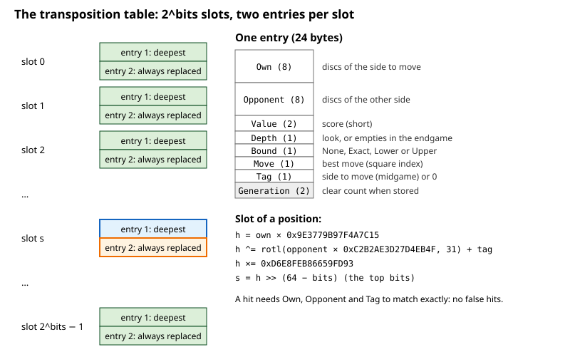
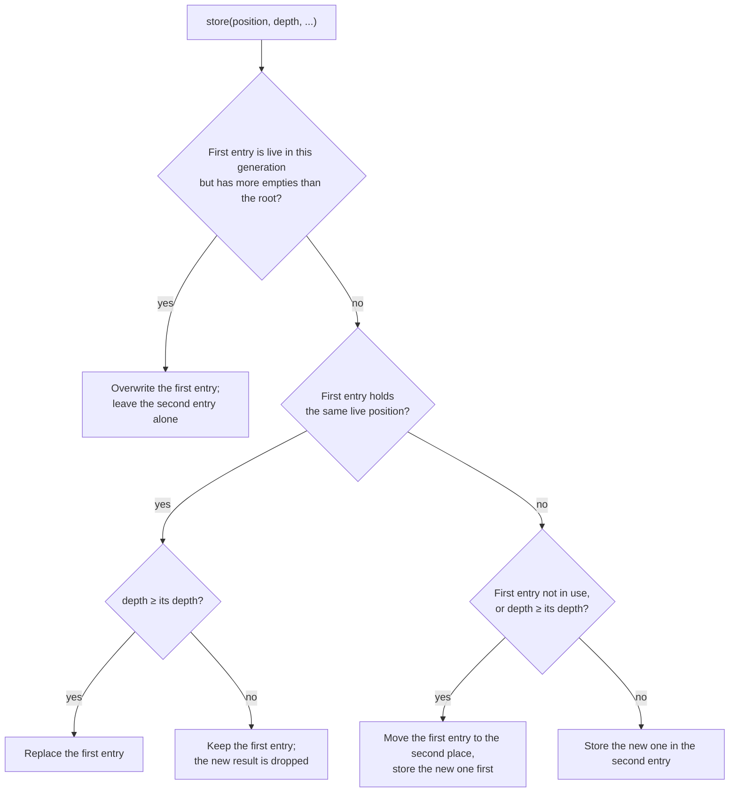
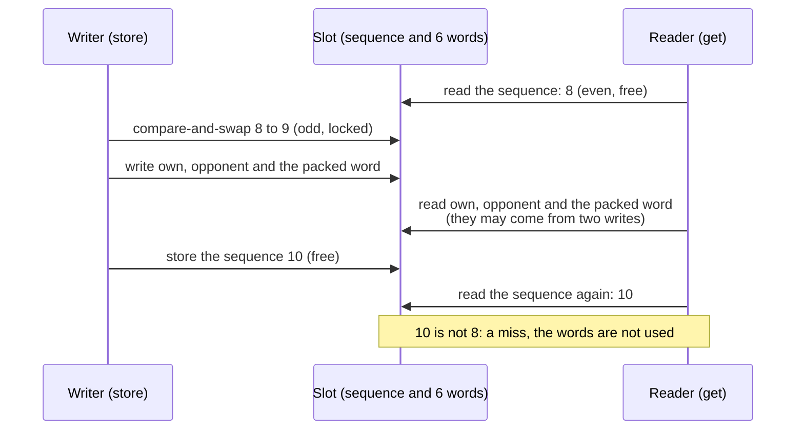
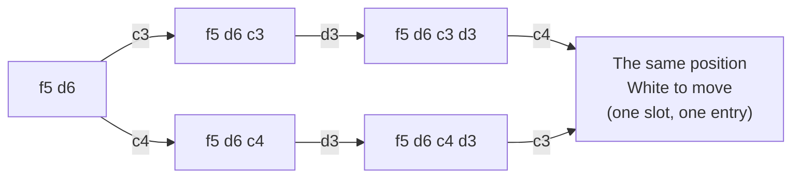

# 07 – Transposition table

[Back to the index](README.md)

## In short

In Othello the same position is often reached by different move orders: a **transposition**. The transposition table (also called the hash table) remembers what the search found out about each position it has searched: the score, whether that score is exact or only a bound, how deep the search was, and the best move. When the position comes up again, the stored result can end the search of that position at once, or at least give the best move to try first. Stello has two tables, one for the midgame search and one for the endgame solver, with two entries per slot so that deep results are not pushed out by shallow ones. All the threads of a search share both tables. Each slot is one 64-byte cache line with a sequence lock, so a thread never takes a half-written entry of another thread for a valid one.

## Data structures



An `Entry` is a `Copy` struct of 24 bytes:

| Field | Type | Contents |
|---|---|---|
| `own`, `opponent` | `u64` | The discs of the side to move and of the other side: the whole position |
| `value` | `i16` | The score |
| `depth` | `i8` | The midgame `look` of the search, or the number of empty squares in the endgame |
| `bound` | `Bound` | `Exact`, `Lower`, `Upper`, or `None` for an unused entry |
| `mv` | `i8` | The best move (square index), or −1 |
| `tag` | `u8` | Extra key: the side to move in the midgame table, 0 in the endgame table |
| `generation` | `u16` | The table's generation when the entry was stored (see [Clearing](#clearing-by-generation)); it fills the two bytes that would otherwise be padding |

| `Bound` | Meaning | C++ name |
|---|---|---|
| `Exact` | The value is the true score (it was inside the window) | `OK_HASH` |
| `Lower` | The true score is at least the value (it failed high: ≥ β) | `HI_HASH` |
| `Upper` | The true score is at most the value (it failed low: ≤ α) | `LO_HASH` |

### The slot

The entries are not stored as `Entry` structs. Each slot is a `Slot` of eight 64-bit words, aligned to 64 bytes so that it fills exactly one cache line ([table.rs](../Stello.Rust/stello-core/src/search/table.rs#L108)):

| Word | Contents |
|---|---|
| 0 | `sequence`: even while the slot is free, odd while a writer holds it |
| 1–3 | The first entry ("deepest"): `own`, `opponent`, and one packed word |
| 4–6 | The second entry ("always replaced"): `own`, `opponent`, and one packed word |
| 7 | Unused: the padding to 64 bytes |

All seven used words are `AtomicU64`. The packed word holds the rest of the entry, from the low bits up ([table.rs](../Stello.Rust/stello-core/src/search/table.rs#L51-L82)):

| Bits | Field |
|---|---|
| 0–15 | `value` |
| 16–23 | `depth` |
| 24–31 | `bound` |
| 32–39 | `mv` |
| 40–47 | `tag` |
| 48–63 | `generation` |

A packed word of zero is an empty entry (`Bound::None`, generation 0), so zeroed memory is an empty table. `get` unpacks the three words into an `Entry` again.

### Memory

`TranspositionTable::new(bits)` allocates $2^{\text{bits}}$ slots. `SearchEngine` takes the hash bits (10–26, default 19) and creates two tables of that size (one for the heuristic midgame and one for the exact endgame solver):

$$2 \times \big(2^{19} \text{ slots} \times 64 \text{ bytes}\big) = 64 \text{ MiB total}$$

Two entries need 48 bytes. The sequence word and the padding take the other quarter of the slot: a third more memory is the price of sharing the table between threads. Stello 2.0 had 48-byte slots and took 48 MiB at the default size; 3.0 takes 64 MiB for the same number of entries ([chapter 26](26-phases-5-9-threads.md#the-hash-table-seqlock-spin-lock-or-xor) has the measurements behind the choice).

### The sizes in the settings

In the Settings dialog ([chapter 15](15-gui-and-settings.md)), players choose the number of entries **per table** from 5 power-of-two sizes. The engine has two tables, so the memory is twice that of one table. The sizes in the option labels are in MiB ($2^{20}$ bytes); the Combined Memory column gives the same sizes in MB ($10^6$ bytes):

| Option label (web) | `hashBits` | Entries / table | Combined memory |
|---|---|---|---|
| **65,536 entries (4 MB)** | 15 | 65,536 | $4.19\text{ MB}$ |
| **262,144 entries (16 MB)** | 17 | 262,144 | $16.78\text{ MB}$ |
| **1,048,576 entries (64 MB) - Default** | 19 | 1,048,576 | $67.11\text{ MB}$ |
| **4,194,304 entries (256 MB)** | 21 | 4,194,304 | $268.44\text{ MB}$ |
| **16,777,216 entries (1,024 MB)** | 23 | 16,777,216 | $1{,}073.74\text{ MB}$ |

The desktop labels are the same without the word "entries" ([SettingsViewModel.cs](../Stello.Net/Stello.App/ViewModels/SettingsViewModel.cs#L88-L95)). The setting is converted via $\text{hashBits} = \log_2(\text{entries}) - 1$ and passed in `SearchLimits.HashBits`. If the active search engine's `HashBits` does not match the requested size, `LocalEngineHost` (desktop) and the WebAssembly engine's `search` in the Web Worker ([chapter 14](14-app-integration.md)) recreate the engine with the requested capacity before launching the search. The threaded WebAssembly engine's shared memory may grow to 2 GiB, so the largest size fits there too ([chapter 14](14-app-integration.md#threads-in-the-browser)).

## Algorithm

### Finding the slot

The slot comes from a hash of the whole position:

$$
\begin{aligned}
h &= \text{own} \cdot \texttt{0x9E3779B97F4A7C15} \\
h &= h \oplus \big(\operatorname{rotl}(\text{opponent} \cdot \texttt{0xC2B2AE3D27D4EB4F}, 31) + \text{tag}\big) \\
h &= h \cdot \texttt{0xD6E8FEB86659FD93} \\
\text{slot} &= h \gg (64 - \text{bits})
\end{aligned}
$$

(multiplications modulo $2^{64}$). The top bits of $h$ choose the slot; they depend on all the input bits.

### Looking up: `get`

The searches use `get_at_root(own, opponent, tag, root_empties)`: it checks the first entry, then the second if needed, and returns one matching entry, if any. An entry is a hit only if `own`, `opponent` and `tag` are all equal, its bound is not `None`, its generation is the table's, and its position has no more empty squares than the current root ([Aging](#aging-across-moves)). Because the whole position is stored, there are **no false hits**: an entry can never belong to a different position that happens to have the same hash. With several threads, the probe also checks that no other thread wrote the slot while it read it ([Sharing the table between threads](#sharing-the-table-between-threads)). The convenience `get(own, opponent, tag)` uses a root limit of 64, so it only applies the generation check.

### Storing: `store`

The searches use `store_at_root(own, opponent, tag, depth, bound, value, mv, root_empties)`, which holds the slot's lock while it decides and writes. A stale first entry is overwritten without disturbing the second entry. Otherwise it keeps the deepest result in the first entry and uses the second entry for everything else. The convenience `store(...)` uses a root limit of 64.



The first entry is "depth-preferred": it survives until a result at least as deep arrives, or its position becomes stale. The second entry is "always replaced": it keeps the most recent shallow result. This is the *two-tier* scheme described on the Chess Programming Wiki. C++ had one entry per slot, so a deep result could be overwritten by many shallow ones. A shallower result for the same position is still dropped even if its bound is tighter; retaining a second bound was tried and not kept.

### Aging across moves

At the start of each search, the engine records the root's empty-square count and passes it to every thread. For a stored position the empty count is `64 - (own | opponent).count_ones()`. If it exceeds the root's count, the position cannot occur below that root: a move fills one square and a pass leaves the count unchanged. Such an entry counts as empty on probe and replacement.

This matters when tables persist across moves, as in apps and matches. Without aging, deep entries from earlier positions could block the first place in a slot for the rest of the game. With aging, even a shallower current entry can reclaim that place; a useful second entry is kept rather than overwritten with the stale one. Empty or old-generation entries still follow the original replacement rules.

The benchmarks clear their tables between positions, so aging changes none of their strict node signatures. A persistent small-table regression exercises the competition that those benchmarks cannot. The [3.1 findings](../Plans/making-stello-3-1-findings.md#item-3-aging-transposition-table-entries-2026-11-06-3a-kept-3b-dropped) record the five matches and the decision to keep aging only.

### Use in the midgame search

In the node search (chapter 06):

- The table is read at plies ≤ `look` − 1 and written at plies ≤ `look` of the current iteration, with the side to move as the tag.
- A stored move is only used if it is a legal move in the position.
- If the stored depth is at least the node's `look`, the stored value ends the search when:
  - the bound is `Exact`, or
  - the bound is `Upper` and the value is at or below α (the position cannot improve our current result), or
  - the bound is `Lower` and the value is at least β (too good; the opponent avoids it).
- Otherwise the stored move is searched first (chapter 05).
- **Enhanced transposition cutoff.** From `look` = 4 (`MIDGAME_ETC_MIN_LOOK`), when the children's ply is still within the read height, the position after each move is looked up before the moves are ordered, with the opponent as the tag. If a child has an `Exact` or `Upper` entry with depth ≥ `look` − 1 whose negated value is at least β, that move already refutes the node, and the node returns at once without searching anything.
- **Multi-ProbCut's shallow searches** (chapter 06) read and write the same table at the same plies. Their entries have a small depth, so for the deep search that follows they mostly give the move to try first, and the depth-preferred entry keeps deeper results.
- **Prefetch.** At a node that will store its result but does not read the table (the deepest ply that is written, one below the last one that is read), the search asks the processor to load the slot into the cache (`prefetch`, x86-64 only) before it searches the children, so the store at the end does not wait for memory. It changes nothing else.
- After the node is searched, the result is stored with the node's `look` as depth and the bound from the window: `Lower` if the best score ≥ β, `Exact` if it is above α, else `Upper`.

### Use in the endgame solver

The solver ([chapter 08](08-endgame-solver.md)) uses the endgame table with tag 0 and the number of empty squares as the depth; an exact endgame result never needs a deeper search, so the stored depth is not checked when reading. Two kinds of node use it:

- **Nodes with a window** (`end_window`, 7 or more empty squares, the principal variation of the solver):
  - an `Exact` entry is returned at once;
  - a `Lower` entry raises α and an `Upper` entry lowers β; if then α ≥ β, the stored value is returned;
  - otherwise the stored move is searched first;
  - the result is stored as `Lower` if it reached β, `Exact` if it is above the original α, else `Upper`.
- **Null-window nodes above 13 empty squares** (`end_deep`, a fail-soft null window around α, so there is no window to narrow):
  - an entry that is not `Upper` with a value above α, or not `Lower` with a value at or below α, already answers the question "better than α?", so its value is returned;
  - otherwise the stored move is searched first, before the other moves are ordered;
  - the result is stored as `Lower` if it is above α, else `Upper`.

Both are described in [Above 13 empty squares: `EndWindow` and `EndDeep`](08-endgame-solver.md#above-13-empty-squares). Null-window nodes with 13 or fewer empty squares use the solver's small local table instead ([7 to 13 empty squares](08-endgame-solver.md#7-to-13-empty-squares)), and nodes with 6 or fewer empty squares no table at all. From 12 empty squares (`END_ETC_MIN_EMPTIES`), both kinds of node first look up the positions after each move (*enhanced transposition cutoff*, chapter 08).

### Two tables

Midgame values (heuristic scores in 1/100 disc, depending on the search depth, or ±(32 600 + discs) for a finished game) and endgame values (final disc differences, −64 to 64) mean different things, so they are kept in separate tables. The tables are never cleared during a game: `SearchEngine::clear_hash` (C# `ClearHash`, which also clears the solver's local table) exists, but the apps do not call it, so results from the previous move are still there when the next search starts. The tools call it between independent searches: the benchmarks, the trainer's `mpc` command, the book recalculation and the book match.

### Clearing by generation

`clear` does not write the table. Each table has a 16-bit generation counter, which `clear` increases, and every entry records the generation it was stored in. An entry of an older generation counts as empty: `get` does not find it, and `store` treats it as an unused first entry. So clearing costs nothing, however large the table; only when the counter wraps, after 65,535 clears, is the whole table set to zero once (an all-zero entry is an empty one), and the count starts again at 1. A new table starts at generation 1, so its zeroed entries (generation 0) are empty too. The tools that clear the tables before each of many short searches gain the most ([chapter 25](25-phases-0-4-the-engine-in-rust.md)).

### Sharing the table between threads

A search with more than one thread ([chapter 06](06-midgame-search.md#threads)) runs on several threads that all read and write the same two tables. They do so through `&self`: there is no lock on the whole table. Instead each slot has its own **sequence lock** (seqlock), the `sequence` word at the start of its cache line.

**A store** ([`store_at_root`](../Stello.Rust/stello-core/src/search/table.rs#L226), [`Slot::lock`](../Stello.Rust/stello-core/src/search/table.rs#L140)):

1. The writer reads the sequence. If it is even, the writer makes it odd with a compare-and-swap: it now holds the slot. If another writer holds it, it waits in a short spin loop; a write is only a few stores.
2. It applies the replacement rules above and writes the words of the entries it changes.
3. It stores the sequence + 2: even again, and larger than before.

**A probe** ([`get_at_root`](../Stello.Rust/stello-core/src/search/table.rs#L198)):

1. The reader reads the sequence. If it is odd, a writer holds the slot, and the probe returns a miss at once. A reader never waits.
2. It reads the words of the two entries and looks for its position. If neither entry matches, it is a miss; a miss read during a write is a miss either way.
3. If an entry matches, it reads the sequence again. The hit counts only if the sequence did not change. Otherwise it is a miss.



**Why a torn read is never taken for a valid entry.** The three words of an entry are written one after the other. Without the check, a reader could combine the discs of one position with the discs or the value of another, and take the mix for the position it looks for. With the check, every write that overlaps the reader's reads changes the sequence between its two reads: the writer makes it odd before its first store and adds 2 after its last. The memory orderings make sure of that: the compare-and-swap is an acquire and is followed by a release fence, the unlock is a release, and the reader's second read of the sequence follows an acquire fence. So if the reader saw any word of a write, it also sees the changed sequence. A missed hit costs only a little search; a false hit could give a wrong score.

**With one thread** the lock is never contended. Apart from aging, lookup and replacement follow the C# 2.0 table's rules; later search changes can alter which entries are used and the nodes visited.

**`clear`** needs `&mut self`: the table to itself. It runs between searches only, when no other thread uses the table.

**What was measured before choosing** (phase 5, on one thread, one pinned CPU, fastest of 3 passes; mid-bench depth 10 / mid-bench depth 12 / random positions at depth 8 / FFO #40–49, from [the findings](../Plans/making-stello-3-findings.md#the-hash-table-a-seqlock-per-slot)):

| Variant | Time | Cost |
|---|---|---|
| Unchanged (single-threaded, 48-byte slot) | 0.346 / 1.001 / 0.856 / 25.0 s | — |
| **Seqlock, 64-byte slot (chosen)** | 0.345 / 1.007 / 0.855 / 24.9 s | 0–0.6 % |
| Spin lock per slot on probe and store (as in Egaroucid) | 0.351 / 1.021 / 0.865 / 25.0 s | 1.5–2 % |
| Hyatt's XOR check, 48-byte slot | 0.341 / 1.008 / 0.848 / 25.1 s | About 0 %, but only probabilistic |

- **The spin lock** makes every probe take and release the lock, which costs time even when no other thread is there.
- **The XOR check** ("lockless hashing") stores the key XOR the data, so a torn entry usually fails the key check. It keeps the 48-byte slot. But it is only probabilistic: two positions that differ in one disc's colour can let a torn read pass.
- **The seqlock** costs nothing measurable and is strict. Its price is memory: a third more ([Memory](#memory)).

## Worked examples

### A transposition

The tiger opening `f5 d6 c3 d3 c4` and the order `f5 d6 c4 d3 c3` reach the same position, White to move:



The slot comes from the two bitboards, not from the moves, so both paths lead to the same slot and entry:

```text
--------
--------
--XO----
--XXX---
---OXX--
---O----
--------
--------
```

When the search has stored this position once, the second path finds it in the table.

### Replacement in one slot

Four positions A, B, C and D with the same slot, all live under the current root, stored in this order in a table with `bits` = 1 (two slots), with the found entries after each step:

| Step | Store | Found afterwards |
|---|---|---|
| 1 | A, depth 5 | A (5) |
| 2 | B, depth 2 | A (5), B (2) |
| 3 | C, depth 1 | A (5), C (1) – C replaced B in the second entry |
| 4 | D, depth 6 | A (5), D (6) – D is deeper, so it takes the first entry and A moves to the second |
| 5 | B, depth 3 | D (6), B (3) – B replaced A in the second entry |

The deep result A survived two shallow stores (steps 2 and 3); only a deeper result (D) pushed it to the second place, from where the next store removed it.

## Design notes

- **Full positions instead of Zobrist keys.** C++ used 32-bit Zobrist-style keys from random numbers, and checked only 32 bits, so false hits were possible. Storing both bitboards costs 16 bytes per entry but makes every hit certain, and there is no random key table to maintain. See [Stello porting documentation.md](../Plans/Stello%20porting%20documentation.md), section 3.5.
- **Two tables** instead of one shared table: C++ mixed midgame and endgame values in the same table.
- **Two entries per slot.** With one entry per slot, as in C++, deep endgame results were overwritten by many shallow ones; the second entry keeps them. The measurements from the port, which also set the default of $2^{19}$ slots, are in the [Stello 1 documentation](stello-1/07-transposition-table.md).
- **One bound and one move per entry.** An entry with both bounds and two moves was tried for the midgame and was not better ([chapter 23](23-phase-5-the-search.md)).
- **Bounds narrow the endgame window.** In the endgame, a stored bound that does not end the search still narrows (α, β), which C++ did not do.
- **One shared table, not one per thread.** The threads help each other through the table: Lazy SMP helpers only fill it ([chapter 06](06-midgame-search.md#lazy-smp)). So all threads must share it, and a slot lock is cheaper than any lock on the whole table.
- **A reader never waits.** A probe of a slot that is being written is a miss, not a wait. Writers wait only for other writers of the same slot, which is rare with $2^{19}$ slots.

## Where in the code

| File | Main members |
|---|---|
| [search/table.rs](../Stello.Rust/stello-core/src/search/table.rs) | `Bound`, `Entry` (`pack`, `unpack`, `is_live`, `matches`, `empty_count`), `Slot` (`load`, `put`, `lock`, `unlock`), `TranspositionTable` (`new`, `get_at_root`, `store_at_root`, `get`, `store`, `prefetch`, `clear`, `slot`), `zeroed_slots` |
| [search/engine.rs](../Stello.Rust/stello-core/src/search/engine.rs) | `midgame_table` and `endgame_table`, the midgame use in `Searcher::search` (with `MIDGAME_ETC_MIN_LOOK` and the prefetch), `SearchEngine::clear_hash` |
| [endgame/search.rs](../Stello.Rust/stello-core/src/endgame/search.rs) | The endgame use in `end_window` and `end_deep`, `END_ETC_MIN_EMPTIES` |
| [SearchEngine.cs](../Stello.Net/Stello.Engine/SearchEngine.cs) | The C# `ClearHash` and `HashBits`, passed on to the Rust engine (chapter 14); `HashBytesPerSlot` (2 × 64), the memory it reports to the garbage collector |
| C++: [Minmax.cpp](../Stello%20C++/BRAIN/Minmax.cpp), [HASH.H](../Stello%20C++/BRAIN/HASH.H) | `f_hash_put`, the C++ hash table |
| C# 2.0 (frozen): [Stello.Engine.V2/Search/TranspositionTable.cs](../Stello.Net/Stello.Engine.V2/Search/TranspositionTable.cs) | The C# original, without aging, the generation (its `Clear` writes every entry), or the lock, in 48-byte slots |

## Tests

- Rust, the unit tests in [search/table.rs](../Stello.Rust/stello-core/src/search/table.rs): store and find; another tag is not found; a shallower result for the same position does not replace the deeper one; after a clear an old entry is not found and counts as empty when storing; over 70,000 clears the generation wraps and the table still works; packing and unpacking keep every field, and an empty entry packs to zero. A compile-time check makes sure that a slot is 64 bytes.
- Aging: a stale first entry is ignored on probe and replaced by a shallower current entry without evicting a live second entry. The persistent-engine test in [search/engine.rs](../Stello.Rust/stello-core/src/search/engine.rs) keeps a 4,096-slot table across 34 game positions at depth 12, pinning the node count; disabling replacement aging makes it fail.
- **The hammer test** ([`many_threads_never_read_a_torn_entry`](../Stello.Rust/stello-core/src/search/table.rs#L413)): 8 threads store and probe 2,048 positions in a table of 1,024 slots, a million times each. Every field of a hit is made from its position, so a torn entry would show. With the sequence check disabled it failed 2 runs in 3; with it, it passes. It and the pool tests also pass under Miri, and ThreadSanitizer finds no reports ([chapter 26](26-phases-5-9-threads.md)).
- [TranspositionTableTests.cs](../Stello.Net/Stello.Engine.Tests/TranspositionTableTests.cs), on the frozen C# 2.0 table: store and find; another position or tag is not found; the deeper result for the same position is kept; a deep entry survives many shallow entries in the same slot; clear removes everything.
- The search and endgame tests (chapters 06 and 08) check strict current-engine signatures, including node counts, against `stello-v3-signatures.txt`. Aging leaves the cleared-table signatures unchanged.

## Further reading

- [Transposition Table – Chess Programming Wiki](https://www.chessprogramming.org/Transposition_Table): what is stored, the three bound types, collisions, and replacement schemes including the two-tier system.
- [Negamax – Wikipedia](https://en.wikipedia.org/wiki/Negamax): pseudocode for negamax with a transposition table.
- [Writing an Othello program – Gunnar Andersson](http://radagast.se/othello/howto.html): "Transposition tables", with the same tiger-opening example.
- [Seqlock – Wikipedia](https://en.wikipedia.org/wiki/Seqlock): the sequence lock, with readers that retry instead of waiting.
- [Shared Hash Table – Chess Programming Wiki](https://www.chessprogramming.org/Shared_Hash_Table): how parallel searches share one table, with locks or with Hyatt's lockless XOR trick.
- [References](30-references.md#26-phases-59-threads): more on threads.

---

Previous: [06 Midgame search](06-midgame-search.md) · Next: [08 Endgame solver](08-endgame-solver.md)
