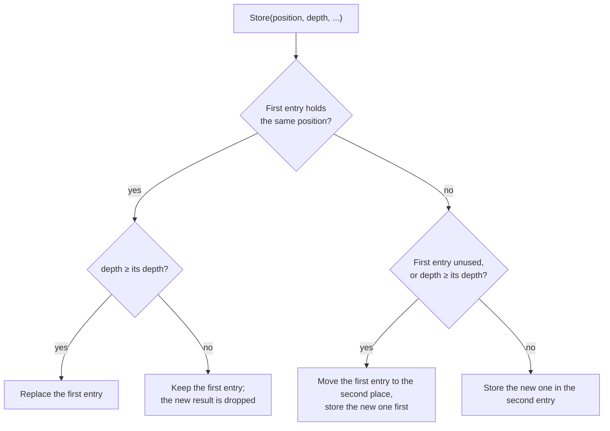
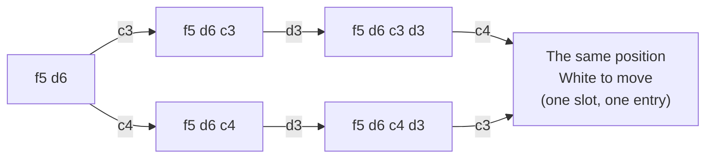

# 07 – Transposition table

[Back to the index](README.md)

## In short

In Othello the same position is often reached by different move orders: a **transposition**. The transposition table (also called the hash table) remembers what the search found out about each position it has searched: the score, whether that score is exact or only a bound, how deep the search was, and the best move. When the position comes up again, the stored result can end the search of that position at once, or at least give the best move to try first. Stello has two tables, one for the midgame search and one for the endgame solver, with two entries per slot so that deep results are not pushed out by shallow ones.

## Data structures


An `Entry` is a `readonly record struct` of 24 bytes:

| Field | Type | Contents |
|---|---|---|
| `Own`, `Opponent` | `ulong` | The discs of the side to move and of the other side: the whole position |
| `Value` | `short` | The score |
| `Depth` | `sbyte` | The midgame `look` of the search, or the number of empty squares in the endgame |
| `Bound` | `Bound` | `Exact`, `Lower`, `Upper`, or `None` for an unused entry |
| `Move` | `sbyte` | The best move (square index), or −1 |
| `Tag` | `byte` | Extra key: the side to move in the midgame table, 0 in the endgame table |

| `Bound` | Meaning | C++ name |
|---|---|---|
| `Exact` | The value is the true score (it was inside the window) | `OK_HASH` |
| `Lower` | The true score is at least the value (it failed high: ≥ β) | `HI_HASH` |
| `Upper` | The true score is at most the value (it failed low: ≤ α) | `LO_HASH` |

`new TranspositionTable(bits)` allocates $2^{\text{bits}}$ slots of two entries. `SearchEngine` takes `hashBits` (10–26, default 19) and creates two tables of that size (one for the heuristic midgame and one for the exact endgame solver):

$$2 \times \big(2^{19} \text{ slots} \times 2 \text{ entries} \times 24 \text{ bytes}\big) = 48 \text{ MiB total}$$

### Configurable Capacity Options

In the Settings dialog (chapter 15), players choose the number of entries **per table** from 5 power-of-two tiers. The engine has two tables, so the memory is twice that of one table. The sizes in the option labels are in MiB ($2^{20}$ bytes); the Combined Memory column gives the same sizes in MB ($10^6$ bytes):

| Option Label | `hashBits` | Entries / Table | Combined Memory | Target Environment |
|---|---|---|---|---|
| **65,536 entries (3 MB)** | 15 | 65,536 | $3.15\text{ MB}$ | Ultra-compact memory for resource-constrained devices |
| **262,144 entries (12 MB)** | 17 | 262,144 | $12.58\text{ MB}$ | Lightweight cache for mobile browsers |
| **1,048,576 entries (48 MB) - Default** | 19 | 1,048,576 | $50.33\text{ MB}$ | Balanced tournament search performance |
| **4,194,304 entries (192 MB)** | 21 | 4,194,304 | $201.33\text{ MB}$ | Deep searches and complex endgame solving |
| **16,777,216 entries (768 MB)** | 23 | 16,777,216 | $805.31\text{ MB}$ | Maximum 64-bit desktop cache |

The setting is converted via $\text{hashBits} = \log_2(\text{entries}) - 1$ and passed in `SearchLimits.HashBits`. If the active search engine's `HashBits` does not match the requested size, `LocalEngineHost` (desktop) and `EngineWorker` (Web Worker) automatically recreate the engine with the requested capacity before launching the search.

## Algorithm

### Finding the slot

The slot comes from a hash of the whole position:

$$
\begin{aligned}
h &= \text{own} \cdot \texttt{0x9E3779B97F4A7C15} \\
h &= h \oplus \big(\operatorname{rotl}(\text{opponent} \cdot \texttt{0xC2B2AE3D27D4EB4F}, 31) + \text{tag}\big) \\
h &= h \cdot \texttt{0xD6E8FEB86659FD93} \\
\text{slot} &= h \gg (64 - \text{bits})
\end{aligned}
$$

(multiplications modulo $2^{64}$). The top bits of $h$ choose the slot; they depend on all the input bits.

### Looking up: `TryGet`

`TryGet(own, opponent, tag, out entry)` checks the two entries of the slot. An entry is a hit only if `Own`, `Opponent` and `Tag` are all equal and the entry is in use. Because the whole position is stored, there are **no false hits**: an entry can never belong to a different position that happens to have the same hash.

### Storing: `Store`

`Store(own, opponent, tag, depth, bound, value, move)` keeps the deepest result in the first entry and uses the second entry for everything else:



The first entry is "depth-preferred": it survives until a result at least as deep arrives. The second entry is "always replaced": it keeps the most recent shallow result. This is the *two-tier* scheme described on the Chess Programming Wiki. C++ had one entry per slot, so a deep result could be overwritten by many shallow ones.

### Use in the midgame search

In the node search (chapter 06):

- The table is read at plies ≤ `look` − 1 and written at plies ≤ `look` of the current iteration, with the side to move as the tag.
- A stored move is only used if it is a legal move in the position.
- If the stored depth is at least the node's `look`, the stored value ends the search when:
  - the bound is `Exact`, or
  - the bound is `Upper` and the value is below α (the position is too bad for us), or
  - the bound is `Lower` and the value is at least β (too good; the opponent avoids it).
- Otherwise the stored move is searched first (chapter 05).
- **Enhanced transposition cutoff.** From `look` = 4 (`MidgameEtcMinLook`), when the children's ply is still within the read height, the position after each move is looked up before the moves are ordered, with the opponent as the tag. If a child has an `Exact` or `Upper` entry with depth ≥ `look` − 1 whose negated value is at least β, that move already refutes the node, and the node returns at once without searching anything.
- **Multi-ProbCut's shallow searches** (chapter 06) read and write the same table at the same plies. Their entries have a small depth, so for the deep search that follows they mostly give the move to try first, and the depth-preferred entry keeps deeper results.
- After the node is searched, the result is stored with the node's `look` as depth and the bound from the window: `Lower` if the best score ≥ β, `Exact` if it is above α, else `Upper`.

### Use in the endgame solver

The solver ([chapter 08](08-endgame-solver.md)) uses the endgame table with tag 0 and the number of empty squares as the depth; an exact endgame result never needs a deeper search, so the stored depth is not checked when reading. Two kinds of node use it:

- **Nodes with a window** (`EndWindow`, 7 or more empty squares, the principal variation of the solver):
  - an `Exact` entry is returned at once;
  - a `Lower` entry raises α and an `Upper` entry lowers β; if then α ≥ β, the stored value is returned;
  - otherwise the stored move is searched first;
  - the result is stored as `Lower` if it reached β, `Exact` if it is above the original α, else `Upper`.
- **Null-window nodes above 13 empty squares** (`EndDeep`, a fail-soft null window around α, so there is no window to narrow):
  - an entry that is not `Upper` with a value above α, or not `Lower` with a value at or below α, already answers the question "better than α?", so its value is returned;
  - otherwise the stored move is searched first, before the other moves are ordered;
  - the result is stored as `Lower` if it is above α, else `Upper`.

Both are described in [Above 13 empty squares: `EndWindow` and `EndDeep`](08-endgame-solver.md#above-13-empty-squares-endwindow-and-enddeep). Null-window nodes with 13 or fewer empty squares use the solver's small local table instead ([7 to 13 empty squares](08-endgame-solver.md#7-to-13-empty-squares-endlocal-and-endsimple)), and nodes with 6 or fewer empty squares no table at all. From 12 empty squares (`EndEtcMinEmpties`), both kinds of node first look up the positions after each move (*enhanced transposition cutoff*, chapter 08).

### Two tables

Midgame values (heuristic scores in 1/100 disc, depending on the search depth, or ±(32 600 + discs) for a finished game) and endgame values (final disc differences, −64 to 64) mean different things, so they are kept in separate tables. The tables are never cleared during a game: `SearchEngine.ClearHash` (which also clears the solver's local table) exists, but the apps do not call it, so results from the previous move are still there when the next search starts. The tools call it between independent searches: the benchmarks, the trainer's `mpc` command, the book recalculation and the book match.

## Worked examples

### A transposition

The tiger opening `f5 d6 c3 d3 c4` and the order `f5 d6 c4 d3 c3` reach the same position, White to move:



The slot comes from the two bitboards, not from the moves, so both paths lead to the same slot and entry:

```text
--------
--------
--XO----
--XXX---
---OXX--
---O----
--------
--------
```

When the search has stored this position once, the second path finds it in the table.

### Replacement in one slot

Four positions A, B, C and D with the same slot, stored in this order in a table with `bits` = 1 (two slots), with the found entries after each step:

| Step | Store | Found afterwards |
|---|---|---|
| 1 | A, depth 5 | A (5) |
| 2 | B, depth 2 | A (5), B (2) |
| 3 | C, depth 1 | A (5), C (1) – C replaced B in the second entry |
| 4 | D, depth 6 | A (5), D (6) – D is deeper, so it takes the first entry and A moves to the second |
| 5 | B, depth 3 | D (6), B (3) – B replaced A in the second entry |

The deep result A survived two shallow stores (steps 2 and 3); only a deeper result (D) pushed it to the second place, from where the next store removed it.

## Design notes

- **Full positions instead of Zobrist keys.** C++ used 32-bit Zobrist-style keys from random numbers, and checked only 32 bits, so false hits were possible. Storing both bitboards costs 16 bytes per entry but makes every hit certain, and there is no random key table to maintain. See [Stello porting documentation.md](../Plans/Stello%20porting%20documentation.md), section 3.5.
- **Two tables** instead of one shared table: C++ mixed midgame and endgame values in the same table.
- **Two entries per slot.** With one entry per slot, as in C++, deep endgame results were overwritten by many shallow ones; the second entry keeps them. The measurements from the port, which also set the default of $2^{19}$ slots, are in the [Stello 1 documentation](stello-1/07-transposition-table.md).
- **One bound and one move per entry.** An entry with both bounds and two moves was tried for the midgame and was not better ([chapter 23](23-phase-5-the-search.md)).
- **Bounds narrow the endgame window.** In the endgame, a stored bound that does not end the search still narrows (α, β), which C++ did not do.

## Where in the code

| File | Main members |
|---|---|
| [TranspositionTable.cs](../Stello.Net/Stello.Engine/Search/TranspositionTable.cs) | `Bound`, `TranspositionTable`, `Entry`, `TryGet`, `Store`, `Clear`, `Slot` |
| [SearchEngine.cs](../Stello.Net/Stello.Engine/SearchEngine.cs) | `_midgameTable` and `_endgameTable`, the midgame use in `Search` (with `MidgameEtcMinLook`), `ClearHash` |
| [Endgame/SearchEngine.Endgame.cs](../Stello.Net/Stello.Engine/Endgame/SearchEngine.Endgame.cs) | The endgame use in `EndWindow` and `EndDeep`, `EndEtcMinEmpties` |
| C++: [Minmax.cpp](../Stello%20C++/BRAIN/Minmax.cpp), [HASH.H](../Stello%20C++/BRAIN/HASH.H) | `f_hash_put`, the C++ hash table |

## Tests

[TranspositionTableTests.cs](../Stello.Net/Stello.Engine.Tests/TranspositionTableTests.cs): store and find; another position or tag is not found; the deeper result for the same position is kept; a deep entry survives many shallow entries in the same slot; clear removes everything. The endgame tests (chapter 08) check that the table gives correct scores in real searches.

## Further reading

- [Transposition Table – Chess Programming Wiki](https://www.chessprogramming.org/Transposition_Table): what is stored, the three bound types, collisions, and replacement schemes including the two-tier system.
- [Negamax – Wikipedia](https://en.wikipedia.org/wiki/Negamax): pseudocode for negamax with a transposition table.
- [Writing an Othello program – Gunnar Andersson](http://radagast.se/othello/howto.html): "Transposition tables", with the same tiger-opening example.

---

Previous: [06 Midgame search](06-midgame-search.md) · Next: [08 Endgame solver](08-endgame-solver.md)
