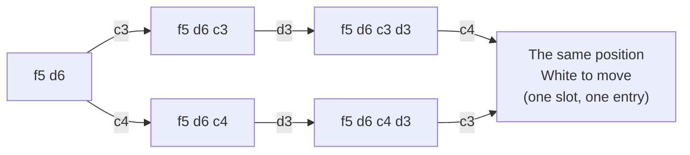

# 07 – Transposition table

[Back to the index](README.md)

## In short

In Othello the same position is often reached by different move orders: a **transposition**. The transposition table (also called the hash table) remembers what the search found out about each position it has searched: dual `[lower, upper]` bounds, whether a bound cuts or is exact, how deep and selective the search was, and the best move. When the position comes up again, the stored result can end the search of that position at once, or at least give the best move to try first. Since Phase 4 Item 2, Stello uses **one unified 4-way transposition table** shared across midgame search (`tag` 0/1 for Black/White) and endgame solving (`ENDGAME_TT_TAG = 2`). All threads share it lock-free inside 64-byte cache-line buckets using Hyatt's XOR verification (`key_xor ^ data`). *(In Stello 3.0–5.0, Stello kept separate `midgame_table` and `endgame_table` allocations of 64-byte seqlock slots with 2 entries each, costing twice as much RAM.)*

## Data structures

A `PackedEntry` in `Slot::entries` (`std::array<PackedEntry, 4>`) is **16 bytes** (`two uint64_t`s), so **4 entries fit in one 64-byte cache-line-aligned `Slot`**:

| Word | Contents |
|---|---|
| `key_xor` | `verify ^ data` (for lockless torn-read detection) |
| `data` | Packed `[lower, upper]`, move, domain tag, cost, selectivity, depth, date, and generation |

Where `verify` packs the 7-bit empty count (`64 - popcount(own | opponent)`) in bits 57–63 and a 57-bit secondary hash in bits 0–56; and `data` packs from the low bits up (`Entry::pack` / `Entry::unpack` in [search/table.hpp](../Stello.Cpp/src/search/table.hpp)):

| Bits | Field | Notes |
|---|---|---|
| 0–15 | `lower` | Signed 16-bit lower bound (`TT_SCORE_MIN = -32768` = none) |
| 16–31 | `upper` | Signed 16-bit upper bound (`TT_SCORE_MAX = 32767` = none) |
| 32–38 | `mv + 1` | 7 bits (`0` = `-1`, `1..64` = square `0..63`) |
| 39–40 | `tag` | `0` = Black midgame, `1` = White midgame, `2` = Endgame (`ENDGAME_TT_TAG`) |
| 41–45 | `cost` | `bit_width(delta_nodes)` clamped to `0..31` |
| 46–48 | `selectivity` | `1` = midgame MPC, `1..6` = endgame MPC stage, `7` = `SEL_EXACT` |
| 49–54 | `depth` | Midgame `look`, or endgame `empties` (`0..63`) |
| 55–56 | `date` | Search counter `0..3` |
| 57–63 | `generation` | 7-bit table generation (`1..127`; `0` = empty/cleared) |

An all-zero `data` word has generation 0 (empty), so zeroed memory is an empty table. Notice that keeping a separate `16`-bit `[lower, upper]` pair handles fail-highs (`lower > TT_SCORE_MIN`), fail-lows (`upper < TT_SCORE_MAX`), and exact matches (`lower == upper`) without discarding the opposite bound at the same `(depth, selectivity)` level.

### Memory

`TranspositionTable(bits)` allocates $2^{\text{bits}}$ 64-byte `Slot`s ($4 \times 2^{\text{bits}}$ shared `16`-byte entries). At the default `hashBits = 19` (`524,288` buckets):

$$2^{19}\text{ buckets} \times 64\text{ bytes} = 32\text{ MiB}\quad (2{,}097{,}152\text{ shared entries})$$

Historically, Stello 2.0 took 48 MiB at the default size (two tables of 48-byte slots), and Stello 3.0–5.0 took **64 MiB** for half as many entries per table (`1,048,576` per table in two seqlock allocations; [chapter 26](26-phases-5-9-threads.md#the-hash-table-seqlock-spin-lock-or-xor)). Keeping the active default table at `32 MiB` avoids DTLB / cache cliffs on Windows while doubling capacity in half the RAM.

### The sizes in the settings

In the Settings dialog ([chapter 15](15-gui-and-settings.md)), players pick from 5 power-of-two table capacities. To preserve saved user preferences across upgrades, the stored numeric `TranspositionTableEntries` key (`65_536`–`16_777_216`) and $\text{hashBits} = \log_2(\text{key}) - 1$ remain unchanged, while the UI labels reflect the unified 4-way shared table sizes (`bytes = 64 × 2^hashBits`, `shared entries = 4 × 2^hashBits`):

| Option label (shared by WPF & Web) | Saved Key | `hashBits` | Shared entries | Memory (MiB / MB) |
|---|---:|---:|---:|---:|
| **131,072 shared entries (2 MiB)** | `65,536` | 15 | 131,072 | $2\text{ MiB}$ ($2.10\text{ MB}$) |
| **524,288 shared entries (8 MiB)** | `262,144` | 17 | 524,288 | $8\text{ MiB}$ ($8.39\text{ MB}$) |
| **2,097,152 shared entries (32 MiB) - Default** | `1,048,576` | 19 | 2,097,152 | $32\text{ MiB}$ ($33.55\text{ MB}$) |
| **8,388,608 shared entries (128 MiB)** | `4,194,304` | 21 | 8,388,608 | $128\text{ MiB}$ ($134.22\text{ MB}$) |
| **33,554,432 shared entries (512 MiB)** | `16,777,216` | 23 | 33,554,432 | $512\text{ MiB}$ ($536.87\text{ MB}$) |

Both apps share `SettingsViewModel.TranspositionTableChoices` ([SettingsViewModel.cs](../Stello.Net/Stello.App/ViewModels/SettingsViewModel.cs#L10-L18)). If the active engine's `HashBits` differs from the requested setting, `LocalEngineHost` (desktop) and the Web Worker ([chapter 14](14-app-integration.md)) recreate the engine with the requested size before searching.

## Algorithm

### Finding the bucket

The 64-byte bucket index comes from a hash of `own`, `opponent`, and `tag`, while `verify` uses a second independent hash permutation plus `empties` (`64 - popcount(own | opponent)`):

```cpp
h1 = (own * C1 ^ rotl(opponent * C2, 31) ^ (tag * C3)) * C4;
slot = h1 >> (64 - bits);
```

### Looking up: `get_at_root`

`get_at_root(own, opponent, tag, root_empties)` scans the 4 entries in `slots_[key.index]`. For each way, it loads `data` and `key_xor` with relaxed `std::atomic_ref<uint64_t>` reads, checks `verify = key_xor ^ data`, `tag`, live `generation`, and `empties <= root_empties` ([Aging](#aging-across-moves)), and returns the first match. The convenience `get(own, opponent, tag)` uses `root_empties = 64`.

### Storing & replacement: `store_bounds_at_root`

If an entry matches `(verify, tag)` and is live:
1. Updates with `new_level < old_level` (where `level = (depth << 3) | selectivity`) are refused.
2. When `new_level == old_level`, `lower` and `upper` are merged monotonically (resetting on contradiction), and `mv` is chosen according to which search established the retained lower bound (a weaker fail-high does not steal the move of a stronger lower bound; a stronger fail-high or fresh exact result adopts the new valid move; upper-only updates only supply a move when no lower bound exists yet).
3. When `new_level > old_level`, stale bounds reset to the new search's bounds while keeping `existing_mv` if the deeper search returned `-1`.

If no entry matches, the 4 ways are scored for replacement: any non-live / stale entry (`empties > root_empties` or old generation) is evicted immediately; otherwise the way with the smallest `writeable_level_packed = 1 + (current_date ? 0x4000 : 0) + ((cost | sel | depth) -> sorted composite)` is overwritten. Notice that for a new key in a full bucket, depth and selectivity help pick the least valuable resident—they do not block a shallow incoming key from entering the bucket.

### Aging across moves

At the start of each search, `SearchEngine` advances `date_` (0–3) and records the root's `empties`. Entries whose `empties > root_empties` belong to ancestors/other branches with fewer discs and are treated as empty on probe and replacement ([3.1 findings](../Plans/making-stello-3-1-findings.md#item-3-aging-transposition-table-entries-2026-11-06-3a-kept-3b-dropped)).

### Use in midgame search and endgame solver

- **Midgame search** (`engine_impl.hpp`) tags Black = `0`, White = `1` with `depth = look` and `selectivity = (probcut_errors ? SEL_MIDGAME_MPC : SEL_EXACT)`. Qualifying hits cut when `lower >= beta`, `upper <= alpha`, or `lower == upper`, and otherwise supply `hash_move` to `1A`'s hash-move-first ordering. `try_probcut_inc` and ETC (`search_inc_deep`) share the same unified table.
- **Endgame solver** (`endgame/search_impl.hpp`) tags positions with `ENDGAME_TT_TAG = 2`, real `depth = empties`, and `selectivity = (end_mpc_stage > 0 ? end_mpc_stage : SEL_EXACT)`, so exact probes (`req_sel = SEL_EXACT`) never accept selective MPC entries while lower-selectivity passes and move ordering can reuse them cleanly.

### Clearing by generation

`clear` resets `date_ = 0` and increments the 7-bit `generation_` counter (`1..127`); only on wraparound back to `0` is the table zeroed (using AVX2 non-temporal stores on x86-64) and `generation_` reset to `1`.

### Sharing the table between threads

Concurrent threads read and write the unified table without per-slot locks using Hyatt's XOR technique (`key_xor = verify ^ data`). A torn read mismatches `verify`, preventing corrupted entries with `0` lock contention on reads or writes.

*(Historical Stello 3.0 note, [making-stello-3-findings.md](../Plans/making-stello-3-findings.md#the-hash-table-a-seqlock-per-slot): in Stello 3.0's 2-table 24-byte-entry seqlock era, a single-thread comparison measured 48-byte Hyatt XOR vs 64-byte seqlock vs spin lock (`mid-bench d10/d12/random d8/FFO #40–49`): `0.341/1.008/0.848/25.1 s` for 48 B XOR vs `0.345/1.007/0.855/24.9 s` for 64 B seqlock vs `0.351/1.021/0.865/25.0 s` for spin lock. In Stello 6.0 Phase 4 Item 2, switching to 16-byte unified entries with 57-bit verify + 7-bit empties + 2-bit tag and 64-byte 4-way buckets halved memory and eliminated striped/seqlock multi-thread contention while keeping lockless reads/writes fast.)*

## Worked examples

### A transposition

The tiger opening `f5 d6 c3 d3 c4` and the order `f5 d6 c4 d3 c3` reach the same position, White to move:



The slot comes from the two bitboards, not from the moves, so both paths lead to the same slot and entry:

```text
--------
--------
--XO----
--XXX---
---OXX--
---O----
--------
--------
```

When the search has stored this position once, the second path finds it in the table.

### Replacement in one slot

Four positions A, B, C and D with the same slot, all live under the current root, stored in this order in a table with `bits` = 1 (two slots), with the found entries after each step:

| Step | Store | Found afterwards |
|---|---|---|
| 1 | A, depth 5 | A (5) |
| 2 | B, depth 2 | A (5), B (2) |
| 3 | C, depth 1 | A (5), C (1) – C replaced B in the second entry |
| 4 | D, depth 6 | A (5), D (6) – D is deeper, so it takes the first entry and A moves to the second |
| 5 | B, depth 3 | D (6), B (3) – B replaced A in the second entry |

The deep result A survived two shallow stores (steps 2 and 3); only a deeper result (D) pushed it to the second place, from where the next store removed it.

## Design notes

- **Unified 4-way 16-byte lockless entries instead of two 24-byte seqlock tables.** Stello 3.0–5.0 stored full 128-bit `(own, opponent)` bitboards inside separate `midgame_table` and `endgame_table` allocations (2 ways per 64-byte seqlock slot, `64 MiB` at `hashBits = 19`). Stello 6.0 unifies both domains via the 2-bit `tag` and stores a 57-bit independent verification hash + 7-bit `empties` + Hyatt XOR check per 16-byte entry (`32 MiB` at `hashBits = 19`), doubling shared entry capacity in half the memory while staying inside the 32 MiB cache/DTLB working-set sweet spot. *(Stello 1 C++ used 32-bit Zobrist-style keys with only 1 entry per slot; see [Stello porting documentation.md](../Plans/Stello%20porting%20documentation.md), section 3.5, and [Stello 1 documentation](stello-1/07-transposition-table.md).)*
- **Dual `[lower, upper]` bounds and composite `(depth, selectivity)` level.** Storing separate 16-bit `[lower, upper]` bounds with same-level monotonic merging preserves complementary fail-high and fail-low information while keeping the move supporting the retained lower bound; composite `(depth << 3) | selectivity` distinguishes selective endgame probes from exact solves.
- **Bounds narrow the endgame window.** In `end_window`, stored bounds that do not cut immediately narrow `(α, β)`.
- **One shared table, not one per thread.** The threads help each other through the table: Lazy SMP and YBWC helpers read and write the shared lockless buckets with zero lock contention.

## Where in the code

| File | Main members |
|---|---|
| [search/table.hpp](../Stello.Cpp/src/search/table.hpp), [search/table.cpp](../Stello.Cpp/src/search/table.cpp) | `Bound`, `Entry` (`pack`, `unpack`, `level`, `is_live`, `matches`, `empty_count`), `PackedEntry`, `Slot`, `StoreParams`, `TranspositionTable` (`get_at_root`, `store_bounds_at_root`, `store_bounds_at_root_slow`, `get`, `store`, `prefetch`, `clear`, `slot_index`, AVX2 non-temporal zeroing) |
| [search/engine_impl.hpp](../Stello.Cpp/src/search/engine_impl.hpp) | `midgame_table` (pointing to the unified `table_`), midgame probes/stores in `Kernel::search_inc` & `search_inc_deep`, `try_probcut_inc`, `MIDGAME_ETC_MIN_LOOK`, prefetch, and `SearchEngine::clear_hash` |
| [endgame/search_impl.hpp](../Stello.Cpp/src/endgame/search_impl.hpp) | `endgame_table` (pointing to the same unified `table_` with `ENDGAME_TT_TAG = 2`) in `end_window` and `end_deep`, `END_ETC_MIN_EMPTIES` |
| [SearchEngine.cs](../Stello.Net/Stello.Engine/SearchEngine.cs) | The C# `ClearHash` and `HashBits`, passed on to the C++ engine (chapter 14); `HashBytesPerSlot` (`64`), the native memory reported to the garbage collector |
| Rust 3.1 (preserved): [search/table.rs](../Stello.Rust/stello-core/src/search/table.rs) | The preserved historical Rust 3.1 seqlock table |
| C++: [Minmax.cpp](../Stello%20C++/BRAIN/Minmax.cpp), [HASH.H](../Stello%20C++/BRAIN/HASH.H) | `f_hash_put`, the historical C++ hash table |
| C# 2.0 (frozen): [Stello.Engine.V2/Search/TranspositionTable.cs](../Stello.Net/Stello.Engine.V2/Search/TranspositionTable.cs) | The historical C# 2.0 original, without aging, the generation (its `Clear` writes every entry), or multi-thread sharing, in 48-byte slots |

## Tests

- C++, [search_tests.cpp](../Stello.Cpp/tests/search_tests.cpp) and [threads_tests.cpp](../Stello.Cpp/tests/threads_tests.cpp) (under `clang-release`, `clang-native`, `msvc-release`, `msvc-native`, and ASan/UBSan `clang-sanitized`): bitfield `pack`/`unpack` & `writeable_level_packed` parity, dual-bound merging, bidirectional lower-bound move preservation (`g01e48` regression), composite-level eviction, 4-way replacement and domain tag isolation, generation wraparound, persistent-table aging regression (`4,096` slots across `34` positions), and the concurrent multi-thread hammer test.
- Rust 3.1 ([search/table.rs](../Stello.Rust/stello-core/src/search/table.rs)): historical Rust tests and Miri/ThreadSanitizer verification ([chapter 26](26-phases-5-9-threads.md)).
- [TranspositionTableTests.cs](../Stello.Net/Stello.Engine.Tests/TranspositionTableTests.cs), on the frozen C# 2.0 table, plus [NativeEngineTests.cs](../Stello.Net/Stello.Engine.Tests/NativeEngineTests.cs) (`SearchEngine.HashBytesPerSlot` & `stello-v3-signatures.txt` 1-thread parity).

## Further reading

- [Transposition Table – Chess Programming Wiki](https://www.chessprogramming.org/Transposition_Table): what is stored, the three bound types, collisions, and replacement schemes including the two-tier system.
- [Negamax – Wikipedia](https://en.wikipedia.org/wiki/Negamax): pseudocode for negamax with a transposition table.
- [Writing an Othello program – Gunnar Andersson](http://radagast.se/othello/howto.html): "Transposition tables", with the same tiger-opening example.
- [Seqlock – Wikipedia](https://en.wikipedia.org/wiki/Seqlock): the sequence lock, with readers that retry instead of waiting.
- [Shared Hash Table – Chess Programming Wiki](https://www.chessprogramming.org/Shared_Hash_Table): how parallel searches share one table, with locks or with Hyatt's lockless XOR trick.
- [References](31-references.md#26-phases-59-threads): more on threads.

---

Previous: [06 Midgame search](06-midgame-search.md) · Next: [08 Endgame solver](08-endgame-solver.md)
