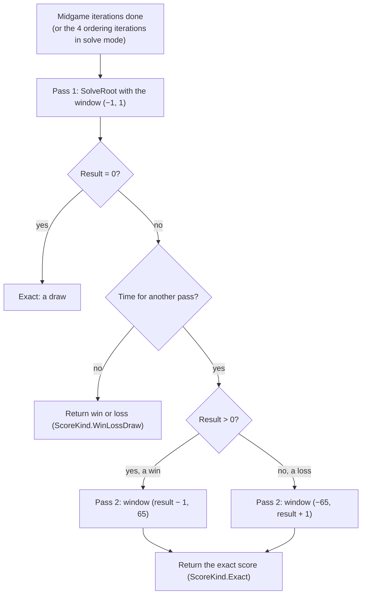
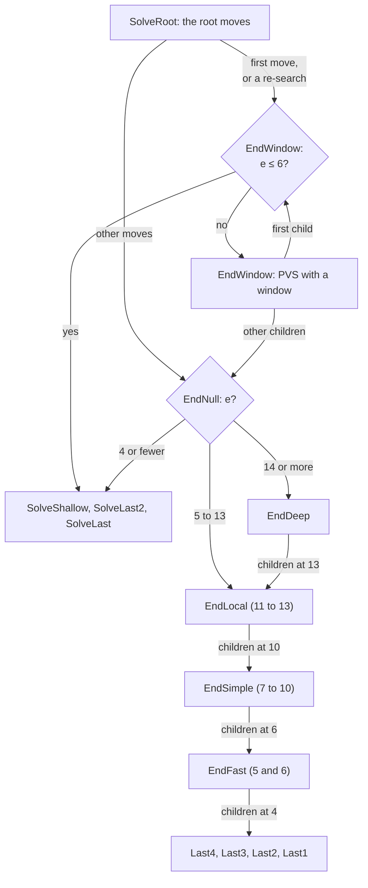

# 08 – Endgame solver

[Back to the index](README.md)

This chapter describes the endgame solver of Stello 2.0. The solver of earlier versions is described in the [Stello 1 documentation](stello-1/08-endgame-solver.md).

## In short

Near the end of the game the engine stops guessing. The **endgame solver** searches every line to the end of the game and computes the true result with perfect play by both sides, as a final disc difference. It works in two passes: first it only finds out whether the side to move **wins, loses or draws**, then, if there is time, the **exact score**.

The solver is adapted from Egaroucid, through Stello's C# port of it ([chapter 18](18-the-egaroucid-port.md)). It is a chain of routines, one for each range of empty squares. The last 13 empty squares are searched by Egaroucid's code, adapted to Stello's bitboards: a small local table, ordering by the opponent's mobility and by parity, a cutoff from stable discs, and special code for the last 4 squares. Above 13 empty squares the solver uses Stello's endgame transposition table, enhanced transposition cutoffs, and move ordering by mobility and Stello's pattern evaluation. It solves the FFO positions #40–49 in 47 seconds on one thread.

## Data structures

The solver is a part of `SearchEngine` (a partial class in [SearchEngine.Endgame.cs](../Stello.Net/Stello.Engine/Endgame/SearchEngine.Endgame.cs)). It works on raw bitboards, `own` for the side to move and `opponent` for the other side, not on `Board`. Scores are final disc differences for the side to move, from −64 to +64. Every null-window search is **fail-soft**: a score above α is a lower bound of the true score, a score at or below α an upper bound.

| Constant | Value | Meaning |
|---|---|---|
| `EndgameDistance` | 7 | The solver takes over when the next midgame iteration would end with 7 or fewer empty squares |
| `SolveOrderingLooks` | 4 | In solve mode, midgame iterations 1 to 4 order the root moves first |
| `EndLocalEmpties` | 13 | `EndLocal` and the layers below it search positions with 13 or fewer empty squares |
| `EndSimpleEmpties` | 10 | `EndSimple` from 10 empty squares down |
| `EndFastEmpties` | 6 | `EndFast` (null window) or `SolveShallow` (with a window) from 6 empty squares down |
| `EndEtcMinEmpties` | 12 | Enhanced transposition cutoff from 12 empty squares |
| `OrderOffset`, `OrderMobility`, … | 38, 35, … | Egaroucid's move-ordering weights (`move_ordering.hpp`), see [Move ordering](#move-ordering-above-13-empty-squares) |
| `OrderHashMove` | 10,000,000 | The ordering value of the stored best move: always first |

The solver uses these tables:

| Table | File | Contents |
|---|---|---|
| Endgame transposition table | [TranspositionTable.cs](../Stello.Net/Stello.Engine/Search/TranspositionTable.cs) | The same table as in [chapter 07](07-transposition-table.md), with tag 0 and the number of empty squares as the depth. Used above 6 empty squares at principal-variation nodes and above 13 at null-window nodes |
| `LocalTable` | [LocalTable.cs](../Stello.Net/Stello.Engine/Endgame/LocalTable.cs) | 7 rows of 1,024 slots, one row for each number of empty squares from 6 to 12. Each slot holds a position (`Own`, `Opponent`) and a `Lower` and an `Upper` bound. A new result simply replaces the old one |
| Stable edges | [StableDiscs.cs](../Stello.Net/Stello.Engine/Endgame/StableDiscs.cs) | For every pair of 8-bit edge lines (`own`, `opponent`), the discs no later move can flip, as a row and as a column: 2 × 65,536 entries, computed at start-up |
| `FlipNeighbours` | [EndgameBits.cs](../Stello.Net/Stello.Engine/Endgame/EndgameBits.cs) | For each square, the neighbours through which a move there can flip something. A square with no opponent disc there is skipped without computing the flips |
| `QuadrantBit` | EndgameBits.cs | The quadrant of each square as one bit (a1–d4, e1–h4, a5–d8, e5–h8), for parity |
| `StabilityThresholdNws`, `StabilityThreshold` | EndgameBits.cs | By the number of discs on the board: how high α (null window) or β (with a window) must be before the stable-disc cutoff is tried |

`EndMove` holds a move during a search: its `Square`, its `Flips`, its ordering `Value`, and `Replies`, the opponent's legal moves after it. `Replies` is computed once for ordering and handed down to the child, so the child does not generate its moves again. `LegalUndefined` (the four centre squares, which can never be legal moves) marks "not computed yet".

### Egaroucid's tables on Stello's bitboards

Egaroucid numbers the squares the other way round: in its bitboards, bit 63 is a1; in Stello's, bit 0 is a1 ([chapter 02](02-board-and-squares.md)). Reversing the 64 bits maps square $i$ to $63 - i$, which turns the board **half a turn** (a1 ↔ h8, h1 ↔ a8).

Othello is the same after a half turn, and so is every table in the solver: the flip neighbours, the quadrants, the corners, the stable edges and the masks of the legal-move and potential-mobility code. So the adapted code works directly on Stello's bitboards, and the move numbers it returns are Stello's. Nothing is converted. A test checks that the solver's `Flips` and `LegalMoves` give the same results as Stello's own [Bitboards.cs](../Stello.Net/Stello.Engine/Bitboards.cs).

## Algorithm

### When the solver runs

The solver is the second half of `SearchEngine.Search`:

- **In the normal modes** (fixed depth, time per move, time per game), the iterative deepening loop ([chapter 06](06-midgame-search.md)) runs its midgame iterations as long as the iteration ends with more than 7 empty squares (`EndgameDistance`). Then the solver takes over. With 8 or fewer empty squares there is no midgame search at all. If the time runs out during the midgame iterations, or a fixed depth is reached first, the midgame move is played and the solver does not run.
- **With a game clock**, the solver may use half of the time that is left ([chapter 09](09-time-control.md)). With a time per move it keeps the budget of the midgame search.
- **In solve mode** (`SearchLimits.Solve`) there is no time limit. Midgame iterations 1 to 4 (`SolveOrderingLooks`) run first, only to order the root moves; then the solver runs. A position with one legal move is solved too. The tests and the benchmark's `solve-bench` use this mode.

### Final score

When neither side can move, the score is the disc difference $d$ = own − opponent, with the $e$ empty squares given to the winner:

$$\text{score} = \begin{cases} d + e & \text{if } d > 0 \\ d - e & \text{if } d < 0 \\ 0 & \text{if } d = 0 \end{cases}$$

This is the standard tournament rule, and it is how the FFO test values are counted. `FinalScore` computes it from the two bitboards; `ScoreWithEmpties` and `ScoreWithOddEmpties` compute it from the side to move's discs alone, without branches (Egaroucid's `end_evaluate`).

### Two passes

- **Pass 1** only has to prove "at least +1", "at most −1" or "exactly 0". Many more cutoffs happen than with a full window.
- Because the search is fail-soft, the result of pass 1 is a **bound**: after a win a lower bound, after a loss an upper bound. Pass 2 searches only the range that is still possible.
- "Time for another pass" uses the soft limit of the time budget. In solve mode and at a fixed depth, pass 2 always runs.
- If pass 1 finds a loss and the midgame search had a best move, that move is kept: all moves lose, and the midgame move gives the opponent the most chances to go wrong.

### `SolveRoot`

`SolveRoot` searches the root moves in their current order with principal variation search (PVS): the first move with the full window, the others with a null window, and again with the window if they turn out better. It reports progress after each root move, with the number of empty squares as the depth. It stops as soon as a move reaches β; in pass 1 that is the first winning move. Every new best move goes to the front of the root list, so pass 2 starts with the move pass 1 found.

`SolveChild` chooses the routine for a root move: `EndNull` for a null window, `EndWindow` otherwise.

### The layers

The routine that searches a position depends on the number of empty squares $e$ and on the window:

Each routine searches its children one empty square lower and hands a position to the next layer as soon as it falls into that layer's range: `EndDeep` calls `EndLocal` at 13, `EndLocal` calls `EndSimple` at 10, and `EndSimple` calls `EndFast` at 6. A null-window search with 4 or fewer empty squares at once is only possible at the root; it uses `SolveShallow`.

| Routine | Empty squares | Window | Table | Stable discs | Move ordering |
|---|---|---|---|---|---|
| `EndWindow` | 7 or more | (α, β), PVS | endgame table, ETC from 12 | on β | hash move, then mobility, potential mobility and the pattern evaluation after 0–2 plies |
| `EndDeep` | 14 or more | null | endgame table, ETC | on α | hash move searched first, then mobility and the pattern evaluation after 0–1 ply |
| `EndLocal` | 11 to 13 | null | local table | on α | the opponent's mobility |
| `EndSimple` | 7 to 10 | null | local table | on α | parity and the opponent's mobility |
| `EndFast` | 5 and 6 | null | none | on α | moves on lone empty squares first; no sorting |
| `Last4` … `Last1` | 4 to 1 | null | none | none | lone empty squares first |
| `SolveShallow` | 6 or fewer | (α, β) | none | none | squares in odd quadrants first |

### Above 13 empty squares: `EndWindow` and `EndDeep`

This part has the shape of Egaroucid's midgame search, which is also its solver above 13 empty squares, but it is written on Stello's endgame transposition table and ordered by Stello's pattern evaluation ([chapter 04](04-evaluation.md)). `EndWindow` searches the principal-variation nodes with a window; `EndDeep` does the null-window searches. Both follow the same steps:

1. **Count the node.** Every 1,024 nodes, check the time and the tokens (see [Stopping](#stopping-progress-and-move-now)).
2. **Generate the legal moves.** Without a move: if the opponent could not move either, return the final score; otherwise pass, with the same number of empty squares. `EndDeep` gets the moves from its parent if the parent computed them for ordering.
3. **The stable-disc cutoff** (not right after a pass). The opponent's stable discs can never become ours, so the best possible score is $64 - 2 \cdot \text{stable}$. If that is at or below α, the node fails low at once. `EndWindow` also lowers β to it. The discs are only counted when α (or β) is at least `StabilityThresholdNws` (`StabilityThreshold`) for the number of discs on the board, because below that the cutoff almost never works.
4. **Look up the endgame table.** In `EndWindow`, an exact entry is returned, a lower bound raises α, an upper bound lowers β, and if then α ≥ β the stored value is returned. In `EndDeep`, a stored lower bound above α or upper bound at or below α decides the node (an exact value is both). Otherwise the stored move becomes the hash move.
5. **Compute the flips of every move once.** If a move takes all of the opponent's discs, the game is won 64–0 at once (the wipe-out test).
6. **Enhanced transposition cutoff (ETC)** from 12 empty squares: the position after each move is looked up first. A child with a stored upper bound or exact value $v$ (from the opponent's point of view) and $-v$ above α (`EndDeep`) or at least β (`EndWindow`) proves the cutoff without any search. In `EndDeep`, a child with a stored lower bound or exact value and $-v \le \alpha$ fails low, so it is marked as done.
7. **`EndDeep`: the hash move first.** The stored best move is searched before the others are ordered. If it already fails high, ordering the others is not needed.
8. **Order the moves** (below) and search them. `EndWindow` uses PVS; `EndDeep` stops at the first move that scores above α.
9. **Store the result** in the endgame table with the number of empty squares as depth: `Lower`, `Exact` or `Upper` in `EndWindow`, `Lower` or `Upper` in `EndDeep`.

#### Move ordering above 13 empty squares

The ordering value of a move combines the opponent's replies after it and the value of the position after it. With $W$ = twice the opponent's moves plus their corner moves (`WeightedMoves`), $P$ = the opponent's potential mobility (empty squares next to our discs, `PotentialMobility`) and $v$ = the value of the child for the opponent, in discs:

$$\text{EndWindow:}\quad (38 - W) \cdot 35 + (38 - P) \cdot 17 + (64 - v) \cdot (269 + 94\,d)$$

$$\text{EndDeep:}\quad (38 - W) \cdot 17 + (64 - v) \cdot (7 + 25\,d)$$

$v$ comes from `OrderingValue`: the pattern evaluation of the child after a small alpha-beta search of depth $d$, in a window a few discs around the node's window. In `EndWindow` $d = \min(\lfloor e/8 \rfloor, 2)$, so 0 plies at 7 empty squares, 1 ply from 8 and 2 plies from 16. In `EndDeep` $d = \lfloor e/16 \rfloor$, so 0 plies at 14 and 15 empty squares and 1 ply from 16. `SwapNextBest` picks the best remaining move before each search; equal values keep their order.

### 7 to 13 empty squares: `EndLocal` and `EndSimple`

These two null-window layers and everything below them are adapted from the port's [EndSearch.cs](../Stello.Net/Egaroucid.Engine/EndSearch.cs), which is node for node Egaroucid's `endsearch_nws.hpp` and its helpers. They need no evaluation and no transposition table.

Both start with the node count, the stable-disc cutoff, the legal moves and the wipe-out test, as above. Then, with more than one move, they go through the moves once:

1. **Look up the child in the local table** (the row for one empty square fewer). A stored lower bound above α decides the node at once. A stored upper bound at or below α means the move fails low: it is marked as done.
2. **Count the opponent's replies** $R$, with corners counted twice (`MovesCornersTwice`).
3. **A move with at most one reply is searched at once.** It is cheap, and it often decides the node.
4. Otherwise the move gets its ordering value:
   - `EndLocal`: $(38 - R) \cdot 40$;
   - `EndSimple`: $(38 - R) \cdot 18$, plus 17 if the move is in a quadrant with an odd number of empty squares (parity, below).

Then the remaining moves are searched, best value first, until one scores above α. After each search, the local table slot of the child gets the result as a bound of the move's value: a lower bound if it is above α, otherwise an upper bound. Because the bounds are true facts about the position, the local table is never cleared during a game (only by `ClearHash`).

**Parity.** In a region with an odd number of empty squares, the player who moves there first can usually also make the last move there, which is an advantage at the end. Squares in odd quadrants are therefore tried earlier.

### 5 and 6 empty squares: `EndFast`

`EndFast` does not sort at all. After the stable-disc cutoff it tries the moves in two groups: first the moves on **lone empty squares** (empty squares with no empty neighbour, `LoneEmpties`), then the others. It returns at the first move that scores above α. At 5 empty squares, the children are searched by `Last4`.

### The last 4 empty squares: `Last4` … `Last1`

These routines have no move lists. Each one gets the empty squares as square numbers and tries them in a fixed order:

- **`Last4`** puts the lone empty squares first. **`Last3`** puts a square that has no empty neighbour among the 4 empty squares first.
- A square is only tried if `FlipNeighbours` shows an opponent disc next to it in a direction that can flip.
- A pass is handled inside the routine: the roles swap, the sign of the score flips, and α becomes $-\alpha - 1$. If neither side can move, the score is computed with the empty squares given to the winner.
- **`Last1`** does not play the last move. It only counts the discs the move would flip, $f$, and computes the score from the side to move's discs $n$: $2 \cdot (n + f + 1) - 64$. If the side to move cannot play there, it counts the opponent's flips instead.

### Principal-variation nodes with 6 or fewer: `SolveShallow`

With a window, the last 6 empty squares are searched by `SolveShallow`, `SolveLast2` and `SolveLast` in [SearchEngine.cs](../Stello.Net/Stello.Engine/SearchEngine.cs). They are Stello's own and do plain alpha-beta without any table. `SolveShallow` tries the empty squares directly in two groups: first the squares in quadrants with an odd number of empty squares, then the others; a square that flips nothing is skipped. `SolveLast2` tries the two last squares directly, and `SolveLast` plays the last square for whichever side can.

In this position `SolveShallow` tries a1, (a6), b6, (b8), g1 and h1; a6 and b8 are skipped because they flip nothing. The best move is a1, and Black loses by 8 discs.

### Stopping, progress and Move Now

- **Every 1,024 nodes** the solver calls `CheckAbort`. If at least 100 ms have passed since the last progress report, it first sends one (a "heartbeat") with the root move being searched and the best move so far. Then it checks the tokens and the time.
- **Stop** (the cancellation token) throws `OperationCanceledException`. **Move Now** (the second token) or the hard time limit throws an internal `SearchAbortedException`, which `Search` catches; it returns the best move found so far. If that happens in pass 1, the result is the midgame move or a win or draw found so far; in pass 2 it is the result of pass 1, or a better exact move found so far.
- **In the web app** the engine runs in a Web Worker that cannot receive messages while it searches ([chapter 14](14-app-integration.md)). `ProgressPoster.Report` in [EngineWorker.cs](../Stello.Net/Stello.Web/Worker/EngineWorker.cs) polls a shared signal on every report and cancels the matching token. So the heartbeats are what make Stop and Move Now work during a long solve. The poster forwards a report to the page at most every 100 ms, unless the depth or the best move changed.

## Worked examples

### Ordering in `EndSimple`

A null-window node with 9 empty squares and three moves:

| Move | Quadrant | Opponent's replies after it | $R$ | Value |
|---|---|---|---:|---:|
| A | odd | 3, one of them on a corner | 4 | $17 + (38 - 4) \cdot 18 = 629$ |
| B | even | 3, no corner | 3 | $0 + (38 - 3) \cdot 18 = 630$ |
| C | odd | 1 | 1 | searched at once |

C is searched while the moves are being ordered; if it scores above α, the node is done. Otherwise B is searched before A: one reply fewer (18 points) is worth slightly more than parity (17 points).

### Ordering above 13 empty squares

Two moves at a null-window node, both with the opponent's value after the move $v$ (in discs):

| Move | Opponent's replies | $W$ | $v$ | Value at 14 or 15 empty squares ($d = 0$) | Value from 16 empty squares ($d = 1$) |
|---|---|---:|---:|---:|---:|
| A | 5, one on a corner | 11 | −4 | $27 \cdot 17 + 68 \cdot 7 = 935$ | $27 \cdot 17 + 68 \cdot 32 = 2635$ |
| B | 3, no corner | 6 | +2 | $32 \cdot 17 + 62 \cdot 7 = 978$ | $32 \cdot 17 + 62 \cdot 32 = 2528$ |

With few empty squares mobility decides and B goes first. From 16 empty squares the value after a 1-ply search weighs much more, and A goes first.

### The stable-disc cutoff

A null-window search at 14 empty squares (50 discs) with α = 30. The threshold for 50 discs is 28, so the stable discs are counted. If the opponent has 11 stable discs, the best possible score is $64 - 22 = 42 > 30$: no cutoff. If it has 18, the best possible score is $64 - 36 = 28 \le 30$: the node fails low with 28, without a search.

### The FFO positions

`solve-bench` solves FFO #40–49 exactly in solve mode, on one thread (Intel i7-12850HX laptop, measured on 2 November 2026, [result](../Plans/benchmark-results/v2-final-solve-bench-40-49.json)):

| Position | Empty squares | Exact score | Move | Nodes | Time |
|---|---:|---:|---|---:|---:|
| #40 | 20 | +38 | a2 | 12.6 M | 0.7 s |
| #41 | 22 | 0 | h4 | 12.5 M | 0.5 s |
| #42 | 22 | +6 | g2 | 22.5 M | 0.8 s |
| #43 | 23 | −12 | c7 | 33.4 M | 1.5 s |
| #44 | 23 | −14 | d2 | 11.5 M | 0.6 s |
| #45 | 24 | +6 | b2 | 306.7 M | 11.0 s |
| #46 | 24 | −8 | b3 | 49.9 M | 2.2 s |
| #47 | 25 | +4 | g2 | 30.7 M | 1.3 s |
| #48 | 25 | +28 | f6 | 237.7 M | 12.0 s |
| #49 | 26 | +16 | e1 | 382.2 M | 16.2 s |
| **Total** | | | | **1.10 G** | **46.8 s** |

- All scores and moves are correct (#43 has two best moves, c7 and g3). That is about 23 M nodes per second; Egaroucid's own solver, in the C# port, takes 25.6 s.
- In the web app (Blazor WebAssembly, AOT build), positions from games with 20 empty squares are solved in 0.1–0.3 s and with 22 empty squares in 0.6–1.3 s, at about native speed.

How these numbers were reached, and the ideas that were tried and dropped, are in [chapter 21](21-phase-3-the-endgame-solver.md).

## Design notes

- **Win/loss/draw first.** Solving exactly at once with a full window was slower on FFO #40–49. Pass 1 also gives a playable result early if the time runs out.
- **The root order matters most.** In solve mode the 4 short midgame iterations order the root moves; without them FFO #43 needed about three times as many nodes. In games, the midgame iterations come first anyway.
- **Two kinds of table.** Above 13 empty squares the nodes are few and expensive, so the large endgame transposition table, ETC and an evaluation-based ordering pay off. Below that the nodes are many and cheap, so the solver uses only the small local table, which is fast to reach, and orders by mobility alone.
- **No pattern evaluation at 11–13 empty squares.** Egaroucid adds a small move-ordering evaluation in `EndLocal`. Stello's full pattern evaluation there saves about 20 % of the nodes but makes each node about 40 % slower, so the opponent's mobility orders alone.
- **Fail-soft everywhere.** A null-window search returns the best bound it found, not just α or α + 1. That makes the stored bounds tighter, and lets pass 2 start from the bound of pass 1.
- **When to start solving** is a fixed rule: the midgame iterations must reach 7 empty squares from the end. Starting a little earlier or later, and a selective (probabilistic) solve as in Egaroucid, were measured and gave no gain.
- **Licence.** The adapted files carry Egaroucid's copyright and are GPL-3.0, as noted in their headers.

## Where in the code

| File | Main members |
|---|---|
| [SearchEngine.cs](../Stello.Net/Stello.Engine/SearchEngine.cs) | The solver part of `Search`, `EndgameDistance`, `SolveRoot`, `SolveShallow`, `SolveLast2`, `SolveLast`, `FinalScore`, `MoveToFront`, `CheckAbort`, `Report`, `ClearHash` |
| [Endgame/SearchEngine.Endgame.cs](../Stello.Net/Stello.Engine/Endgame/SearchEngine.Endgame.cs) | `SolveChild`, `EndNull`, `EndWindow`, `EndDeep`, `OrderingValue`, `EndLocal`, `EndSimple`, `EndFast`, `Last4`, `Last3`, `Last2`, `Last1`, `StabilityCut`, `FillEndMoves`, `SwapNextBest`, the ordering weights |
| [Endgame/EndgameBits.cs](../Stello.Net/Stello.Engine/Endgame/EndgameBits.cs) | `Flips`, `LegalMoves`, `LoneEmpties`, `Parity`, `WeightedMoves`, `MovesCornersTwice`, `PotentialMobility`, `ScoreWithEmpties`, `FlipNeighbours`, `QuadrantBit`, the stability thresholds |
| [Endgame/StableDiscs.cs](../Stello.Net/Stello.Engine/Endgame/StableDiscs.cs) | `StableDiscs.Of`: the stable edge tables, full lines, and growing from stable discs |
| [Endgame/LocalTable.cs](../Stello.Net/Stello.Engine/Endgame/LocalTable.cs) | `LocalTable`, `Get`, `Entry.Matches`, `Entry.Set` |
| [Search/TimeControl.cs](../Stello.Net/Stello.Engine/Search/TimeControl.cs) | `ForEndgame`: the time for the solver with a game clock |
| [SearchLimits.cs](../Stello.Net/Stello.Engine/SearchLimits.cs) | `SearchLimits.Solve` |
| [Stello.Web/Worker/EngineWorker.cs](../Stello.Net/Stello.Web/Worker/EngineWorker.cs) | `ProgressPoster`: Stop and Move Now through the progress reports |
| Source: [Egaroucid.Engine/EndSearch.cs](../Stello.Net/Egaroucid.Engine/EndSearch.cs), [Stability.cs](../Stello.Net/Egaroucid.Engine/Stability.cs) | The C# port of Egaroucid's endgame search and stability code that the last 13 empty squares were adapted from |

## Tests

[EndgameTests.cs](../Stello.Net/Stello.Engine.Tests/EndgameTests.cs):

- FFO #40–44: exact score and one of the correct best moves;
- the 112 test positions from endgame.c ([Data/endgame-c-positions.txt](../Stello.Net/Stello.Engine.Tests/Data/endgame-c-positions.txt), 100 of them with 12 empty squares): the exact scores;
- 40 random endgames after 52 random plies (about 8 empty squares): the solver's score, and the score after its move, agree with a plain negamax search to the end;
- 300 random positions after 57–60 random plies (the last few empty squares): the same check for the last layers;
- 30 random positions with 14 to 18 empty squares: the same exact scores as the frozen Stello 1 engine, to test `EndDeep`, the endgame table and ETC;
- a fixed-depth search near the end switches to the solver and returns the exact score;
- Move Now during the solve of FFO #49 (26 empty squares) returns a legal move within 100 ms.

[EndgameBitsTests.cs](../Stello.Net/Stello.Engine.Tests/EndgameBitsTests.cs): the solver's `Flips` and `LegalMoves` equal Stello's own on 300 positions; `ScoreWithEmpties` and `ScoreWithOddEmpties` give the empty squares to the winner; discs found by `StableDiscs.Of` are never flipped in 200 random games played to the end.

## Further reading

- [Chapter 18](18-the-egaroucid-port.md): the C# port of Egaroucid that the solver was adapted from.
- [Chapter 21](21-phase-3-the-endgame-solver.md): how the solver was developed and measured.
- [Egaroucid on GitHub](https://github.com/Nyanyan/Egaroucid): `src/engine/endsearch_nws.hpp`, `endsearch_nws_last_generic.hpp`, `stability_cutoff.hpp`, `move_ordering.hpp`.
- [The FFO endgame test suite – radagast.se](http://radagast.se/othello/ffotest.html): the positions, their correct scores and moves.
- [Writing an Othello program – Gunnar Andersson](http://radagast.se/othello/howto.html): the "Endgame" section explains why move ordering decides everything.
- [Enhanced Transposition Cutoff – Chess Programming Wiki](https://www.chessprogramming.org/Enhanced_Transposition_Cutoff).
- [Glossary](25-glossary.md) and [References](26-references.md).

---

Previous: [07 Transposition table](07-transposition-table.md) · Next: [09 Time control](09-time-control.md)
