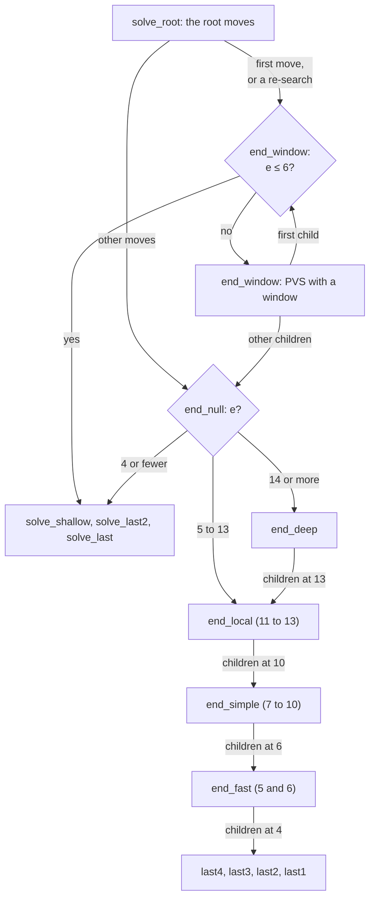

# 08 – Endgame solver

[Back to the index](README.md)

This chapter describes the endgame solver of Stello 3.0. It is Stello 2.0's solver ported to Rust, node for node the same; how and why it was ported is in [chapter 25](25-phases-0-4-the-engine-in-rust.md). The solver of earlier versions is described in the [Stello 1 documentation](stello-1/08-endgame-solver.md).

## In short

Near the end of the game the engine stops guessing. The **endgame solver** searches every line to the end of the game and computes the true result with perfect play by both sides, as a final disc difference. It works in two passes: first it only finds out whether the side to move **wins, loses or draws**, then, if there is time, the **exact score**.

The solver is adapted from Egaroucid, through Stello's C# port of it ([chapter 18](18-the-egaroucid-port.md)). It is a chain of routines, one for each range of empty squares. The last 13 empty squares are searched by Egaroucid's code, adapted to Stello's bitboards: a small local table, ordering by the opponent's mobility and by parity, a cutoff from stable discs, and special code for the last 4 squares. Above 13 empty squares the solver uses Stello's endgame transposition table, enhanced transposition cutoffs, and move ordering by mobility and Stello's pattern evaluation. It solves the FFO positions #40–49 in 26 seconds on one thread, and in 7.8 seconds on 8 threads, which share the work of a node once its first move has been searched ([Threads in the solver](#threads-in-the-solver)).

## Data structures

The solver is a part of the search in `stello-core`: an `impl Searcher` block in [endgame/search.rs](../Stello.Rust/stello-core/src/endgame/search.rs), so it shares the node counters, the abort checks, the progress reports and both hash tables with the midgame search ([chapter 06](06-midgame-search.md)). It works on raw bitboards, `own` for the side to move and `opponent` for the other side, not on `Board`. Scores are final disc differences for the side to move, from −64 to +64. Every null-window search is **fail-soft**: a score above α is a lower bound of the true score, a score at or below α an upper bound.

| Constant | Value | Meaning |
|---|---|---|
| `ENDGAME_DISTANCE` (search/engine.rs) | 7 | The solver takes over when the next midgame iteration would end with 7 or fewer empty squares |
| `SOLVE_ORDERING_LOOKS` | 4 | In solve mode, midgame iterations 1 to 4 order the root moves first |
| `END_LOCAL_EMPTIES` | 13 | `end_local` and the layers below it search positions with 13 or fewer empty squares |
| `END_SIMPLE_EMPTIES` | 10 | `end_simple` from 10 empty squares down |
| `END_FAST_EMPTIES` | 6 | `end_fast` (null window) or `solve_shallow` (with a window) from 6 empty squares down |
| `END_ETC_MIN_EMPTIES` | 12 | Enhanced transposition cutoff from 12 empty squares |
| `ORDER_OFFSET`, `ORDER_MOBILITY`, … | 38, 35, … | Egaroucid's move-ordering weights (`move_ordering.hpp`), see [Move ordering](#move-ordering-above-13-empty-squares) |
| `ORDER_HASH_MOVE` | 10,000,000 | The ordering value of the stored best move: always first |

The solver uses these tables:

| Table | File | Contents |
|---|---|---|
| Endgame transposition table | [search/table.rs](../Stello.Rust/stello-core/src/search/table.rs) | The same table as in [chapter 07](07-transposition-table.md), with tag 0 and the number of empty squares as the depth. Used above 6 empty squares at principal-variation nodes and above 13 at null-window nodes |
| `LocalTable` | [endgame/local.rs](../Stello.Rust/stello-core/src/endgame/local.rs) | 7 rows of 1,024 slots, one row for each number of empty squares from 6 to 12. Each slot (`LocalEntry`) holds a position (`own`, `opponent`) and a `lower` and an `upper` bound. A new result simply replaces the old one |
| Stable edges | [endgame/stable.rs](../Stello.Rust/stello-core/src/endgame/stable.rs) | For every pair of 8-bit edge lines (`own`, `opponent`), the discs no later move can flip, as a row and as a column: 2 × 65,536 entries, computed once per process (`stable::init`, called by `SearchEngine::new`) |
| `FLIP_NEIGHBOURS` | [endgame/bits.rs](../Stello.Rust/stello-core/src/endgame/bits.rs) | For each square, the neighbours through which a move there can flip something. A square with no opponent disc there is skipped without computing the flips |
| `RAYS` | endgame/bits.rs | For each square and each of the 8 directions, the squares from the next one to the edge, for `flips` (below) |
| `QUADRANT_BIT` | endgame/bits.rs | The quadrant of each square as one bit (a1–d4, e1–h4, a5–d8, e5–h8), for parity |
| `STABILITY_THRESHOLD_NWS`, `STABILITY_THRESHOLD` | endgame/bits.rs | By the number of discs on the board: how high α (null window) or β (with a window) must be before the stable-disc cutoff is tried |
| `LAST_LINES`, `LAST_FLIP_COUNTS` | [endgame/last.rs](../Stello.Rust/stello-core/src/endgame/last.rs) | For each square, the masks of its column and diagonals; for each place on a line of 8 squares and each set of own discs on it (8 × 256), how many discs a move there flips. `last1` counts its flips with them (below) |

`EndMove` holds a move during a search: its `square`, its `flips`, its ordering `value`, and `replies`, the opponent's legal moves after it. `replies` is computed once for ordering and handed down to the child, so the child does not generate its moves again. `LEGAL_UNDEFINED` (the four centre squares, which can never be legal moves) marks "not computed yet".

### Egaroucid's tables on Stello's bitboards

Egaroucid numbers the squares the other way round: in its bitboards, bit 63 is a1; in Stello's, bit 0 is a1 ([chapter 02](02-board-and-squares.md)). Reversing the 64 bits maps square $i$ to $63 - i$, which turns the board **half a turn** (a1 ↔ h8, h1 ↔ a8).

Othello is the same after a half turn, and so is every table in the solver: the flip neighbours, the quadrants, the corners, the stable edges and the masks of the legal-move and potential-mobility code. So the adapted code works directly on Stello's bitboards, and the move numbers it returns are Stello's. Nothing is converted. The parity test checks that the solver's `flips` and `legal_moves` give the same results as Stello's own move generation (C# [Bitboards.cs](../Stello.Net/Stello.Engine/Bitboards.cs) and Rust [bits.rs](../Stello.Rust/stello-core/src/bits.rs)). The midgame search uses the same `flips` ([chapter 03](03-rules-and-move-generation.md)).

### The flips of a move

`flips` in [endgame/bits.rs](../Stello.Rust/stello-core/src/endgame/bits.rs) computes the discs a move flips with the 8 ray masks of the square (`RAYS`), without loops along a ray. On each ray it finds the first square, seen from the move, that is not an opponent disc; if that square is an own disc, the opponent discs before it are flipped:

- **The 4 rays towards higher squares:** the first such square is the lowest set bit of `ray & !opponent`, isolated with `x & -x`.
- **The 4 rays towards lower squares:** it is the highest set bit, `1 << 63 >> lzcnt(x | 1)`, without a branch. If every square of the ray is an opponent disc, the `| 1` gives a1, which is then either not on the ray or an opponent disc, so the test for an own disc fails. That test is turned into a mask of all ones or all zeros instead of a branch.

## Algorithm

### When the solver runs

The solver is the second half of the search, in `Searcher::iterate` ([search/engine.rs](../Stello.Rust/stello-core/src/search/engine.rs)), which `SearchEngine::search` runs:

- **In the normal modes** (fixed depth, time per move, time per game), the iterative deepening loop ([chapter 06](06-midgame-search.md)) runs its midgame iterations as long as the iteration ends with more than 7 empty squares (`ENDGAME_DISTANCE`). Then the solver takes over. With 8 or fewer empty squares there is no midgame search at all. If the time runs out during the midgame iterations, or a fixed depth is reached first, the midgame move is played and the solver does not run.
- **With a game clock**, the solver may use half of the time that is left ([chapter 09](09-time-control.md)). With a time per move it keeps the budget of the midgame search.
- **In solve mode** (`SearchLimits.Solve` in C#, `SearchLimits::SOLVE` in Rust) there is no time limit. Midgame iterations 1 to 4 (`SOLVE_ORDERING_LOOKS`) run first, only to order the root moves; then the solver runs. A position with one legal move is solved too. The tests and the benchmark's `solve-bench` use this mode.

### Final score

When neither side can move, the score is the disc difference $d$ = own − opponent, with the $e$ empty squares given to the winner:

$$\text{score} = \begin{cases} d + e & \text{if } d > 0 \\ d - e & \text{if } d < 0 \\ 0 & \text{if } d = 0 \end{cases}$$

This is the standard tournament rule, and it is how the FFO test values are counted. `final_score` computes it from the two bitboards; `score_with_empties` and `score_with_odd_empties` compute it from the side to move's discs alone, without branches (Egaroucid's `end_evaluate`).

### Two passes

- **Pass 1** only has to prove "at least +1", "at most −1" or "exactly 0". Many more cutoffs happen than with a full window.
- Because the search is fail-soft, the result of pass 1 is a **bound**: after a win a lower bound, after a loss an upper bound. Pass 2 searches only the range that is still possible.
- "Time for another pass" uses the soft limit of the time budget. In solve mode and at a fixed depth, pass 2 always runs.
- If pass 1 finds a loss and the midgame search had a best move, that move is kept: all moves lose, and the midgame move gives the opponent the most chances to go wrong.

### The root of the solver

`solve_root` searches the root moves in their current order with principal variation search (PVS): the first move with the full window, the others with a null window, and again with the window if they turn out better. It reports progress after each root move, with the number of empty squares as the depth. It stops as soon as a move reaches β; in pass 1 that is the first winning move. Every new best move goes to the front of the root list, so pass 2 starts with the move pass 1 found.

`solve_child` chooses the routine for a root move: `end_null` for a null window, `end_window` otherwise.

### The layers

The routine that searches a position depends on the number of empty squares $e$ and on the window:

Each routine searches its children one empty square lower and hands a position to the next layer as soon as it falls into that layer's range: `end_deep` calls `end_local` at 13, `end_local` calls `end_simple` at 10, and `end_simple` calls `end_fast` at 6. A null-window search with 4 or fewer empty squares at once is only possible at the root; it uses `solve_shallow`.

| Routine | Empty squares | Window | Table | Stable discs | Move ordering |
|---|---|---|---|---|---|
| `end_window` | 7 or more | (α, β), PVS | endgame table, ETC from 12 | on β | hash move, then mobility, potential mobility and the pattern evaluation after 0–2 plies |
| `end_deep` | 14 or more | null | endgame table, ETC | on α | hash move searched first, then mobility and the pattern evaluation after 0–1 ply |
| `end_local` | 11 to 13 | null | local table | on α | the opponent's mobility |
| `end_simple` | 7 to 10 | null | local table | on α | parity and the opponent's mobility |
| `end_fast` | 5 and 6 | null | none | on α | moves on lone empty squares first; no sorting |
| `last4` … `last1` | 4 to 1 | null | none | none | lone empty squares first |
| `solve_shallow` | 6 or fewer | (α, β) | none | none | squares in odd quadrants first |

### Above 13 empty squares

This part, `end_window` and `end_deep`, has the shape of Egaroucid's midgame search, which is also its solver above 13 empty squares, but it is written on Stello's endgame transposition table and ordered by Stello's pattern evaluation ([chapter 04](04-evaluation.md)). `end_window` searches the principal-variation nodes with a window; `end_deep` does the null-window searches. Both follow the same steps:

1. **Count the node.** Every 1,024 nodes, check the time and the stop signals (see [Stopping](#stopping-progress-and-move-now)).
2. **Generate the legal moves.** Without a move: if the opponent could not move either, return the final score; otherwise pass, with the same number of empty squares. `end_deep` gets the moves from its parent if the parent computed them for ordering.
3. **The stable-disc cutoff** (not right after a pass). The opponent's stable discs can never become ours, so the best possible score is $64 - 2 \cdot \text{stable}$. If that is at or below α, the node fails low at once. `end_window` also lowers β to it. The discs are only counted when α (or β) is at least `STABILITY_THRESHOLD_NWS` (`STABILITY_THRESHOLD`) for the number of discs on the board, because below that the cutoff almost never works.
4. **Look up the endgame table.** In `end_window`, an exact entry is returned, a lower bound raises α, an upper bound lowers β, and if then α ≥ β the stored value is returned. In `end_deep`, a stored lower bound above α or upper bound at or below α decides the node (an exact value is both). Otherwise the stored move becomes the hash move.
5. **Compute the flips of every move once.** If a move takes all of the opponent's discs, the game is won 64–0 at once (the wipe-out test).
6. **Enhanced transposition cutoff (ETC)** from 12 empty squares: the position after each move is looked up first. A child with a stored upper bound or exact value $v$ (from the opponent's point of view) and $-v$ above α (`end_deep`) or at least β (`end_window`) proves the cutoff without any search. In `end_deep`, a child with a stored lower bound or exact value and $-v \le \alpha$ fails low, so it is marked as done; the best of these values and its move become the node's best so far, so the move stored with an upper bound is the move that gave it.
7. **`end_deep`: the hash move first.** The stored best move is searched before the others are ordered. If it already fails high, ordering the others is not needed.
8. **Order the moves** (below) and search them. `end_window` uses PVS; `end_deep` stops at the first move that scores above α.
9. **Store the result** in the endgame table with the number of empty squares as depth: `Lower`, `Exact` or `Upper` in `end_window`, `Lower` or `Upper` in `end_deep`.

#### Move ordering above 13 empty squares

The ordering value of a move combines the opponent's replies after it and the value of the position after it. With $W$ = twice the opponent's moves plus their corner moves (`weighted_moves`), $P$ = the opponent's potential mobility (empty squares next to our discs, `potential_mobility`) and $v$ = the value of the child for the opponent, in discs:

In `end_window`:

$$(38 - W) \cdot 35 + (38 - P) \cdot 17 + (64 - v) \cdot (269 + 94\,d)$$

In `end_deep`:

$$(38 - W) \cdot 17 + (64 - v) \cdot (7 + 25\,d)$$

$v$ comes from `ordering_value`: the pattern evaluation of the child after a small alpha-beta search of depth $d$, in a window a few discs around the node's window. In `end_window` $d = \min(\lfloor e/8 \rfloor, 2)$, so 0 plies at 7 empty squares, 1 ply from 8 and 2 plies from 16. In `end_deep` $d = \lfloor e/16 \rfloor$, so 0 plies at 14 and 15 empty squares and 1 ply from 16. `swap_next_best` picks the best remaining move before each search; equal values keep their order.

### 7 to 13 empty squares

These two null-window layers, `end_local` and `end_simple`, and everything below them are adapted from the port's [EndSearch.cs](../Stello.Net/Egaroucid.Engine/EndSearch.cs), which is node for node Egaroucid's `endsearch_nws.hpp` and its helpers. They need no evaluation and no transposition table.

Both start with the node count, the stable-disc cutoff, the legal moves and the wipe-out test, as above. Then, with more than one move, they go through the moves once:

1. **Look up the child in the local table** (the row for one empty square fewer). A stored lower bound above α decides the node at once. A stored upper bound at or below α means the move fails low: it is marked as done.
2. **Count the opponent's replies** $R$, with corners counted twice (`moves_corners_twice`).
3. **A move with at most one reply is searched at once.** It is cheap, and it often decides the node.
4. Otherwise the move gets its ordering value:
   - `end_local`: $(38 - R) \cdot 40$;
   - `end_simple`: $(38 - R) \cdot 18$, plus 17 if the move is in a quadrant with an odd number of empty squares (parity, below).

Then the remaining moves are searched, best value first, until one scores above α. After each search, the local table slot of the child gets the result as a bound of the move's value: a lower bound if it is above α, otherwise an upper bound. Because the bounds are true facts about the position, the local table is never cleared during a game (only by `clear_hash`).

**Parity.** In a region with an odd number of empty squares, the player who moves there first can usually also make the last move there, which is an advantage at the end. Squares in odd quadrants are therefore tried earlier.

### 5 and 6 empty squares

`end_fast` does not sort at all. After the stable-disc cutoff it tries the moves in two groups: first the moves on **lone empty squares** (empty squares with no empty neighbour, `lone_empties`), then the others. It returns at the first move that scores above α. At 5 empty squares, the children are searched by `last4`.

### The last 4 empty squares: `last4` … `last1`

These routines have no move lists. Each one gets the empty squares as square numbers and tries them in a fixed order:

- **`last4`** puts the lone empty squares first. **`last3`** puts a square that has no empty neighbour among the 4 empty squares first.
- A square is only tried if `FLIP_NEIGHBOURS` shows an opponent disc next to it in a direction that can flip.
- A pass is handled inside the routine: the roles swap, the sign of the score flips, and α becomes $-\alpha - 1$. If neither side can move, the score is computed with the empty squares given to the winner.
- **`last1`** does not play the last move. It only counts the discs the move would flip, $f$, and computes the score from the side to move's discs $n$: $2 \cdot (n + f + 1) - 64$. If the side to move cannot play there, it counts the opponent's flips instead. `last_flip_count` counts them without computing the flips: every square but the last one is taken, so the row, the column and the two diagonals through the square are each read into one byte (a column with one multiplication), and `LAST_FLIP_COUNTS` gives the count for each line, as Edax's `count_last_flip` does.

### Principal-variation nodes with 6 or fewer

With a window, the last 6 empty squares are searched by `solve_shallow`, `solve_last2` and `solve_last` in [endgame/search.rs](../Stello.Rust/stello-core/src/endgame/search.rs). They are Stello's own and do plain alpha-beta without any table. `solve_shallow` tries the empty squares directly in two groups: first the squares in quadrants with an odd number of empty squares, then the others; a square that flips nothing is skipped. `solve_last2` tries the two last squares directly, and `solve_last` plays the last square for whichever side can.

In this position `solve_shallow` tries a1, (a6), b6, (b8), g1 and h1; a6 and b8 are skipped because they flip nothing. The best move is a1, and Black loses by 8 discs.

### Stopping, progress and Move Now

- **Every 1,024 nodes** the solver calls `check_abort` (through `count_end_node`; `solve_shallow` checks when the node count is a multiple of 1,024, as the midgame does). If at least 100 ms have passed since the last progress report, it first sends one (a "heartbeat") with the root move being searched and the best move so far. Then it checks the stop signals (`StopSignal`) and the time.
- **Stop** (cancel) ends the search with `SearchError::Cancelled` and no result; the C# wrapper turns it into `OperationCanceledException` ([chapter 09](09-time-control.md)). **Move Now** or the hard time limit unwinds the search with `Abort::Stop` (an `Err` passed up with `?`), which `Searcher::run` catches; it returns the best move found so far, and a score only as far as it is proven. If that happens in pass 1, the result is the midgame move, a win found so far (`WinLossDraw`; one winning move proves the win), or a move found to draw, as a `Heuristic` 0 (a later move could still win); a loss found so far is not kept (a later move could still be better), so with no midgame result before the solve (8 empty squares or fewer) the result is the first ordered move with kind `None` and no score. In pass 2 it is the result of pass 1 with its move: the scores found so far in pass 2 are only bounds until every root move is searched (3.1; before, a stopped pass reported them as `Exact`, see [the 3.1 findings](../Plans/making-stello-3-1-findings.md#phase-1-real-bugs)).
- **In the web app** the engine is the Rust code compiled to WebAssembly, in a Web Worker ([engine-worker.js](../Stello.Net/Stello.Web/wwwroot/js/engine-worker.js)) that cannot receive messages while it searches ([chapter 14](14-app-integration.md)). The page sets a signal in a `SharedArrayBuffer` instead, and the engine's stop signal in [stello-wasm/src/lib.rs](../Stello.Rust/stello-wasm/src/lib.rs) (`HostSignal`) reads it with `Atomics.load` at each of these checks, so Stop and Move Now answer within about a millisecond even during a long solve ([findings](../Plans/making-stello-3-findings.md#gate-p3-release-aot-publish-in-headless-chromium-served-with-coopcoep-and-brotli)). Its `ProgressPoster` forwards a report to the page at most every 100 ms, unless the depth or the best move changed.

## Threads in the solver

With more than 1 thread the solver splits its nodes over the threads with YBWC, as the midgame search does ([chapter 06](06-midgame-search.md#ybwc)). The machinery is the same `Searcher::split`; only the nodes that split and the way a child is searched are the solver's own.

- **The tables.** All threads share the endgame transposition table ([chapter 07](07-transposition-table.md#sharing-the-table-between-threads)). Each thread has its own local table for 6 to 12 empty squares, in its `ThreadState`, so the many small nodes near the end never touch shared memory. `clear_hash` clears the local tables of all threads.
- **Where nodes split.** `end_window` splits after its first child ([search.rs](../Stello.Rust/stello-core/src/endgame/search.rs#L223)); `end_deep` after the first child it searched, where the stored best move, searched first, counts ([search.rs](../Stello.Rust/stello-core/src/endgame/search.rs#L386)), whether or not it raised the best score. Children decided by ETC were not searched and do not count. (Up to 3.0 the stored move counted only if it raised the best score, so after a better ETC bound the node split one move later; fixed in 3.1, [findings](../Plans/making-stello-3-1-findings.md#item-4-endgame-deep-node-stored-moves-and-split-timing).) Both split only when the children have 16 or more empty squares (`YBWC_END_MIN_EMPTIES`, [engine.rs](../Stello.Rust/stello-core/src/search/engine.rs#L256)). Egaroucid has the same kind of limit; here 15 and 16 were the fastest on FFO #40–49 with 8 and 16 threads. Below it, a node's subtree is too small to be worth a thread.
- **The children.** The brothers are handed out best first, in the solver's own order, and the moves `end_deep` already decided (the stored best move, and the children that ETC showed to fail low) are left out (`end_children`). A brother is first searched with a null window at α through `end_null`, which chooses the layer by the number of empty squares. A fail high at an `end_window` node that is below β is searched again with `end_window`, from the null window's lower bound up to β, as the single-threaded PVS does (`EndgameChild`, [search.rs](../Stello.Rust/stello-core/src/endgame/search.rs#L911)).
- **The root.** `solve_root` still searches the root moves one after another; the splits begin in `end_window` one ply below.
- **No Lazy SMP in the solver.** The midgame helpers stop when the midgame iterations end, so every worker is free for YBWC in both passes. Helpers that solve the same root were measured: with YBWC on, 3 of them made FFO #40–49 with 8 threads take 11.2 s instead of 8.0 s, because they take the workers that YBWC uses better. With YBWC off (`SearchOptions::ybwc`, kept to compare with phase 6), up to 3 helpers (`SOLVE_HELPERS`, [engine.rs](../Stello.Rust/stello-core/src/search/engine.rs#L240)) solve each pass with the same window, their root moves rotated so that they begin with different moves. Their results are not used; they fill the endgame table. More than 3 made it worse: with 7, FFO #49 took 15 s instead of 8.8 s, because they filled the table with less useful entries.
- **Exact with any number of threads.** The threads only change which thread searches what; every result is still proved. FFO #40–49 with 2 to 16 threads, and 500 random endgames with 8 and with 16 threads, gave every score and move equal to Stello 2.0's (the random endgames in 180 s and 150 s, against 974 s for 2.0).

FFO #40–49 in solve mode, through the C# wrapper, every score and move correct (phase 7, [findings](../Plans/making-stello-3-findings.md#numbers-through-the-wrapper-machine-idle)); Egaroucid's own C++ solver (hash bits 21) on the same machine for comparison:

| Threads | Stello 3.0 | Speed-up | Lazy SMP alone (YBWC off) | Egaroucid C++ | Speed-up |
|---:|---:|---:|---:|---:|---:|
| 1 | 25.6 s | 1.00× | | 11.46 s | 1.00× |
| 4 | 12.9 s | 1.98× | 24.3 s | 4.39 s | 2.61× |
| 8 | 7.8 s | 3.29× | 23.5 s | 2.76 s | 4.15× |
| 16 | 6.45 s | 3.97× | 23.7 s | 2.36 s | 4.86× |

Egaroucid gains more from threads; part of the gap may be that it also splits at the root ([chapter 26](26-phases-5-9-threads.md#what-comes-next)). The C# port of Egaroucid is single-threaded.

The final measurement of 3.0, position by position (3 November 2026, one pass each, results [1 thread](../Plans/benchmark-results/v3final-solve-bench-40-49-t1.json), [8](../Plans/benchmark-results/v3final-solve-bench-40-49-t8.json), [24](../Plans/benchmark-results/v3final-solve-bench-40-49-t24.json)):

| Position | Empty squares | 1 thread | 8 threads | 24 threads |
|---|---:|---:|---:|---:|
| #40 | 20 | 0.23 s | 0.10 s | 0.10 s |
| #41 | 22 | 0.28 s | 0.08 s | 0.08 s |
| #42 | 22 | 0.44 s | 0.16 s | 0.16 s |
| #43 | 23 | 0.91 s | 0.20 s | 0.25 s |
| #44 | 23 | 0.30 s | 0.11 s | 0.14 s |
| #45 | 24 | 6.30 s | 1.63 s | 1.35 s |
| #46 | 24 | 1.19 s | 0.34 s | 0.35 s |
| #47 | 25 | 0.66 s | 0.25 s | 0.29 s |
| #48 | 25 | 6.77 s | 2.23 s | 1.53 s |
| #49 | 26 | 8.77 s | 2.70 s | 2.31 s |
| **Total** | | **25.8 s** | **7.81 s** (3.30×) | **6.56 s** (3.93×) |
| Nodes per second | | 42.6 M | 205.8 M | 260.5 M |

The threads search more nodes than 1 thread (FFO #49: 382 M with 1, 599 M with 8), since a brother handed out before a cutoff is found is wasted work; the speed-up comes from searching them at the same time. The small positions gain least: at 20–23 empty squares few nodes have children with 16 or more.

## Worked examples

### Ordering at 7 to 10 empty squares

In `end_simple`, a null-window node with 9 empty squares and three moves:

| Move | Quadrant | Opponent's replies after it | $R$ | Value |
|---|---|---|---:|---:|
| A | odd | 3, one of them on a corner | 4 | $17 + (38 - 4) \cdot 18 = 629$ |
| B | even | 3, no corner | 3 | $0 + (38 - 3) \cdot 18 = 630$ |
| C | odd | 1 | 1 | searched at once |

C is searched while the moves are being ordered; if it scores above α, the node is done. Otherwise B is searched before A: one reply fewer (18 points) is worth slightly more than parity (17 points).

### Ordering above 13 empty squares

Two moves at a null-window node, both with the opponent's value after the move $v$ (in discs):

| Move | Opponent's replies | $W$ | $v$ | Value at 14 or 15 empty squares ($d = 0$) | Value from 16 empty squares ($d = 1$) |
|---|---|---:|---:|---:|---:|
| A | 5, one on a corner | 11 | −4 | $27 \cdot 17 + 68 \cdot 7 = 935$ | $27 \cdot 17 + 68 \cdot 32 = 2635$ |
| B | 3, no corner | 6 | +2 | $32 \cdot 17 + 62 \cdot 7 = 978$ | $32 \cdot 17 + 62 \cdot 32 = 2528$ |

With few empty squares mobility decides and B goes first. From 16 empty squares the value after a 1-ply search weighs much more, and A goes first.

### The stable-disc cutoff

A null-window search at 14 empty squares (50 discs) with α = 30. The threshold for 50 discs is 28, so the stable discs are counted. If the opponent has 11 stable discs, the best possible score is $64 - 22 = 42 > 30$: no cutoff. If it has 18, the best possible score is $64 - 36 = 28 \le 30$: the node fails low with 28, without a search.

### The FFO positions

`solve-bench` solves FFO #40–49 exactly in solve mode, on one thread (Intel i7-12850HX laptop, one CPU pinned with `taskset`, the fastest of 3 passes, measured on 2 November 2026, [result](../Plans/benchmark-results/v3p2-solve-bench-40-49.json)):

| Position | Empty squares | Exact score | Move | Nodes | Time |
|---|---:|---:|---|---:|---:|
| #40 | 20 | +38 | a2 | 12.6 M | 0.23 s |
| #41 | 22 | 0 | h4 | 12.5 M | 0.28 s |
| #42 | 22 | +6 | g2 | 22.5 M | 0.44 s |
| #43 | 23 | −12 | c7 | 33.4 M | 0.90 s |
| #44 | 23 | −14 | d2 | 11.5 M | 0.31 s |
| #45 | 24 | +6 | b2 | 306.7 M | 6.29 s |
| #46 | 24 | −8 | b3 | 49.9 M | 1.23 s |
| #47 | 25 | +4 | g2 | 30.7 M | 0.66 s |
| #48 | 25 | +28 | f6 | 237.7 M | 6.87 s |
| #49 | 26 | +16 | e1 | 382.2 M | 8.88 s |
| **Total** | | | | **1.10 G** | **26.1 s** |

- All scores and moves are correct (#43 has two best moves, c7 and g3). That is about 42 M nodes per second; Egaroucid's own solver, in the C# port, takes 25.6 s.
- The nodes, moves and scores are exactly those of Stello 2.0's C# solver, which took 46.8 s ([result](../Plans/benchmark-results/v2-final-solve-bench-40-49.json), [chapter 25](25-phases-0-4-the-engine-in-rust.md)). Since 3.1, `end_deep` stores the move of the best ETC fail-low (above), which changes the move ordering of later visits even on one thread: #43 takes 33,446,615 nodes instead of 33,415,521 and #44 11,515,148 instead of 11,480,338, with the same scores and moves; #40–42 are unchanged.
- In the web app (the same Rust code in WebAssembly, in Chromium), FFO #40–44 take 2.61 s at 35.4 M nodes per second, FFO #41 (22 empty squares) 0.34 s, and a position from a game with 22 empty squares 0.26 s ([findings](../Plans/making-stello-3-findings.md#gate-p3-release-aot-publish-in-headless-chromium-served-with-coopcoep-and-brotli)).

How the solver was developed, and the ideas that were tried and dropped, are in [chapter 21](21-phase-3-the-endgame-solver.md); how the Rust port was made faster with the same nodes is in [chapter 25](25-phases-0-4-the-engine-in-rust.md).

## Design notes

- **Win/loss/draw first.** Solving exactly at once with a full window was slower on FFO #40–49. Pass 1 also gives a playable result early if the time runs out.
- **The root order matters most.** In solve mode the 4 short midgame iterations order the root moves; without them FFO #43 needed about three times as many nodes. In games, the midgame iterations come first anyway.
- **Two kinds of table.** Above 13 empty squares the nodes are few and expensive, so the large endgame transposition table, ETC and an evaluation-based ordering pay off. Below that the nodes are many and cheap, so the solver uses only the small local table, which is fast to reach, and orders by mobility alone.
- **No pattern evaluation at 11–13 empty squares.** Egaroucid adds a small move-ordering evaluation in `end_local`. Stello's full pattern evaluation there saves about 20 % of the nodes but makes each node about 40 % slower, so the opponent's mobility orders alone.
- **Fail-soft everywhere.** A null-window search returns the best bound it found, not just α or α + 1. That makes the stored bounds tighter, and lets pass 2 start from the bound of pass 1.
- **When to start solving** is a fixed rule: the midgame iterations must reach 7 empty squares from the end. Starting a little earlier or later, and a selective (probabilistic) solve as in Egaroucid, were measured and gave no gain.
- **The same nodes as Stello 2.0.** The Rust solver visits exactly the nodes of the C# solver it was ported from, including its quirks: `end_window` and `end_deep` count an evaluation at a final score but the layers below do not, `ordering_value` counts a node without an abort check, and `last4` … `last1` count each pass as a node. So the recorded 2.0 searches and `solve-bench --compare` check every change, and speed work is kept only when the nodes stay the same ([chapter 25](25-phases-0-4-the-engine-in-rust.md)).
- **Threads split, they do not race.** In the solver every thread works on a different part of the same proof (YBWC), instead of solving the same position side by side (Lazy SMP). Side-by-side solves mostly repeat work and fill the shared table; splits make FFO #40–49 3.3 times faster with 8 threads.
- **Licence.** The adapted files carry Egaroucid's copyright and are GPL-3.0, as noted in their module comments.

## Where in the code

| File | Main members |
|---|---|
| [search/engine.rs](../Stello.Rust/stello-core/src/search/engine.rs) | The solver part of `Searcher::iterate`, `ENDGAME_DISTANCE`, `solve_root`, `final_score`, `move_to_front`, `check_abort`, `report`, `SearchEngine::clear_hash`; for threads [`SOLVE_HELPERS`](../Stello.Rust/stello-core/src/search/engine.rs#L240), [`YBWC_END_MIN_EMPTIES`](../Stello.Rust/stello-core/src/search/engine.rs#L256), [`solve_iteration`](../Stello.Rust/stello-core/src/search/engine.rs#L667) |
| [search/ybwc.rs](../Stello.Rust/stello-core/src/search/ybwc.rs), [search/pool.rs](../Stello.Rust/stello-core/src/search/pool.rs) | `Searcher::split`, `SplitChild`, and the thread pool ([chapter 06](06-midgame-search.md#threads)) |
| [endgame/search.rs](../Stello.Rust/stello-core/src/endgame/search.rs) | `solve_child`, `end_null`, `end_window`, `end_deep` (with their splits), `EndgameChild`, `end_children`, `ordering_value`, `end_local`, `end_simple`, `end_fast`, `count_end_node`, `solve_shallow`, `solve_last2`, `solve_last`, `stability_cut`, `fill_end_moves`, `swap_next_best`, `EndMove`, `EndgameState`, the layer limits and the ordering weights |
| [endgame/last.rs](../Stello.Rust/stello-core/src/endgame/last.rs) | `last4`, `last3`, `last2`, `last1`, `last_flip_count`, `LAST_LINES`, `LAST_FLIP_COUNTS` |
| [endgame/bits.rs](../Stello.Rust/stello-core/src/endgame/bits.rs) | `flips`, `RAYS`, `legal_moves`, `lone_empties`, `parity`, `weighted_moves`, `moves_corners_twice`, `potential_mobility`, `score_with_empties`, `score_with_odd_empties`, `FLIP_NEIGHBOURS`, `QUADRANT_BIT`, the stability thresholds, `LEGAL_UNDEFINED` |
| [endgame/stable.rs](../Stello.Rust/stello-core/src/endgame/stable.rs) | `stable::of`: the stable edge tables, full lines, and growing from stable discs; `stable::init` |
| [endgame/local.rs](../Stello.Rust/stello-core/src/endgame/local.rs) | `LocalTable`, `slot`, `get`, `set`, `LocalEntry::matches` |
| [search/table.rs](../Stello.Rust/stello-core/src/search/table.rs) | `TranspositionTable`, `Bound`: the endgame table |
| [search/time.rs](../Stello.Rust/stello-core/src/search/time.rs) | `for_endgame`: the time for the solver with a game clock |
| [SearchLimits.cs](../Stello.Net/Stello.Engine/SearchLimits.cs), [search/limits.rs](../Stello.Rust/stello-core/src/search/limits.rs) | `SearchLimits.Solve` (C#), `SearchLimits::SOLVE` (Rust) |
| [SearchEngine.cs](../Stello.Net/Stello.Engine/SearchEngine.cs) | The C# wrapper that the apps and tools call; cancel and Move Now set the engine's signals ([chapter 14](14-app-integration.md)) |
| [stello-wasm/src/lib.rs](../Stello.Rust/stello-wasm/src/lib.rs), [engine-worker.js](../Stello.Net/Stello.Web/wwwroot/js/engine-worker.js) | The web app's engine: `HostSignal` reads the page's stop signal at every abort check; `ProgressPoster` |
| Source: [Egaroucid.Engine/EndSearch.cs](../Stello.Net/Egaroucid.Engine/EndSearch.cs), [Stability.cs](../Stello.Net/Egaroucid.Engine/Stability.cs) | The C# port of Egaroucid's endgame search and stability code that the last 13 empty squares were adapted from |
| C# 2.0 (frozen): [Endgame/SearchEngine.Endgame.cs](../Stello.Net/Stello.Engine.V2/Endgame/SearchEngine.Endgame.cs), [EndgameBits.cs](../Stello.Net/Stello.Engine.V2/Endgame/EndgameBits.cs), [LocalTable.cs](../Stello.Net/Stello.Engine.V2/Endgame/LocalTable.cs), [StableDiscs.cs](../Stello.Net/Stello.Engine.V2/Endgame/StableDiscs.cs), [SearchEngine.cs](../Stello.Net/Stello.Engine.V2/SearchEngine.cs) | The C# solver the Rust code was ported from, kept in `Stello.Engine.V2` (`engine=stello-v2`) |

## Tests

The Rust tests (`cargo test` in `Stello.Rust`):

- [tests/search.rs](../Stello.Rust/stello-core/tests/search.rs): the recorded Stello 2.0 solves of FFO #40–44 (move, score, kind, depth and nodes, from [stello-v2-signatures.txt](../Stello.Net/Stello.Engine.Tests/Data/stello-v2-signatures.txt)); 120 random endings with 2 to 11 empty squares, where the solver's score and the score after its move agree with a plain minimax to the end; Move Now and cancel from another thread during the solve of FFO #49; Move Now from the progress callback in the exact pass of FFO #40 gives the win/loss/draw result, and after a draw is found in the win/loss/draw pass of FFO #41 gives no solved result, nor after a loss is found in the win/loss/draw pass of a lost 8-empty position (a legal move with kind `None`);
- [tests/threads.rs](../Stello.Rust/stello-core/tests/threads.rs): FFO #40–44 with 2, 4 and 8 threads give the published exact score and a move with that score; random endings with 14–20 empty squares, solved with 4 threads on one engine without clearing its tables, score as with 1 thread; endings with 19–21 empty squares, where the solver splits, are exact with 3, 8 and 16 threads on small tables, with Multi-ProbCut on and off in the midgame part; with YBWC off the solves are exact too; Move Now and cancel stop a solve of FFO #49 with 8 threads within 200 ms; the hand-over from the midgame to the solver with 4 threads gives the single-threaded win/loss/draw or exact result; and a unit test in [search/engine.rs](../Stello.Rust/stello-core/src/search/engine.rs) has 8 threads solve different positions at the same time on one engine's small tables, with the single-threaded scores;
- [tests/parity.rs](../Stello.Rust/stello-core/tests/parity.rs): the solver's `flips`, `legal_moves`, `potential_mobility`, `lone_empties`, `parity` and the ordering value at depth 0 equal the C# values written by `Stello.Engine.V2` for 6,214 positions;
- unit tests: `solve_shallow` gives the exact score and correct bounds on 300 random endings ([endgame/search.rs](../Stello.Rust/stello-core/src/endgame/search.rs)); `last_flip_count` equals the count of `flips` on 20,000 boards × 64 squares ([endgame/last.rs](../Stello.Rust/stello-core/src/endgame/last.rs)); `score_with_empties` and `score_with_odd_empties` give the empty squares to the winner ([endgame/bits.rs](../Stello.Rust/stello-core/src/endgame/bits.rs)); corners and full edges are stable ([endgame/stable.rs](../Stello.Rust/stello-core/src/endgame/stable.rs)).

The C# tests in [EndgameTests.cs](../Stello.Net/Stello.Engine.Tests/EndgameTests.cs) run the Rust solver through the wrapper:

- FFO #40–44: exact score and one of the correct best moves;
- the 112 test positions from endgame.c ([Data/endgame-c-positions.txt](../Stello.Net/Stello.Engine.Tests/Data/endgame-c-positions.txt), 100 of them with 12 empty squares): the exact scores;
- 40 random endgames after 52 random plies (about 8 empty squares): the solver's score, and the score after its move, agree with a plain negamax search to the end;
- 300 random positions after 57–60 random plies (the last few empty squares): the same check for the last layers;
- 30 random positions with 14 to 18 empty squares: the same exact scores as the frozen Stello 1 engine, to test `end_deep`, the endgame table and ETC;
- a fixed-depth search near the end switches to the solver and returns the exact score;
- Move Now during the solve of FFO #49 (26 empty squares) returns a legal move within 100 ms.

[StelloV2Tests.cs](../Stello.Net/Stello.Engine.Tests/StelloV2Tests.cs) checks the recorded FFO #40–44 solves for the frozen C# engine, and [StelloV3BaselineTests.cs](../Stello.Net/Stello.Engine.Tests/StelloV3BaselineTests.cs) checks the same solves for the Rust one, against the 3.0 baseline. [EndgameBitsTests.cs](../Stello.Net/Stello.Engine.Tests/EndgameBitsTests.cs) tests the frozen C# solver's helpers in `Stello.Engine.V2`: its `Flips` and `LegalMoves` equal `Bitboards` on 300 positions, `ScoreWithEmpties` and `ScoreWithOddEmpties` give the empty squares to the winner, and discs found by `StableDiscs.Of` are never flipped in 200 random games played to the end. The Node tests of the web build ([engine.test.mjs](../Stello.Rust/stello-wasm/tests/engine.test.mjs)) solve FFO #40 and #41 node for node like 2.0, and Move Now stops the solve of FFO #45 at once.

## Further reading

- [Chapter 18](18-the-egaroucid-port.md): the C# port of Egaroucid that the solver was adapted from.
- [Chapter 21](21-phase-3-the-endgame-solver.md): how the solver was developed and measured.
- [Chapter 25](25-phases-0-4-the-engine-in-rust.md): how it was ported to Rust and made faster with the same nodes.
- [Egaroucid on GitHub](https://github.com/Nyanyan/Egaroucid): `src/engine/endsearch_nws.hpp`, `endsearch_nws_last_generic.hpp`, `stability_cutoff.hpp`, `move_ordering.hpp`.
- [The FFO endgame test suite – radagast.se](http://radagast.se/othello/ffotest.html): the positions, their correct scores and moves.
- [Writing an Othello program – Gunnar Andersson](http://radagast.se/othello/howto.html): the "Endgame" section explains why move ordering decides everything.
- [Enhanced Transposition Cutoff – Chess Programming Wiki](https://www.chessprogramming.org/Enhanced_Transposition_Cutoff).
- [Young Brothers Wait Concept – Chess Programming Wiki](https://www.chessprogramming.org/Young_Brothers_Wait_Concept), and [chapter 26](26-phases-5-9-threads.md) for how the threads were added to the solver and measured.
- [Glossary](27-glossary.md) and [References](28-references.md).

---

Previous: [07 Transposition table](07-transposition-table.md) · Next: [09 Time control](09-time-control.md)
