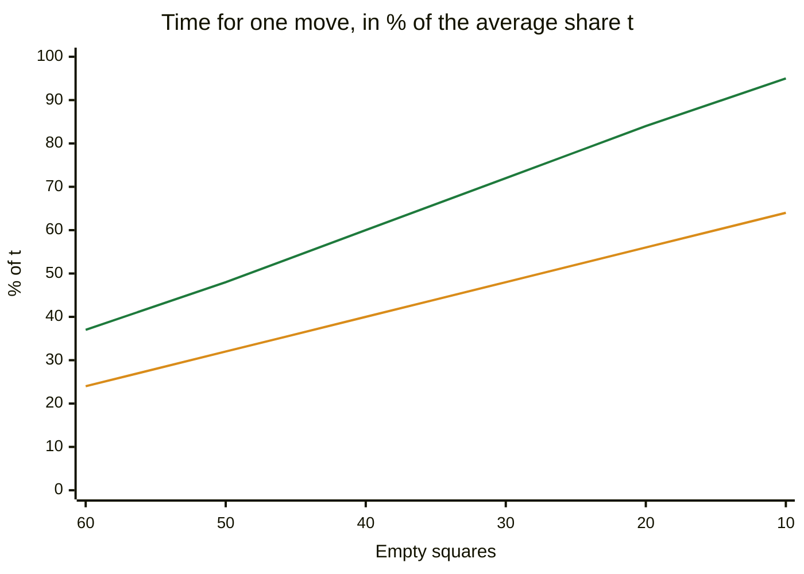
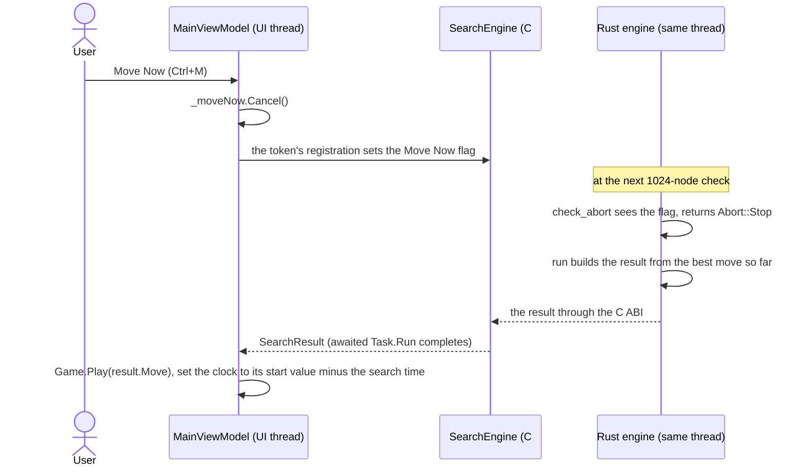

# 09 – Time control

[Back to the index](README.md)

## In short

The search can always go one ply deeper, so something must decide when to stop. `SearchLimits` says what the caller wants: a fixed depth, a fixed time per move, a share of the time left for the whole game, or a full solve. The time control (`search/time.rs`) turns that into two limits: a **soft** limit (do not start another iteration after it) and a **hard** limit (stop the search in the middle). The user can also stop the search at any moment: **Move Now** plays the best move found so far, and **cancel** discards the search. Progress is reported while the engine thinks, and the result says what kind of score it found.

## Data structures

### `SearchLimits`

| Mode (`TimeControlMode`) | Created with | Meaning | C++ |
|---|---|---|---|
| `FixedDepth` | `SearchLimits.FixedDepth(plies, ...)` | Search 1–60 plies, no time limit | `sogedybde` |
| `TimePerMove` | `SearchLimits.TimePerMove(time, ...)` | A fixed time for this move | `tid_per_trek` |
| `TimePerGame` | `SearchLimits.TimePerGame(remaining, ...)` | Share the time left on the computer's clock over the remaining moves | `spil_tid` |
| `Solve` | `SearchLimits.Solve` | Solve to the end, no time limit (tests, the endgame benchmark, the trainer's `mpc-end`) | – |

In addition to the time mode, `SearchLimits` carries two engine configuration properties configured via the settings dialog (chapter 15):
* `UseOpeningBook` (`bool`, default `true`): toggles whether the opening book is queried.
* `HashBits` (`int`, default `19`): specifies the power-of-two capacity for transposition tables.

These are the C# types that the apps and tools use. The Rust engine has the same `SearchLimits` ([search/limits.rs](../Stello.Rust/stello-core/src/search/limits.rs)) without `UseOpeningBook` and `HashBits`, which only `ComputerPlayer` and the engine hosts read, and with the time in whole milliseconds; the C# wrapper passes the mode, the depth and the time on (chapter 14).

In the app, the settings dialog gives a depth of 1–20 plies, 1–60 seconds per move or 1–60 minutes per game; the default is 5 minutes per game (`GameSettings.ToLimits`). In timed games (`TimePerGame`), both players have independent digital countdown clocks shown on the dual-card scoreboard. If the human's time runs out against the computer, a dialog lets the human continue casually (the clock stays at 0:00 and the status is marked modified, `#E74C3C`). Otherwise a clock reaching 0:00 ends the game: "Black ran out of time. Game over, White won on time." (chapter 14).

### `TimeBudget`

A small struct with `soft_ms` and `hard_ms`, in milliseconds since the search started. `TimeBudget::UNLIMITED` (both `i64::MAX`) is used for fixed depth and solve.

The soft limit is two thirds of the hard limit in every timed mode (below). For experiments, `SearchOptions.SoftTimePercent` (the match key `soft-pct=`) replaces it by another share of the hard limit (`with_soft_percent`); the apps always use two thirds. Using more of the time was measured and gave no significant gain ([chapter 23](23-phase-5-the-search.md)).

### Progress and result

| Type | Contents |
|---|---|
| `SearchInfo` | Reported after each root move: depth (plies, or empty squares in the endgame), current move, best move so far, score, `ScoreKind`, nodes, evaluations, elapsed time |
| `SearchResult` | The move (or a pass), score, `ScoreKind`, depth, nodes, evaluations, elapsed time |

`ScoreKind` says what the score means, and how the app's analysis panel shows it:

| `ScoreKind` | Meaning | Shown as |
|---|---|---|
| `None` | No search: a pass or a single legal move | (nothing) |
| `Heuristic` | 1/100 disc from the midgame search; beyond ±32 600 the game is won or lost | In discs with one decimal, "+1.2 discs", or "Win"/"Loss"; depth "8 plies" |
| `WinLossDraw` | Only the sign is known | "Win", "Loss" or "Draw"; depth "to the end (20 empty)" |
| `Exact` | The final disc difference with perfect play | "+12 discs" |
| `Book` | The move comes from the opening book | Score "Book"; depth empty |

## Algorithm

### The budget for the midgame

`time::for_midgame(limits, empties)`:

- **Time per move:** hard = the given time, soft = 2/3 of it (as the C++ `tider`/`rtider` tables, where `tider` was about 2/3 of `rtider`).
- **Time per game:** from the remaining time $T$ and the number of empty squares $e$ (C++ `calc_time`), in integer arithmetic:

$$
\begin{aligned}
s &= \max(0,\ e - 6) \qquad \text{(the last 6 squares take almost no time)} \\
n &= \lfloor s / 2 \rfloor \qquad \text{(the computer's moves left)} \\
t &= T / n \qquad \text{(or } T \text{ if } n = 0\text{)} \\
\text{hard} &= \left\lfloor \frac{t}{4} \right\rfloor + \left\lfloor \frac{3\,t\,(64 - s)}{256} \right\rfloor \\
\text{soft} &= \left\lfloor \frac{10 \cdot \text{hard}}{15} \right\rfloor
\end{aligned}
$$

  Early in the game $64 - s$ is small, so a move gets about a third of its average share $t$; near the end it gets almost all of it. This saves time for the middle and end of the game, where the search matters most:

  The green line is the hard limit, $\frac{1}{4} + \frac{3\,(64 - s)}{256}$ of $t$; the orange line is the soft limit, two thirds of it. The 6 is `FAST_ENDGAME_EMPTIES` (C++ `lookahead − 2` at the default level). If the clock is already below zero, the remaining time is taken as 10 ms (the same in the endgame budget).
- **Fixed depth and solve:** no time limit.

### The budget for the endgame

When the search switches to the solver, `time::for_endgame` gives it more time, but only with a game clock (C++ `calc_end_time`): with $R$ = the time left minus the time already used for this move, it may use half of it:

$$m = \lfloor R / 2 \rfloor, \qquad \text{hard} = \text{elapsed} + m, \qquad \text{soft} = \left\lfloor \frac{10\,m}{15} \right\rfloor$$

The soft limit decides whether pass 2 (the exact score) is started after pass 1 (chapter 08). With a time per move, the midgame budget is kept.

### How the search uses the limits

- **Soft limit:** `stop_iterating` is checked after each midgame iteration and after the win/loss/draw pass: no new iteration, and no exact pass, is started once the elapsed time is past the soft limit. For fixed depth it checks the depth instead (and after the win/loss/draw pass always goes on to the exact score); for solve it never stops.
- **Hard limit:** `check_abort` is called about every 1024 nodes: in the midgame node search when the node counter reaches a multiple of 1024, in the solver every 1024 nodes counted since the last check (`next_abort_check`, in `count_end_node`). If no progress was reported for 100 ms, it first repeats the last report, so the app's analysis panel stays alive during a long iteration. When the hard limit is passed, or Move Now is requested, it returns `Abort::Stop`, which every search function passes up with `?`, so the whole search unwinds; `run` then returns the best move found so far. That move may come from an unfinished iteration: each iteration starts with the previous best move, so a new best move from an unfinished iteration has already been compared with it at the new depth.
- **Cancel:** `check_abort` reads the cancel signal first. A cancelled search unwinds the same way but ends in `SearchError::Cancelled`, without a result, and the C# wrapper throws an `OperationCanceledException`, so the caller knows that nothing should be played. A search that is already cancelled when it starts returns at once.

At about 10 million nodes per second over whole games ([Stello 3.0 against 2.0 at 500 ms](../Plans/benchmark-results/match_v3p2-vs-v2-500ms.md)) and about 40 million in the solver ([FFO #40–49](../Plans/benchmark-results/v3p2-solve-bench-40-49.json)), 1024 nodes take well under a millisecond, so the search reacts to the limits and the signals almost at once. In the browser, Move Now and cancel are answered within 1 ms of the signal ([findings, gate P3](../Plans/making-stello-3-findings.md#gate-p3-release-aot-publish-in-headless-chromium-served-with-coopcoep-and-brotli)).

### The stop signals and the clock

The engine reads cancel and Move Now through the `StopSignal` trait (`is_cancelled`, `is_move_now`), at the start and at every abort check:

- **On the desktop and in the tools** they are `SearchSignals`, two atomic flags that any thread may set. The C# `SearchEngine` makes one pair per engine and clears them before each search; it registers its `cancellationToken` and `moveNowToken` so that cancelling a token sets the flag at once (`stello_signals_cancel`, `stello_signals_move_now` in the C ABI). The search itself runs on the calling thread.
- **In the browser** the engine runs in a Web Worker, which cannot receive messages while the search runs. The page writes the signal into a `SharedArrayBuffer` (1 Move Now, 2 cancel), and the WebAssembly engine reads it with `Atomics.load` at every abort check (`HostSignal` in the WebAssembly crate).

The clock is `system_clock` (`std::time::Instant`). WebAssembly has no clock in Rust's standard library, so the web build sets `performance.now()` with `SearchEngine::set_clock`. How each app loads the engine is in [chapter 14](14-app-integration.md).

### Move Now

This sequence shows what happens when the user clicks the prominent `[Move Now]` button or presses `Ctrl+M` while the computer thinks:

New Game, Open, Back and the other commands that change the game use the other token: `StopAsync` cancels the search and waits for it, and `ComputerMoveAsync` catches the `OperationCanceledException` and plays nothing (chapter 14).

## Worked example: time budgets

Values from `time::for_midgame` and `time::for_endgame` (soft / hard):

| Situation | Soft | Hard |
|---|---|---|
| Game clock 5 min, 60 empty squares (first move) | 2.7 s | 4.1 s |
| Game clock 5 min, 50 empty squares | 4.4 s | 6.6 s |
| Game clock 3 min, 40 empty squares | 4.2 s | 6.4 s |
| Game clock 2 min, 30 empty squares | 4.8 s | 7.2 s |
| Game clock 1 min, 20 empty squares | 4.8 s | 7.2 s |
| Game clock 30 s, 14 empty squares | 4.5 s | 6.8 s |
| 5 s per move | 3.3 s | 5.0 s |
| Endgame, 60 s left, 2 s already used for this move | 19.3 s | 31.0 s |

For the first move with 5 minutes: $s = 54$, $n = 27$, $t = 300\,000 / 27 = 11\,111$ ms, hard $= 2\,777 + \lfloor 3 \cdot 11\,111 \cdot 10 / 256 \rfloor = 2\,777 + 1\,302 = 4\,079$ ms, soft $= 2\,719$ ms.

## Design notes

- **Seconds instead of levels.** C++ had levels 0–14 that mapped to times in the tables `tider` and `rtider`. Stello uses seconds and plies directly; the formulas for the game clock are the same.
- **Deadline checks instead of a timer and `longjmp`.** C++ used a Windows multimedia timer that set a flag, and jumped out of the search with `longjmp`. Stello checks the clock every 1024 nodes and unwinds by returning `Abort` from every search function, which needs nothing special in Rust or WebAssembly and never leaves Rust through the C ABI.
- **Two kinds of stop.** C++ had a "Træk nu" (Move Now) menu item without any code behind it. Stello has both Move Now and cancel.
- **The engine does not know the clock.** The app keeps the computer's clock, passes the time left in `TimePerGame`, sets the clock after each move to its value at the start of the search minus the search time (charged once, although the display clock also ticks during the search), and restores it on Back and Forward (chapter 14).

See [Stello porting documentation.md](../Plans/Stello%20porting%20documentation.md), section 3.8.

## Where in the code

| File | Main members |
|---|---|
| [search/time.rs](../Stello.Rust/stello-core/src/search/time.rs) | `TimeBudget` (`UNLIMITED`, `with_soft_percent`), `for_midgame`, `for_endgame`, `for_game`, `FAST_ENDGAME_EMPTIES` |
| [search/engine.rs](../Stello.Rust/stello-core/src/search/engine.rs) | `StopSignal`, `SearchSignals`, `NoStop`, `Clock`, `system_clock`, `SearchEngine::set_clock`, `Searcher::stop_iterating`, `check_abort`, `report`, `result`, `Abort`, `SearchError` |
| [endgame/search.rs](../Stello.Rust/stello-core/src/endgame/search.rs) | `count_end_node`, the solver's node count and abort check |
| [search/limits.rs](../Stello.Rust/stello-core/src/search/limits.rs) | `TimeControlMode`, `SearchLimits`, `ScoreKind`, `SearchInfo`, `SearchResult` |
| [SearchLimits.cs](../Stello.Net/Stello.Engine/SearchLimits.cs), [SearchResult.cs](../Stello.Net/Stello.Engine/SearchResult.cs) | The C# `TimeControlMode`, `SearchLimits`, `ScoreKind`, `SearchInfo`, `SearchResult` |
| [SearchEngine.cs](../Stello.Net/Stello.Engine/SearchEngine.cs), [Native/StelloNative.cs](../Stello.Net/Stello.Engine/Native/StelloNative.cs) | The tokens registered on the signals, the progress callback, `OperationCanceledException` on cancel |
| [stello-ffi/src/lib.rs](../Stello.Rust/stello-ffi/src/lib.rs) | `stello_signals_create`, `stello_signals_cancel`, `stello_signals_move_now`, `stello_signals_reset` |
| [stello-wasm/src/lib.rs](../Stello.Rust/stello-wasm/src/lib.rs) | `HostSignal`, `browser_clock`, the throttled progress (`ProgressPoster`) |
| [Search/SearchOptions.cs](../Stello.Net/Stello.Engine/Search/SearchOptions.cs) | `SoftTimePercent` |
| [GameSettings.cs](../Stello.Net/Stello.App/Models/GameSettings.cs), [AnalysisViewModel.cs](../Stello.Net/Stello.App/ViewModels/AnalysisViewModel.cs) | The app's settings and how scores are shown |
| C++: [Kontrol.cpp](../Stello%20C++/BRAIN/Kontrol.cpp) | `calc_time`, `calc_end_time`, `getcomputer` |
| C# 2.0 (frozen): [Stello.Engine.V2/Search/TimeControl.cs](../Stello.Net/Stello.Engine.V2/Search/TimeControl.cs) | The C# original of the time control |

## Tests

[SearchEngineTests.cs](../Stello.Net/Stello.Engine.Tests/SearchEngineTests.cs), through the C# wrapper:

- 300 ms per move finishes within 400 ms with a legal move;
- a 10-second game clock uses at most 2 seconds for one midgame move;
- progress is reported for every depth, and repeated periodically during a long search;
- Move Now returns a legal move within 100 ms;
- cancel throws within 100 ms, and an already cancelled token throws at once.

[NativeEngineTests.cs](../Stello.Net/Stello.Engine.Tests/NativeEngineTests.cs) checks cancel and Move Now from inside the progress callback, and that the tokens of an earlier search do not stop the next one.

In Rust, the unit tests in [search/time.rs](../Stello.Rust/stello-core/src/search/time.rs) check the two-thirds rule, `with_soft_percent`, the game clock against Kontrol.cpp's formula (60 s and 40 empty squares give 1 414 / 2 122 ms), a used-up clock and the endgame budget. [tests/search.rs](../Stello.Rust/stello-core/tests/search.rs) checks the soft and the hard limit with a clock that the test moves by hand, a time per move, the heartbeats, and cancel and Move Now from another thread, in the midgame and in a solve. The Node tests of the WebAssembly package ([engine.test.mjs](../Stello.Rust/stello-wasm/tests/engine.test.mjs)) check a time per move with the `performance.now()` clock, the throttled progress, and Move Now and cancel through the signal.

In the app tests, [MainViewModelTests.cs](../Stello.Net/Stello.Net.Tests/MainViewModelTests.cs) check that Move Now stops the search, that the settings dialog sets the clock, and that the clock runs down during a game. The restore of the clock on Back and Forward has no test of its own.

## Further reading

- [Iterative Deepening – Chess Programming Wiki](https://www.chessprogramming.org/Iterative_Deepening): iterative deepening as the basis of time management.

---

Previous: [08 Endgame solver](08-endgame-solver.md) · Next: [10 Opening book](10-opening-book.md)
