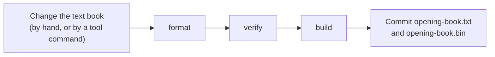
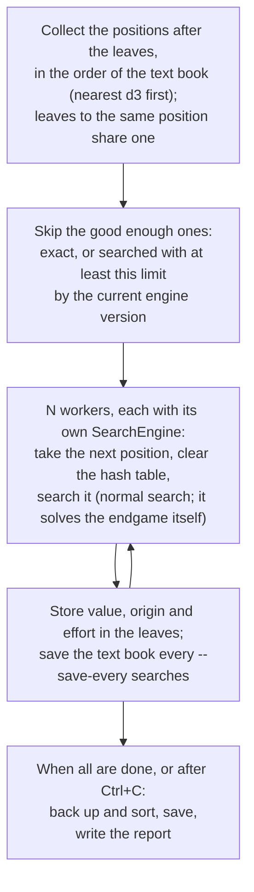

# 12 – Book tool

[Back to the index](README.md)

## In short

`Stello.BookTool` is a console program for keeping the master opening book ([chapter 10](10-opening-book.md)). It imports the C++ book, keeps the text book in its normal form, builds the binary book that the apps use, checks the book, and prints statistics. It also **recalculates** the book: it searches every leaf again with the current engine, on several engines at once, and then plays the old and the new book against each other in a **match**, to see whether the new book is stronger. It uses the book code in `Stello.Engine`, so the tool and the apps always agree on the format.

## Running it

From the repository root:

```text
dotnet run -c Release --project Stello.Net/tools/Stello.BookTool -- <command> [arguments]
```

| Command | Does |
|---|---|
| `import <OPENING> <book.txt>` | Reads the C++ book file and writes the text book (origins as in chapter 10) |
| `format <book.txt>` | Reads the text book and writes it again in its normal form, e.g. after editing it by hand |
| `build <book.txt> <book.bin>` | Builds the binary book for the apps from the text book |
| `verify <book.txt> [<book.bin>]` | Checks the text book and, if given, that the binary book holds the same book |
| `stats <book>` | Statistics for a book in any of the three formats |
| `recalc <book.txt> [--time-s 60 \| --depth N] [--workers N] [--save-every 10] [--hash-bits 19]` | Searches the leaves again, backs up and sorts, and writes `<book>.report.txt` |
| `compare <old book> <new book> [--out <report.txt>]` | Reports the values and first moves that changed |
| `match <book A> <book B> (--starts <report.txt> \| --starts-ply N) [--max-starts N] [--depth 10 \| --time-s S] [--workers N] [--threads 1] [--hash-bits 19]` | Plays the two books against each other; `--threads` is each engine's search threads (1–256), and workers × threads should stay within the cores |

Books are written to a temporary file first and then renamed (`WriteAtomically`), so a failed run never leaves half a book; the reports of `recalc` and `compare` are written directly. A file that cannot be read gives the error and exit code 1. `--workers` is the number of engines that search at the same time; the default is half the number of logical processors (the physical cores with hyper-threading). Each engine has two hash tables of $2^{\text{hash-bits}}$ slots (48 MiB at 19, chapter 07). Ctrl+C stops `recalc` and `match` cleanly; they then exit with code 2.

## Updating the master book



```text
dotnet run -c Release --project Stello.Net/tools/Stello.BookTool -- format Stello.Net/Book/opening-book.txt
dotnet run -c Release --project Stello.Net/tools/Stello.BookTool -- build Stello.Net/Book/opening-book.txt Stello.Net/Book/opening-book.bin
dotnet run -c Release --project Stello.Net/tools/Stello.BookTool -- verify Stello.Net/Book/opening-book.txt Stello.Net/Book/opening-book.bin
```

Two engine tests guard the files: `ShippedBinaryBook_HoldsTheTextBook` fails if the binary book was not built again, and `TextBook_IsInNormalForm` fails if the text book was not formatted.

## What `verify` checks

- **Errors** (the book cannot be used): reading the text book fails (an illegal move, a position or a move given twice, a position that cannot be reached from d3, a malformed line; the message has the line number), or the binary book holds another book.
- **Warnings** (the book can be used, but book learning would change it):
  - the file is not in the normal form;
  - a book move whose value is not minus the best value of the position after it;
  - a position whose moves are not sorted best first.

The master book as imported from the C++ book had 104 moves that were not backed up and 18 positions that were not sorted:

```text
Stello.Net/Book/opening-book.txt: 11,200 positions, 22,878 moves, every move legal and every position reached from d3.
Warning: moves whose value is not backed up from the position after them: 104, e.g.
  d3c3c4c5b3f3 b4
  d3c5d6c3c4e3 f4
  ...
Warning: positions whose moves are not sorted best first: 18, e.g.
  d3e3f4c3f5g5g4
  d3c3c4c5b3f3b4e3
  ...
Stello.Net/Book/opening-book.bin holds the same book.
```

They came from positions that the C++ tree stored more than once: each copy had its own values, and the import joined them. The import does not back up or sort, so the computer played the same book moves as before (chapter 10). `recalc` backs up and sorts the whole book, so the recalculated master book gives no warnings.

## Recalculating the leaves: `recalc`

A **leaf** is a book move whose position after it is not in the book; its value comes from a search, not from the book. `recalc` (`BookRecalculator`) searches the leaves again:



- **The search** is the one used in a game (`SearchEngine.Search` through `BookSearch.PositionValue`, chapter 06): with 60 s per move it deepens the midgame search and switches to the endgame solver when it gets near enough to the end (chapter 08). The kind of result gives the origin: `Heuristic`, `WinLossDraw` or `Exact`. A position with a single legal move is searched too; for a position where the player must pass, the opponent's position is searched; a finished game gets its disc count.
- **A proven result is kept.** If a leaf was `WinLossDraw` with a proof and the new search only gives a heuristic value, the old value stays, with the new effort. A proof is a value beyond ±32 600 (`SearchEngine.WinScore`), a win or loss, or a draw (value 0) that Stello itself solved, which its effort shows by an engine version (`IsProof`). A `WinLossDraw` value of evaluation size (from the C++ book's `INEXACT` flag, chapter 10) is no proof and gets the new value and origin. A new result that is solved (win/loss/draw or exact) always replaces the old one.
- **The same result with any number of workers.** Each search starts with a clean hash table, so a value does not depend on which searches the worker did before.
- **Stop and continue.** The text book is the checkpoint: it is saved every `--save-every` searches (default 10) and when the run stops. Running `recalc` again skips what is already done, because those leaves now have the effort of this run.
- **The end.** The values are backed up and sorted (`BookMinimax`, as in Evaluate Book), so `verify` gives no more warnings, and `<book>.report.txt` is written (see `compare`). Then run `build`.

| Option | Default | Meaning |
|---|---|---|
| `--time-s S` | 60 | Time per move for each position (the soft limit is two thirds of it, chapter 09) |
| `--depth N` | | A fixed depth instead of a time |
| `--workers N` | physical cores | Engines searching at the same time |
| `--save-every N` | 10 | Save the book after every N searches |
| `--hash-bits N` | 19 | Hash table size of each engine |

The run starts with a line that counts the leaf positions, how many will be searched and how many are already good enough, the limit and the workers. Then each search prints a line with the count, the ply and line of the leaf position, the new value (for the player who makes the book move), origin and depth, the time it took, and an estimate of the time left (the average search time so far, times the searches left, divided by the workers). The lines have this form; the values here are those of the master book's first leaf, d3 c3 e6:

```text
11,613 leaf positions; <to search> to search, <rest> already good enough. 60 s per position, 8 workers. Ctrl+C stops and saves; run again to continue.
[     1/<to search>] ply  3 d3c3e6   -525 Heuristic d30 (<time> s), left <time left>
```

The master book has 11 613 leaf positions (11 622 leaf moves; a few lead to the same position). When the engine version is raised, every leaf position that has a value that is not exact is searched again: about 8 200 for the master book. With Stello 2.0 and 60 s per position, a search in the opening reaches 19–30 plies, mostly 24–26 (it starts no new iteration after 40 s, and 60 s is the hard limit, chapter 09); near the end of the book the endgame solver finishes much sooner. With 8 workers on a Ryzen 7 7800X3D the whole run takes about 14 hours.

## Comparing two books: `compare`

`compare` (`BookComparison`) compares the book moves the two books have in common, and the move each book plays first in each position. The report that `recalc` wrote for the last recalculation of the master book, [opening-book.report.txt](../Stello.Net/Book/opening-book.report.txt) (shortened):

```text
# Recalculated Stello.Net/Book/opening-book.txt with 60 s per position (2026-11-02 00:05)
# Positions: 11,200 (before 11,200); book moves: 22,878 (before 22,878)
# Values changed: 15,776
# Origin before -> after: book moves (values changed)
#   Heuristic   -> Heuristic     4,225 (4,095)
#   Heuristic   -> WinLossDraw     595 (595)
#   Heuristic   -> Exact           606 (604)
#   WinLossDraw -> Heuristic     2,723 (2,719)
#   WinLossDraw -> Exact            38 (32)
#   Exact       -> Exact         3,435 (0)
#   BackedUp    -> BackedUp     11,256 (7,731)
# Positions whose first book move changed: 1,694
# <line> <old move>:<old value> <new move>:<new value>
d3c5 f6:25 d6:87
d3e3f4 g3:-150 c3:-775
...
```

The title line is the one `recalc` writes; `compare` writes "Comparison of <old> (old) and <new> (new)" instead. The `WinLossDraw -> Heuristic` row is the rule above at work: 2 718 of those values came from the C++ book's `INEXACT` flag and had no proof, and 5 were proven draws (value 0); the new search gave them all a heuristic value. The draws were lost because the rule then kept only values beyond ±32 600; it now keeps a draw that Stello solved too. The 38 proven wins and losses were solved exactly this time.

Everything except the changed positions is a comment, so the report can be given to `match` as its list of start positions.

## Playing the books against each other: `match`

`match` (`BookMatch`) plays book A against book B with the same engine and the same search limits, so only the books differ. It is the engine match of [chapter 17](17-measuring-the-engine.md) (`EngineMatch`) with a book on each side.

- **Start positions:** the lines in a file (`--starts`, normally the report: the positions where the first book move changed, the only places where the books can play differently), or every book position at a ply (`--starts-ply`). `--max-starts` takes the first N.
- **A pair of games** is played from each start position: first book A plays the side to move and book B the other side, then the other way round. Each side is a `ComputerPlayer` with its own `SearchEngine` (with a cleared hash table) and its own book, used as in a real game. The games are played to the end.
- **No repeated games:** with a fixed depth, the engine and the book always choose the same moves, so the variety comes from the start positions. If both books agree all the way, the pair scores 1–1 and cancels out.
- **Result:** points for book B (win 1, draw ½), its share of the points with a 95 % interval over the pairs ($\bar{s} \pm 1.96\, \sigma / \sqrt{n}$, where $s$ is a pair's share), and the average disc difference. B is stronger if the whole interval is above 50 %. At the end the pairs where book B lost points are listed, to look at by hand.
- **Fixed depth by default** (`--depth 10`), so the result does not depend on the machine's load.

```text
Finished after 9m 36s: 2,163 pairs. Book B scored 2284 of 4,326 (52.8 %, 95 % interval 51.6 % to 54.0 %), +1.1 discs per game.
Book B is stronger.

Pairs where book B lost points (376):
  ...
```

(The C++ book as imported, A, against its first recalculation, B, from the 2 163 positions of that recalculation's report, depth 10 per move, 8 workers; see the [Stello 1 documentation](stello-1/12-book-tool.md).) The verdict line is "Book B is stronger." when the whole interval is above 50 %, "Book A is stronger." when it is below, and otherwise "No significant difference.".

## Recalculating the master book

```text
dotnet run -c Release --project Stello.Net/tools/Stello.BookTool -- recalc Stello.Net/Book/opening-book.txt
```

Stop it with Ctrl+C and run the same command again to continue. When it has finished:

```text
git show HEAD:Stello.Net/Book/opening-book.txt > old-book.txt
dotnet run -c Release --project Stello.Net/tools/Stello.BookTool -- compare old-book.txt Stello.Net/Book/opening-book.txt --out book-report.txt
dotnet run -c Release --project Stello.Net/tools/Stello.BookTool -- match old-book.txt Stello.Net/Book/opening-book.txt --starts book-report.txt
dotnet run -c Release --project Stello.Net/tools/Stello.BookTool -- build Stello.Net/Book/opening-book.txt Stello.Net/Book/opening-book.bin
dotnet run -c Release --project Stello.Net/tools/Stello.BookTool -- verify Stello.Net/Book/opening-book.txt Stello.Net/Book/opening-book.bin
```

The report that `recalc` writes compares with the book at the start of the last run; after a run that was stopped and continued, `compare` against the book in git gives the report of the whole recalculation. Commit the text and the binary book if the match does not show that the old book is stronger.

### The master book now

The master book's values are those of Stello 2.0, engine version 4 (chapter 10): every leaf that is not exact was searched with 60 s per position, 8 workers on a Ryzen 7 7800X3D, in about 14 hours, and the exact values of earlier engine versions were kept. The run changed 15 776 values and the first move in 1 694 positions (the report above). In 1 180 games with books on and 500 ms per move, a pair from each of the 590 start positions at plies 10–12 in the benchmark's `starts.txt` (chapter 17), it scored 51.7 % (49.7–53.6 %) against the book before it, which is no significant difference but not worse ([result](../Plans/benchmark-results/match_v2x-book2x-vs-book20-500ms.md)). The book was recalculated twice for Stello 2.0, as told in [chapter 22](22-phase-4-the-release.md) and [chapter 23](23-phase-5-the-search.md); the second run also searched the 2 718 `INEXACT` leaves that the first one had kept by mistake.

Since Stello 3.0, `recalc` searches with the Rust engine (chapter 14). The original 3.0 port searched node for node like Stello 2.0: the whole master book at `--depth 10` with 4 workers gave identical books and reports, in 32 s instead of 50 s with the C# engine ([findings, speed pass](../Plans/making-stello-3-findings.md#speed-one-pinned-cpu-fastest-of-3-passes-same-session)). Later search fixes can change the nodes. With `--time-s` the faster engine searches deeper in the same time, so the values would change; the master book has not been recalculated by 3.0.

## Worked example: `stats`

`stats Stello.Net/Book/opening-book.bin` (shortened):

```text
Positions:    11,200
Moves:        22,878
Leaf moves:   11,622
Passes:       4
Longest line: 57 plies
Replies to d3: c5 (-87, BackedUp), c3 (-262, BackedUp), e3 (-775, BackedUp)

Origin of the values:
  Heuristic       6,948
  WinLossDraw       595
  Exact           4,079
  BackedUp       11,256

Search limit of the searched values:
  unknown         1,091
  60s            10,531

Ply  Positions  Leaf moves   (d3 is ply 1; a position counts at its shortest line)
  1          1           0
  2          3           0
  3          5           3
...
 55         26           2
```

Only the 1 091 exact values from the C++ book have no known effort; all other leaves were searched by `recalc` with 60 s per move. The values are in 1/100 disc for the player who makes the move: c5 is worth −0.87 discs for White.

## Design notes

- **A separate tool.** Long book jobs do not belong in the game app, and a console program can run for hours, be stopped and started again.
- **The binary book is committed.** Building it on every build of the apps would need the tool to run inside MSBuild for both the WPF and the web project (also in the GitHub workflow); the tests catch a binary book that was not built again instead.
- **Internals of the engine.** The tool uses the internal book types of `Stello.Engine` through `InternalsVisibleTo`, so the apps only see `OpeningBook`.
- **The engine's own endgame switch.** `recalc` does not decide when to solve exactly; the normal search does that, as in a game, within the time limit.
- **The book is the checkpoint.** Unlike the Checkers book tool, there is no separate `.partial` file: the effort stored with each value tells what is done.
- **Workers instead of a parallel search.** Since Stello 3.0 the engine can search on several threads, but `recalc` keeps 1 thread per worker and has no `--threads` (a user decision). Running one engine per core on different positions scales almost perfectly; threads within one search scale far less. On the whole master book at depth 14, 24 workers × 1 thread did 11,191 positions per minute, 3 × 8 did 4,160 and 1 × 24 did 1,816 ([chapter 26](26-phases-5-9-threads.md#the-user-decisions)). Only `match` has `--threads`, for comparing engines.
- **Only the leaves.** The values of the other book moves follow from the leaves by back-up. New moves are not added (that is dropout expansion, chapter 11, and the planned drop-out expansion of the book tool).

## Where in the code

| File | Main members |
|---|---|
| [Program.cs](../Stello.Net/tools/Stello.BookTool/Program.cs) | `Main`, `Import` (also `format`), `Build`, `Verify`, `Stats`, `Compare`, `WriteText` |
| [SearchCommands.cs](../Stello.Net/tools/Stello.BookTool/SearchCommands.cs) | `Recalc`, `Match`, `Cancellable` (Ctrl+C) |
| [Options.cs](../Stello.Net/tools/Stello.BookTool/Options.cs) | `Parse`, `Allow`, `Number`, `Limits` |
| [BookRecalculator.cs](../Stello.Net/Stello.Engine/BookRecalculator.cs) | `LeafPositions`, `ToSearch`, `Run` |
| [BookComparison.cs](../Stello.Net/Stello.Engine/BookComparison.cs) | `Of`, `Write` |
| [BookMatch.cs](../Stello.Net/Stello.Engine/BookMatch.cs) | `BookMatch.Play`, `ReadStarts`, `StartsAtPly`, `EngineMatch.Play`, `MatchSummary.Of` |
| [BookSearch.cs](../Stello.Net/Stello.Engine/BookSearch.cs), [BookMinimax.cs](../Stello.Net/Stello.Engine/BookMinimax.cs) | `PositionValue`, `Search`; `Run` (shared with book learning) |
| [ParallelWork.cs](../Stello.Net/Stello.Engine/ParallelWork.cs) | `Run` (the worker threads) |
| [BookAnalysis.cs](../Stello.Net/Stello.Engine/BookAnalysis.cs) | `Statistics`, `Consistency` |
| [BookTextFormat.cs](../Stello.Net/Stello.Engine/BookTextFormat.cs) | `Read`, `Write`, `Lines`, `Replay` |
| [BookBinaryFormat.cs](../Stello.Net/Stello.Engine/BookBinaryFormat.cs) | `Read`, `Write` |

## Tests

The tool itself has no tests; the code it calls is tested in [OpeningBookTests.cs](../Stello.Net/Stello.Engine.Tests/OpeningBookTests.cs) (chapter 10), including the two tests on the shipped files above, and in [BookRecalculatorTests.cs](../Stello.Net/Stello.Engine.Tests/BookRecalculatorTests.cs):

- `recalc` searches only the leaves that are not good enough, searches a transposed leaf once, keeps a proven result the search cannot solve, keeps a draw that Stello solved but replaces an imported one, replaces a win/loss/draw value that is no proof, gives the same book with 1 and 4 workers (and a consistent book after back-up), and continues where a stopped run stopped, with checkpoints;
- `compare` reports the changed values and first moves, and its report gives the start positions;
- `match` with the same book on both sides scores exactly 50 % with the colours swapped and finished, legal games; an illegal start position is rejected; the summary and its interval; reading start positions.

---

Previous: [11 Book learning](11-book-learning.md) · Next: [13 Game record](13-game-record.md)
