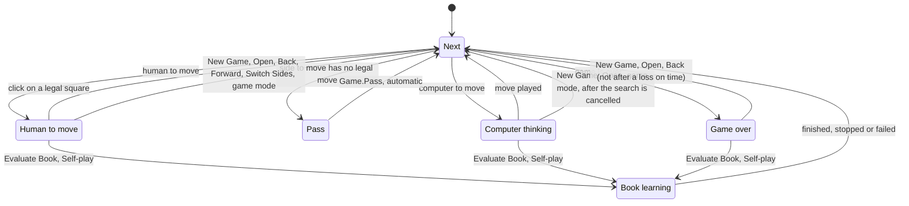
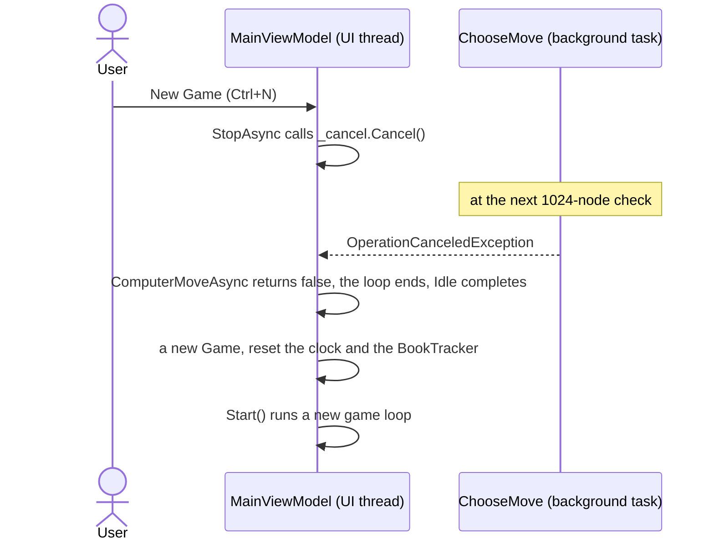
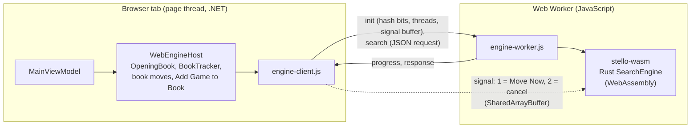
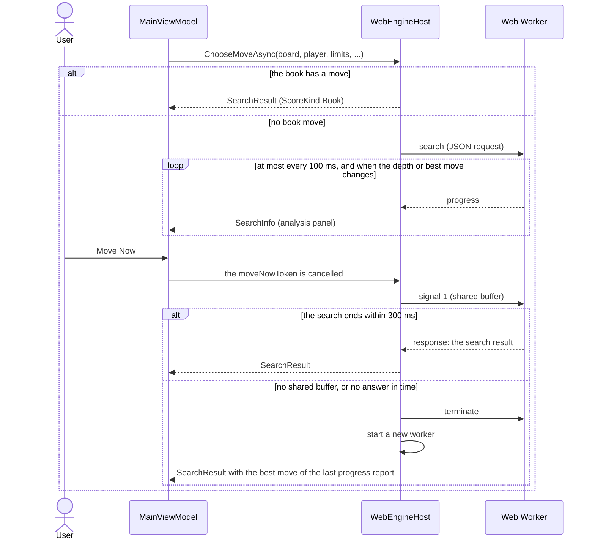
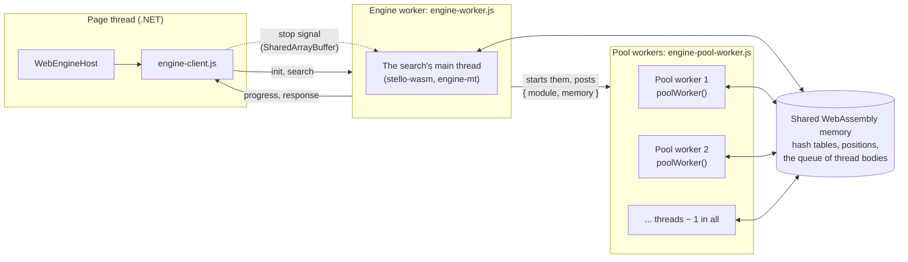
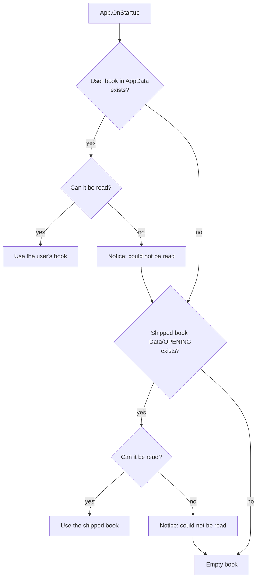

# 14 – App integration

[Back to the index](README.md)

## In short

The engine is a plain library: it knows nothing about windows, threads, clocks or files. Both apps, the WPF desktop app and the web app, drive it from one class, `MainViewModel` in `Stello.App`. It runs a **game loop** that plays passes and computer moves until the human is to move. It runs every search and every book-learning job through an **engine host**: on a background task in the desktop app, in a Web Worker in the browser, so the window stays responsive. The search itself is Stello's Rust engine in both apps: a **native library** that the desktop app calls through a C ABI, and a **WebAssembly module** in the browser's worker. The search may use **several threads** (the Threads setting, chapter 15): on the desktop the native library starts them itself; in the browser a second, threaded WebAssembly package runs them as extra Web Workers on a shared memory. It **stops the computer** before any command that changes the game. It turns the user's **settings** into `SearchLimits` and keeps the **computer's clock**. It also decides where the **opening book** is loaded from and saved to; the trained **evaluation** is built into the Rust engine itself. This chapter explains these parts; the layout of the windows and pages is in chapter 15.

## Data structures

### `MainViewModel`

The state that matters for the engine:

| Member | Contents |
|---|---|
| `_game` | The `Game` (chapter 13), including which colour the human plays (`Human`) |
| `GameMode` | `HumanVsComputer` (the default, the human plays Black), `ComputerVsHuman` or `HumanVsHuman` (two players); chosen in the web app's Game menu (`SetGameMode`). The enum also has `ComputerVsComputer`, which no menu offers |
| `_engine` | The `IEngineHost` that runs the searches and owns the opening book. In the desktop app it is `LocalEngineHost`, with the game's `ComputerPlayer` (its `SearchEngine`, the book and the `BookTracker`, chapter 10); in the browser it is `WebEngineHost`, which keeps the book and a `ComputerPlayer` for the book moves on the page and sends only the searches to the worker. Its `Threads` (a `ThreadCounts`) says how many threads the device offers and what Automatic means there ([below](#search-threads)) |
| `IsThinking`, `IsLearning` | True while a search or a learning job runs; they enable and disable commands |
| `Idle` | The task of the running game loop; it completes when the human is to move or the game is over |
| `Learning` | The task of the running learning job |
| `_cancel`, `_moveNow`, `_learningCancel` | The cancellation sources of the current search (two tokens, chapter 09) and of learning |
| `_searchId` | A number that goes up with each computer move, to recognise old progress reports |
| `Settings` | The `GameSettings`: mode, depth, seconds per move, minutes per game, opening book toggle, transposition table capacity, threads |
| `_blackTimeLeft`, `_whiteTimeLeft`, `_timeLeftAtPly` | The player clocks, and their snapshot pairs for every ply so Undo and Redo restore the destination position's clocks |
| `IsGameModified`, `IsStatusModified` | `IsGameModified` is set by Back against the computer, Switch Sides, a settings change after the first move and continuing after a timeout, and cleared by New Game, Open and a new game mode; `IsStatusModified` is `IsGameModified` in a game against the computer (chapter 15) |
| `Analysis` | The `AnalysisViewModel` that shows `SearchInfo` and `SearchResult` (chapter 09) |

The commands are generated by the MVVM Toolkit from methods marked `[RelayCommand]`, with a `CanExecute` method or property that decides when they are enabled. When `IsThinking` or `IsLearning` changes, the commands that depend on it are told to check again (`[NotifyCanExecuteChangedFor]`).

### Services

The view model reaches the engine, files and dialogs only through small interfaces, so each app can supply its own implementation and the tests can replace them:

| Interface | Desktop app | Web app | Does |
|---|---|---|---|
| `IEngineHost` | `LocalEngineHost` | `WebEngineHost` | Runs the searches and book learning; owns the book |
| `IBookStore` | `FileBookStore` | `LocalStorageBookStore` | Saves the learned book; appends to the self-play log |
| `ISettingsStore` | `JsonSettingsStore` | `LocalStorageSettingsStore` | Loads and saves `AppSettings` (game settings, analysis panel, window position) as JSON |
| `IDialogService` | `DialogService` | `BrowserDialogService` | Message boxes, file dialogs, the settings dialog, "Did Black win the game?" |
| `IGameFileService` | `GameFileService` | `BrowserGameFileService` | Opens and saves game files (`.stello`, `.txt`) |
| `ISoundService` | `NullSoundService` (no sound) | `BrowserSoundService` | Sounds synthesized by `SoundWaves` for a move, a pass, a win and a loss (chapter 15) |

In the desktop app, `BookLoader` (static) picks the book file at start-up, and `AppPaths` (static) holds all file locations. The web app keeps the settings and the learned book in the browser's local storage instead.

### Files

| File (`AppPaths`) | Location | Written |
|---|---|---|
| `SettingsFile` | `%AppData%\Stello\settings.json` | When a setting, the analysis panel or the window position changes |
| `UserBookFile` | `%AppData%\Stello\OPENING` | After book learning and after Add Game to Book |
| `SelfPlayLogFile` | `%AppData%\Stello\SELFPLAY` | One line per self-play game |
| `DefaultBookFile` | `Data\OPENING` next to the program | Never; it is the shipped master book |

Settings and the book are written to a temporary file first and then renamed over the old file, so a crash cannot leave half a file. Nothing depends on the current directory. Both book files are in the binary book format (chapter 10); a user book in the C++ format is still read, and is written in the binary format the next time it is saved.

### What the builds put in the apps

| Data | Source in the repository | How it gets into the apps |
|---|---|---|
| The search engine (chapters 03–09) | [Stello.Rust](../Stello.Rust) (crates `stello-core`, `stello-ffi`, `stello-wasm`) | Built by Cargo during the .NET build (next section): the native library `stello_engine.dll` / `libstello_engine.so` next to the desktop app, the tools and the tests, and two WebAssembly packages in the web app: the single-threaded one in `wwwroot/engine/` and the threaded one in `wwwroot/engine-mt/` ([Threads in the browser](#threads-in-the-browser)). None of them is committed |
| The evaluation weights (chapter 04) | [Stello.Net/Book/stello-eval.bin](../Stello.Net/Book/stello-eval.bin) | `stello-core` embeds it with `include_bytes!` (`BUILT_IN_FILE` in [weights.rs](../Stello.Rust/stello-core/src/eval/weights.rs)), so the native library and the WebAssembly module carry it, with no file to load. The C# evaluation in `Stello.Engine` is not embedded; the trainer and the benchmark tool, which use it, copy the file to their `Data` folder |
| The opening book (chapter 10) | [Stello.Net/Book/opening-book.bin](../Stello.Net/Book/opening-book.bin), built by the book tool (chapter 12) | `Stello.Net.csproj` links it as `Data\OPENING`, copied next to the program. `Stello.Web.csproj` copies it to `wwwroot/data/OPENING.bin` before every build (target `CopyOpeningBook`; the copy is git-ignored), because the development server does not serve linked files |
| This documentation | `docs/**` | `Stello.Web.csproj` copies it to `wwwroot/content/docs/` (target `CopyDocs`), where the web app's Docs pages show it (Help menu, chapter 15) |
| The picture in the About box | `Stello.Net/Images/2026 Claus Pedersen.jpg` | The WPF app has it as a WPF resource (`Images\ClausPedersen.jpg`); the web build copies it to `wwwroot/images/claus-pedersen.jpg` (target `CopyAboutPicture`, git-ignored) |

The web app's .NET code (the view models, the book, the game record) is published with ahead-of-time compilation to WebAssembly (`RunAOTCompilation` in Release, which needs the `wasm-tools` workload). The search does not run in .NET there: it is the Rust module.

### How each app gets the engine

| | Desktop app, tools and tests | Web app |
|---|---|---|
| Crate | `stello-ffi`, a C ABI library (`cdylib`) named `stello_engine` | `stello-wasm`, a [wasm-bindgen](28-references.md#25-phases-04-the-engine-in-rust) package (`--target web`) |
| MSBuild target | `BuildStelloNative` in [Stello.Engine.csproj](../Stello.Net/Stello.Engine/Stello.Engine.csproj), before every build of `Stello.Engine` | `BuildStelloWasm` in [Stello.Web.csproj](../Stello.Net/Stello.Web/Stello.Web.csproj), before every build of the web app, then `BuildStelloWasmThreads` ([line 171](../Stello.Net/Stello.Web/Stello.Web.csproj#L171)) for the threaded package |
| What Cargo builds | `cargo build --release -p stello-ffi`, into `Stello.Rust/target/<os>` (`linux`, `windows`: each OS has its own folder, because the repository folder is shared between the Linux sandbox and Windows) | `cargo build --release --target wasm32-unknown-unknown -p stello-wasm`, then `wasm-bindgen --target web --no-typescript` writes `stello_wasm.js` and `stello_wasm_bg.wasm` to `wwwroot/engine/` (git-ignored). The threaded package is the same crate built with a pinned nightly into `target/<os>-wasm-mt` and packaged into `wwwroot/engine-mt/` (git-ignored) |
| When | Only when a Rust source, a Cargo file or `stello-eval.bin` is newer than the library (`StelloRustSource`) | The same (`StelloWasmSource`), for each package |
| Where it goes | The library is a `None` item of `Stello.Engine`, so it is copied to the output of every project that references it: the WPF app, the tools and the tests. The web app removes it from its output and its publish (`RemoveStelloNativeEngine`) | Both packages are content of the web app (`IncludeStelloWasm`). The worker loads one of them: `engine/` or `engine-mt/` |
| How it is loaded | `[LibraryImport("stello_engine")]` in [Native/StelloNative.cs](../Stello.Net/Stello.Engine/Native/StelloNative.cs), from the application's folder, at the first search. `EnsureLoaded` checks once that the library has ABI version 3 ([`AbiVersion`](../Stello.Net/Stello.Engine/Native/StelloNative.cs#L16)) and explains a missing library or another version | `engine-worker.js` imports the package and calls `init` |
| Threads | The library starts its own threads (`std::thread`) at the first search with more than 1 thread ([chapter 06](06-midgame-search.md#the-thread-pool)) | The threaded package gets its threads from Web Workers that the engine worker starts ([Threads in the browser](#threads-in-the-browser)) |
| Switched off with | `-p:StelloNativeEngine=false` (a build that never searches; the web app's publish uses it) | `-p:StelloWasmEngine=false` (a check of the C# code without Rust); `-p:StelloWasmThreads=false` builds only the single-threaded package |

The toolchain:

- **For the desktop app on Windows:** Rust from [rustup](https://rustup.rs) with its default toolchain, `x86_64-pc-windows-msvc`, which needs Visual Studio's C++ build tools for the linker (the "Desktop development with C++" workload). The DLL links the C runtime statically (`+crt-static` in [.cargo/config.toml](../Stello.Rust/.cargo/config.toml)), so the app needs no Visual C++ redistributable. Cargo is found on the PATH or in `%USERPROFILE%\.cargo\bin`, or the property `StelloCargo` gives its path; without it, or without the linker, the build stops with a message that says what to install. A Linux build can check the Windows DLL with `-p:StelloCargoTarget=x86_64-pc-windows-gnu` and MinGW.
- **For the web app:** also the target (`rustup target add wasm32-unknown-unknown`) and `wasm-bindgen-cli` of exactly the version of the `wasm-bindgen` crate, 0.2.130 (`cargo install wasm-bindgen-cli --version 0.2.130 --locked`). `BuildStelloWasm` checks all three and names the missing one.
- **For the threaded web package:** the nightly Rust named by the property `StelloWasmNightly` (`nightly-2026-11-02`, [Stello.Web.csproj line 81](../Stello.Net/Stello.Web/Stello.Web.csproj#L81)) with its standard library source: `rustup toolchain install nightly-2026-11-02 --profile minimal --component rust-src`. It is pinned in the project, not in a `rust-toolchain` file, so the rest of the workspace stays on stable. The property `StelloWasmThreads` decides what happens without it:

  | `StelloWasmThreads` | Without the nightly or rust-src | Used by |
  |---|---|---|
  | `auto` (the default) | A warning with the rustup command; only the single-threaded package is built, and an old `engine-mt` folder is removed. A Windows build without the nightly still works | Local builds |
  | `required` | An error | The deploy workflow |
  | `false` | The threaded package is not built, and nothing is checked | Builds that do not need it |

  The check runs `rustc +nightly-2026-11-02 --print sysroot` with `RUSTUP_AUTO_INSTALL=0`, so a build never downloads a toolchain.
- **The deploy workflow**, [azure-static-web-apps.yml](../.github/workflows/azure-static-web-apps.yml), installs Rust stable with the target ([line 41](../.github/workflows/azure-static-web-apps.yml#L41)), the pinned nightly with `rust-src` ([line 49](../.github/workflows/azure-static-web-apps.yml#L49); its version must equal `StelloWasmNightly`) and the prebuilt wasm-bindgen 0.2.130, and publishes with `-p:StelloNativeEngine=false -p:StelloWasmThreads=required` ([line 69](../.github/workflows/azure-static-web-apps.yml#L69)), so the live site always has both packages.

## Algorithm

### The game loop

`Start()` runs `RunAsync` and keeps its task in `Idle`. The loop refreshes the board, and then, depending on the position:

- **Pass** is never a command: when the side to move has no legal move, the loop passes for it and says so in the status panel; the notice stays until the human's next turn ("You had no legal move and passed.", "The computer had no legal move and passed.", or "Black had no legal move and passed." with two players).
- **Thinking** is `ComputerMoveAsync`: it asks the engine host for a move (`ChooseMoveAsync`, which runs `ComputerPlayer.ChooseMove` in the background) and plays the result. A move that took less than 250 ms (`ComputerDelayMs`, for example a book move) is played 250 ms after the search started, so it does not appear the instant the human has moved; Move Now skips the wait. If the search is cancelled, it plays nothing and the loop ends with "Stopped."; the command that cancelled it then starts a new loop.
- Every command that changes the game (New Game, Open, Back, Forward, Switch Sides, a new game mode, Add Game to Book, Evaluate Book, Self-play) first calls `StopAsync`, which cancels the search and waits for `Idle`. Then it changes the game and calls `Start()` again. So there is never more than one loop, and the game is never changed while the engine reads it.
- Against the computer, Back goes back to the previous position where the human is to move, skipping the computer's moves and passes, and Forward goes to the next such position or to the end; with two players they move one ply. Switch Sides gives the human the other colour, so the computer moves at once. After Open the human plays the side to move (except with two players). New Game and a new game mode ask "Abandon current match and start a new game?" while a game is under way.

### Which commands are enabled

| Command | Human to move | Computer thinking | Game over | Book learning |
|---|---|---|---|---|
| Click on a square | Plays it if legal, otherwise beeps | Beeps | Beeps | Beeps |
| New Game, Open | Yes | Yes, stops the search first | Yes | No |
| Switch Sides | Yes, against the computer | No | No | No |
| Back / Forward | If there is a move to go back / forward to | No | The same as for the human, except after a loss on time (disabled) | No |
| Move Now | No | Yes | No | No |
| Settings | Yes | Yes; the new settings count from the next computer move | Yes | No |
| Game mode (web Game menu) | Yes | Yes, stops the search first | Yes | – (no learning in the web app) |
| Save, Save As | Yes | Yes | Yes | Yes |
| Add Game to Book | Yes (at least two moves) | Yes, stops the search first | Yes | No |
| Evaluate Book, Self-play | Yes | Yes, stops the search first | Yes | No |
| Stop Learning | No | No | No | Yes |
| Analysis, About, Exit | Yes | Yes | Yes | Yes |

An asynchronous command is also disabled while it runs, for example while New Game waits for the search to stop (the MVVM Toolkit default). Exit cancels the search and learning without waiting (`Stop`). Back and Forward are not enabled while the computer thinks (`CanUndo` and `CanRedo` check `IsThinking`, and `IsThinking` re-evaluates both commands when it changes); take the move back after it is played, or use Move Now first.

### Threading

The engine is synchronous (chapter 01). The desktop host, `LocalEngineHost`, runs it with `Task.Run`, and the view model awaits the task on the UI thread:

- **Progress.** `ComputerMoveAsync` creates a `Progress<SearchInfo>` on the UI thread. In both apps, the analysis panel is updated on that thread. A report can be handled after its search has ended, so the callback checks the search id, whether the search has completed, and whether the computer is still thinking. The final result closes the progress callback before updating the panel, so a late report cannot replace it.
- **Result.** After `await`, the code is back on the UI thread: it sets the computer's clock to its value at the start of the search minus the search time (so the time is charged once), shows the result in the analysis panel and plays the move.
- **Stopping.** Move Now and cancel are the two tokens of chapter 09. This sequence shows New Game while the computer thinks (after the confirmation):

- **Book learning** (chapter 11) runs the same way in `LearnAsync`: `StopAsync`, then `IsLearning = true` (which disables the game commands), then `IEngineHost.LearnAsync`, which runs the learning job on `Task.Run` with its own `SearchEngine` and reports a `Progress<BookLearningProgress>` to the status panel. The book is shared with the game's `ComputerPlayer`, which is safe because the game loop does not run while learning runs. When the job ends (finished, stopped or failed), the book is saved, the `BookTracker` is reset, a summary is shown, and the game loop starts again.

### Search threads

The background task above is the thread the app sees. The search itself may run on more threads: the Rust engine's own (Lazy SMP and YBWC, [chapter 06](06-midgame-search.md#threads)). How many it uses comes from the Threads setting (chapter 15) and travels with the limits of each search:

1. **The device.** `IEngineHost.Threads` is a [`ThreadCounts`](../Stello.Net/Stello.App/Models/ThreadCounts.cs): `Device`, the most the setting offers, and `Default`, what Automatic uses. On the desktop (`ThreadCounts.ForThisProcess`) these are `Environment.ProcessorCount` and one fewer (at least 1), so one thread is left for the app. In the browser (`ThreadCounts.ForBrowser`, made in [Program.cs](../Stello.Net/Stello.Web/Program.cs#L18) from `navigator.hardwareConcurrency`) both are the browser's count, because the page's own thread is not one of the engine's.
2. **The setting.** `GameSettings.ThreadsFor(counts)` ([GameSettings.cs](../Stello.Net/Stello.App/Models/GameSettings.cs#L66)) gives the device's default for Automatic (stored as 0), or the chosen number capped at the device's.
3. **The limits.** `ComputerMoveAsync` passes it to `GameSettings.ToLimits` ([MainViewModel.cs](../Stello.Net/Stello.App/ViewModels/MainViewModel.cs#L702)), which sets `SearchLimits.Threads`: an `init` property, 1 to `SearchLimits.MaxThreads` (256), default 1, checked when it is set ([SearchLimits.cs](../Stello.Net/Stello.Engine/SearchLimits.cs#L56)). Only the Rust engine reads it; the frozen Stello 1 and 2.0 engines always search with 1.
4. **The desktop.** `LocalEngineHost` → `ComputerPlayer.ChooseMove` → `SearchEngine.Search`, as for every search. The wrapper calls `stello_engine_set_threads` only when the number differs from the last one it set ([SearchEngine.cs](../Stello.Net/Stello.Engine/SearchEngine.cs#L108)). The Rust engine starts its worker threads at the first search with more than 1 and keeps them for the next searches with the same number. Book learning makes its own `SearchEngine` with the default limits, so it stays on 1 thread.
5. **The browser.** `WebEngineHost` writes the threads into the `MoveRequest`, and the worker caps them at what its package and the device can run ([below](#threads-in-the-browser)).

The C ABI has version 3 (`ABI_VERSION` in [stello-ffi](../Stello.Rust/stello-ffi/src/lib.rs#L57)). Each version only adds functions; the earlier ones are unchanged:

| ABI version | Adds | C# |
|---|---|---|
| 1 | The engine, the signals and the search (phase 2) | `StelloNative`'s first functions |
| 2 | `stello_engine_set_threads(engine, threads)`: 1–256, else `STELLO_INVALID_ARGUMENT` ([line 255](../Stello.Rust/stello-ffi/src/lib.rs#L255)) | `SetThreads`, called from `Search` when `SearchLimits.Threads` changes |
| 3 | `stello_engine_set_ybwc(engine, ybwc)`: YBWC on (the default) or off, for comparisons ([line 275](../Stello.Rust/stello-ffi/src/lib.rs#L275)) | `SetYbwc`, called once when the engine is made if `SearchOptions.Ybwc` is false ([SearchEngine.cs](../Stello.Net/Stello.Engine/SearchEngine.cs#L208)) |

The wrapper requires exactly this version ([`AbiVersion`](../Stello.Net/Stello.Engine/Native/StelloNative.cs#L16) = 3). Progress and the iteration callback still run on the thread that called `Search`, with the nodes of all threads. The hash tables now take 64 bytes per slot, one cache line with the slot's lock ([chapter 07](07-transposition-table.md)), so the wrapper tells the .NET garbage collector about $2 \times 64 \times 2^{\text{hashBits}}$ bytes of native memory (`HashBytesPerSlot`, [SearchEngine.cs](../Stello.Net/Stello.Engine/SearchEngine.cs#L31)): 64 MiB at the default 19 bits.

### The engine in the browser

WebAssembly runs the page on one thread, so a search on the page would freeze it. The web app therefore runs the search in a **Web Worker**: a small JavaScript module, `engine-worker.js`, with Stello's Rust engine compiled to WebAssembly ([stello-wasm](../Stello.Rust/stello-wasm/src/lib.rs)). The book stays on the page. `WebEngineHost`, the `IEngineHost` on the page side, plays the book move itself (`ComputerPlayer.TryChooseBookMove`, the book step of `ChooseMove`, with the page's `BookTracker`) and sends only the searches to the worker. It talks to the worker through `engine-client.js`, with the JSON messages of `EngineProtocol`, and it shares one 4-byte `SharedArrayBuffer` with the worker for the stop signal:

- **Starting.** `WebEngineHost` starts the worker at once (`start`, then `init` with 19 hash bits, the threads of the saved setting and the signal buffer), so the worker is usually ready before the computer's first search. The threads decide which package the worker loads ([Threads in the browser](#threads-in-the-browser)). `init` makes the engine and decodes the built-in evaluation; the worker needs no book. A request with other hash bits than the engine's makes a new engine in `search` (chapter 07), and the host resets its `BookTracker`, as the desktop app's new `ComputerPlayer` does.
- **The messages.** `search` takes the JSON of a `MoveRequest` and returns the JSON of a `MoveResponse`. Rust reads and writes it itself ([protocol.rs](../Stello.Rust/stello-wasm/src/protocol.rs)), because JavaScript's `JSON.parse` would round the 64-bit boards. The page uses `EngineProtocol.WriteRequest`, `ReadResult` and `ReadProgress`.
- **Progress.** `ProgressPoster` in `stello-wasm` posts a report at most every 100 ms, but always when the depth or the best move changes, so the page is not flooded.
- **Stopping.** The worker runs the search synchronously and reads no message until it is over, so a stop request cannot be a message. Move Now writes 1 and cancel writes 2 into the shared buffer (`signal`, with `Atomics.store`); the client clears it before each new request. The engine reads it (`host.signal()`, an `Atomics.load`) at every abort check, every 1,024 nodes (chapter 09), and stops exactly as in the desktop app; the worker keeps its hash tables. In Chromium the engine answers in under 1 ms, and a click on Move Now changes the board in about 25 ms ([findings, gate P3](../Plans/making-stello-3-findings.md#gate-p3-release-aot-publish-in-headless-chromium-served-with-coopcoep-and-brotli)).
- **The clock.** WebAssembly has no clock in Rust's standard library, so the engine is timed by the browser (`set_clock`, chapter 09): with `performance.timeOrigin + performance.now()` ([lib.rs](../Stello.Rust/stello-wasm/src/lib.rs#L54)), in both packages. `performance.now()` alone counts from the start of each worker, and the threads of a search compare their time with the start of the search, which the engine worker took.
- **The fallback.** A `SharedArrayBuffer` exists only when the page is cross-origin isolated; [staticwebapp.config.json](../Stello.Net/Stello.Web/wwwroot/staticwebapp.config.json) sends the headers `Cross-Origin-Opener-Policy: same-origin` and `Cross-Origin-Embedder-Policy: require-corp` for this. If there is no buffer, if the search has not ended 300 ms after the signal, or if a Move Now result cannot be read, the host **terminates the worker** and starts a new one (`Restart`). A search that fails also gets a new worker for the next search.

- **Move Now** normally plays the search's own result. After a restart it plays the best move from the last progress report, or the move being searched, or the first legal move if there was no report (`EngineProtocol.MoveNowResult`). **Cancel** throws `OperationCanceledException`, as in the desktop app, whether the worker stopped or was restarted.
- A restarted worker has an empty hash table, and the host resets its `BookTracker`. The page does not wait for the worker, and it is usually ready before the computer's next move: it starts in about 90 ms ([findings, gate P3](../Plans/making-stello-3-findings.md#gate-p3-release-aot-publish-in-headless-chromium-served-with-coopcoep-and-brotli)).
- **Add Game to Book** runs on the page (`BookLearner.AddGame`, which does not search), and the changed book is saved in the browser's local storage. Evaluate Book and Self-play are only in the desktop app (`SupportsLearning` is false).

### Threads in the browser

WebAssembly has threads only when its memory is a `SharedArrayBuffer` that several Web Workers use, and only on a page that is **cross-origin isolated** (the two headers in [staticwebapp.config.json](../Stello.Net/Stello.Web/wwwroot/staticwebapp.config.json)). Rust's `std::thread::spawn` does not work there: the threads must come from JavaScript. So the web app has two packages of the same crate, `stello-wasm`:

| | `wwwroot/engine` | `wwwroot/engine-mt` |
|---|---|---|
| Threads | 1, whatever a request asks for | Up to the request's `Threads`, capped at `navigator.hardwareConcurrency` |
| Rust | Stable | The pinned nightly `nightly-2026-11-02`, with `-Z build-std=std,panic_abort` (the standard library rebuilt with atomics) |
| Target features | The default | `+atomics,+bulk-memory,+mutable-globals` ([Stello.Web.csproj line 90](../Stello.Net/Stello.Web/Stello.Web.csproj#L90)) |
| Memory | Its own, growing | Shared and imported (`--shared-memory --import-memory`), at most 2 GiB (`--max-memory=2147483648`), so the 1,024 MB hash setting fits; plus the thread-local storage exports that wasm-bindgen needs |
| `threaded()` | `false` | `true` |
| Loaded when | Otherwise, and as the fallback | `init` asks for more than 1 thread, `self.crossOriginIsolated` is true and `SharedArrayBuffer` exists |

Only the package that is used is downloaded. The two differ only in how the engine gets its threads: the threaded package gives the engine's pool ([chapter 06](06-midgame-search.md#the-thread-pool)) a `Spawner` that runs each pool thread on a Web Worker (`new_engine` in [lib.rs](../Stello.Rust/stello-wasm/src/lib.rs#L134)).

- **Loading** (`load` in [engine-worker.js](../Stello.Net/Stello.Web/wwwroot/js/engine-worker.js#L31)). At `init` the worker imports `../engine-mt/stello_wasm.js`, fetches and compiles the module once (`WebAssembly.compile`) and instantiates it, which makes the shared memory. If any step fails, it prints a console warning ("The threaded engine could not be loaded; the single-threaded one plays.") and loads `../engine` instead. `init` answers `{ version, mode, threads }`: `mode` is `'threaded'` or `'single'`, and `threads` is the most the engine can use (`hardwareConcurrency`, or 1). `engine-client.js` keeps it for `info()`.
- **The pool workers** ([engine-pool-worker.js](../Stello.Net/Stello.Web/wwwroot/js/engine-pool-worker.js)). The engine worker starts them itself, as nested workers, and posts each the compiled module, the memory and the address of the glue code. Each instantiates the module on the same memory (`initSync({ module, memory })`), answers `'ready'` and calls `poolWorker()`, which never returns: it waits for a thread body with `Atomics.wait` (through Rust's `Condvar`), runs it, and waits again. A worker may block like this; the page's main thread never runs this code and never blocks.
- **How the engine gets a thread** ([threads.rs](../Stello.Rust/stello-wasm/src/threads.rs)). `web_spawner` is the engine's `Spawner`: it puts the body in a queue in the shared memory and wakes a pool worker that waits, or fails if none waits; the engine's pool then simply has fewer threads. The workers of the previous pool may still be on their way back to the wait when a new pool starts, so `web_spawner` waits for one of them, but at most 200 ms (`RETURN_WAIT`). A review found that this wait first had no limit: if fewer Web Workers had started than the pool asked for, it would have waited for the new pool's own threads, which end only with the pool, and the search would have hung.
- **Before each search** (`prepare`, [line 87](../Stello.Net/Stello.Web/wwwroot/js/engine-worker.js#L87)). The worker caps the request's threads at `hardwareConcurrency` (at 1 in the single-threaded package) and rewrites the request if it changed them. With more than 1 it makes sure that threads − 1 pool workers exist and wait (`ensurePoolWorkers`): it starts the missing ones, waits for their `'ready'` and then, at most 2 s, until the engine counts them as idle (`idleThreads()`). A worker that cannot start leaves the search with fewer threads. The pool workers are started once and kept; the first ones already start at `init`, so the first search finds them ready.
- **Stopping.** Only the engine worker reads the page's stop signal. The other threads stop through the engine's own flags ([chapter 06](06-midgame-search.md#threads)), and the main thread also reads the signal while it waits for them, so Move Now and cancel answer within milliseconds with any number of threads (table below).
- **Changing the number of threads.** The package is chosen at `init`, so `WebEngineHost` starts a new worker when a search asks for more than 1 thread after one with 1, or the other way round ([WebEngineHost.cs](../Stello.Net/Stello.Web/Services/WebEngineHost.cs#L88)). The new worker has empty hash tables, but the host keeps its `BookTracker`. Another number above 1 needs no restart: the worker starts more pool workers if it needs them.

Measured in headless Chromium on a Release AOT publish served with COOP/COEP, `hardwareConcurrency` 24 (engine times, [findings, gate P8](../Plans/making-stello-3-findings.md#gate-p8-local-passed)):

| Threads | FFO #40–44 (exact) | Speed-up | Midgame depth 14, 20 positions | Speed-up | Move Now / cancel |
|---:|---:|---:|---:|---:|---|
| 1 (single-threaded package) | 2.87 s | 1.00× | 1.72 s | 1.00× | 0.1–1.2 ms |
| 2 | 1.93 s | 1.49× | 1.62 s | 1.06× | ≤ 2.1 ms |
| 4 | 1.24 s | 2.31× | 1.06 s | 1.62× | ≤ 1.5 ms |
| 8 | 0.82 s | 3.50× | 0.89 s | 1.93× | ≤ 6.5 ms |
| 24 | 0.89 s | 3.22× | 0.90 s | 1.91× | ≤ 15.6 ms |

- Every solve was exact, and every midgame move legal and at depth 14. The threaded package with 1 thread searches the same nodes as the single-threaded one, 3–8 % slower; with 1 thread the worker loads `engine`.
- In the game with 8 threads the engine played at 1 s per move at depth 25 and about 21 M nodes/s; Move Now took 83 ms through the user interface. With the Threads setting at 1 the single-threaded package ran at 3.7 M nodes/s, at 8 the threaded one at 22 M, and at Automatic (24) at 33 M ([findings, phase 9](../Plans/making-stello-3-findings.md#the-setting)).
- **The fallbacks were checked:** served without COOP/COEP and asked for 8 threads, the app runs single-threaded, plays, and Move Now works; with `engine-mt` missing, it runs single-threaded with the console warning.
- **The first visit** (brotli) is 6.85 MB with 1 thread (only `engine/`) and 6.88 MB with 8 threads (only `engine-mt/`).
- **Not verified:** Firefox and Safari (nested workers and shared memory), and mobile devices.

### Settings and the clock

`GameSettings.ToLimits(computerTimeLeft, threads)` turns the settings into the limits for the next computer move (chapter 09), with `Threads` set to the threads of [Search threads](#search-threads):

| Mode | Setting | Range | Default | `SearchLimits` |
|---|---|---|---|---|
| `FixedDepth` | `Depth` | 1–20 plies | 8 | `FixedDepth(Depth, UseOpeningBook, HashBits)` |
| `TimePerMove` | `SecondsPerMove` | 1–60 s | 5 | `TimePerMove(SecondsPerMove, UseOpeningBook, HashBits)` |
| `TimePerGame` (default) | `MinutesPerGame` | 1–60 min | 5 | `TimePerGame(remaining, UseOpeningBook, HashBits)` |

`GameSettings` also configures engine features:
- `UseOpeningBook` (`bool`, default `true`): enables or disables opening book lookups.
- `TranspositionTableEntries` (`int`, default `1_048_576`): the entries in each of the two hash tables (midgame and endgame, chapter 07), a power of two from 65 536 to 16 777 216; `HashBits` is $\log_2(\text{entries}) - 1$ (each slot holds two entries), so the default gives 19. The memory is $2 \times 64 \times 2^{\text{HashBits}}$ bytes: 4, 16, 64, 256 or 1,024 MB (chapter 15).
- `Threads` (`int`, default 0 = `AutomaticThreads`): the threads to search with; 0 means the device's default, so the same saved settings mean cores − 1 on a desktop and all of the browser's threads in a browser. `Normalize` keeps it within 0–256, and `ThreadsFor` caps a chosen number at the device's.
- When `HashBits` differs from the current engine's size, `LocalEngineHost` makes a new `ComputerPlayer` with a `SearchEngine` of the new size (and so a fresh `BookTracker`). In the browser the worker makes a new engine of the new size, and `WebEngineHost` resets its `BookTracker`.

`GameSettings.Normalize` clamps the values into these ranges, rounds the table size up to a power of two (or uses the default if it is out of range), and replaces any other mode (including `Solve`) by the default mode. It is used when the settings are loaded and when the settings dialog closes.

In timed games (`TimePerGame`):
- Both Black and White start at `MinutesPerGame`. `ResetClock` sets both back to the full time on New Game, on Open, and when settings change.
- A 250 ms heartbeat runs down the active player's clock (`_blackTimeLeft` or `_whiteTimeLeft`). While the computer thinks this is only for display: after the search, `ComputerMoveAsync` sets its clock to the value at the start of the search minus the search time, so thinking time is charged once.
- At each ply, `_timeLeftAtPly[ply]` stores the `(Black, White)` remaining times for that position. After `Undo` and `Redo`, `RestoreClock` restores both clocks to the snapshot for the destination position. Opening a saved game initializes its existing positions with the full clocks, since game files do not contain clock history.
- If the human runs out of time against the computer, a Yes/No dialog asks "You ran out of time! Do you want to continue playing?": Yes freezes the human's clock at 0:00 and sets `IsGameModified` (so `IsStatusModified` is true). No ends the game, as does the computer's clock (or either clock with two players) running out. `_lostOnTime` then makes `IsGameOver` true: the status reads "Black ran out of time. Game over, White won on time.", moves, Undo, Redo and Switch Sides are blocked, and New Game starts without asking.

### Loading the book

At start-up `App.OnStartup` loads the book with `BookLoader.Load(AppPaths.BookFiles)`, which tries the files in this order:

"Cannot be read" means an `IOException`, `UnauthorizedAccessException` or `InvalidDataException` (a damaged file, chapter 10); the notice is "The opening book <path> could not be read.". If no file can be used at all, the notice is "No opening book was found." The notice is shown in the status panel before "Your move.". The same `OpeningBook` object goes to the `ComputerPlayer` (with a `SearchEngine` of the default size, chapter 07) and to `LocalEngineHost` for book learning, which saves it through `FileBookStore` to the user's file. The shipped book is never overwritten, so deleting `%AppData%\Stello\OPENING` goes back to the master book. The web app's `StartupBook` loads the book it saved in local storage, or else downloads the shipped `data/OPENING.bin` (notices "The saved opening book could not be read." and "No opening book was found."); `Program.cs` waits for it before the first page is shown, because the engine host and the view model need the book.

## Worked example: the clock with Back and Forward

A run of `MainViewModel` with an empty book and 1 minute per game: the human (Black) plays f5, c3 and f3, and the computer replies d6, f4 and g5. Then Back is used twice and Forward twice. The times are from a Release build on 2026-09-25 and depend on the machine.

| Step | Ply | Computer's clock | Why |
|---|---|---|---|
| Start | 0 | 1:00.000 | `MinutesPerGame` = 1 |
| f5, the computer thinks 0.778 s and plays d6 | 2 | 0:59.222 | Snapshots `[1]` = 1:00.000; `[2]` = 0:59.222 |
| c3, 0.953 s, f4 | 4 | 0:58.269 | Snapshots `[3]` = 0:59.222; `[4]` = 0:58.269 |
| f3, 0.760 s, g5 | 6 | 0:57.508 | Snapshots `[5]` = 0:58.269; `[6]` = 0:57.508 |
| Back | 4 | 0:58.269 | Restore snapshot `[4]` |
| Back | 2 | 0:59.222 | Restore snapshot `[2]` |
| Forward | 4 | 0:58.269 | Restore snapshot `[4]` |
| Forward | 6 | 0:57.508 | Restore snapshot `[6]` |

After Back, the computer gets back the time of the moves that were taken back, which is the point: it will play those positions again. Forward restores each recorded position, including the time charged for the computer's move. C++ stores the time for ply $p$ and $p + 1$ before each computer move (`timesleft` in [Kontrol.cpp](../Stello%20C++/BRAIN/Kontrol.cpp)).

## Design notes

- **One loop, stopped before every change.** Because every command that changes the game waits for `StopAsync`, the engine never sees a game that changes under it, and there is no locking. The price is that a command during a long search waits until the next 1024-node check, which is well under a millisecond (chapter 09).
- **Two tokens.** Move Now must play a move and cancel must not, so they are separate tokens instead of one token with a flag (chapter 09).
- **Old progress reports.** The search id drops reports from an earlier search after a new search starts. A per-search completion gate, synchronized with the final update, drops reports that arrive after the current result. The UI apps create `Progress<T>` on the UI thread; without a `SynchronizationContext` (for example in a console program), it calls back on the thread pool instead.
- **Services behind interfaces.** Files and dialogs are behind `IBookStore`, `ISettingsStore` and `IDialogService`, so `MainViewModelTests` run the real view model and the real engine with fakes and a temporary file.
- **Files in AppData.** C++ read and wrote `rev.cfg`, `OPENING` and `selfplay` in the current directory. The app keeps the shipped book read-only and writes only to `%AppData%\Stello`. See [Stello porting documentation.md](../Plans/Stello%20porting%20documentation.md), phases 5 and 6.
- **Two web packages instead of one.** The threaded package needs a nightly Rust, a cross-origin isolated page and a browser that allows nested workers with shared memory, and with 1 thread it is 3–8 % slower. Keeping the stable single-threaded package as the default and the fallback means that a page, a browser or a local build without any of these still plays at full single-thread speed.
- **Our own small pool of Web Workers, not wasm-bindgen-rayon.** The engine already has its pool and the `Spawner` hook, and Rayon would add two crates only to run long-lived bodies. With our own, the engine worker starts the Web Workers asynchronously before a search, so Rust never waits for a worker the browser has not started yet. It is about 70 lines of Rust and 60 of JavaScript.
- **Kept C++ behaviour.** Back re-enables the book (`BookTracker.Reset`), the human continues with the side to move after Open, and the clock is restored as with C++ `timesleft[]`, including the side effect in the worked example.

## Where in the code

| File | Main members |
|---|---|
| [MainViewModel.cs](../Stello.Net/Stello.App/ViewModels/MainViewModel.cs) | `Start`, `RunAsync`, `ComputerMoveAsync`, `WaitForNaturalDelayAsync`, `StopAsync`, `Stop`, `Play`, `NewGame`, `Open`, `Undo`, `Redo`, `SwitchSides`, `SetGameMode`, `MoveNow`, `EditSettings`, `ResetClock`, `RestoreClock`, `HandleTimeoutAsync`, `LearnAsync` |
| [LocalEngineHost.cs](../Stello.Net/Stello.App/Services/LocalEngineHost.cs) | `ChooseMoveAsync`, `ResetBookTracker`, `AddGameToBookAsync`, `LearnAsync`, `CreateLearner` |
| [WebEngineHost.cs](../Stello.Net/Stello.Web/Services/WebEngineHost.cs) | `ChooseMoveAsync` (the book move with `TryChooseBookMove`; a new worker between 1 and more threads; Move Now and cancel: the signal, then `Restart`), `Threads`, `StartAsync`, `Restart`, `ResetBookTracker`, `AddGameToBookAsync`, `OnProgress` |
| [EngineProtocol.cs](../Stello.Net/Stello.Web/Worker/EngineProtocol.cs) | The JSON requests, results and progress reports (`MoveRequest`, `MoveResponse`, `ProgressReport`); `WriteRequest`, `ReadResult`, `ReadProgress`, `MoveNowResult` |
| [engine-worker.js](../Stello.Net/Stello.Web/wwwroot/js/engine-worker.js), [engine-client.js](../Stello.Net/Stello.Web/wwwroot/js/engine-client.js) | The worker's message loop (`init`, `search`) and its `host` (`progress`, `signal`); `load` (which package), `ensurePoolWorkers`, `prepare` (the threads of a request); the page side: `start`, `call`, `info`, `signal`, `terminate` |
| [engine-pool-worker.js](../Stello.Net/Stello.Web/wwwroot/js/engine-pool-worker.js) | A thread of the threaded package: `initSync` on the shared memory, then `poolWorker` |
| [stello-wasm/src/lib.rs](../Stello.Rust/stello-wasm/src/lib.rs), [protocol.rs](../Stello.Rust/stello-wasm/src/protocol.rs) | `init`, `search`, `version`, `threaded`; `HostSignal` (the stop signal), `ProgressPoster`, `browser_clock` and `absolute_now`, `new_engine` (sets the clock and, in the threaded package, the spawner); reading and writing `EngineProtocol`'s JSON (with `Threads`) |
| [stello-wasm/src/threads.rs](../Stello.Rust/stello-wasm/src/threads.rs) | The threaded package only: `web_spawner`, `RETURN_WAIT`, `idle_threads` (`idleThreads`), `pool_worker` (`poolWorker`) |
| [SearchEngine.cs](../Stello.Net/Stello.Engine/SearchEngine.cs), [Native/StelloNative.cs](../Stello.Net/Stello.Engine/Native/StelloNative.cs) | The C# wrapper over the native library: `Search` (sets the threads when they change), `ClearHash`, `HashBytesPerSlot`; the `[LibraryImport]` functions (`SetThreads`, `SetYbwc`), `AbiVersion`, `EnsureLoaded`, `EngineHandle`, `SignalsHandle` |
| [SearchLimits.cs](../Stello.Net/Stello.Engine/SearchLimits.cs), [SearchOptions.cs](../Stello.Net/Stello.Engine/Search/SearchOptions.cs) | `Threads`, `MaxThreads`; `Ybwc` |
| [stello-ffi/src/lib.rs](../Stello.Rust/stello-ffi/src/lib.rs) | The C ABI: `stello_engine_create`, `stello_engine_search`, `stello_engine_clear_hash`, `stello_engine_set_threads`, `stello_engine_set_ybwc`, `stello_signals_create`, `stello_signals_cancel`, `stello_signals_move_now`, `stello_version`, `stello_abi_version`, `ABI_VERSION` |
| [StartupBook.cs](../Stello.Net/Stello.Web/Services/StartupBook.cs), [Program.cs](../Stello.Net/Stello.Web/Program.cs) | Loading the web app's book; wiring the web app's services, with the browser's `ThreadCounts` and the worker's first threads |
| [staticwebapp.config.json](../Stello.Net/Stello.Web/wwwroot/staticwebapp.config.json) | The cross-origin isolation headers |
| [AnalysisViewModel.cs](../Stello.Net/Stello.App/ViewModels/AnalysisViewModel.cs) | `Update`, `FormatScore` |
| [GameSettings.cs](../Stello.Net/Stello.App/Models/GameSettings.cs), [ThreadCounts.cs](../Stello.Net/Stello.App/Models/ThreadCounts.cs) | `Default`, `Normalize`, `ToLimits`, `GameTime`, `UseOpeningBook`, `TranspositionTableEntries`, `HashBits`, `Threads`, `AutomaticThreads`, `ThreadsFor`; `ThreadCounts` (`ForThisProcess`, `ForBrowser`) |
| [weights.rs](../Stello.Rust/stello-core/src/eval/weights.rs) | `BUILT_IN_FILE` (the embedded evaluation), `EvalWeights::built_in` |
| [Stello.Engine.csproj](../Stello.Net/Stello.Engine/Stello.Engine.csproj) | The target `BuildStelloNative`, `StelloRustSource`, the properties `StelloNativeEngine`, `StelloCargo`, `StelloCargoTarget` |
| [Stello.Net.csproj](../Stello.Net/Stello.Net/Stello.Net.csproj), [Stello.Web.csproj](../Stello.Net/Stello.Web/Stello.Web.csproj) | The linked book `Data\OPENING`; the targets `BuildStelloWasm`, `BuildStelloWasmThreads`, `IncludeStelloWasm`, `RemoveStelloNativeEngine`, `CopyOpeningBook`, `CopyDocs`, `CopyAboutPicture`, the properties `StelloWasmEngine`, `StelloWasmThreads`, `StelloWasmNightly` |
| [.cargo/config.toml](../Stello.Rust/.cargo/config.toml), [azure-static-web-apps.yml](../.github/workflows/azure-static-web-apps.yml) | The Windows linkers (MinGW for the check build, `+crt-static` for MSVC); the deploy workflow's Rust, nightly and wasm-bindgen steps |
| [AppSettings.cs](../Stello.Net/Stello.App/Models/AppSettings.cs) | `AppSettings`, `WindowPlacement` |
| [SoundWaves.cs](../Stello.Net/Stello.App/Services/SoundWaves.cs) | `Create`: the sounds as 16-bit PCM WAV bytes |
| [BookLoader.cs](../Stello.Net/Stello.Net/Services/BookLoader.cs) | `Load` |
| [AppPaths.cs](../Stello.Net/Stello.Net/Services/AppPaths.cs) | `DataDirectory`, `SettingsFile`, `UserBookFile`, `SelfPlayLogFile`, `DefaultBookFile`, `BookFiles` |
| [FileBookStore.cs](../Stello.Net/Stello.Net/Services/FileBookStore.cs) | `Save`, `AppendSelfPlayLog` |
| [JsonSettingsStore.cs](../Stello.Net/Stello.Net/Services/JsonSettingsStore.cs) | `Load`, `Save` |
| [Home.razor](../Stello.Net/Stello.Web/Pages/Home.razor) | Web page built from the shared GameShell components: menus, scoreboard, quick actions, mobile drawer (chapter 15) |
| [App.xaml.cs](../Stello.Net/Stello.Net/App.xaml.cs) | `OnStartup`: wiring the book, engine, services and view model |
| [MainWindow.xaml.cs](../Stello.Net/Stello.Net/MainWindow.xaml.cs) | `OnClosing`: stop and save the window position |
| C++: [MainFrm.cpp](../Stello%20C++/MainFrm.cpp), [Kontrol.cpp](../Stello%20C++/BRAIN/Kontrol.cpp) | `OnTilbage`, `OnFrem` and the other menu handlers; `getcomputer` (stores `timesleft`) |

## Tests

- [MainViewModelTests.cs](../Stello.Net/Stello.Net.Tests/MainViewModelTests.cs):
  - the start position and the start-up notice;
  - the computer replies; an instant reply waits for the 250 ms delay, a slow one does not, and Move Now skips it; an illegal click and a click while thinking beep;
  - Back and Forward move between the human's turns; Switch Sides makes the computer move at once;
  - Move Now and New Game stop the search;
  - saving and opening a game, the side to move after Open, a damaged file, an automatic pass after Open, a finished game;
  - the settings change the clock, cancelling keeps them, the clock runs down in `TimePerGame` mode, the computer's thinking time is charged once, and the natural delay is not charged;
  - Back and Forward restore both clocks to the destination ply, including Redo of a computer move and Undo in a two-human timed game;
  - a timeout: declining to continue ends the game, continuing keeps it going, the computer's timeout ends it without asking, and New Game after a timeout starts without confirmation;
  - the pass notice in the status line, the two-player game-over text that names the winner, and the move count ("N moves");
  - settings, the analysis panel and the window position are saved, and a save failure is shown;
  - the book commands (chapter 11).
- [SettingsAndBookTests.cs](../Stello.Net/Stello.Net.Tests/SettingsAndBookTests.cs): `JsonSettingsStore` (defaults, round trip, damaged file, values kept in range, write failure) and `BookLoader` (missing files skipped, fallback from a damaged user book, no book).
- [ViewModelTests.cs](../Stello.Net/Stello.Net.Tests/ViewModelTests.cs): how scores are shown, `SettingsViewModel`, and `GameSettings.ToLimits` for each mode.
- [NewGuiFeaturesTests.cs](../Stello.Net/Stello.Net.Tests/NewGuiFeaturesTests.cs): the move history and the sounds, Back and Switch Sides mark the game modified and New Game clears it, `SetGameMode`, the clock texts, the book and table settings of `SettingsViewModel`, and `ComputerPlayer` without the book when `UseOpeningBook` is off.

- [NativeEngineTests.cs](../Stello.Net/Stello.Engine.Tests/NativeEngineTests.cs): the C# wrapper over the native library, its options and callbacks, stop signals and threads. It checks the cutoff switch and that one-thread searches are unchanged after threaded searches.
- The unit tests in [stello-ffi/src/lib.rs](../Stello.Rust/stello-ffi/src/lib.rs#L607) check invalid engine pointers, thread counts and the cutoff switch; searches with the threads set finish.
- [engine.test.mjs](../Stello.Rust/stello-wasm/tests/engine.test.mjs): Node tests of the single-threaded WebAssembly package, including recorded moves and scores, the equality-cutoff node count, progress, time limits, stop signals and rejected requests. The unit tests in `protocol.rs` check the JSON.
- [engine-mt.test.mjs](../Stello.Rust/stello-wasm/tests/engine-mt.test.mjs): Node tests of the threaded package, skipped if it was not built. With 1 thread it checks recorded moves and scores and the equality-cutoff node count; with 4 threads FFO #40–44 are solved exactly, midgame moves are legal, and Move Now and cancel answer at once.
- [NewGuiFeaturesTests.cs](../Stello.Net/Stello.Net.Tests/NewGuiFeaturesTests.cs) also checks `ThreadCounts` (the desktop keeps one thread for the app, the browser uses all) and `ThreadsFor` (chapter 15).

`WebEngineHost` itself has no unit test; it was checked in Chromium ([findings, gate P3](../Plans/making-stello-3-findings.md#gate-p3-release-aot-publish-in-headless-chromium-served-with-coopcoep-and-brotli)), and with threads, the restart between 1 and more threads and the fallbacks ([gate P8](../Plans/making-stello-3-findings.md#gate-p8-local-passed)). The WPF Threads box was built here but needs a check on Windows.

## Further reading

- [Introduction to the MVVM Toolkit – Microsoft Learn](https://learn.microsoft.com/dotnet/communitytoolkit/mvvm/): the library behind `ObservableObject`, `[ObservableProperty]` and the commands.
- [RelayCommand attribute – Microsoft Learn](https://learn.microsoft.com/dotnet/communitytoolkit/mvvm/generators/relaycommand): generated commands, `CanExecute`, `NotifyCanExecuteChangedFor`, and why an async command is disabled while it runs.
- [Progress&lt;T&gt; class – Microsoft Learn](https://learn.microsoft.com/dotnet/api/system.progress-1): callbacks run on the `SynchronizationContext` captured when the object is created, or on the thread pool if there is none.
- [SharedArrayBuffer and cross-origin isolation – MDN](https://developer.mozilla.org/docs/Web/JavaScript/Reference/Global_Objects/SharedArrayBuffer#security_requirements): why shared memory needs the COOP and COEP headers.
- [Atomics.wait – MDN](https://developer.mozilla.org/docs/Web/JavaScript/Reference/Global_Objects/Atomics/wait): blocking is allowed in workers but not on the page's main thread.
- [The threads proposal for WebAssembly](https://github.com/WebAssembly/threads): shared memory, atomics, `memory.atomic.wait` and `notify`.
- [References](28-references.md#26-phases-59-threads) for the parallel search; how the threads came to be is in [chapter 26](26-phases-5-9-threads.md).
- [Cancellation in managed threads – Microsoft Learn](https://learn.microsoft.com/dotnet/standard/threading/cancellation-in-managed-threads): the cooperative cancellation model with `CancellationTokenSource` and `OperationCanceledException`.

---

Previous: [13 Game record](13-game-record.md) · Next: [15 GUI and settings](15-gui-and-settings.md)
