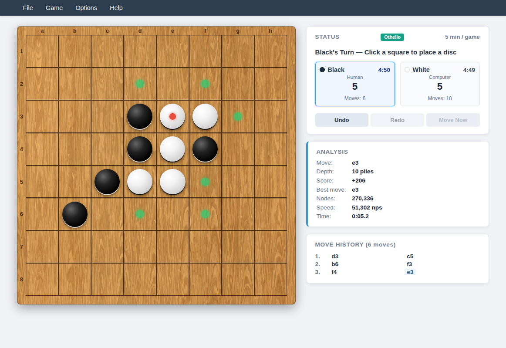
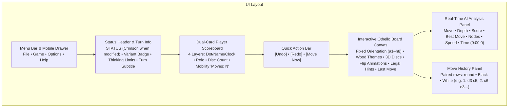
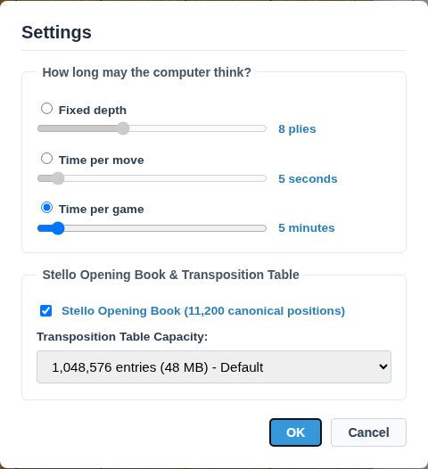
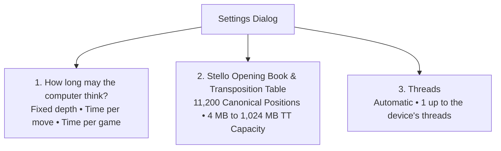

# 15 – GUI and settings

[Back to the index](README.md)

## In short

Stello has two front ends on one view model (`MainViewModel`, chapter 14): the **web app** (Blazor WebAssembly) and the **desktop app** (WPF). The web app follows the tournament game GUI blueprint ([general-game-gui-specification.md](https://github.com/cjp-dev/GameShell/blob/main/docs/general-game-gui-specification.md), v1.1, kept in the shared GameShell library): a wooden board, a 4-layer dual-card player scoreboard, fixed board orientation, quick action buttons, the analysis panel, a move history and synthesized sounds. The desktop app is aligned with it and also has the book-learning commands ([below](#the-desktop-app)).

This chapter documents the visual layout, the menus, the settings dialog, the status that marks a modified game, the opening book, transposition table and threads settings, the analysis panel, and the keyboard shortcuts. Everything up to the desktop section describes the web app; the settings model, the shared transposition-table choices and the analysis are used by both apps.

---

## Graphical User Interface layout (web app)





### Modern Light Theme & Color Palette

The web app uses a palette designed for high contrast, clean typography, and tactile wooden board aesthetics:

| UI Element | Color Value | Description |
|---|---|---|
| **App Background** | `#FFFDF8` | Warm parchment / canvas background tone |
| **Card & Panel Background** | `#FFFFFF` / `#F8FAFC` | Elevated card surfaces with soft ambient drop shadows |
| **Border Stroke** | `#E2E8F0` / `#CBD5E1` | Subtle $1\text{ px}$ borders separating navigation, cards, and panels |
| **Primary Typography** | `#0F172A` / `#334155` | Deep slate gray text ensuring high readability |
| **Active Turn Highlight** | `#3498DB` / `#EFF6FF` | Sky-blue border and light tint highlighting the active player card |
| **Status Modified Notice** | `#E74C3C` | Crimson red text for `STATUS` indicating unranked/casual state |
| **Evaluation Score** | `#B45309` | Warm amber text displaying the score in discs |
| **Best Move Coordinate** | `#0284C7` | Blue accent text displaying the engine's current candidate move |
| **Legal Move Hints** | `#2ECC71` | Soft translucent green circular markers indicating valid placement squares |
| **Last Move Indicator** | `#E74C3C` | Crimson central pip marking the most recently placed disc |

### Board Themes & Visual Appearance

The interface supports customization of board materials and piece rendering directly from the **Options** menu:

* **Board Textures:**
  * **Green Board:** Classic tournament felt / mat green surface.
  * **Golden Oak Board:** Warm natural oak wood grain.
  * **Reddish Wood Board:** Rich mahogany / cherry wood finish.
* **3D Pieces:** Toggles realistic spherical beveling, radial lighting gradients, and ambient disc drop shadows.
* **Animate Flips:** Toggles smooth rotations when discs are captured and converted: CSS 3D transitions in the web app and WPF scale/rise animations on the desktop.

---

## Menu bar and navigation

The web app's header has four menus (`Home.razor`):

### 1. File Menu
* **New Game (`Ctrl+N`):** Starts a new game in the current game mode. While a game is under way it asks "Abandon current match and start a new game?" first. Resets the clocks and the undo/redo history; Black moves first (the computer, in vs Computer (White) and CvC).
* **Open... (`Ctrl+O`):** Loads saved `.stello` or `.txt` game record files into the active session.
* **Save (`Ctrl+S`):** Saves the current game record to the active file path.
* **Save As...:** Exports the current match, complete with move history, to a `.stello` or `.txt` game file.
* *(Separator)*
* **Add Game to Book...:** Adds the game's moves to the user's opening book in the browser's local storage (chapter 11). It needs at least two moves and a confirmation; for an unfinished game it asks "Who won the game?" and offers Black won, White won, or Cancel.

### 2. Game Menu
* **vs Computer (Black):** Configures human vs computer play with the human playing Black (first move). Prompts confirmation if switching modes during an active match.
* **vs Computer (White):** Configures computer vs human play with the computer playing Black (makes opening move) and human playing White.
* **vs Human (Two players):** Hot-seat multiplayer mode where both Black and White are controlled locally.
* **vs Computer (both sides):** Starts a watchable CvC game; the two computer players use the current settings and alternate moves automatically.
* *(Separator)*
* **Switch sides:** Gives the human the other colour without resetting or rotating the board, and switches between vs Computer (Black) and vs Computer (White). It is enabled on the human's turn in those modes and during CvC. In CvC it stops the loop and switches to vs Computer (White); the computer plays the current Black turn if that is next, then the human takes White. It marks the game modified (`IsStatusModified` becomes true), and the computer moves at once when needed.
* *(Separator)*
* **Settings... (`F2`):** Opens the modal Game Settings dialog to configure engine thinking limits, opening book usage, transposition table capacity and the number of threads.

### 3. Options Menu
* **Analysis (`Ctrl+A`):** Toggles the visibility of the real-time AI search analysis side panel.
* **Sound:** Toggles synthesized procedural audio feedback (disc clicks, flip rustles, pass tones, and victory fanfares).
* *(Separator)*
* **Green Board:** Activates the green tournament felt board style.
* **Golden Oak Board:** Activates the natural oak wood board style.
* **Reddish Wood Board:** Activates the reddish mahogany board style.
* *(Separator)*
* **3D Pieces:** Toggles realistic 3D disc rendering with radial gradients and drop shadows.
* **Animate Flips:** Toggles 3D disc flip animations during captures.

### 4. Help Menu
* **User guide (`F1`):** Opens this chapter in a new browser tab, shown by the app's Docs pages (`/docs/15-gui-and-settings`).
* **Rules & Documentation (`Shift+F1`):** Opens the index of this documentation in a new tab (the Docs pages at `/docs`; the build copies `docs` into the app, chapter 14).
  Markdown in docs subfolders, including the frozen Stello 1 archive, opens on GitHub rather than in the viewer.
* *(Separator)*
* **About Stello...:** Shows "Stello Version 3.1", the picture of the author with the caption "Claus Pedersen – wrote Stello in C++ in 1992 and ported it to C# in 2026", and four paragraphs (`AboutInfo`, shared by both apps): what Stello is; its brain (alpha-beta search, a hash table and iterative deepening; since version 2.0 an evaluation by patterns of squares, trained on 500 million positions from the games of Egaroucid, the Othello program by Takuto Yamana, and an endgame solver adapted from Egaroucid's; more than 11,000 opening positions; perfect play near the end); the port of the 1992 C++ original to C# and .NET 10, and since version 3.0 the brain in Rust, two to three times faster, the same brain in the Windows program and, compiled to WebAssembly, in the browser; and the licence (GPL-3.0-only) with the address of the source code, https://github.com/cjp-dev/Stello.

> [!NOTE] Dedicated Quick Action Buttons for Undo & Redo
> In accordance with the tournament GUI specification, Undo and Redo are provided via prominent **Quick Action buttons** beneath the scoreboard and via standard keyboard shortcuts (`Ctrl+Z` / `Ctrl+Y`), keeping the top menus streamlined and uncluttered.

### Responsive Mobile Navigation Drawer ($\le 768\text{px}$)
On mobile devices and narrow viewports ($\le 768\text{px}$), the horizontal desktop menu bar collapses into a compact header featuring the title (`Stello`) and a hamburger button (`☰`). Tapping the hamburger slides out an off-canvas navigation drawer on the right with touch targets $\ge 44\text{px}$, organizing all File, Game, Options, and Help actions cleanly. `Escape` or the 44 px `✕` button closes the drawer (`Escape` also closes an open desktop menu).

---

## Status header, dual-card scoreboard and quick actions

Located above the game board, the status board displays real-time match conditions, player clocks, disc counts, and immediate action controls:

```text
┌─────────────────────────────────────────────────────────────────┐
│ STATUS [Othello]                                     5 min / game
│ Black's Turn — Click a square to place a disc                   │
│                                                                 │
│ ┌─────────────────────────────┐   ┌───────────────────────────┐ │
│ │ ● Black             4:47    │   │ ○ White           4:40    │ │
│ │ Human                       │   │ Computer                  │ │
│ │ 5                           │   │ 5                         │ │
│ │ Moves: 6                    │   │ Moves: 8                  │ │
│ └─────────────────────────────┘   └───────────────────────────┘ │
│                                                                 │
│ [  Undo  ]           [  Redo  ]            [ Move Now ]         │
└─────────────────────────────────────────────────────────────────┘
```

### 1. Status Header & Competitive Integrity
* **Status Label (`STATUS`):** Normally displayed in neutral slate gray. When an unranked casual action occurs—such as taking back moves against the computer (`Undo`), switching sides mid-game, modifying engine settings during a match, or continuing past clock expiration—the `STATUS` text dynamically turns **crimson red (`#E74C3C`)**, visually indicating that competitive match integrity has been modified.
* **Variant Badge:** A rounded teal badge displaying `[Othello]`.
* **Thinking Limits Badge:** Summarizes the active AI constraint in the top-right corner (e.g., `5 min / game`, `5s / move`, or `8 plies`).
* **Turn Subtitle:** Announces the active turn (e.g., `Black's Turn — Click a square to place a disc`) or the end of the game (`Game over, you win: Black 42 – White 22.`, `Game over, the computer wins: …`, with two players `Game over, Black wins: Black 33 – White 31.`, `Game over, a draw: Black 32 – White 32.`, or on time `Black ran out of time. Game over, White won on time.`).

### 2. Dual-Card Player Scoreboard (4 Vertical Layers)
In Othello, Black always moves first. In adherence to the first-mover specification, the Black player card is positioned on the left as Player 1, followed by White on the right as Player 2.

Each player card is structured into 4 clear vertical layers:
1. **Layer 1 (Identity & Digital Clock):**
   * High-contrast circular swatch (`● Black` / `○ White`).
   * Digital countdown chess clock formatted as `m:ss` (e.g., `4:47`).
   * The active player's card is highlighted with a sky-blue border (`#3498DB`), a 2 px glow and a light background tint (`#EFF6FF`).
2. **Layer 2 (Role):** Identifies player controller type (`Human` or `Computer`).
3. **Layer 3 (Primary Metric):** Displays the total disc count owned by the player in prominent bold numerals.
4. **Layer 4 (Secondary Metric):** Real-time **Mobility** count (`Moves: 6`), displaying the exact number of legal moves currently available to this player.

### 3. Quick Action Buttons
Positioned directly beneath the dual player cards:
* **`[Undo]`:** Takes back one move with two players; against the computer it goes back to the previous position where the human is to move, taking back the computer's reply as well, and marks the game modified. Both clocks are restored from the snapshot for the destination position (`_timeLeftAtPly`, chapter 14). Disabled at move 0, while the computer is thinking, and after a game lost on time.
* **`[Redo]`:** Plays the undone moves again, up to the next position where the human is to move (one move with two players). Disabled when nothing was undone, while the computer is thinking, and after a game lost on time.
* **`[Move Now]`:** Shown when playing against the computer, enabled while it thinks. It stops the search and makes the computer play the best move it has found so far (chapter 09).

### 4. Board Orientation (Fixed) & Visual Indicators
The $8 \times 8$ board orientation remains **strictly fixed** (`a1` in the top-left, `h8` in the bottom-right) regardless of whether the user plays Black or White or switches sides.
* **Legal Move Hints:** Translucent green circular markers highlight all squares where the active player can legally place a disc and execute flippable captures.
* **Last Move Marker:** A soft crimson central dot marks the exact square of the most recently placed disc.

### 5. Automatic Pass Handling
Unlike games where passing is optional, Othello rules dictate that passing is mandatory when a player has no legal moves while the opponent can still play. The Stello game loop detects this condition automatically, executes the pass without requiring manual button clicks, shows a notice in the status line that stays until the human's next turn (`"You had no legal move and passed."`, `"The computer had no legal move and passed."`, or in two-player games `"Black had no legal move and passed."`), and yields the turn to the opponent.

### 6. Timeout Continuation Safeguard
In timed matches (`TimePerGame`), if the human's clock reaches 0:00 against the computer, a Yes/No dialog asks *"You ran out of time! Do you want to continue playing?"*. **Yes** freezes the human's clock at 0:00 and lets play continue casually, marking the status modified (`#E74C3C`). **No** ends the game, and so does the computer's clock (or either clock in a two-player game) running out. The status then reads `Black ran out of time. Game over, White won on time.` (or vice versa); moves, Undo, Redo and Switch sides are blocked, and New Game starts without asking.

---

## Game Settings dialog

Accessed via **Game $\rightarrow$ Settings...**, the modal settings dialog lets players configure computer thinking limits, opening book usage, transposition table memory and the threads the computer searches with.



The dialog is arranged into three fieldset groups:



### 1. Computer Thinking Limits
* **Fixed depth:** Searches to an exact ply depth (slider: 1 to 20 plies, default **8 plies**), regardless of time taken.
* **Time per move:** Allocates a dedicated thinking window for every turn (slider: 1 to 60 seconds, default **5 seconds**). The engine employs a soft limit (two-thirds of the window) to cleanly conclude iterative deepening iterations before the hard limit interrupts.
* **Time per game:** Allocates a total chess clock bank per game (slider: 1 to 60 minutes, default **5 minutes**). The engine dynamically budgets remaining time across estimated remaining plies.

### 2. Stello Opening Book & Transposition Table
* **Stello Opening Book (11,200 canonical positions):** Checkbox controlling whether the engine queries the canonical opening book database before launching tree search. When checked, known book positions are played instantly. When unchecked, book lookups are bypassed and the engine searches every move from scratch.
* **Transposition Table Capacity:** Selects the number of entries in each of the two tables (the midgame heuristic table and the exact endgame solver table); the memory shown covers both. Both dialogs use the same five choices from `SettingsViewModel.TranspositionTableChoices`:

| Entries Option | Hash Bits | Entries / Table | Combined Memory | Description |
|---|---|---|---|---|
| **65,536 entries (4 MB)** | 15 | 65,536 | $4.19\text{ MB}$ | Ultra-compact memory for low-resource environments |
| **262,144 entries (16 MB)** | 17 | 262,144 | $16.78\text{ MB}$ | Lightweight cache for fast mobile browsers |
| **1,048,576 entries (64 MB) - Default** | 19 | 1,048,576 | $67.11\text{ MB}$ | Tournament balance of speed and cache hit rates |
| **4,194,304 entries (256 MB)** | 21 | 4,194,304 | $268.44\text{ MB}$ | Deep tactical searches and endgame solving |
| **16,777,216 entries (1,024 MB)** | 23 | 16,777,216 | $1{,}073.74\text{ MB}$ | Maximum transposition table cache for 64-bit desktop |

#### Memory Calculation & Architecture
Each transposition table slot is one 64-byte cache line ([chapter 07](07-transposition-table.md)): an 8-byte sequence word, which lets all the search threads share the table safely, and 2 entries (primary and replacement) of 24 bytes. Each entry is stored as three 64-bit words:
* 16 bytes for the position bitboards (`own`, `opponent`)
* 8 bytes packed into one word: the score (`value`, 2 bytes), the search depth (`depth`, 1 byte), the bound type (`bound`, 1 byte), the best move (`mv`, 1 byte), the extra key (`tag`, 1 byte: the side to move in the midgame table) and the table's generation when it was stored (`generation`, 2 bytes, for clearing without writing the table)

The total entries per table equals $2^{\text{hashBits} + 1}$ (the number in the option label), in $2^{\text{hashBits}}$ slots. Because the search engine keeps two tables of that size—one for the heuristic midgame search and one for the exact endgame solver—the combined memory equals $2 \times 2^{\text{hashBits}} \times 64\text{ bytes}$. The option labels give this in MiB ($2^{20}$ bytes); the Combined Memory column gives it in MB ($10^6$ bytes). Stello 2.0 had no sequence word and 48-byte slots, so its labels said 3, 12, 48, 192 and 768 MB; Stello 3.0 needs a third more memory for the same number of entries ([chapter 26](26-phases-5-9-threads.md)). When the capacity setting changes, the engine host dynamically reinitializes the engine with the requested hash size.

### 3. Threads
The computer can search with several threads at once ([chapter 06](06-midgame-search.md#threads)), which makes it reach more depth in the same time. The **Threads** group chooses how many:

* **Automatic** (the default) is shown with the number it means on this device, e.g. `Automatic (7 threads)`. On the desktop it is the processor's threads minus one (at least 1), so one is left for the app; in the browser it is all of `navigator.hardwareConcurrency`, because the page's own thread is not one of the engine's.
* **1 thread**, **2 threads**, ... up to the device's number of threads. The dialog says how many there are: "of N on this computer" in the desktop app, "Search with (of N on this device):" in the web app.
* The setting is stored with the others as `GameSettings.Threads`; Automatic is stored as 0 (`AutomaticThreads`), so the same saved settings follow the device they are used on, and old settings files without the field read as Automatic. A chosen number above what a device has is used as the device's number (`ThreadsFor`, [chapter 14](14-app-integration.md#search-threads)).
* **In the browser** more than 1 thread needs the threaded engine package. The engine's Web Worker loads its package when it starts, so changing between 1 thread and more restarts the worker (with empty hash tables; the opening book state is kept); another number above 1 does not. Without cross-origin isolation, or if the threaded package cannot be loaded, the computer plays on 1 thread ([chapter 14](14-app-integration.md#threads-in-the-browser)).
* Book learning in the desktop app (Evaluate Book, Self-play) always searches with 1 thread.

---

## Real-Time AI Analysis panel

When enabled via **Options $\rightarrow$ Analysis** (`Ctrl+A`), the telemetry sidebar streams real-time search statistics while the computer thinks:

```text
┌─────────────────────────────────┐
│ ANALYSIS                        │
├───────────────────┬─────────────┤
│ Move:             │ f4          │
│ Depth:            │ 10 plies    │
│ Score:            │ +2.4 discs  │
│ Best move:        │ f4          │
│ Nodes:            │ 226.269     │
│ Speed:            │ 45.085 nps  │
│ Time:             │ 0:05.0      │
└───────────────────┴─────────────┘
```

### Telemetry Fields Explained

| Field | Description & Formatting |
|---|---|
| **Move** | The coordinate currently being searched at the root (e.g., `f4`, `d3`). |
| **Depth** | Current search depth in plies (e.g., `10 plies`), or `to the end (20 empty)` when the endgame is solved. Empty for a book move or when there is no search (a pass or a single legal move). |
| **Score** | The search's score for the computer, the side that is searching, in discs with one decimal (the search scores in 1/100 disc, [chapter 04](04-evaluation.md)):<br/>• Positive (e.g. `+2.4 discs`): Advantage for the engine.<br/>• Negative (e.g. `-1.5 discs`): Advantage for the opponent.<br/>• Solved endgame: the final disc difference (e.g. `+4 discs`, `-2 discs`), or only `Win`, `Loss` or `Draw` when just the result is known (also for a heuristic score beyond ±32 600).<br/>• `Book`: the move comes from the opening book. |
| **Best move** | Coordinate of the currently leading principal variation candidate (e.g., `f4`). |
| **Nodes** | Total board states evaluated during the search, over all its threads, formatted with thousands separators (`226.269`). |
| **Speed** | Search throughput in nodes per second (`nps`), over all threads. |
| **Time** | Elapsed thinking duration in stopwatch format (`m\:ss\.f`, e.g. `0:05.0`). |

### Natural Feel Delay ($250\text{ ms}$)
Instant moves, such as opening-book moves and single legal moves, would otherwise appear the moment the human has moved. `MainViewModel` therefore plays a computer move no sooner than $250\text{ ms}$ (`ComputerDelayMs`) after the search started: a search that took $40\text{ ms}$ waits another $210\text{ ms}$, while a search that took longer than $250\text{ ms}$ is played at once. **Move Now** skips the wait. The Analysis panel shows the time of the search itself.

### Web Worker Engine Host in the Browser
In Blazor WebAssembly (`Stello.Web`), running deep searches directly on the main UI thread would block JavaScript execution and cause interface stutter. Stello runs the search in a dedicated **Web Worker**:
1. `WebEngineHost` plays a book move itself, on the page. Otherwise it sends the search request as a compact JSON message to `engine-worker.js`.
2. The Web Worker runs Stello's Rust engine compiled to WebAssembly (`stello-wasm`), off the page's thread. With more than 1 thread it loads the threaded package and starts more Web Workers that share its memory, one per extra thread (chapter 14).
3. The worker sends progress reports to the page at most every $100\text{ ms}$ (and whenever the depth or the best move changes) to update the analysis panel.
4. **Move Now** or a cancel sets a stop signal in memory shared with the worker, which the engine reads at its next abort check (every 1,024 nodes). If that is not possible, the worker is terminated and started again (chapter 14).

---

## Move History panel

Located below the analysis panel, the **Move History** card logs all played moves in chronological order:

```text
MOVE HISTORY (6 moves)
1. d3   c5
2. c6   e3
3. f3   f4
```

Each row is one round: the round number, Black's move and White's move (a pass is shown as `pass`). The newest move is highlighted and the list scrolls itself to it. When moves are taken back via `[Undo]`, the history trims back to the corresponding move.

---

## Procedural Sound System

The web app plays sounds through the Web Audio API (`BrowserSoundService`); the desktop plays the same sounds through a background `SoundPlayer` queue (`SoundService`). **Options → Sound** switches playback on or off (`IsSoundOn`). The shared setting is saved in `AppSettings` by both settings stores (browser local storage and the desktop `settings.json`). On the desktop, muting discards pending sounds; an already-playing sound can finish. `SoundWaves.Create` synthesizes each sound as a 16-bit PCM WAV byte array at run time, so no `.mp3` or `.wav` files are downloaded; the browser registers the bytes once, on the first sound:

* **Move:** a short click, for every move of the human and of the computer.
* **Pass:** a double clack, when the game loop passes for a player.
* **Win:** a rising fanfare when the human beats the computer, when a two-player game has a winner, or when the computer runs out of time.
* **Loss:** a falling chime when the computer wins, or when the human runs out of time.

---

## Keyboard shortcuts reference

In the web app the letter shortcuts are Ctrl+letter (or Cmd+letter on a Mac); GameShell catches them only for the letters Stello uses.

| Shortcut | Web app | Desktop app |
|---|---|---|
| `Ctrl+N` | New Game (with the confirmation while a game is under way) | New Game |
| `Ctrl+O` | Open a game record (`.stello` or `.txt`) | Open |
| `Ctrl+S` | Save the game record | Save |
| `Ctrl+A` | Show or hide the **Analysis** panel | Show or hide the Analysis panel |
| `Ctrl+Z` | Undo (the clocks go back too) | Undo (also `Ctrl+T`) |
| `Ctrl+Y` | Redo | Redo (also `Ctrl+F`) |
| `Ctrl+M` | **Move Now** | Move Now |
| `F1` | **User guide** (this chapter) | User guide on the live site, in the default browser |
| `Shift+F1` | **Rules & Documentation** (the index of this documentation) | Documentation index on the live site, in the default browser |
| `F2` | **Settings** | Settings |
| `Escape` | Close an open menu or the mobile drawer | – |

---

## The desktop app

The WPF app ([MainWindow.xaml](../Stello.Net/Stello.Net/MainWindow.xaml)) runs the same view model with the engine on a background task (chapter 14). Its menus, side panels, board styles and sound follow the web app. Help menu items and their shortcuts open the live site's `/docs/15-gui-and-settings` and `/docs/` pages in the default browser.

| Menu | Items |
|---|---|
| File | New Game (`Ctrl+N`), Open... (`Ctrl+O`), Save (`Ctrl+S`), Save As..., Add Game to Book..., Exit |
| Game | vs Computer (Black/White), vs Human, vs Computer (both sides), Switch sides, Settings (`F2`) |
| Options | Analysis (`Ctrl+A`), Sound, Green Board, Golden Oak Board, Reddish Wood Board, 3D Pieces, Animate Flips |
| Book | Evaluate Book..., Self-play..., Stop Learning (chapter 11) |
| Help | User guide (`F1`), Rules & Documentation (`Shift+F1`), About Stello... (the same text as the web app, `AboutInfo`) |

- **The board** (`BoardView`) follows `MainViewModel.Appearance`: Green (`#1E7A3C`), Golden Oak or Reddish Wood. The WPF assembly embeds the same wood JPEGs used by the web app. Legal hints are translucent green (`#2ECC71`), 26% of a cell; the last-move pip is red (`#E74C3C`), 20%. The board is sized to the window and centred together with the panels.
- **3D Pieces** adds radial lighting, contrasting lower rims and shadows; turning it off uses flat black/white discs. **Animate Flips** adds a 250 ms placement animation and 450 ms flips, delayed by 150 ms plus 70 ms per further square from the placed disc. Faces change at the flip midpoint. Undo, Redo, Open and New Game redraw without animation; changing appearance cancels outstanding animations. The Windows client-area animation preference is respected.
- **Status** spaces the `STATUS` heading (crimson for a modified game), Othello badge and thinking-limit badge across its header, as on the web. It also has a thinking bar and Black/White player cards. Each card shows the player role, clock when time-per-game is selected, disc count, legal-move count and active-turn highlight. The status text reports whose turn it is and notices from chapter 14.
- **Quick actions** are Undo (`Ctrl+Z`, also `Ctrl+T`), Redo (`Ctrl+Y`, also `Ctrl+F`) and Move Now (`Ctrl+M`) buttons.
- **Move History** shows paired Black/White rows, the move count, the latest row highlighted and auto-scrolls to the latest move.
- **Analysis** has seven fields: Move, Depth, Score, Best move, Nodes, Speed and Time. The title is uppercase; empty fields show `-`, as in the web app.
- **Settings** ([SettingsWindow.xaml](../Stello.Net/Stello.Net/Views/SettingsWindow.xaml)) uses the web wording: "How long may the computer think?", "Stello Opening Book (11,200 canonical positions)", "Transposition Table Capacity" and "Search with (of N on this device):". It offers the same five table capacities and the same thread choices.
- Board-style, piece-animation and Sound choices are remembered in the shared settings. The window position and size are also saved (chapter 14).

---

## Where in the code

| File | Component | Description |
|---|---|---|
| [`Home.razor`](../Stello.Net/Stello.Web/Pages/Home.razor) | `Home` | Web page: Stello's menus, board styles and shortcuts, built from the shared [GameShell](https://github.com/cjp-dev/GameShell) components (`ShellLayout` with menu bar and mobile drawer, `StatusPanel`, `AnalysisPanel`, `MoveHistoryPanel`) |
| [`DialogHost.razor`](https://github.com/cjp-dev/GameShell/blob/main/src/GameShell/Dialogs/DialogHost.razor) | `DialogHost` | Shared modal dialog host (GameShell) for the About box, timeout confirmations and game notices |
| [`SettingsForm.razor`](../Stello.Net/Stello.Web/Components/SettingsForm.razor) | `SettingsForm` | The Settings form, shown in the dialog host, with the Threads list |
| [`AnalysisAdapter.cs`](../Stello.Net/Stello.Web/Services/AnalysisAdapter.cs) | `AnalysisAdapter` | Shows the `AnalysisViewModel` in GameShell's 7-field analysis panel |
| [`MainViewModel.cs`](../Stello.Net/Stello.App/ViewModels/MainViewModel.cs) | `MainViewModel` | Central orchestrator managing game flow, competitive integrity (`IsStatusModified`), clocks, and undo/redo |
| [`SettingsViewModel.cs`](../Stello.Net/Stello.App/ViewModels/SettingsViewModel.cs) | `SettingsViewModel` | Data backing for thinking limits, opening book toggle, the shared transposition-table choices (`TranspositionTableChoices`), and threads (`Threads`, `ThreadChoices`, `ThreadsText`, `DeviceThreads`) |
| [`GameSettings.cs`](../Stello.Net/Stello.App/Models/GameSettings.cs), [`ThreadCounts.cs`](../Stello.Net/Stello.App/Models/ThreadCounts.cs) | `GameSettings`, `ThreadCounts` | The stored settings (`Threads`, `AutomaticThreads`, `ThreadsFor`); the device's thread counts on the desktop (`ForThisProcess`) and in the browser (`ForBrowser`) |
| [`AppSettings.cs`](../Stello.Net/Stello.App/Models/AppSettings.cs), [`Appearance.cs`](../Stello.Net/Stello.App/Models/Appearance.cs) | `AppSettings`, `Appearance`, `BoardStyle` | Shared settings model (including appearance and sound); the web also keeps its existing `AppearanceStore` entry synchronized with the view model |
| [`AnalysisViewModel.cs`](../Stello.Net/Stello.App/ViewModels/AnalysisViewModel.cs) | `AnalysisViewModel` | Observable ViewModel formatting depth, evaluation score, node counts, and elapsed search time |
| [`WebEngineHost.cs`](../Stello.Net/Stello.Web/Services/WebEngineHost.cs) | `WebEngineHost` | The book move on the page, the Web Worker's lifecycle (a new worker between 1 and more threads), the message serializer, and the cancellation controller |
| [`engine-worker.js`](../Stello.Net/Stello.Web/wwwroot/js/engine-worker.js), [`stello-wasm/src/lib.rs`](../Stello.Rust/stello-wasm/src/lib.rs) | `init`, `search` | The Web Worker and the Rust engine in WebAssembly, which makes a new engine when the hash bits change |
| [`LocalEngineHost.cs`](../Stello.Net/Stello.App/Services/LocalEngineHost.cs) | `LocalEngineHost` | Desktop background task runner for search and book operations |
| [`SoundWaves.cs`](../Stello.Net/Stello.App/Services/SoundWaves.cs) | `SoundWaves` | Procedural 16-bit PCM WAV synthesized sound generator |
| [`BrowserSoundService.cs`](../Stello.Net/Stello.Web/Services/BrowserSoundService.cs) | `BrowserSoundService` | Registers the sounds with the page and plays them (web app) |
| [`SoundService.cs`](../Stello.Net/Stello.Net/Services/SoundService.cs) | `SoundService` | WPF background FIFO playback of the same generated sounds, controlled by Options → Sound |
| [`AboutInfo.cs`](../Stello.Net/Stello.App/Models/AboutInfo.cs) | `AboutInfo` | The title, version, picture caption and paragraphs of the About box, shared by both apps |
| [`MainWindow.xaml`](../Stello.Net/Stello.Net/MainWindow.xaml) | `MainWindow` | WPF desktop application window, menus and key bindings |
| [`BoardView.xaml`](../Stello.Net/Stello.Net/Views/BoardView.xaml), [`AboutWindow.xaml`](../Stello.Net/Stello.Net/Views/AboutWindow.xaml) | `BoardView`, `AboutWindow` | The WPF board and About box |
| [`SettingsWindow.xaml`](../Stello.Net/Stello.Net/Views/SettingsWindow.xaml) | `SettingsWindow` | WPF desktop modal settings dialog with thinking-limit sliders, the shared transposition-table choices and the Threads box |

---

## Further reading

- Nielsen, J. (1994). *Usability Engineering*. Morgan Kaufmann (Visibility of system status and match integrity).
- Buro, M. (1997). *The Othello Match of the Year: Logistello versus Takeshi Murakami*. NEC Research Institute.
- World Othello Federation (WOF). *Official Tournament Rules and Time Control Specifications*.

---

Previous: [14 App integration](14-app-integration.md) · Next: [16 The goal and the plan](16-the-goal-and-the-plan.md)
