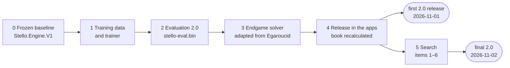

# 16 – The goal and the plan

[Back to the index](README.md)

## In short

Part 2 of these documents tells how Stello .NET 1.0 ("Stello 1"), the C# port of the C++ original, became Stello .NET 2.0. This chapter gives the goal, the plan and the rules of the work. The chapters after it follow the work phase by phase.

- **Why:** the C# port of Egaroucid showed that Stello 1 was 330–500 Elo weaker on one thread. The main cause was the evaluation; the endgame solver was also 14 times slower ([chapter 19](19-stello-1-against-egaroucid.md)).
- **The order:** first a new evaluation, trained on Egaroucid's data and about 1 MB, small enough for the web; then Egaroucid's endgame solver, adapted to Stello; only then the search.
- **The method:** three engines that can all play each other (Stello 1 frozen, Stello 2 being improved, the Egaroucid port as the reference); a gate per phase; 1,180-game matches that must have a lower bound above 50 %; one switch per change; a findings document updated after every phase.
- **The phases:** 0 the frozen baseline, 1 the training data and the trainer, 2 the evaluation, 3 the endgame solver, 4 the release in the apps with a recalculated book, 5 the search. Phases 0–3 and most of phase 4 took one day, 31 October 2026; the book was recalculated overnight. The first 2.0 release followed on 1 November, the final 2.0 with the phase 5 search on 2 November.

The working documents are [improve-stello-strength-plan.md](../Plans/improve-stello-strength-plan.md) (the plan, with a Status section per phase) and [improve-stello-strength-findings.md](../Plans/improve-stello-strength-findings.md) (the findings). The raw results are in [Plans/benchmark-results](../Plans/benchmark-results).

## Where it started

The work began right after the Egaroucid port ([chapter 18](18-the-egaroucid-port.md)) and its comparison with Stello ([chapter 19](19-stello-1-against-egaroucid.md), [egaroucid-comparison-report.md](../Plans/egaroucid-comparison-report.md)). The last commit of the port, a261a6d on 30 October 2026, is the engine that is now Stello 1. On one thread:

| What | Stello 1 | Egaroucid port |
|---|---:|---:|
| Match score, 100 ms per move | 12.9 % | **87.1 %** (+331 Elo) |
| Match score, 500 ms per move | 5.4 % | **94.6 %** (+497 Elo) |
| Evaluation error, `eval-compare` (discs) | 11.07 | **3.96** |
| Discs lost per move in `mid-quality`, 50 ms / 1000 ms | 1.61 / 1.38 | 1.23 / **0.51** |
| FFO #40–49 solved exactly | 369 s | **25.6 s** |

Reports: [100 ms](../Plans/benchmark-results/match_stello-100ms_vs_egaroucid-100ms.md), [500 ms](../Plans/benchmark-results/match_stello-500ms_vs_egaroucid-500ms.md), [eval-compare](../Plans/benchmark-results/eval-compare.md), [mid-quality](../Plans/benchmark-results/mid-quality.md).

What this showed, in order of weight:

1. **The evaluation was the main cause.** Stello 1's error was 2.8 times Egaroucid's, and its best scale drifted 5-fold over the game, from about 20 units per disc in the opening to 113 near the end. A deeper search with a biased evaluation keeps the bias.
2. **More time hardly helped Stello 1.** With 20 times more time per move, its loss per move fell from 1.61 to 1.38 discs; Egaroucid's halved.
3. **The endgame solver was 14 times slower,** but in games at 500 ms both engines first solved at about 20 empty squares, so it decided fewer games than that suggests.
4. **Time use was a small effect:** Stello 1 used about 313 ms of a 500 ms move.

## The goals and their order

The order was set at the start:

1. **A new, smaller evaluation** for Stello, trained on Egaroucid's training data and small enough for the web: **about 1 MB**.
2. **Egaroucid's endgame solver,** adapted as a replacement for Stello's.
3. **Only then improvements to the search.**

The order has reasons:

- **The evaluation first,** because it was the largest gap, and because it is the step that makes more thinking time worth something.
- **The solver second,** because it needs the evaluation. Egaroucid's last 13 empty squares need no evaluation, but above 13 its solver is its midgame search, ordered by its 38 MB evaluation. Stello had to rebuild that part on its own search, ordered by the new evaluation.
- **The search last,** so that every search change is measured with the evaluation it will play with. Each change of the search then gets its own number.

### Can Egaroucid's solver just replace Stello's?

The plan answered this question before the work began. Mostly yes:

- **The last 13 empty squares** (the port's `EndSearch.cs`, 984 lines) need no midgame evaluation. The only evaluation they use is a small 4-pattern move-ordering table at 11–13 squares, and Stello could use its new evaluation there instead.
- **Above 13 squares** the part is rebuilt on Stello's search.
- **No bit conversion is needed.** Reversing the 64 bits turns the board half a turn, Othello is the same after that turn, and every table in the solver is geometric ([chapter 08](08-endgame-solver.md#egaroucids-tables-on-stellos-bitboards)).
- **The licence** allows it: the port is already GPL.

How it turned out is in [chapter 21](21-phase-3-the-endgame-solver.md).

## The decisions

| Decision | What it meant |
|---|---|
| The evaluation is **about 1 MB** | The web app downloads the evaluation with the engine. Egaroucid's evaluation is 38 MB; Egaroucid for Web has a 192 KB evaluation with 12 patterns of 8–9 squares and 10 phases, a reference for a small one. The experiments of phase 2 chose how to spend the budget ([chapter 20](20-phases-0-2-the-evaluation.md)) |
| **2.0 replaces the engine** in the WPF and web apps once the evaluation and the solver pass their gates; the search work follows | Phase 4 released the new evaluation, solver and book as the first 2.0 release (2026-11-01). The phase 5 search then became part of 2.0 too: the final 2.0 (2026-11-02) |
| **The opening book is recalculated** with the new engine, so its values are the new engine's scores in discs | Phase 4 recalculated it with Stello 2 ([chapter 22](22-phase-4-the-release.md)); the final 2.0 recalculated it again with the phase 5 search ([chapter 23](23-phase-5-the-search.md)) |
| **The port's YBWC phase** (multi-threading, the port's phase 6) **is postponed** | Everything in Part 2 is measured on 1 thread. YBWC or Lazy SMP is the optional last item of phase 5 |
| The naming: Stello C++ → Stello .NET 1.0 → Stello .NET 2.0 | The engine of the apps is Stello 2.0; the frozen engine before it is Stello 1 |

Two facts of the machine shaped the plan as much:

- **The training data** (in the git-ignored folder `Traning data/`) is free to use for training, but its terms forbid redistribution. It is never committed. The trained weights are not covered by that rule, so `stello-eval.bin` is committed and credited in [THIRD-PARTY-NOTICES.md](../THIRD-PARTY-NOTICES.md).
- **The laptop has no GPU and no Python libraries, and the projects are .NET only.** So the trainer is a C# console tool that runs on the CPU ([chapter 20](20-phases-0-2-the-evaluation.md#phase-1-the-training-data-and-the-trainer)).

## The three engines

All three must be able to play each other, in matches and in every benchmark of [chapter 17](17-measuring-the-engine.md):

| Name | Project | Match side / benchmark | What it is | Used by |
|---|---|---|---|---|
| Stello 1 | [Stello.Engine.V1](../Stello.Net/Stello.Engine.V1) | `engine=stello-v1`, `--engine stello-v1` | The engine before 2.0 (commit a261a6d), frozen as the baseline | Tools and tests |
| Stello 2 | [Stello.Engine](../Stello.Net/Stello.Engine) | `engine=stello` (the default), `--engine stello` | The engine being improved; since phase 4 the engine of the apps | Apps, tools, tests |
| Egaroucid | [Egaroucid.Engine](../Stello.Net/Egaroucid.Engine) | `engine=egaroucid`, `--engine egaroucid` | The C# port of Egaroucid 7.9 ([chapter 18](18-the-egaroucid-port.md)), exact node for node on 1 thread: the reference | Tools and tests |

- **Stello 1 and Stello 2 share** the board, the moves, the limits, the results and the opening book code. Only the search, the evaluation, the move ordering, the time control, the transposition table and `ComputerPlayer` are copied into `Stello.Engine.V1` ([chapter 20](20-phases-0-2-the-evaluation.md#phase-0-the-frozen-baseline)).
- **Stello 1 is never changed.** A test checks 32 recorded searches, so every match against it compares with the same engine.
- **Egaroucid needs its resources** (its evaluation and book) from `Egaroucid-main/bin/resources` or `$EGAROUCID_RESOURCES`; they are not in the repository ([chapter 18](18-the-egaroucid-port.md#running-it)).

## The gates

Each phase ends with a gate: checks that must pass before the next phase starts. The plan's gates, and what the phases measured:

| Phase | Gate | Result |
|---|---|---|
| 0 Frozen baseline | Stello 1 gives the same moves, scores and nodes as the engine it was copied from; a match between them is even; all tests pass | Identical on 100 midgame positions at depth 8 and FFO #40–44; 51.8 % (49.5–54.1 %) |
| 1 Trainer | `convert` is deterministic; a first model has far less than Stello 1's 11.1-disc error | The same SHA-256 with 24 and 7 workers; 5.55 discs on the test split (Stello 1 12.14) |
| 2 Evaluation | A table of error against size, model ≤ about 1 MB; `mid-quality` better than Stello 1 at 50, 200 and 1000 ms; matches against Stello 1 at 100 and 500 ms with a lower bound above 50 %; the same against Egaroucid for the record | 0.99 MB, 5.47 discs; 90.9 % and 90.6 % against Stello 1; better at 200 and 1000 ms, at 50 ms within the margin; 59.5 % and 38.2 % against Egaroucid |
| 3 Solver | FFO #40–49 correct in at most about 2 × the port's 25.6 s; endgame tests pass; Move Now within 100 ms during a solve; a 500 ms match against the old solver not worse; the browser solve time noted | 47.1 s (1.8 ×); 51.1 % (49.2–53.0 %); the browser time was measured in phase 4 |
| 4 Release | With books on at 500 ms, Stello 2 with its new book beats Stello 1 with its book; the new book is at least as good as the old one; the apps build; the live site plays, stops and solves | 88.9 % (+362 Elo); 49.2 % (47.3–51.2 %); live check passed |
| 5 Search | Each change: a match against the best Stello 2 so far with a lower bound above 50 % at 100 ms, confirmed at 500 ms; or, for a pure speed change, faster on `mid-bench` or `solve-bench` with no loss in a match | Per item in [chapter 23](23-phase-5-the-search.md) |

### How a match decides

A match ([chapter 17](17-measuring-the-engine.md#the-engine-match-match)) plays 1,180 games: a pair from each of the 590 start positions in `starts.txt`, once with each colour, without books unless the gate says otherwise. The score has a 95 % interval over the pairs, about ±2.5 % of score or ±19 Elo.

- **Stronger** means the whole interval is above 50 %: its lower bound is above 50 %. A new evaluation, a search change or a new engine must pass this.
- **Not worse** means the interval reaches above 50 %. This was the gate for changes that are needed for other reasons and are not expected to change the result much: the new solver in games (phase 3) and the recalculated book (phase 4). Their start positions are at plies 10–12, after the first book moves, so a new book has little room to show.
- **Confirmed at 500 ms.** A search change is first measured at 100 ms, where a match takes about 5 minutes, then at 500 ms (about 23 minutes). Some effects only show with more depth: the larger pattern set of phase 2 was even at 100 ms and won at 500 ms.

The matches ran on the Intel i7-12850HX laptop VM: 8 performance cores with 2 threads each and 8 efficiency cores, 24 threads, 15 GB of memory. A match plays 12 games at a time, and both engines of a game share a thread, so A/B results are fair. Absolute depths and times differ on other machines. Timed matches had the machine to themselves; training ran only when no match ran. The long book recalculations ran on a second computer, a Ryzen 7 7800X3D.

## The working method

### One switch per change

Every alternative sat behind a switch in `SearchOptions` ([SearchOptions.cs](../Stello.Net/Stello.Engine/Search/SearchOptions.cs)), an internal record on `SearchEngine`. A match side or a benchmark sets it with a key, so the old and the new way play in the same build:

| Phase | Switch | Key | What became of it |
|---|---|---|---|
| 2 | `Pattern` | `eval=<file>\|default\|classic` | Kept as `eval=<file>\|default`; `classic` went with the old evaluation in phase 4 |
| 2 | `SelectiveMargin`, `SelectivePercent` | `sel-margin=`, `sel-percent=` | Removed when Multi-ProbCut replaced the old selective search (phase 5) |
| 2 | `DangerousCorners` | `danger=on\|off` | Removed with the old evaluation (phase 4) |
| 3 | `NewEndgame` | `endgame=new\|classic`, `--endgame` | Removed with the old solver (phase 4) |
| 5 | `SoftTimePercent` | `soft-pct=` | Kept, to try again later |
| 5 | `Selective`, `ProbCutPercent` | `mpc=` | Kept, to turn Multi-ProbCut off for the trainer and to retune it |

The other experiments of phase 5 had their own keys for as long as they were measured ([chapter 23](23-phase-5-the-search.md)).

The plan put `SearchOptions` in phase 0, but there was nothing to switch yet, so it came with the first alternative in phase 2. A change that was kept became the default and lost its switch. A change that was rejected was removed, and its code stays only in the git history. From phase 4 on, the old evaluation and solver are only in Stello 1: to play them, a side plays `engine=stello-v1`.

### How a change is measured

All with the benchmark tool ([chapter 17](17-measuring-the-engine.md)):

```text
dotnet run -c Release --project Stello.Net/tools/Stello.Benchmark -- <command> [options]
```

| What | Command |
|---|---|
| Stello 2 against Stello 1, 100 ms | `match --a engine=stello-v1,time-ms=100,name=stello1 --b time-ms=100,name=stello2` |
| Stello 2 against Egaroucid, 500 ms | `match --a engine=egaroucid,time-ms=500,name=egaroucid --b time-ms=500,name=stello2` |
| A new evaluation file against the built-in one | `match --a time-ms=100,name=default --b time-ms=100,eval=<file>,name=new` |
| The endgame | `solve-bench --to 49`, with `--engine stello-v1` or `--engine egaroucid` for the others |
| Midgame speed | `mid-bench --engine stello`, `--engine stello-v1`; `--eval <file>` or `--side <keys>` for a variant of Stello 2 |
| Midgame quality | `mid-quality --engines stello,stello-v1,egaroucid`, or `--sides "<side>;<side>"` for match sides with their own keys |
| A trained evaluation's error | `Stello.Trainer report --model <file>` |

### Documents and commits

- **The findings document** was updated after every phase, with the decisions, the measurements, what worked and what did not, and the ideas for later. The plan's Status section got a short entry per phase. Every number in Part 2 comes from these two documents or from a result file.
- **One commit per phase,** and in phase 5 one per change, each with its gate in the message.
- **Branches:** phases 0–4 on `feature/stello-v2`. Phase 5 on `feature/stello-v2.x`, based on it, so that the first 2.0 release kept exactly the engine that had recalculated the book. The second book recalculation on `book-v2x-recalc` on the other computer. The rule was to fast-forward main after each green gate and check the deploy of the web app; the release of phase 4 was checked on the live site ([chapter 22](22-phase-4-the-release.md#the-deploy-and-the-live-check)).
- **What is never committed:** the training data, the converted binary files, Egaroucid's source tree and its resources.

## The phases



| Phase | What it did | Chapter | What it showed |
|---|---|---|---|
| 0 | Froze Stello 1 as `Stello.Engine.V1`; the three engines in the tools | [20](20-phases-0-2-the-evaluation.md#phase-0-the-frozen-baseline) | The copy searches node for node like the original; a match against it is even |
| 1 | Converted Egaroucid's data; wrote the C# trainer | [20](20-phases-0-2-the-evaluation.md#phase-1-the-training-data-and-the-trainer) | 500 M positions in 2 minutes; a first model has 5.55 discs error against Stello 1's 12.14 |
| 2 | Chose and trained the evaluation; put it in the old search | [20](20-phases-0-2-the-evaluation.md#phase-2-the-evaluation-in-stello) | 15 patterns × 10 stages in 0.99 MB, 5.47 discs; +400 Elo against Stello 1 |
| 3 | Adapted Egaroucid's solver | [21](21-phase-3-the-endgame-solver.md) | FFO #40–49 in 47.1 s instead of 369 s; in games as strong as the old solver |
| 4 | Made Stello 2 the engine of the apps; recalculated the book | [22](22-phase-4-the-release.md) | 88.9 % against Stello 1 with books; the new book as good as the old one |
| 5 | Improved the search, item by item | [23](23-phase-5-the-search.md) | Kept: PVS in every node, Multi-ProbCut, evaluation ordering with ETC; the book recalculated again |
| — | The final measurements and the ideas left | [24](24-results-and-what-comes-next.md) | |

The plan's phase 5 list, in the order of the expected gain: (1) time use, (2) PVS throughout and a better transposition table, (3) Multi-ProbCut with an error model fitted on Stello 2's own searches, (4) move ordering by a shallow search and ETC in the midgame, (5) a selective endgame and a clog search, (6) checking the moves outside the book, (7) optional: Lazy SMP or YBWC.

## The timeline

The commits of the work, with their commit times (Central European Time):

| When | Commit | What |
|---|---|---|
| 2026-10-30 21:58 | a261a6d | The Egaroucid port compared with Stello: the engine that becomes Stello 1 |
| 2026-10-31 10:27 | 75698e0 | Phase 0: Stello 1 frozen; the plan and the findings document |
| 2026-10-31 10:51 | 9ec4dee | Phase 1: the pattern format and the trainer; the first model |
| 2026-10-31 14:24 | 3d895d6 | Phase 2: `stello-eval.bin` in the search |
| 2026-10-31 15:19 | 6c335cb | Phase 3: the new endgame solver |
| 2026-10-31 15:38–16:16 | 720f224, 5414efb, 689bfbf | Phase 4, parts 1–3: the engine is Stello 2; scores in discs and the About text; the documentation |
| 2026-10-31 17:47 – 2026-11-01 02:03 | 299bcb7 … 6960a31 | Phase 5, items 1–5, on `feature/stello-v2.x`, while the other computer recalculated the book |
| 2026-11-01 08:54 | 153baa2 | Phase 4, part 4: the book recalculated by Stello 2 (engine version 3) |
| 2026-11-01 09:09 | d21e42f | The fix for the book's stale win/loss/draw leaves, for the next recalculation |
| 2026-11-01 09:44 | 8f2c12d | Phase 4 done: the book gates passed. **The first 2.0 release** |
| 2026-11-01 18:12, 22:45 | 8cf2341, 9b1ee56 | Side experiment: the 16-bit trainer and a larger evaluation for the desktop, not pursued |
| 2026-11-02 06:46 | abb5160 | The book recalculated with the phase 5 search (engine version 4) |
| 2026-11-02 07:26 | 124cf2d, 6e08ec5 | Phase 5, item 6, tried and removed. **The final 2.0** |
| 2026-11-02 | 9009cce and later | This documentation for the 2.0 release |

## Design notes

- **The search was kept, the knowledge replaced.** Phases 2 and 3 changed the evaluation and the solver, not the midgame search. So the +400 Elo of phase 2 belong to the evaluation, measured in the same search, and phase 5 could measure each search change on its own.
- **A frozen baseline.** Without Stello 1 in its own project, "better than before" would drift with every commit. With it, every phase is measured against the same engine.
- **A reference that is exact.** The Egaroucid port is the C++ program node for node, so a gap to it is a gap to Egaroucid, not to a port's bugs.
- **Numbers decide.** The size of the evaluation, the pattern set, the solver's ordering and every search change were chosen by measurements, and the gates were set before the work.
- **Switches, not branches.** Two ways side by side in one build make an A/B match a one-line command, and the classic paths disappear once the frozen baseline holds them.

---

Previous: [15 GUI and settings](15-gui-and-settings.md) · Next: [17 Measuring the engine](17-measuring-the-engine.md)
