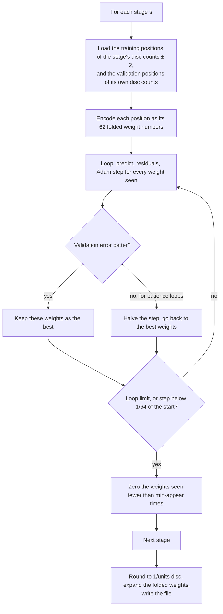

# 20 – Phases 0–2: the evaluation

[Back to the index](README.md)

## In short

The first three phases of Stello 2.0 replaced the part that [chapter 19](19-stello-1-against-egaroucid.md) found weakest, the evaluation, and left the search as it was:

- **Phase 0** froze the engine as it was, as **Stello 1** in its own project, `Stello.Engine.V1`. It searches node for node like the engine it was copied from, and every later change is measured against it.
- **Phase 1** converted Egaroucid's training data into 500 million positions with their final scores, and wrote the C# trainer `Stello.Trainer`. Its first model, 11 patterns in 15 stages, had **5.55 discs** error on held-out games, against 12.14 for Stello 1's evaluation.
- **Phase 2** chose the evaluation by experiments: how many stages, which patterns, which weights to drop and how fine the units, all within about 1 MB. The result is `stello-eval.bin`: 15 patterns, 10 stages, 0.99 MB, **5.47 discs** error. In Stello 1's unchanged search it scores **90.9 % against Stello 1** (+400 Elo) at 100 ms per move and 90.6 % (+393) at 500 ms. Against the Egaroucid port it wins at 100 ms (59.5 %) and loses at 500 ms (38.2 %).

How the evaluation works is described in [chapter 04](04-evaluation.md). This chapter tells how it was made and chosen. A later side experiment, a larger evaluation for the desktop, is at the [end of the chapter](#side-experiment-a-larger-evaluation-for-the-desktop).

## Phase 0: the frozen baseline

### What was copied

[Stello.Engine.V1](../Stello.Net/Stello.Engine.V1) is a copy of the engine at commit a261a6d, the last commit before the 2.0 work, in the namespace `Stello.Engine.V1`:

| Copied (unchanged) | Shared with Stello 2 |
|---|---|
| `SearchEngine` (838 lines): the midgame search and the solver of the [Stello 1 documentation](stello-1/06-midgame-search.md) | `Board`, `Move`, the rules and the bitboards |
| `Search/*`: move ordering, time control, transposition table | `SearchLimits`, `SearchResult`, `SearchInfo` |
| `Evaluation/*`: the evaluator and its edge tables ([Stello 1's chapter 04](stello-1/04-evaluation.md)) | The opening book code |
| `ComputerPlayer`, with Stello 1's book choice | |

- Stello 1 reaches the internal `Bitboards` of `Stello.Engine` through `InternalsVisibleTo`.
- [V1MatchPlayer.cs](../Stello.Net/Stello.Engine.V1/V1MatchPlayer.cs) makes it a match player, like `StelloMatchPlayer` for Stello 2.
- Only the tools and the tests use it. The apps use `Stello.Engine`.
- The benchmark tool got `engine=stello-v1|stello|egaroucid` on match sides (the old yes/no switch for Egaroucid became an enum) and `--engine stello-v1` for `solve-bench` and `mid-bench`. `mid-quality --engines` takes any of the three and gives the paired difference for every pair.
- Stello 1 plays from the book it was made with. When phase 4 recalculated the book for Stello 2, the old one was kept as `Book/opening-book-stello1.txt` ([chapter 22](22-phase-4-the-release.md#the-book-recalculated-by-stello-2)).

### The gate

| Check | Result |
|---|---|
| The same moves, scores, kinds, depths and nodes as `Stello.Engine` at a261a6d | Yes, on all 100 `midgame.txt` positions at depth 8 (4,650,177 nodes) and on FFO #40–44 (329,535,633 nodes) |
| A match of the copy against the engine it was copied from, 100 ms per move, 1,180 games | 51.8 % (49.5–54.1 %), +13 Elo: no significant difference. Depth 10.36 and 10.35, 2.5 M nodes per second for both ([result](../Plans/benchmark-results/match_v2-p0-v1-vs-current-100ms.md)) |
| Tests | Stello.Engine.Tests 238, Egaroucid.Engine.Tests 34, all green |

The node counts prove that the copy is exact. The match shows that two identical engines in timed games come out even within the interval, as they should.

[StelloV1Tests.cs](../Stello.Net/Stello.Engine.Tests/StelloV1Tests.cs) keeps checking 32 of the recorded searches, 30 midgame positions at depth 8 and FFO #40–41, against [Data/stello-v1-signatures.txt](../Stello.Net/Stello.Engine.Tests/Data/stello-v1-signatures.txt). A line there reads `midgame.txt g01e48 depth=8 c4 57 Heuristic 8 78706`: position, limit, move, score, kind, depth and nodes. So the copy cannot drift.

Phase 0 also closed the Egaroucid port: its YBWC phase was postponed, and its chapters ([18](18-the-egaroucid-port.md) and [19](19-stello-1-against-egaroucid.md)) were written. The `SearchOptions` switches the plan put here moved to phase 2, where the first alternative appeared ([chapter 16](16-the-goal-and-the-plan.md#one-switch-per-change)).

## Phase 1: the training data and the trainer

### The data

Egaroucid's training data ([Training data – Egaroucid](https://www.egaroucid.nyanyan.dev/en/technology/train-data/)) is free to use for training, but its terms forbid redistribution. It lives in the git-ignored folder `Traning data/` and is never committed. Two sources were used:

| Source | Contents | How it was used |
|---|---|---|
| `0001` (Egaroucid 7.5.1 at level 17) | 25.5 M positions with final scores, 500 k per disc count from 14 to 63 discs | All kept. Split by line, so positions of one game can fall in different splits |
| `v0002_0`, `v0002_1` (Egaroucid 7.8 against Edax 4.5.5 at level 11) | 52 M game records, no scores. The folder name gives the number of random opening moves | Each game replayed (no invalid game), the random opening moves dropped, each position given the game's final disc difference for its side to move, with empty squares to the winner and passes handled. Thinned to about 10 M positions per disc count |

`Stello.Trainer convert` writes them into `Traning data/stello-bin` (git-ignored too) as **17-byte records**: the own discs (u64), the opponent's discs (u64) and the final score for the side to move (sbyte). There is one file per split and disc count, such as `train-d20.bin`.

- **The split is by game,** with a hash: 2 % validation, 2 % test, the rest training. So the positions of one game stay together. The test split replaces `eval-compare`'s sample of [chapter 19](19-stello-1-against-egaroucid.md#evaluation-eval-compare), which overlaps Egaroucid's own training data.
- **The result:** 499.5 M positions, 8.0 GB: 479.6 M for training, 10.0 M for validation, 10.0 M for testing. From 20 discs on there are about 10 M positions per disc count, at 12 discs about 1 M, and below 12 almost none, because the games start after at least 8 random moves.
- **Fast and deterministic:** 1 m 53 s on 24 cores. The output does not depend on the number of workers: the same SHA-256 with 24 and with 7. Each batch of files is written in file order, and the split depends only on the hash.

**The test split is harder than `eval-compare`'s sample.** Most test positions come from the Egaroucid–Edax games at level 11, whose results are noisier than Egaroucid's self-play at level 17. On it, Egaroucid's own error is 5.05 discs, against 3.96 on `eval-compare`'s sample. All errors in this chapter are on this test split: 1,040,276 positions.

### The trainer

[Stello.Trainer](../Stello.Net/tools/Stello.Trainer) is a console tool. The machine has no GPU and no Python libraries, so it is written in C# and runs on all CPU cores.

| Command | What it does | File |
|---|---|---|
| `convert` | The training data to binary records, as above | [ConvertCommand.cs](../Stello.Net/tools/Stello.Trainer/ConvertCommand.cs) |
| `train` | Fits the weights of a pattern set stage by stage and writes an evaluation file | [TrainCommand.cs](../Stello.Net/tools/Stello.Trainer/TrainCommand.cs) |
| `report` | A model's error on the test split per 5 empty squares, next to Stello 1's evaluation (with a fitted scale) and the Egaroucid port | [ReportCommand.cs](../Stello.Net/tools/Stello.Trainer/ReportCommand.cs) |
| `size` | How small a model's weights compress with coarser units (phase 2) | [SizeCommand.cs](../Stello.Net/tools/Stello.Trainer/SizeCommand.cs) |
| `mpc`, `mpc-end` | Fit Multi-ProbCut's error models (phase 5, [chapter 23](23-phase-5-the-search.md)) | [MpcCommand.cs](../Stello.Net/tools/Stello.Trainer/MpcCommand.cs) |

The options of `train`, with their defaults in the code:

| Option | Default | Meaning |
|---|---|---|
| `--set` | `classic11` | The pattern set: `classic11`, `plus15` or `egaroucid16` ([chapter 04](04-evaluation.md#the-patterns)) |
| `--stages` | 15 | The number of stages, cut by `EvalWeights.EvenStages` |
| `--max-per-discs` | 2,000,000 | Positions read per disc count and split |
| `--smooth` | 2 | Disc counts on each side that a stage also trains on |
| `--loops`, `--rate`, `--patience` | 1,000, 0.05, 20 | The loop limit, the step size and the early stopping |
| `--prior` | 1 | The pull of rarely seen weights towards zero |
| `--min-appear` | 0 | Weights seen fewer times than this are set to 0 at the end |
| `--units` | 32 | Units per disc of the written weights |

### How training works

The model is linear: the evaluation of a position is the sum of the weights of its 62 features ([chapter 04](04-evaluation.md#evaluating-a-position)). Training finds the weights that predict the final disc difference best.



- **The target and the loss.** The target is the final disc difference for the side to move; the loss is the mean squared error.
- **Folded weights.** The weights that a symmetry makes equal are one weight ([chapter 04](04-evaluation.md#folding)). `FoldedIndex` numbers the representatives, and each position is stored as the folded numbers of its 62 features. For `plus15`, folding cuts the 403,461 raw indices of a stage to 233,676 weights: 42 % fewer over the set. A row loses about half its indices; the 2 × 5 corner, which has no symmetry of its own, loses none.
- **The step** is full-batch Adam, as in Egaroucid's trainer. For each weight $j$, with $n_j$ the number of training positions in which it appears, $r_i$ the residual (target − prediction) of position $i$, and the prior $\lambda$:

  $$g_j = -\frac{\sum_{i \ni j} r_i - \lambda w_j}{n_j + \lambda}$$

  This is the mean residual of the weight, so a weight seen in a million positions and one seen in ten get steps of the same size. The prior pulls rarely seen weights towards zero. Adam then smooths the step with $\beta_1 = 0.9$ and $\beta_2 = 0.999$. A weight that is never seen is never changed.
- **Stages and smoothing.** A stage is trained on its own disc counts and 2 more on each side (`--smooth 2`), and validated on its own disc counts only. So neighbouring stages share data and agree better, and the sparse early stages get more data. A stage with fewer than 1,000 training or 100 validation positions is not trained; it gets the weights of the nearest trained stage. So stage 0 (4–10 discs) is a copy of stage 1.
- **Early stopping.** When the validation error has not improved for `--patience` loops, the step is halved and training goes on from the best weights so far. It stops at the loop limit or when the step has fallen below 1/64 of its start. The weights that were best on validation are kept.
- **Rare weights.** At the end, a weight seen fewer than `--min-appear` times is set to 0. About half of all weights are never seen at all.
- **The output.** The weights are rounded to 1/`--units` disc as 16-bit integers, expanded to full tables of raw indices, and written as an evaluation file ([chapter 04](04-evaluation.md#the-file)).

One stage of 8 M positions converges in 300–500 loops, about 30 s on 24 cores.

What the training showed:

- **The model does not overfit.** The training and validation errors are equal (5.90 against 5.90 in stage 7). More data would not help; more patterns might.
- **The rate hardly matters.** 0.05 with 1,000 loops and 0.2 with 300 give the same 5.903. A stronger prior (20) is slightly worse.

### The gate: the first model

The first model is `classic11` (11 patterns, 46 features) in 15 stages, in 1/32 disc: 1,505,517 bytes in file version 1 ([report](../Plans/benchmark-results/v2-p1-eval-c11-s15.md)).

| Empty squares | Always 0 | First model | Stello 1 (scale per group) | Egaroucid |
|---|---:|---:|---:|---:|
| 51–55 | 12.69 | 6.16 | 8.08 | 5.96 |
| 41–45 | 17.08 | 6.48 | 8.34 | 6.12 |
| 31–35 | 19.54 | 6.14 | 10.22 | 5.68 |
| 21–25 | 20.57 | 5.32 | 10.20 | 4.75 |
| 11–15 | 20.65 | 5.26 | 9.29 | 4.73 |
| 1–5 | 19.80 | 3.30 | 8.00 | 2.51 |
| **All** (mean absolute / root mean squared error) | | **5.55 / 7.40** | **12.14 / 15.46** (one scale) | **5.05 / 6.90** |

The errors are in discs. Stello 1's evaluation is in its own units, so the report divides it by a scale fitted by least squares: one per group in the rows, one for all positions in the last row. Its scale drifts over the game, so one scale is much worse than a scale per group.

- **The gate passes by a wide margin:** 5.55 discs against Stello 1's 12.14, and within 0.5 disc of Egaroucid's 5.05. Egaroucid has 16 patterns, 60 stages, and was trained on more data, including these games.
- **Speed:** 4.80 M evaluations per second from scratch on 1 thread, against 2.14 M for Stello 1's evaluator and 0.33 M for Egaroucid's (from `eval-compare`).
- **Tests:** [PatternTests.cs](../Stello.Net/Stello.Engine.Tests/PatternTests.cs), 7 tests of the symmetries, the folding, the index reading and the file.

## Phase 2: the evaluation in Stello

### What was to be chosen

The plan listed the choices, to be made by numbers: a table of test error against compressed size picks the best model under about 1 MB.

- **The pattern set:** a Logistello/Edax-like set (`classic11`), plus selected Egaroucid shapes (`plus15`), or Egaroucid's 16 patterns (`egaroucid16`).
- **The stages:** 10, 15, 20 or 30.
- **Rare weights:** kept, or zeroed below some number of appearances.
- **The units:** 1/32, 1/16 or 1/8 disc as 16-bit integers.
- **Extra features** such as mobility, potential mobility and parity were also on the list. The findings record no experiment with them; the pattern sets were enough.

### The file, version 2

Version 1 of the file stored each stage's folded weights as they are. Version 2 stores each stage as its **difference from the stage before**, with all low bytes first and then all high bytes. Neighbouring stages are alike, so the differences are small, and most high bytes are 0 or 0xFF, which compresses well:

| `classic11` × 15 stages | File |
|---|---:|
| 1/32 disc, version 1 | 1.5 MB |
| 1/32 disc, version 2 | 1.27 MB |
| 1/16 disc, version 2 | 1.17 MB |

The format is described in [chapter 04](04-evaluation.md#the-file).

### Experiment 1: stages and rare weights

`classic11`, 1 M positions per disc count, 1/16 disc. Errors in discs, mean absolute / root mean squared:

| Stages | Rare weights | File | Test error | Report |
|---:|---|---:|---:|---|
| 10 | kept | 0.81 MB | 5.59 / 7.44 | [c11-s10](../Plans/benchmark-results/v2-p2-c11-s10.md) |
| 15 | kept | 1.5 MB (1/32 disc, version 1) | 5.55 / 7.40 | [c11-s15](../Plans/benchmark-results/v2-p1-eval-c11-s15.md) |
| 15 | zeroed below 10 appearances | 0.97 MB | 5.55 / 7.41 | [c11-s15-m10](../Plans/benchmark-results/v2-p2-c11-s15-m10.md) |
| 20 | kept | 1.52 MB | 5.53 / 7.38 | [c11-s20](../Plans/benchmark-results/v2-p2-c11-s20.md) |
| 30 | kept | 2.20 MB | 5.51 / 7.36 | [c11-s30](../Plans/benchmark-results/v2-p2-c11-s30.md) |

- **More stages hardly help.** From 10 to 30 stages the error falls by only 0.08 discs, while the file grows 2.7 times. Training each stage on ±2 disc counts already lets neighbouring stages share their data.
- **Weights seen fewer than 10 times can be zeroed** at no cost, and the file shrinks by a third. They are noise, and zeros compress well.
- So the budget of about 1 MB is better spent on **more patterns than on more stages**.

### Experiment 2: pattern sets

10 stages, weights seen fewer than 10 times zeroed, 1 M positions per disc count, 1/16 disc:

| Set | Patterns / features | Weights per stage | File | Test error | Evaluations per second | Report |
|---|---|---:|---:|---:|---:|---|
| `classic11` | 11 / 46 | 113,877 | 0.68 MB | 5.59 / 7.45 | 4.65 M | [c11-s10-m10](../Plans/benchmark-results/v2-p2-c11-s10-m10.md) |
| `plus15` | 15 / 62: `classic11` + Egaroucid's triangle, corner + block, cross and edge + y | 233,676 | 1.28 MB | 5.46 / 7.28 | 3.72 M | [p15-s10-m10](../Plans/benchmark-results/v2-p2-p15-s10-m10.md) |
| `egaroucid16` | Egaroucid 7.9's 16 / 64 | 320,193 | 1.62 MB | 5.37 / 7.16 | 2.17 M | [e16-s10-m10](../Plans/benchmark-results/v2-p2-e16-s10-m10.md) |

The four shapes from Egaroucid all have 10 squares in a corner area. They see combinations the classic set misses: a corner with the squares of both its edges and the diagonal at once, or an edge with the two squares in front of it ([chapter 04](04-evaluation.md#the-patterns)).

A better error only counts if it wins games, and a larger set is slower. So the sets played each other, with the same search, 1,180 games each:

| Match | 100 ms per move | 500 ms per move |
|---|---:|---:|
| `plus15` against `classic11` | 50.7 % (48.1–53.4 %), +5 ([result](../Plans/benchmark-results/match_v2-p2-p15-vs-c11-100ms.md)) | **53.2 % (50.6–55.8 %), +22** ([result](../Plans/benchmark-results/match_v2-p2-p15-vs-c11-500ms.md)) |
| `egaroucid16` against `classic11` | 49.4 % (47.0–51.9 %), −4 ([result](../Plans/benchmark-results/match_v2-p2-e16-vs-c11-100ms.md)) | — |

- **Accuracy matters more as the search gets deeper.** At 100 ms the better accuracy of `plus15` and its slower evaluation cancel out. At 500 ms it wins at about the same depth: 13.36 against 13.56 plies, at 3.00 M against 3.55 M nodes per second.
- **`egaroucid16` is too slow in this implementation.** Its diagonal patterns with extra squares are read row by row, up to 8 parts each ([chapter 04](04-evaluation.md#reading-an-index-fast)). At 100 ms it searched 2.43 M nodes per second against 3.47 M.

### Experiment 3: `plus15` within about 1 MB

`plus15` at 1.28 MB was over the budget. Five ways to bring it down, 1 M positions per disc count:

| Variant | File | Test error | Report |
|---|---:|---:|---|
| 10 stages, zeroed below 10 appearances, 1/16 disc | 1.28 MB | 5.46 / 7.28 | [p15-s10-m10](../Plans/benchmark-results/v2-p2-p15-s10-m10.md) |
| 10 stages, zeroed below 30, 1/16 disc | 1.09 MB | 5.47 / 7.30 | [p15-s10-m30](../Plans/benchmark-results/v2-p2-p15-s10-m30.md) |
| 8 stages, zeroed below 10, 1/16 disc | 1.06 MB | 5.49 / 7.32 | [p15-s8-m10](../Plans/benchmark-results/v2-p2-p15-s8-m10.md) |
| 10 stages, zeroed below 10, 1/8 disc | 1.16 MB | 5.46 / 7.28 | [p15-s10-m10-u8](../Plans/benchmark-results/v2-p2-p15-s10-m10-u8.md) |
| **10 stages, zeroed below 30, 1/8 disc: chosen** | **0.99 MB (990,568 bytes)** | **5.47 / 7.31** | [p15-s10-m30-u8](../Plans/benchmark-results/v2-p2-eval-p15-s10-m30-u8.md) |
| 3 M positions per disc count | — | ran out of memory (24 M positions × 62 features as 32-bit numbers) | |

- **Coarser units cost nothing.** 1/8 disc gives the same error as 1/16 and saves 0.12 MB. The search scores are in 1/100 disc anyway, and the error is over 5 discs.
- **Zeroing more weights costs 0.01 disc** and saves 0.19 MB. Fewer stages cost more.
- **More data was not needed:** the training and validation errors were already equal. The run with 3 M positions per disc count ran out of the laptop's 15 GB; the [side experiment](#side-experiment-a-larger-evaluation-for-the-desktop) later made it fit.

The chosen model is [Stello.Net/Book/stello-eval.bin](../Stello.Net/Book/stello-eval.bin). It was trained with `--set plus15 --stages 10 --units 8 --min-appear 30 --max-per-discs 1000000`. Its exact rate and loop count are not recorded; the rate hardly matters. It evaluates 3.3 M positions per second from scratch.

### All models by size

| Model | File | Test error (mean absolute) |
|---|---:|---:|
| `classic11` × 10, zeroed below 10 | 0.68 MB | 5.59 |
| `classic11` × 10 | 0.81 MB | 5.59 |
| `classic11` × 15, zeroed below 10 | 0.97 MB | 5.55 |
| **`plus15` × 10, zeroed below 30, 1/8 disc** | **0.99 MB** | **5.47** |
| `plus15` × 8, zeroed below 10 | 1.06 MB | 5.49 |
| `plus15` × 10, zeroed below 30 | 1.09 MB | 5.47 |
| `plus15` × 10, zeroed below 10, 1/8 disc | 1.16 MB | 5.46 |
| `plus15` × 10, zeroed below 10 | 1.28 MB | 5.46 |
| `classic11` × 15 (version 1, 1/32 disc) | 1.5 MB | 5.55 |
| `classic11` × 20 | 1.52 MB | 5.53 |
| `egaroucid16` × 10, zeroed below 10 | 1.62 MB | 5.37 |
| `classic11` × 30 | 2.20 MB | 5.51 |
| Stello 1's evaluation (one fitted scale) | — | 12.14 |
| Egaroucid 7.9 (16 patterns, 60 stages) | 38 MB | 5.05 |

Below about 1 MB, the chosen model is the most accurate one. `egaroucid16` is more accurate still, but larger and too slow.

### The first match with the pattern evaluation

Before the experiments were done, a first model, `classic11` in 10 stages (0.81 MB), played Stello 1 in Stello's unchanged search, with `eval=` on the match side ([result](../Plans/benchmark-results/match_v2-p2-c11-s10-vs-v1-100ms.md)):

- **90.7 % (89.2–92.2 %), +395 Elo, +14.6 discs per game** at 100 ms per move. For comparison, the Egaroucid port scored 87.1 % against Stello 1 at 100 ms.
- **The search also got faster and deeper:** 3.44 M against 2.76 M nodes per second, midgame depth 11.38 against 10.34. On `mid-bench` at depth 8 it needed 4.0 M nodes in 1.15 s against 4.65 M in 1.9 s: better values order the moves better.
- **The evaluation alone is worth more than the whole difference** between Stello 1 and Egaroucid at this speed.

### The search on the new scale

The plan said the search should be fitted to the new evaluation. In phase 2:

- **Scores in 1/100 disc.** `EvaluateLeaf` returns the sum of the weights × 100 / 8 ([chapter 04](04-evaluation.md#from-weights-to-search-scores)). Heuristic search scores, progress reports and later the book are in this unit. A finished game still scores ±(32 600 + discs). The plan had suggested the evaluation's own resolution (for example 1/32 disc); 1/100 disc is finer than any of the trained units and reads directly as discs. The clamp to ±64 discs came later, in the final 2.0, after a book leaf was found at −65 discs ([chapter 22](22-phase-4-the-release.md#what-the-recalculation-changed)).
- **Stello 1's solver ordered its moves by the evaluation** from 18 empty squares ([Stello 1's chapter 08](stello-1/08-endgame-solver.md)). It now used the pattern score there.
- **The switches:** `SearchOptions.Pattern`, `SelectiveMargin`, `SelectivePercent` and `DangerousCorners`, with the match keys `eval=<file>|default|classic`, `sel-margin=`, `sel-percent=` and `danger=on|off`, `--eval` for the benchmarks and `mid-quality --sides`.

Two parts of the old search were tied to the old evaluation, and both were measured.

**The old selective search.** At nodes with `look` = 7 or 5, Stello 1 ran a 4-ply null-window test search (`look` = 3) against widened bounds ([Stello 1's chapter 06](stello-1/06-midgame-search.md#selective-search)):

$$\beta' = \beta + \left\lfloor \frac{|\beta|}{2} \right\rfloor + 50, \qquad \alpha' = \alpha - \left\lfloor \frac{|\alpha|}{2} \right\rfloor - 50$$

If the test scored at least $\beta'$, the node returned β at once; at most $\alpha'$, it returned α. It was skipped near won and lost scores (|α| or |β| ≥ 32 000). The margin came from the C++ code (`SELEXT`): a fixed formula, not fitted to any statistics of shallow against deep results. With Stello 1's scale of about 20 to 113 units per disc, the constant 50 had meant between 0.4 and 2.5 discs. On the new scale it was half a disc, so the margin needed checking.

**The dangerous-corner extension.** Before a leaf was evaluated, Stello 1 asked its edge tables whether the move just played was a corner that is dangerous for the mover (`Evaluator.IsDangerous`). If so, the search looked one ply deeper instead of evaluating the leaf ([Stello 1's chapter 04](stello-1/04-evaluation.md#dangerous-corner-moves)). It was the only part of the search that still read Stello 1's edge tables.

The tuning matches, 100 ms per move, 1,180 games each, against the defaults (margin |β| × 50 % + 50, with the extension):

| Change | Key | Score | Elo | Depth (default → variant) |
|---|---|---:|---:|---:|
| Margin \|β\| × 25 % + 50 | `sel-percent=25` | 49.4 % (47.0–51.7 %) ([result](../Plans/benchmark-results/match_v2-p2-tune-sel-percent_25-100ms.md)) | −4 | 11.51 → 11.88 |
| Margin 50 % + 100 | `sel-margin=100` | 50.1 % (47.8–52.4 %) ([result](../Plans/benchmark-results/match_v2-p2-tune-sel-margin_100-100ms.md)) | +1 | 11.54 → 11.30 |
| Margin 25 % + 25 | `sel-percent=25,sel-margin=25` | 48.3 % (45.9–50.7 %) ([result](../Plans/benchmark-results/match_v2-p2-tune-sel-percent_25-sel-margin_25-100ms.md)) | −12 | 11.50 → 11.99 |
| A fixed margin of 2 discs (0 % + 200) | `sel-percent=0,sel-margin=200` | 51.7 % (49.2–54.1 %) ([result](../Plans/benchmark-results/match_v2-p2-tune-sel-percent_0-sel-margin_200-100ms.md)) | +11 | 11.51 → 11.54 |
| No dangerous-corner extension | `danger=off` | 49.4 % (47.2–51.6 %) ([result](../Plans/benchmark-results/match_v2-p2-tune-danger_off-100ms.md)) | −4 | 11.54 → 11.59 |

- **None is significant.** A narrower margin buys depth (up to half a ply) and loses as much in wrong cuts. The selective search stayed as it was until phase 5 replaced it with Multi-ProbCut and an error model fitted on Stello 2's own searches: about +120 Elo at 500 ms ([chapter 23](23-phase-5-the-search.md)).
- **The corner extension was worth nothing** with the new evaluation, which sees the corners and edges in its patterns. So phase 4 removed it together with the old evaluation ([chapter 22](22-phase-4-the-release.md#cleaning-up)), and 2.0 has no extensions besides the single-reply one.

### The gate

`eval=default` (`stello-eval.bin`) in Stello's search, with Stello 1's selective margin, corner extension and solver. 1,180 games, no books, 1 thread per engine:

| Match | Score | Elo | Discs per game | Midgame depth (Stello 2 / other) |
|---|---:|---:|---:|---:|
| Against Stello 1, 100 ms ([result](../Plans/benchmark-results/match_v2-p2-eval-vs-v1-100ms.md)) | **90.9 %** (89.3–92.5 %) | **+400** | +15.1 | 11.10 / 10.38 |
| Against Stello 1, 500 ms ([result](../Plans/benchmark-results/match_v2-p2-eval-vs-v1-500ms.md)) | **90.6 %** (89.0–92.2 %) | **+393** | +12.7 | 13.08 / 12.34 |
| Against Egaroucid, 100 ms ([result](../Plans/benchmark-results/match_v2-p2-eval-vs-egaroucid-100ms.md)) | **59.5 %** (57.0–62.1 %) | **+67** | +1.9 | 11.40 / 8.62 |
| Against Egaroucid, 500 ms ([result](../Plans/benchmark-results/match_v2-p2-eval-vs-egaroucid-500ms.md)) | 38.2 % (35.9–40.5 %) | −84 | −2.1 | 13.36 / 13.52 |

Against Stello 1 at 100 ms Stello 2 won 1,058 games, drew 30 and lost 92.

`mid-quality` ([chapter 19](19-stello-1-against-egaroucid.md#midgame-quality-mid-quality)): the discs a move loses against perfect play, on 300 positions with 24–28 empty squares, lower is better ([result](../Plans/benchmark-results/v2-p2-mid-quality.md)):

| ms/move | Stello 1 | Stello 2 | Egaroucid | Stello 1 − Stello 2 | Stello 2 − Egaroucid |
|---:|---:|---:|---:|---:|---:|
| 50 | 1.59 ± 0.31 | 1.33 ± 0.30 | 1.18 ± 0.30 | +0.26 ± 0.36 | +0.15 ± 0.26 |
| 200 | 1.59 ± 0.33 | 0.91 ± 0.22 | 0.94 ± 0.24 | +0.68 ± 0.36 | −0.03 ± 0.21 |
| 1000 | 1.39 ± 0.30 | 0.68 ± 0.18 | 0.54 ± 0.18 | +0.71 ± 0.30 | +0.14 ± 0.19 |

- **The gate passes.** Both matches against Stello 1 are far above 50 %. Stello 2 loses fewer discs than Stello 1 at all three times, clearly at 200 and 1000 ms. At 50 ms the difference (+0.26 ± 0.36) is inside its margin: in 50 ms both engines are mostly at the same shallow depth.
- **Unlike Stello 1, Stello 2 gets better with time** (1.33 → 0.91 → 0.68 discs lost), as Egaroucid does. Stello 1 hardly improves (1.59 → 1.39). This was the main finding of [chapter 19](19-stello-1-against-egaroucid.md), and the new evaluation fixed it.
- **At 100 ms Stello 2 beats the Egaroucid port.** Egaroucid's 38 MB evaluation is slow to compute, and at 100 ms it only reaches depth 8.6. At 500 ms the depths are equal, and Egaroucid's better evaluation and search are worth about 84 Elo. Phases 3 and 5 went after that gap.
- **Tests:** Stello.Engine.Tests 250, Egaroucid.Engine.Tests 34, all green.

## Side experiment: a larger evaluation for the desktop

On 1 November 2026, during phase 5, one question came back: does an evaluation well over 1 MB, for the desktop app only, play better? The desktop app has no download budget.

**The trainer first (8cf2341).** `train` stored each position as 62 folded numbers of 32 bits, in one array. Now each number is stored in 16 bits, relative to the first folded number of its pattern (a pattern has at most $3^{10} = 59{,}049$ raw indices), in blocks of $2^{22}$ rows. This halves the memory, so 3 M positions per disc count fit on the 15 GB laptop, and more than $2^{31}$ numbers fit at all. The change reproduces `Book/stello-eval.bin` byte for byte ([check](../Plans/benchmark-results/grid-check-p15-s10-m30-u8.md)).

**The grid (9b1ee56).** All runs use 1/16 disc and zero the weights seen fewer than 10 times:

| Model | Positions per disc count | File | Test error | Peak memory | Training time | Report |
|---|---:|---:|---:|---:|---:|---|
| `plus15` × 10 stages (the shipped model, 1/8 disc, zeroed below 30) | 1 M | 0.99 MB | 5.47 / 7.31 | 5.8 GB | 8 min | [check](../Plans/benchmark-results/grid-check-p15-s10-m30-u8.md) |
| `plus15` × 30 stages | 3 M | 3.6 MB | 5.35 / 7.16 | 11.1 GB | 36 min | [p15-s30-3m](../Plans/benchmark-results/grid-p15-s30-3m.md) |
| `plus15` × 60 stages | 1 M | 6.0 MB | 5.35 / 7.17 | 3.1 GB | 21 min | [p15-s60-1m](../Plans/benchmark-results/grid-p15-s60-1m.md) |
| `plus15` × 60 stages | 3 M | 6.5 MB | 5.31 / 7.12 | 8.6 GB | 56 min | [p15-s60-3m](../Plans/benchmark-results/grid-p15-s60-3m.md) |
| `egaroucid16` × 30 stages | 3 M | 4.6 MB | 5.27 / 7.05 | 10.4 GB | 45 min | [e16-s30-3m](../Plans/benchmark-results/grid-e16-s30-3m.md) |
| `egaroucid16` × 60 stages | 1 M | 7.6 MB | 5.28 / 7.07 | 3.6 GB | 25 min | [e16-s60-1m](../Plans/benchmark-results/grid-e16-s60-1m.md) |
| **`egaroucid16` × 60 stages** | **3 M** | **8.3 MB** | **5.23 / 7.01** | 10.0 GB | 70 min | [e16-s60-3m](../Plans/benchmark-results/grid-e16-s60-3m.md) |
| `plus15` / `egaroucid16` × 10 stages | 3 M | — | out of memory | > 13 GB | — | |

The 10-stage runs failed because each stage spans 6 disc counts, so with 3 M positions per disc count it holds 18 M rows plus its neighbours'.

- **The gains on paper are small.** The best model is 0.24 discs better than the shipped one, at 8 times the size. About 2/3 of the gain comes from more stages and the larger pattern set, 1/3 from three times the data. Three times the data alone gives only 0.04–0.05 discs, so 10 M per disc count would gain perhaps another 0.05.
- **In play it is no better.** The best model played the shipped one at 500 ms per move, no books, 1,180 games, both with the shipped model's Multi-ProbCut fit: 51.2 % (49.0–53.4 %), +9 Elo (−7 to +24), not significant ([result](../Plans/benchmark-results/match_v2x-eval-e16-s60-3m-500ms.md)). `egaroucid16` is slower, so the search ran at 3.66 M against 4.41 M nodes per second (−17 %), and the midgame depth fell from 16.75 to 16.39. The better accuracy roughly pays for the lower speed, and no more.
- **Not pursued.** A 10 M model, its own Multi-ProbCut fit (about 2 hours) and a 2 s match could add a few Elo at most, for an 8 MB file. Size alone does not close the gap to Egaroucid's 5.05: with Egaroucid's own 16 patterns and 60 stages, Stello's trainer reaches 5.23. The rest must come from Egaroucid's other inputs or from its training.

## Design notes

- **About 1 MB, chosen by numbers.** The budget came from the web app. The experiments showed that more stages buy little, while four more patterns buy accuracy that pays off at longer times. Within the budget the chosen model is the most accurate.
- **More patterns, not more data.** The training and validation errors were equal, so the model was limited by what its patterns can see, not by the data. The side experiment confirmed it: three times the data gave 0.05 discs.
- **From scratch, not incremental.** Stello's boards are immutable, and reading all indices with shifts, one multiplication per diagonal and byte tables gives 3.3 M evaluations per second. Incremental updates, as in Egaroucid, would need a mutable board in the search.
- **Portable.** No BMI2 or AVX2 instructions, so the evaluation runs in WebAssembly at about the same speed as on the desktop.
- **Speed counts as much as accuracy.** `egaroucid16` was the most accurate set both times and won neither time, because it slowed the search.
- **Trained in C#.** A CPU trainer in the same language as the engine shares the pattern code (`Patterns.cs`) with the engine, so the trained indices are exactly the indices the engine reads.

## Where in the code

| File | Main members |
|---|---|
| [Stello.Engine.V1](../Stello.Net/Stello.Engine.V1) | Stello 1: `SearchEngine`, `Evaluation/Evaluator.cs`, `Evaluation/EdgeTables.cs`, `ComputerPlayer`, `V1MatchPlayer` |
| [ConvertCommand.cs](../Stello.Net/tools/Stello.Trainer/ConvertCommand.cs) | `Run`, `ReadPositions` (`0001`), `ReadGames` (`v0002`) |
| [TrainCommand.cs](../Stello.Net/tools/Stello.Trainer/TrainCommand.cs) | `Run`, `Fit1` (Adam, early stopping, rare weights), `Encoded` (16-bit rows in blocks), `FoldedIndex` |
| [ReportCommand.cs](../Stello.Net/tools/Stello.Trainer/ReportCommand.cs), [SizeCommand.cs](../Stello.Net/tools/Stello.Trainer/SizeCommand.cs) | The error report; the size with coarser units |
| [TrainingData.cs](../Stello.Net/tools/Stello.Trainer/TrainingData.cs) | `Sample` (the 17-byte record), `Split`, `TrainingData.Load` |
| [Patterns.cs](../Stello.Net/Stello.Engine/Evaluation/Patterns.cs), [Symmetry.cs](../Stello.Net/Stello.Engine/Evaluation/Symmetry.cs), [EvalWeights.cs](../Stello.Net/Stello.Engine/Evaluation/EvalWeights.cs) | The pattern sets, the symmetries and the file, shared by the trainer and the engine ([chapter 04](04-evaluation.md#where-in-the-code)) |
| [SearchOptions.cs](../Stello.Net/Stello.Engine/Search/SearchOptions.cs) | `Pattern` (another evaluation file) |
| [MatchCommands.cs](../Stello.Net/tools/Stello.Benchmark/MatchCommands.cs), [BenchSearcher.cs](../Stello.Net/tools/Stello.Benchmark/BenchSearcher.cs) | The `engine=` and `eval=` keys; `--engine` and `--eval` |

## Tests

In [Stello.Engine.Tests](../Stello.Net/Stello.Engine.Tests):

- [StelloV1Tests.cs](../Stello.Net/Stello.Engine.Tests/StelloV1Tests.cs): Stello 1 still gives its 32 recorded searches.
- [PatternTests.cs](../Stello.Net/Stello.Engine.Tests/PatternTests.cs): the symmetries, the sets and their folded sizes, the fast index against the slow one, the same sum for symmetric positions, and the file ([chapter 04](04-evaluation.md#tests)).
- [EvaluatorTests.cs](../Stello.Net/Stello.Engine.Tests/EvaluatorTests.cs): Stello 1's evaluator, which `eval-compare` and the trainer's `report` still use.

## Reproducing the evaluation

The training data must be in `Traning data/` (it is not in the repository):

```text
dotnet run -c Release --project Stello.Net/tools/Stello.Trainer -- convert
dotnet run -c Release --project Stello.Net/tools/Stello.Trainer -- train --out p15.bin --set plus15 --stages 10 --units 8 --min-appear 30 --max-per-discs 1000000
dotnet run -c Release --project Stello.Net/tools/Stello.Trainer -- report --model p15.bin
dotnet run -c Release --project Stello.Net/tools/Stello.Benchmark -- match --a time-ms=500,name=default --b time-ms=500,eval=p15.bin,name=new
```

The trainer's `report` needs Egaroucid's resources for the Egaroucid column ([chapter 18](18-the-egaroucid-port.md#running-it)); `--egaroucid off` leaves it out.

## Further reading

- [Training data – Egaroucid](https://www.egaroucid.nyanyan.dev/en/technology/train-data/): the data the evaluation was trained on, and its terms.
- [Technical explanation – Egaroucid](https://www.egaroucid.nyanyan.dev/en/technology/explanation/): Egaroucid's pattern evaluation and its training with Adam.
- [Kingma and Ba (2014): Adam: A Method for Stochastic Optimization – arXiv](https://arxiv.org/abs/1412.6980): the optimiser the trainer uses.
- [Logistello – Michael Buro](https://skatgame.net/mburo/log.html): the program that brought trained pattern evaluations to Othello.
- [References](29-references.md).

---

Previous: [19 Stello 1 against Egaroucid](19-stello-1-against-egaroucid.md) · Next: [21 Phase 3: the endgame solver](21-phase-3-the-endgame-solver.md)
