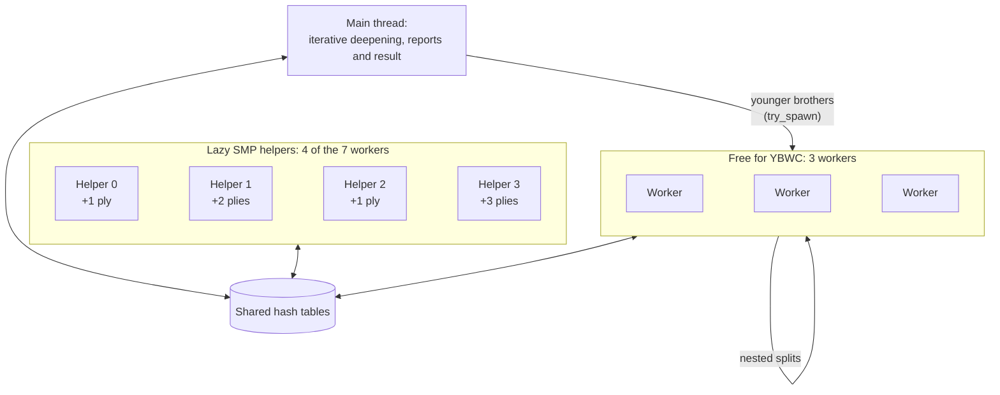

# 26 – Phases 5–9: threads

[Back to the index](README.md)

## In short

Part 2 of the plan for Stello 3.0, [making-stello-3-plan.md](../Plans/making-stello-3-plan.md), made the Rust engine search on several threads, in the desktop app, in the tools and in the browser. It took five phases, from 2 to 4 November 2026. Every measurement is in [making-stello-3-findings.md](../Plans/making-stello-3-findings.md).

- **Why:** the desktop machines have 16–24 threads, but the engine used one. The model is Egaroucid: its `thread_pool.hpp`, the Lazy SMP helpers of its `ai.hpp`, and the Young Brothers Wait Concept of its `ybwc.hpp`.
- **1 thread stays as it was.** With 1 thread the engine is node for node identical to Stello 2.0 after every phase, so all the parity checks of Part 1 still hold.
- **Phase 5, a shared hash table and a thread pool:** each slot of the hash tables became one 64-byte cache line with a sequence lock, at a cost of 0–0.6 % on 1 thread in the comparison (at most 2.2 % through the C# wrapper) and a third more memory (64 MB at the default size instead of 48). A fixed pool of worker threads hands a task only to an idle worker.
- **Phase 6, Lazy SMP:** helper threads run their own iterative deepening a few plies ahead of the main thread and fill the shared table. At 500 ms per move, 4 threads beat 1 thread with 55.3 % and 8 threads with 53.0 %.
- **Phase 7, YBWC:** after the first child of a node, its younger brothers go to idle threads, in the midgame and in the solver; half the threads stay Lazy SMP helpers. FFO #40–49 is solved 3.29 times faster with 8 threads, and YBWC plus Lazy SMP beats Lazy SMP alone with 54.4 % at 500 ms and 54.7 % at 2 s.
- **Phase 8, threads in the browser:** a second, threaded WebAssembly package whose threads are Web Workers on one shared memory. With 8 threads, Chromium solves FFO #40–44 3.5 times faster and searches the midgame 1.93 times faster.
- **Phase 9, the Threads setting and the final matches:** a Threads setting in both apps. Against Stello 2.0, 3.0 scores +78 Elo on 1 thread and +121 on 8 threads at 500 ms. Against the Egaroucid port it is +109 and +115 at 500 ms; at 2 s it is −30 on 1 thread and even (−1) on 8 threads.

## The decisions

| Question | Decision |
|---|---|
| The model | Egaroucid's thread pool, Lazy SMP helpers and YBWC. The Egaroucid port had left them out ([chapter 18](18-the-egaroucid-port.md)) |
| 1 thread | Must stay node for node identical to Part 1 (gate P5), so the parity checks stay valid |
| The hash table | Shared by all threads, with entries that a torn read can never pass for valid. Measured on 1 thread before choosing |
| The browser | Threads only where they can work: a separate package built with nightly Rust, loaded only when the page is cross-origin isolated and more than 1 thread is asked for. The single-threaded package stays the fallback |
| The apps (user, 2 November 2026) | A Threads setting in both apps. The default is the cores minus one on the desktop and `navigator.hardwareConcurrency` in the browser |
| The tools | A `threads=` match side key and `--threads` options. The book recalculation was to measure workers × threads; the user decided otherwise in phase 9 (see [the user decisions](#the-user-decisions)) |

## Phase 5: a shared hash table and a thread pool

Phase 5 (2 November 2026) built what the parallel search needs, without making it faster yet: a hash table that all threads can share, a thread pool, and a `Threads` value from the apps down to Rust.

### The hash table: seqlock, spin lock or XOR

The C# table of 2.0 was written by one thread only. With several threads, a reader can see an entry while another thread writes it, and take half of one entry and half of another for a valid result. Three ways to prevent that were measured on 1 thread (one pinned CPU, fastest of 3 passes; mid-bench depth 10 / mid-bench depth 12 / random positions at depth 8 / FFO #40–49):

| Variant | Time | Cost |
|---|---|---|
| Unchanged (single-threaded, 48-byte slot) | 0.346 / 1.001 / 0.856 / 25.0 s | — |
| **Seqlock, 64-byte slot (chosen)** | 0.345 / 1.007 / 0.855 / 24.9 s | 0–0.6 % |
| Spin lock per slot on probe and store (as in Egaroucid) | 0.351 / 1.021 / 0.865 / 25.0 s | 1.5–2 % |
| Hyatt's XOR check, 48-byte slot | 0.341 / 1.008 / 0.848 / 25.1 s | About 0 %, but only probabilistic |

- **The seqlock** was chosen. A slot is one cache line: a sequence word and the two entries, each as three atomic 64-bit words. A store takes the slot with a compare-and-swap and releases it with the sequence + 2. A probe returns a miss if the slot is locked, and on a hit reads the sequence again: a read that overlapped a write is a miss. So a torn entry is never taken for a valid one, and with 1 thread nothing changes. [Chapter 07](07-transposition-table.md#sharing-the-table-between-threads) explains it in detail.
- **The spin lock** is strict too, but every probe pays for the lock.
- **The XOR check** costs nothing and keeps the 48-byte slot, but two positions that differ in one disc's colour can let a torn read pass.
- **The price is memory:** a third more. The default 19 hash bits take 64 MB instead of 48, and the Settings labels in both apps now say 4, 16, 64, 256 and 1,024 MB ([chapter 15](15-gui-and-settings.md)).

### The thread pool

The pool, [search/pool.rs](../Stello.Rust/stello-core/src/search/pool.rs), is shaped like Egaroucid's `thread_pool.hpp` ([chapter 06](06-midgame-search.md#the-thread-pool)):

- **The workers are fixed,** and each has its own state: the solver's local table and the move-ordering killers. The engine starts the pool at the first search with N > 1 threads (N − 1 workers, plus the calling thread) and keeps it for later searches with the same N.
- **Tasks run in a scope,** which waits for them, as `std::thread::scope` does, also when its body panics, and passes a task's panic on. So tasks may borrow the position, the shared tables and the stop flags.
- **`try_spawn`** hands a task to an idle worker, or refuses at once when all are busy. That is what YBWC needs: split only where a thread is free.
- **A `Spawner` hook,** `std::thread` by default, lets another kind of thread run the workers: the Web Workers of phase 8. On WebAssembly without atomics the engine always searches with 1 thread and starts no thread.

The first N-thread search was a stand-in: N − 1 helpers ran the same root search with the root moves rotated, into the shared tables. It was not faster: FFO #40–49 took 27–31 s against 25 s on 1 thread, and mid-bench depth 12 with 8 threads took about the time of 1 thread (1.03 against 1.11 s). Phases 6 and 7 replaced it.

### Threads through every layer

| Layer | What it got |
|---|---|
| Rust | `SearchLimits::with_threads(n)`, 1–256, default 1 |
| FFI | ABI version 2 with `stello_engine_set_threads`; the version-1 functions unchanged ([chapter 14](14-app-integration.md#search-threads)) |
| C# | `SearchLimits.Threads` (init, 1–256, default 1). The wrapper sets the threads only when they change; Stello 1 and 2.0 ignore them |
| Web | `Threads` in `EngineProtocol.MoveRequest`; the WebAssembly engine searched with 1 thread until phase 8 |
| Tools | `--threads N` for `stello-cli` and `Stello.Benchmark`'s `mid-bench` and `solve-bench`; the match side key `threads=` (for `engine=stello`), and each side's threads in the match header |

**Matches with threads:** at the time, the default number of games at a time (`--workers`) was the logical processors / 2. Since Stello 3.1 the default is the physical cores divided by the larger side's thread count, at least one; an explicit `--workers` overrides it ([chapter 17](17-measuring-the-engine.md#timing)).

### The gate of phase 5

| Gate | Result |
|---|---|
| threads = 1 identical | Identical to the 2.0 reference results through the wrapper: mid-bench depth 10 and 12, random positions at depth 8, FFO #40–49, the 300 handover and 500 random endgame positions; also with `--cpu portable`. The 105 signatures pass |
| N threads give the right results | FFO #40–49 with 2, 4, 8 and 16 threads, and 500 random endgames with 4 and 8 threads: every score exact. In the midgame with 4–16 threads no wrong score kind or depth |
| At most 3 % overhead on 1 thread | Through the wrapper: depth 10 +1.5 %, depth 12 +0.7 %, random depth 8 +2.2 %, FFO −0.4 % |

The new tests include a **hammer test** of the table: 8 threads on 1,024 slots, every field of a hit checked against its key. With the sequence check disabled, it failed 2 runs in 3. Miri passed the table and pool tests, and ThreadSanitizer found no reports in the library and the thread tests (both on nightly Rust, only for these checks).

## Phase 6: Lazy SMP

Phase 6 (2 November 2026) made the threads useful. In Lazy SMP the helper threads do not share work with the main thread: they search the same root and help only through the shared hash table, where the main thread finds their results.

### The design

- **The midgame:** one pool scope covers all the midgame iterations. Helper *i* (from 0) runs its own iterative deepening on the root, 1 + ctz(*i* + 1) plies ahead of the main thread: +1, +2, +1, +3, +1, +2, +1 for helpers 0 to 6. It reads the main thread's depth from an atomic and jumps ahead when the main thread catches up, but not past the last midgame depth. Helpers use the main thread's selectivity, and a flag stops them when the midgame iterations end. Their nodes are counted; the result is the main thread's ([chapter 06](06-midgame-search.md#lazy-smp)).
- **The solve:** each solve pass (win/loss/draw, then exact) got at most 3 helpers, which solve the same window with the root moves rotated, into the shared endgame table.
- **Few empty squares:** with too few empty squares for a midgame iteration, no helper starts.
- **Not as planned:** the plan said "helpers at main depths up to 10", as in Egaroucid. That limit gave no gain without YBWC: the deep iterations take nearly all the time, and Egaroucid relies on YBWC there. So the helpers run at all midgame depths.

### Egaroucid's scheme or helpers ahead

Before choosing, the schemes were measured with the command-line tool, as the time to depth 14 on mid-bench (1 thread: 3.03 s):

| Scheme | 4 threads | 8 threads |
|---|---|---|
| Egaroucid's: helpers per iteration at depth + ctz(i + 1) with a Multi-ProbCut ladder, main depth ≤ 10 | 2.93–3.14 s (no gain) | |
| The same at all depths | 2.22 s | 2.27 s (1.35 times) |
| Helpers only deeper, or rotated helpers at the same depth | about 1.4 times | about 1.4 times |
| **Helpers with their own iterative deepening ahead (chosen)** | **2.00 s** | **1.83 s** (1.5–1.65 times) |

Other ways of choosing how far ahead a helper goes were the same or worse.

**The machine limits the scaling.** N single-threaded copies running side by side at depth 12 take 1.16 s alone, 1.31 s each with 4 copies, 1.50 s with 8 and 2.03 s with 16: 12 %, 27 % and 75 % slower. The development VM's performance and efficiency cores and its hyperthreads are the cause, so no parallel search on it can scale fully.

### The solve helpers

On FFO #40–47 (1 thread: 10.1 s), 3 or 7 rotated helpers on the same window took 9.0–9.4 s with 4 threads and 6.5–6.7 s with 8. An exact window was no better. But on FFO #40–49, 7 helpers made #49 take 15 s instead of 8.8 s, by filling the table with less useful entries. With 8 threads: 0 helpers 26.1 s, 3 helpers 23.5 s with no position slower, 5 helpers 25.7 s. So at most 3.

### Time to depth

Through the wrapper, the mean wall time of 3 mid-bench passes (100 positions):

| Threads | Depth 14 | Speed-up | Nodes/s | Depth 16 | Speed-up | Nodes/s |
|---:|---:|---:|---:|---:|---:|---:|
| 1 | 3.22 s | 1.00× | 9.9 M | 8.48 s | 1.00× | 9.5 M |
| 2 | 2.57 s | 1.25× | 18.0 M | 6.89 s | 1.23× | 17.7 M |
| 4 | 2.10 s | 1.53× | 34.0 M | 5.31 s | 1.60× | 33.7 M |
| 8 | 1.94 s | 1.66× | 58.0 M | 4.81 s | 1.76× | 57.9 M |
| 16 | 1.97 s | 1.63× | 83.7 M | 5.01 s | 1.69× | 81.5 M |

The nodes per second grow almost with the threads; the time to depth much less, because the helpers' work only partly saves the main thread's. FFO #40–49 took 25.4 s on 1 thread (identical to 2.0), 23.6 s on 4 and 23.1 s on 8: Lazy SMP barely helps the solver.

### The gate of phase 6

500 ms per move, 1,180 games, `engine=stello` on both sides, hash bits 19, no book ([4 threads](../Plans/benchmark-results/match_v3p6-4t-vs-1t-500ms.md), [8 threads](../Plans/benchmark-results/match_v3p6-8t-vs-1t-500ms.md)):

| Match | Games at a time | Score of N threads (95 %) | Elo | Midgame depth | Nodes/s |
|---|---:|---|---|---|---|
| 4 threads vs 1 | 5 | **55.3 %** (53.1–57.4) | +37 (+22 to +52) | 19.41 vs 18.50 | 39.4 M vs 10.4 M |
| 8 threads vs 1 | 2 | **53.0 %** (50.9–55.0) | +21 (+6 to +35) | 20.20 vs 18.97 | 70.2 M vs 13.4 M |

Both pass (lower bound above 50 %). 8 threads passed only just, and scored below 4 threads. The two matches are not directly comparable: with only 2 games at a time, the 1-thread side ran on a less loaded machine (13.4 M against 10.4 M nodes per second). The real test of 8 threads came with YBWC.

## Phase 7: YBWC

Phase 7 (3 November 2026) added the Young Brothers Wait Concept, after Egaroucid's `ybwc.hpp`: once the first child of a node has been searched, its younger brothers may be searched in parallel, each on a thread that is idle at that moment.

### The design

- **Splitting** ([`Searcher::split`](../Stello.Rust/stello-core/src/search/ybwc.rs#L136-L295)): every younger brother is searched with a null window at alpha. Each one but the last goes to an idle worker if there is one; otherwise this thread searches it. A fail high sets the split point's cut and stop flags. A brother at or above beta cuts the node off; the other fail highs are searched again with the full window, in order. Brothers that were stopped get another round at the new alpha. [Chapter 06](06-midgame-search.md#ybwc) shows a split step by step.
- **Split points form a chain,** so a split-off search stops when any split point above it is stopped, and a split-off search may split again.
- **Waiting without going deaf:** the pool's `scope_polling` waits for the tasks and checks Move Now, cancel and the time limit about every millisecond. A thread waiting at a split still stops in time.
- **Where nodes split:** the midgame `search`, at its second child, when the children are searched 6 plies deep or more (Egaroucid's minimum), at PVS and null-window nodes; the solver's `end_window` and `end_deep`, when the children have 16 or more empty squares ([chapter 08](08-endgame-solver.md#threads-in-the-solver)).
- **An internal switch,** `SearchOptions::ybwc` (FFI `stello_engine_set_ybwc` in ABI 3, `stello-cli --ybwc off`, the match key `ybwc=on|off`), gives exactly phase 6 with `off`. It is kept for later comparisons, like the `selective` switch.

How the threads of one 8-thread search are used in the midgame:

Only the main search and the searches split off from it split nodes; the Lazy SMP helpers never do. In the solve, no worker is a helper: all 7 are free for YBWC.

### YBWC alone or mixed with Lazy SMP

The plan said "Lazy SMP at shallow main depths, as in Egaroucid". Measured with 8 threads at depth 14, helpers only up to depth 10 took 2.79 s, against 1.82 s for Lazy SMP alone. **YBWC alone is weak in this midgame:** 51,000 tasks of 415 nodes on average kept the workers only 26 % busy, and 8 threads took 3.30 s, slower than 1 thread's 3.07 s. The split-off searches are too small to pay for themselves.

So half of the workers, rounded up, run Lazy SMP helpers at all depths (2 threads → 1, 4 → 2, 8 → 4, 16 → 8), and the rest are free for YBWC. The number was measured (command-line tool, mean of 3 passes at depth 16; 1 thread about 8.1–8.5 s):

| Threads | Lazy SMP helpers | Time | Lazy SMP alone |
|---:|---|---:|---:|
| 2 | 0 / 1 | 7.13 / 6.66 s | |
| 4 | 1 / 2 | 5.08 / 4.89 s | 5.49 s |
| 8 | 3 / **4** / 5 | 4.02 / **3.82** / 4.08 s | 4.80 s |
| 16 | 4 / 8 / 12 | 4.92 / 4.96 / 5.26 s | 5.18 s |

At depth 17 with 8 threads: 4 helpers 6.39 s, 2 helpers 6.62 s, Lazy SMP alone 7.68 s, YBWC alone 9.69 s (1 thread 13.4 s).

**In the solve** the Lazy SMP helpers went: with them, FFO #40–49 with 8 threads took 11.2 s, without them 8.0 s. They took the workers that YBWC uses better. The minimum of 16 empty squares for a split was measured too: 15 and 16 were the fastest.

### The numbers

FFO #40–49, through the wrapper, every score and move correct:

| Threads | Stello 3.0 | Speed-up | Lazy SMP alone | Egaroucid C++ (hash 21) | Speed-up |
|---:|---:|---:|---:|---:|---:|
| 1 | 25.6 s | 1.00× | | 11.46 s | 1.00× |
| 4 | 12.9 s | 1.98× | 24.3 s | 4.39 s | 2.61× |
| 8 | 7.8 s | 3.29× | 23.5 s | 2.76 s | 4.15× |
| 16 | 6.45 s | 3.97× | 23.7 s | 2.36 s | 4.86× |

The C# Egaroucid port is single-threaded (26.2 s), so it has no thread numbers. Egaroucid's C++ scales better; part of the gap may be that it also splits at the root, which Stello does not.

Time to depth 16, the mean wall time of 3 mid-bench passes:

| Threads | YBWC + Lazy SMP | Speed-up | Lazy SMP alone |
|---:|---:|---:|---:|
| 1 | 8.13 s | 1.00× | |
| 4 | 4.85 s | 1.68× | 5.28 s |
| 8 | 3.89 s | 2.09× | 4.72 s |
| 16 | 5.39 s | 1.51× | 4.97 s |

At 16 threads this VM is saturated (16 single-threaded copies each run 75 % slower), and YBWC + Lazy SMP is slower there than Lazy SMP alone.

### The gate of phase 7

| Gate | Result |
|---|---|
| FFO #40–49 correct and faster with N threads | 1.98, 3.29 and 3.97 times faster with 4, 8 and 16 threads, all correct |
| 500 ms, 8 threads, YBWC + Lazy SMP against Lazy SMP alone: not worse | **54.4 %** (52.2–56.5), +30 Elo (+16 to +45), 1,180 games; midgame depth 20.51 against 19.89, first solve at 24.9 against 23.6 empty squares ([results](../Plans/benchmark-results/match_v3p7-ybwc-vs-lazy-8t-500ms.md)) |
| 2 s, the same: better | **54.7 %** (52.0–57.3), +33 Elo (+14 to +51), 600 games; depth 23.14 against 22.26, first solve at 26.7 against 25.3 ([results](../Plans/benchmark-results/match_v3p7-ybwc-vs-lazy-8t-2s.md)) |

- **600 games at 2 s** instead of 1,180, because 1,180 would have taken about 8 hours. The lower bound is above 50 % anyway.
- **Correctness:** 500 random endgames with 8 and with 16 threads gave every score and move equal to 2.0, in 180 s and 150 s against 974 s for 2.0. The 300 handover positions with 8 threads gave no wrong score kind or depth. With 1 thread, mid-bench depth 12 and FFO #40–49 stayed identical to 2.0.
- **Checks:** 72 `cargo test` tests (new: split solves with 3, 8 and 16 threads on small tables, with Multi-ProbCut on and off; Lazy SMP alone solves exactly; the polling scope; `set_ybwc`). Miri passes the pool tests, including the polling scope; ThreadSanitizer found no reports. In release, the worst overshoot of a 150 ms move with 8 threads was 4.9 ms.

## Phase 8: threads in the browser

Phase 8 (3 November 2026) brought the same threads to the web app ([chapter 14](14-app-integration.md#threads-in-the-browser)).

### The design

- **A second package.** The threaded build, `wwwroot/engine-mt`, is the same `stello-wasm` crate compiled with atomics and a shared memory. That needs nightly Rust (pinned to `nightly-2026-11-02`, with `-Z build-std=std,panic_abort`); the rest of the workspace stays on stable. The single-threaded `wwwroot/engine` stays as it was.
- **Loaded only when it can work.** At `init` the engine worker loads `engine-mt` only if more than 1 thread is asked for, the page is cross-origin isolated and `SharedArrayBuffer` exists; otherwise, or if the load fails, it loads `engine`. Only the package used is downloaded.
- **Our own small pool, not wasm-bindgen-rayon.** The engine already has its pool and the `Spawner` hook, and Rayon would add two crates only to run long-lived bodies. With our own, the engine worker decides when the Web Workers start (asynchronously, before a search), so Rust never waits for a worker that the browser has not started yet. It is about 70 lines of Rust and 60 of JavaScript.
- **The threads are Web Workers.** The engine worker compiles the module once and starts the pool workers, which instantiate it on the shared memory and wait for thread bodies with `Atomics.wait`, which a worker may do. The page's main thread never blocks. `web_spawner` hands a body to a waiting Web Worker, or fails if none waits, and the pool then has fewer threads. Before each search the threads are capped at `navigator.hardwareConcurrency`.
- **Found in review:** `web_spawner` waited without a limit for a Web Worker on its way back from the previous pool. If fewer Web Workers had started than the pool asked for, it would have waited for the pool's own threads, which end only with the pool: the search would hang. Now it gives up after 200 ms.
- **The clock** is `performance.timeOrigin + performance.now()` in both builds, because `performance.now()` counts from each worker's own start, and the threads compare their time with the search's start.
- **Shared memory** may grow to 2 GiB, so the 1,024 MB hash setting fits. Where a device cannot reserve that, the threaded load fails and the single-threaded package plays.
- **The build:** the MSBuild target `BuildStelloWasmThreads`, with `StelloWasmThreads` = `auto` (the default: without the nightly a warning, and only the single-threaded engine), `required` (the deploy workflow) or `false`. A build never downloads a toolchain. The deploy workflow installs the pinned nightly with `rust-src`.

### The gate of phase 8

Headless Chromium, the Release AOT publish served with COOP/COEP, `hardwareConcurrency` 24; the engine's times:

| Threads | FFO #40–44 (exact) | Speed-up | Midgame depth 14, 20 positions | Speed-up | Move Now / cancel |
|---:|---:|---:|---:|---:|---|
| 1 (single-threaded package) | 2.87 s | 1.00× | 1.72 s | 1.00× | 0.1–1.2 ms |
| 2 | 1.93 s | 1.49× | 1.62 s | 1.06× | ≤ 2.1 ms |
| 4 | 1.24 s | 2.31× | 1.06 s | 1.62× | ≤ 1.5 ms |
| 8 | 0.82 s | 3.50× | 0.89 s | 1.93× | ≤ 6.5 ms |
| 24 | 0.89 s | 3.22× | 0.90 s | 1.91× | ≤ 15.6 ms |

- **Results:** every solve exact, every midgame move legal and at depth 14. The threaded package with 1 thread searches the same nodes, 3–8 % slower.
- **In the UI** with 8 threads, the engine played at 1 s per move at depth 25 and about 21 M nodes per second; Move Now took 83 ms through the UI.
- **The fallback:** served without COOP/COEP, a request for 8 threads ran single-threaded, played, and Move Now worked; with `engine-mt` missing, it ran single-threaded with a console warning.
- **The first visit** (brotli) is 6.85 MB with 1 thread (only `engine/`) and 6.88 MB with 8 threads (only `engine-mt/`).
- **Node tests:** 10 on the single-threaded package, and 5 new ones on the threaded package with `worker_threads` as pool workers: 1-thread parity with the 2.0 signatures, FFO #40–44 exact with 4 threads, a legal midgame move, and Move Now and cancel under 30 ms.
- **Not verified:** the Windows build with the nightly, Firefox and Safari (nested workers and shared memory), and mobile devices.

## Phase 9: the Threads setting and the release

### The setting

Phase 9, part A (3 November 2026), gave both apps a **Threads** setting ([chapter 15](15-gui-and-settings.md#3-threads)):

- **`GameSettings.Threads`** is stored with the other settings. 0 means Automatic, so the default follows the device the settings are used on; old settings files read as Automatic.
- **`ThreadCounts`:** on the desktop the device has `Environment.ProcessorCount` threads, and Automatic uses the cores − 1 (at least 1), which leaves one for the app. In the browser both are `navigator.hardwareConcurrency`, since the page's own thread is not one of the engine's. A chosen number is capped at the device's.
- **The desktop:** the threads reach the Rust engine through `SearchLimits.Threads`, on the existing path (`MainViewModel` → `ComputerPlayer` → `SearchEngine`). Book learning stays on 1 thread.
- **The web:** the worker starts with the saved setting, so the first search finds the right package loaded. Going between 1 thread and more restarts the worker, keeping the book tracker; another number above 1 does not.
- **The analysis panel** already showed the nodes per second over all threads.
- **Checks:** in headless Chromium, the setting at 1 ran the single-threaded package (3.7 M nodes per second), 8 the threaded one (22 M), and Automatic (24) gave 33 M. A reload kept the setting. The WPF app itself needs the user's check on Windows.

### The user decisions

| Question | Decision (user) |
|---|---|
| The defaults (2 November 2026) | Automatic: the cores − 1 on the desktop, `navigator.hardwareConcurrency` in the browser |
| Threads in the book recalculation (3 November 2026) | None: `recalc` keeps 1 thread per worker and has no `--threads` |
| Threads in the tools (3 November 2026) | Threads stay where engines are compared: `Stello.Benchmark match` (`threads=`), `mid-bench` and `solve-bench --threads`, and `Stello.BookTool match --threads` (new, default 1, shown in the header) |

**Why the book recalculation has no threads.** It already searches many positions in parallel, one search per core, which scales almost perfectly. Threads within one search scale far less: 1.7–2.1 times in the midgame and about 3.3 times in the endgame with 8 threads. So with the same cores, 1 thread with more time per position always beats several threads. A measurement made before the decision confirms it (the whole master book at depth 14, 7,534 positions):

| Workers × threads | Positions per minute |
|---|---:|
| 24 × 1 | 11,191 |
| 12 × 1 (the default) | 8,969 |
| 12 × 2 | 6,831–8,056 |
| 8 × 1 | 6,683 |
| 6 × 4 | 5,993 |
| 3 × 8 | 4,160 |
| 2 × 12 | 3,129 |
| 1 × 24 | 1,816 |

The book recalculation default stays at 12 workers on that machine. 24 × 1 was 25 % faster at depth 14, but with a time per position, hyperthreads and efficiency cores give each search less CPU.

### The final matches

Phase 9, part B (3–4 November 2026), measured the final 3.0 as 2.0 was measured: against Stello 2.0 and against the C# Egaroucid port, at 100 ms, 500 ms and 2 s per move, with 1 thread and with 8 threads. Each match started on the user's go and ran alone on the machine, with no books, hash bits 19 and Stello 3.0 as side A; 1,180 games, or 600 at 2 s ([findings](../Plans/making-stello-3-findings.md#phase-9-part-b-the-final-matches-started-2026-11-03)):

| Match | Games | Stello 3.0 (95 %) | Elo | Midgame depth | Nodes/s |
|---|---:|---|---|---|---|
| [1 thread vs 2.0, 100 ms](../Plans/benchmark-results/match_v3final-1t-vs-v2-100ms.md) | 1,180 | **63.8 %** (61.5–66.1) | +99 | 15.76 vs 13.83 | 10.1 M vs 4.2 M |
| [1 thread vs 2.0, 500 ms](../Plans/benchmark-results/match_v3final-1t-vs-v2-500ms.md) | 1,180 | **61.1 %** (58.9–63.3) | +78 | 18.59 vs 16.70 | 10.4 M vs 4.3 M |
| [1 thread vs 2.0, 2 s](../Plans/benchmark-results/match_v3final-1t-vs-v2-2s.md) | 600 | **61.7 %** (58.7–64.6) | +83 | 21.03 vs 19.20 | 10.8 M vs 4.6 M |
| [8 threads vs 2.0, 100 ms](../Plans/benchmark-results/match_v3final-8t-vs-v2-100ms.md) | 1,180 | **69.4 %** (67.3–71.5) | +142 | 17.85 vs 14.26 | 64.3 M vs 5.4 M |
| [8 threads vs 2.0, 500 ms](../Plans/benchmark-results/match_v3final-8t-vs-v2-500ms.md) | 1,180 | **66.7 %** (64.7–68.7) | +121 | 21.02 vs 17.26 | 78.2 M vs 6.0 M |
| [8 threads vs 2.0, 2 s](../Plans/benchmark-results/match_v3final-8t-vs-v2-2s.md) | 600 | **62.7 %** (59.9–65.5) | +90 | 23.70 vs 19.68 | 88.3 M vs 6.3 M |
| [1 thread vs Egaroucid port, 100 ms](../Plans/benchmark-results/match_v3final-1t-vs-egaroucid-100ms.md) | 1,180 | **82.8 %** (80.9–84.7) | +273 | 15.73 vs 8.69 | 9.7 M vs 3.8 M |
| [1 thread vs Egaroucid port, 500 ms](../Plans/benchmark-results/match_v3final-1t-vs-egaroucid-500ms.md) | 1,180 | **65.2 %** (63.1–67.4) | +109 | 18.58 vs 13.42 | 10.3 M vs 4.2 M |
| [1 thread vs Egaroucid port, 2 s](../Plans/benchmark-results/match_v3final-1t-vs-egaroucid-2s.md) | 600 | **45.7 %** (42.8–48.5) | −30 | 20.95 vs 21.45 | 10.7 M vs 5.0 M |
| [8 threads vs Egaroucid port, 100 ms](../Plans/benchmark-results/match_v3final-8t-vs-egaroucid-100ms.md) | 1,180 | **79.7 %** (77.7–81.7) | +237 | 17.88 vs 9.61 | 64.3 M vs 5.2 M |
| [8 threads vs Egaroucid port, 500 ms](../Plans/benchmark-results/match_v3final-8t-vs-egaroucid-500ms.md) | 1,180 | **65.9 %** (63.8–68.1) | +115 | 21.04 vs 14.97 | 77.7 M vs 6.1 M |
| [8 threads vs Egaroucid port, 2 s](../Plans/benchmark-results/match_v3final-8t-vs-egaroucid-2s.md) | 600 | **49.9 %** (47.2–52.6) | −1 | 23.62 vs 23.20 | 88.0 M vs 7.1 M |

The summary, in Elo for Stello 3.0:

| Opponent | Threads | 100 ms | 500 ms | 2 s |
|---|---:|---:|---:|---:|
| Stello 2.0 | 1 | +99 | +78 | +83 |
| Stello 2.0 | 8 | +142 | +121 | +90 |
| Egaroucid port (1 thread) | 1 | +273 | +109 | −30 |
| Egaroucid port (1 thread) | 8 | +237 | +115 | −1 |

**Compare rows of the same thread count.** The 1-thread matches play 12 games at a time and the 8-thread matches 2, so the opponent runs on a more or less loaded machine. In the 8-thread match against the port at 100 ms, the port searched 5.2 M nodes per second and reached depth 9.61, against 3.8 M and 8.69 in the 12-at-a-time match. So that match scored a little below the 1-thread one; each match says how 3.0 does on a machine loaded like that. Phase 6 saw the same effect.

- **On 1 thread** 3.0 searches about 1.9 plies deeper than 2.0 at every time per move, and starts the exact solve one empty square earlier. The 61.1 % at 500 ms lies within the interval of the phase 2 match (59.6 %, 57.3–61.9); the single-threaded engine has not changed since.
- **8 threads** reach 2.1–2.7 plies deeper than 1 thread at the same time per move: at 500 ms they reach 21.0 plies, as deep as 1 thread at 2 s. They also start the exact solve about 2 empty squares earlier. Against 2.0 the gain from threads shrinks with time (+43 Elo at 100 ms and at 500 ms, +7 at 2 s), partly because 2.0 runs on a less loaded machine in the 2-at-a-time matches (6.3 M against 4.6 M nodes per second at 2 s). A guess, not measured: at 2 s both sides solve the endgame exactly early, so extra depth decides fewer games.
- **Against the Egaroucid port** 3.0 gained on 2.0 at every time:

  | Time per move | Stello 2.0 | Stello 3.0, 1 thread | Gain |
  |---|---|---|---|
  | 100 ms | 75.6 % (+196 Elo) | 82.8 % (+273) | +77 Elo |
  | 500 ms | 58.8 % (+62) | 65.2 % (+109) | +47 Elo |
  | 2 s | 40.8 % (−64), 1,180 games | 45.7 % (−30), 600 games | +34 Elo |

  At short times the port reaches far less depth (8.7 plies at 100 ms), so Stello wins clearly. At 2 s the port's evaluation and deeper search (21.45 against 20.95 plies, at half the nodes per second) still win on 1 thread. With 8 threads 3.0 is even with it at 2 s (49.9 %), while the port reaches nearly the same depth (23.2 against 23.6) on one thread, at a twelfth of the nodes per second.

### FFO #40–49 with 1, 8 and 24 threads

Every score and move correct ([1 thread](../Plans/benchmark-results/v3final-solve-bench-40-49-t1.json), [8](../Plans/benchmark-results/v3final-solve-bench-40-49-t8.json), [24](../Plans/benchmark-results/v3final-solve-bench-40-49-t24.json)):

| Threads | Time | Speed-up | Nodes/s |
|---:|---:|---:|---:|
| 1 | 25.8 s | 1.00× | 42.6 M |
| 8 | 7.81 s | 3.30× | 205.8 M |
| 24 | 6.56 s | 3.93× | 260.5 M |

For comparison, Stello 2.0 took 46.8 s on 1 thread ([the baseline](../Plans/making-stello-3-findings.md#baseline-stello-20-c-1-thread)). The per-position times are in [chapter 08](08-endgame-solver.md#threads-in-the-solver).

### The release

After the matches came these documents and the user's check of the WPF app on Windows (OK). Then main was fast-forwarded to 261b5f9 on 4 November 2026. The deploy (run 41770100838) succeeded, including its first run with the nightly Rust for the threaded package.

The live check in headless Chromium:
- **Isolation and files:** the site is cross-origin isolated (COOP/COEP), and both packages (`engine/`, `engine-mt/`) and `engine-pool-worker.js` are served.
- **The Threads setting:**

  | Setting | Package | Speed |
  |---|---|---|
  | 1 thread | single-threaded | 3.8 M nodes/s |
  | 8 threads | threaded | 22.7 M nodes/s |
  | back to 1 thread | single-threaded | 3.7 M nodes/s |
  | Automatic (24) | threaded | 36.3 M nodes/s |

  After a reload the saved Automatic setting starts the threaded package.
- **With Automatic,** the default for a new visitor:
  - a game at 1 s per move reached depth 21–25 at 34–38 M nodes/s;
  - Move Now answered in 0.06 s;
  - a position with 22 empty squares was solved in 0.31 s at 67 M nodes/s;
  - About shows the 3.0 text with threads;
  - this chapter opens in the docs viewer;
  - there were no page errors.

## What comes next

The ideas the phases left open ([findings](../Plans/making-stello-3-findings.md#not-done-and-ideas-for-later)):

- **Root splitting.** `search_root` and `solve_root` still go through the root moves one by one. Egaroucid splits at the root too, which could close part of the FFO gap to it (3.29 against 4.15 times with 8 threads).
- **Interrupting the splitting thread's own brother.** When a task fails high, the brother that the splitting thread searches itself runs to the end. That is correct, but the work is wasted.
- **Heartbeats while waiting.** A thread waiting at a split sends no progress reports, so the apps may show a stale report for as long as the wait.
- **The stored move in `end_deep`.** A stored best move that was searched but did not improve on the best score did not count as searched, so that node split one move later. Fixed in 3.1 ([findings](../Plans/making-stello-3-1-findings.md#item-4-endgame-deep-node-stored-moves-and-split-timing)).
- **16 threads in the midgame** are slower than Lazy SMP alone on the development VM, which saturates at 16 threads. The split between helpers and YBWC workers should be measured again on other machines.
- **A Ryzen 7 7800X3D** (8 cores, 16 threads, no efficiency cores) has not been measured. It may scale better than the VM with its performance and efficiency cores.
- **Firefox, Safari and mobile devices** have not been verified with the threaded package (nested workers and shared memory). The single-threaded package is the fallback there if the threaded one does not load.
- **After the plan** (user, 2 November 2026): align the WPF GUI with the web apps.

## Design notes

- **One table, many threads.** All threads share both hash tables, so Lazy SMP helpers can help at all, and a lock per slot is cheaper than a lock on the table. A reader never waits: a slot being written is a miss.
- **The main thread decides.** The result, the progress and the time control are the main thread's. Helpers and split-off searches only add to the table, to the node counts and, for YBWC, to the main search's scores; their own results are dropped.
- **A pool that never waits.** A task is handed out only when a worker is idle, so a thread that wants to split never waits for a busy pool; it searches the brother itself.
- **Measured, not copied.** Two of Egaroucid's choices did not carry over: helpers only up to depth 10, and Lazy SMP only at shallow depths beside YBWC. In the browser, the usual wasm-bindgen-rayon gave way to the engine's own pool. Each change was measured or reasoned out first.
- **1 thread untouched.** Every phase kept 1 thread node for node identical to 2.0, so a thread bug could not hide in a parity difference.
- **Parallel positions beat a parallel search.** Where there are many independent searches, as in the book recalculation, one thread per search uses the cores best.

## Where in the code

| File | What |
|---|---|
| [search/table.rs](../Stello.Rust/stello-core/src/search/table.rs) | The 64-byte `Slot` with its sequence lock; `get` and `store` ([chapter 07](07-transposition-table.md#sharing-the-table-between-threads)) |
| [search/pool.rs](../Stello.Rust/stello-core/src/search/pool.rs) | `ThreadPool` (`new`, `scope`, `scope_polling`, `for_each_state`), `Scope::try_spawn`, `Spawner` and `std_spawner` |
| [search/engine.rs](../Stello.Rust/stello-core/src/search/engine.rs) | `SearchEngine::search` with the pool, `ThreadState`, `SearchContext`, `Helpers`, `lazy_smp_midgame`, `solve_iteration`, `lazy_smp_helpers`, `SOLVE_HELPERS`, `YBWC_MID_MIN_DEPTH`, `YBWC_END_MIN_EMPTIES`, the split in `Searcher::search` |
| [search/ybwc.rs](../Stello.Rust/stello-core/src/search/ybwc.rs) | `SplitPoint`, `SplitStop`, `SplitChild`, `MidgameChild`, `Searcher::split` |
| [endgame/search.rs](../Stello.Rust/stello-core/src/endgame/search.rs) | The splits in `end_window` and `end_deep`, `EndgameChild`, `end_children` |
| [stello-ffi/src/lib.rs](../Stello.Rust/stello-ffi/src/lib.rs) | ABI 3: `stello_engine_set_threads`, `stello_engine_set_ybwc` |
| [stello-wasm/src/threads.rs](../Stello.Rust/stello-wasm/src/threads.rs), [lib.rs](../Stello.Rust/stello-wasm/src/lib.rs) | `web_spawner`, `poolWorker`, `idleThreads`; the clock and `threaded` |
| [engine-worker.js](../Stello.Net/Stello.Web/wwwroot/js/engine-worker.js), [engine-pool-worker.js](../Stello.Net/Stello.Web/wwwroot/js/engine-pool-worker.js), [engine-client.js](../Stello.Net/Stello.Web/wwwroot/js/engine-client.js) | Choosing the package, the pool workers, `info()` |
| [Stello.Web.csproj](../Stello.Net/Stello.Web/Stello.Web.csproj), [azure-static-web-apps.yml](../.github/workflows/azure-static-web-apps.yml) | `BuildStelloWasmThreads`, `StelloWasmThreads`, `StelloWasmNightly`; the nightly in the deploy |
| [SearchLimits.cs](../Stello.Net/Stello.Engine/SearchLimits.cs), [SearchEngine.cs](../Stello.Net/Stello.Engine/SearchEngine.cs), [Native/StelloNative.cs](../Stello.Net/Stello.Engine/Native/StelloNative.cs) | `SearchLimits.Threads` and `MaxThreads`; the wrapper's threads and ABI check |
| [GameSettings.cs](../Stello.Net/Stello.App/Models/GameSettings.cs), [ThreadCounts.cs](../Stello.Net/Stello.App/Models/ThreadCounts.cs), [SettingsViewModel.cs](../Stello.Net/Stello.App/ViewModels/SettingsViewModel.cs), [SettingsWindow.xaml](../Stello.Net/Stello.Net/Views/SettingsWindow.xaml), [SettingsForm.razor](../Stello.Net/Stello.Web/Components/SettingsForm.razor), [WebEngineHost.cs](../Stello.Net/Stello.Web/Services/WebEngineHost.cs) | The Threads setting in both apps, and the worker restart |
| [Stello.Benchmark](../Stello.Net/tools/Stello.Benchmark), [Stello.BookTool](../Stello.Net/tools/Stello.BookTool) | `threads=` and `ybwc=` side keys, `--threads`; `match --threads` |

## Tests

- **Rust** (`cargo test`, 72 tests): the hammer test of the table and the packing test ([search/table.rs](../Stello.Rust/stello-core/src/search/table.rs)); the pool's tests ([search/pool.rs](../Stello.Rust/stello-core/src/search/pool.rs)): no workers, borrowed data, stopping through a flag, the polling scope, a panic in a task, and a spawner that fails; and [tests/threads.rs](../Stello.Rust/stello-core/tests/threads.rs): FFO and random endings with several threads, the midgame, the node count of all threads, 1 thread after several, split solves on small tables with Multi-ProbCut on and off, Lazy SMP alone, the time per move with 8 threads, the handover with 4 threads, few empty squares with 8 threads, and Move Now and cancel stopping 8 threads in under 200 ms. Miri and ThreadSanitizer ran on the table and the pool.
- **.NET:** 488 engine tests, including the 105 signatures on 1 thread and the wrapper's threads; new app tests for the Threads setting and `ThreadCounts` (Windows only).
- **WebAssembly:** [engine.test.mjs](../Stello.Rust/stello-wasm/tests/engine.test.mjs) (10 tests) on the single-threaded package and [engine-mt.test.mjs](../Stello.Rust/stello-wasm/tests/engine-mt.test.mjs) (5 tests) on the threaded one ([chapter 14](14-app-integration.md#tests)).

## Further reading

- [making-stello-3-plan.md](../Plans/making-stello-3-plan.md): the plan, with its Status section.
- [making-stello-3-findings.md](../Plans/making-stello-3-findings.md): every measurement of phases 5–9.
- [Chapter 06](06-midgame-search.md#threads), [chapter 07](07-transposition-table.md#sharing-the-table-between-threads), [chapter 08](08-endgame-solver.md#threads-in-the-solver), [chapter 14](14-app-integration.md#threads-in-the-browser) and [chapter 15](15-gui-and-settings.md#3-threads): the threads in the current code.
- [References](30-references.md#26-phases-59-threads): Lazy SMP, YBWC and Feldmann's papers, seqlocks, WebAssembly threads and cross-origin isolation.

---

Previous: [25 Phases 0–4: the engine in Rust](25-phases-0-4-the-engine-in-rust.md) · Next: [27 Stello 3.1: fixes and the desktop app](27-stello-3-1-fixes-and-the-desktop-app.md)
