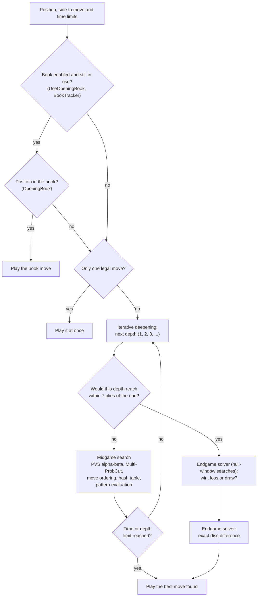

# The Stello brain

Stello is an Othello program. Its "brain" is the engine library `Stello.Engine`, which decides the computer's move. The brain consists of:

- **the board and rules**: bitboards and fast move generation;
- **the evaluation**: a pattern evaluation, 15 patterns of squares with weights trained on 500 million positions, in 10 stages of the game;
- **the search**: alpha-beta with principal variation search, Multi-ProbCut, move ordering and a hash table;
- **the endgame solver**: perfect play near the end of the game, adapted from Egaroucid;
- **the opening book**: about 11 000 known opening positions, which can learn from games.

These documents explain how the parts work, how they fit together and how they came to be. They describe Stello .NET 2.0, the current C# code in [Stello.Net](../Stello.Net).

## Three versions

| Version | When | What it is |
|---|---|---|
| **Stello C++** | 1992 | The original program by Claus Pedersen, written in C++ (later MFC, Visual C++ 6): a hand-made evaluation of edges, corners and mobility, alpha-beta with a selective search, an endgame solver and an opening book that learns from games. The source is in [Stello C++](../Stello%20C++). |
| **Stello .NET 1.0** ("Stello 1") | September–October 2026 | The C++ program ported to C# and .NET 10, with a WPF app for Windows and a Blazor WebAssembly app for the browser. The engine works as in C++, made faster with bitboards; the opening book was imported and recalculated. How it was ported, phase by phase, is in [Stello porting documentation.md](../Plans/Stello%20porting%20documentation.md). Its engine is kept, frozen, as `Stello.Engine.V1` for matches. |
| **Stello .NET 2.0** | November 2026 | A new trained pattern evaluation, an endgame solver adapted from Egaroucid, a new search (PVS everywhere, Multi-ProbCut, evaluation ordering) and the opening book recalculated by the new engine. It scores about 95 % against Stello 1 and beats the C# port of Egaroucid at short time limits ([chapter 24](24-results-and-what-comes-next.md)). |

The documentation of Stello 1 is kept as it was in the **[Stello 1 documentation](stello-1/README.md)** (archive).

## The brain on one page

This is how the computer finds a move, from the position to the move that is played. Each box is explained in a chapter.

The time limit can stop the search at any point; the best move found so far is then played. In solve mode (`SearchLimits.Solve`) a 4-ply midgame search first orders the moves, then the solver runs. After a draw the exact pass is not needed. The app handles passes before it asks the brain for a move.

## Chapters

### Part 1: How Stello 2.0 works

| # | Chapter | Content |
|---|---|---|
| 01 | [Overview](01-overview.md) | Projects, main types, the life of one computer move, design principles |
| 02 | [Board and squares](02-board-and-squares.md) | Bitboards, square numbering, the start position |
| 03 | [Rules and move generation](03-rules-and-move-generation.md) | Legal moves with shift-and-mask, flips, pass, game over, perft |
| 04 | [Evaluation](04-evaluation.md) | The pattern evaluation: patterns, places and folding, stages, reading the indices fast, the weights file |
| 05 | [Move ordering](05-move-ordering.md) | Square values, the response table, the hash move, evaluation ordering in deeper nodes |
| 06 | [Midgame search](06-midgame-search.md) | Negamax alpha-beta, iterative deepening, PVS, Multi-ProbCut with a fitted error model, the score scale |
| 07 | [Transposition table](07-transposition-table.md) | Two-entry slots, bounds, replacement, enhanced transposition cutoff, the endgame table |
| 08 | [Endgame solver](08-endgame-solver.md) | When it runs, the win/loss/draw and exact passes, the layers by empty squares, stable discs, parity, stopping |
| 09 | [Time control](09-time-control.md) | Time modes, time per move, the soft and hard limits, "Move Now" |
| 10 | [Opening book](10-opening-book.md) | Positions in canonical form, the text and binary files, the import of the C++ book, `BookTracker` |
| 11 | [Book learning](11-book-learning.md) | Adding games, dropout expansion, minimax, self-play |
| 12 | [Book tool](12-book-tool.md) | The console tool for the master book: import, build, verify, statistics, recalculating the leaves, comparing and matching books |
| 13 | [Game record](13-game-record.md) | Move history, undo/redo, the text file format |
| 14 | [App integration](14-app-integration.md) | The game loop, threading, engine hosts, WebAssembly worker, settings, data files |
| 15 | [GUI and settings](15-gui-and-settings.md) | The web and desktop interfaces, menu commands, settings, real-time analysis |

### Part 2: From Stello 1 to Stello 2.0

| # | Chapter | Content |
|---|---|---|
| 16 | [The goal and the plan](16-the-goal-and-the-plan.md) | Why Stello 2.0, the order of the work, the three engines, the gates, the working method, the timeline |
| 17 | [Measuring the engine](17-measuring-the-engine.md) | The benchmark tool: engine matches, the FFO endgame benchmark, the midgame benchmarks, the trainer's measurements, the baseline before 2.0 |
| 18 | [The Egaroucid port](18-the-egaroucid-port.md) | The C# port of Egaroucid, the reference engine: licence, C++ to C# file map, node-for-node parity, how to run it |
| 19 | [Stello 1 against Egaroucid](19-stello-1-against-egaroucid.md) | Matches, evaluation error, midgame quality and speed; what explained the gap |
| 20 | [Phases 0–2: the evaluation](20-phases-0-2-the-evaluation.md) | The frozen baseline, the training data, the C# trainer, the evaluation experiments, a larger evaluation that was not pursued |
| 21 | [Phase 3: the endgame solver](21-phase-3-the-endgame-solver.md) | Adapting Egaroucid's solver: what made it fast, what was dropped, the gate |
| 22 | [Phase 4: the release](22-phase-4-the-release.md) | The first 2.0 release in the apps, the book recalculated by Stello 2, the gates and the live check |
| 23 | [Phase 5: the search](23-phase-5-the-search.md) | Every search change, kept or rejected, with its matches; the book recalculated again; time odds; C++ against C# |
| 24 | [Results and what comes next](24-results-and-what-comes-next.md) | The final measurements of Stello 2.0 against Stello 1 and Egaroucid, and the next steps |

### Reference

| # | Chapter | Content |
|---|---|---|
| 25 | [Glossary](25-glossary.md) | The terms used in these documents |
| 26 | [References](26-references.md) | Articles, papers and source code on the internet |

## Reading paths

- **Everything:** read the chapters in order.
- **Just the engine:** 01, 02, 03, 04, 05, 06, 07, 08, 09.
- **Just the opening book:** 01, 02 (square numbers), 10, 11, 12.
- **UI and application architecture:** 01, 13, 14, 15.
- **Tuning the engine:** 17 (how to measure a change), then 23 for what has been tried, with its measurements, and 24 for the ideas that remain.
- **The story of Stello 2.0:** 16 to 24, then the working documents [improve-stello-strength-plan.md](../Plans/improve-stello-strength-plan.md) and [improve-stello-strength-findings.md](../Plans/improve-stello-strength-findings.md).

## How to view these documents

- **On GitHub:** diagrams and formulas are shown directly.
- **In VS Code:** open the Markdown preview (Ctrl+Shift+V). Formulas are shown by the built-in preview. The diagrams need the extension *Markdown Preview Mermaid Support* (`bierner.markdown-mermaid`).

The diagrams are written in [Mermaid](https://mermaid.js.org/), the formulas in LaTeX math, and the pictures are SVG files in the `images` folder.
