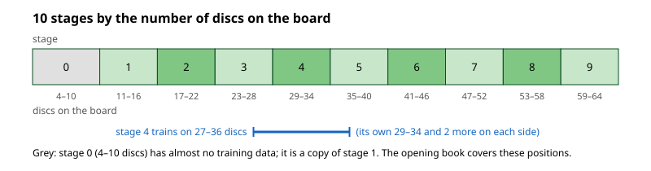
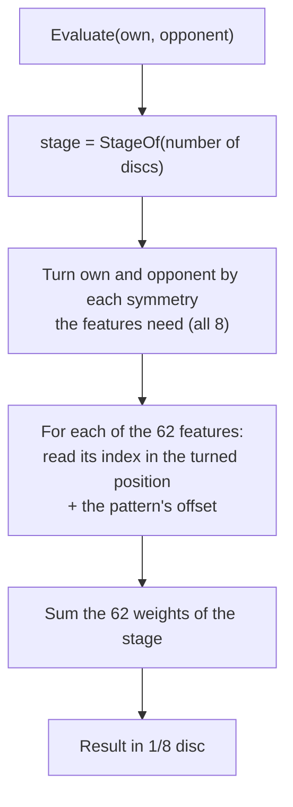

# 04 – Evaluation

[Back to the index](README.md)

## In short

At the leaves of the midgame search the engine cannot look further ahead, so it estimates how good the position is for the side to move. Stello's evaluation is a **pattern evaluation**. A pattern is a fixed group of squares, such as the second row or the 3 × 3 squares in a corner. For every way its squares can be filled with empty squares, own discs and opponent's discs, the pattern has one trained **weight**: a number of discs. Stello uses 15 patterns, each in all its places on the board: 62 **features** in all. The evaluation of a position is the sum of the 62 weights, and the weights are different in each of 10 **stages** of the game. The result estimates the final disc difference for the side to move. The search uses it in 1/100 disc.

The weights were trained on positions from real games and are built into the engine as the file `stello-eval.bin` (0.99 MB). Stello 1's hand-made evaluation is described in the [Stello 1 documentation](stello-1/04-evaluation.md).

## Data structures

### Patterns and indices

A **pattern** (`PatternShape`) is a list of up to 10 squares. Each square is empty, own (the side to move) or the opponent's, so a pattern of $n$ squares can be filled in $3^n$ ways. The filling is read as a number in base 3, the **index**:

$$i = \sum_{k=0}^{n-1} d_k \cdot 3^{k}, \qquad d_k = \begin{cases} 0 & \text{empty} \\ 1 & \text{own disc} \\ 2 & \text{opponent's disc} \end{cases}$$

The first square of the list is the lowest digit. For example, the pattern `diagonal4` is d1 c2 b3 a4. With an own disc on d1, c2 empty, an opponent's disc on b3 and an own disc on a4, the digits are 1, 0, 2, 1 and the index is $1 + 0 \cdot 3 + 2 \cdot 9 + 1 \cdot 27 = 46$. `PatternShape.Size` is $3^n$, the number of possible indices.

Own and opponent are relative to the side to move, not Black and White. So one table of weights serves both colours.

### Places and symmetries

The board has 8 symmetries: the identity, three rotations and four mirrors. [Symmetry.cs](../../Stello.Net/Stello.Engine/Evaluation/Symmetry.cs) numbers them 0–7 by three bits, applied in this order:

| Bit | Value | Turn | Example |
|---|---:|---|---|
| 0 | 1 | Mirror the columns (`MirrorColumns`) | a1 ↔ h1 |
| 1 | 2 | Mirror the rows (a byte swap) | a1 ↔ a8 |
| 2 | 4 | Mirror in the a1–h8 diagonal (`Transpose`) | a2 ↔ b1 |

A pattern is written once, in its **canonical place**. Its other places are the same squares turned by a symmetry. The row a2–h2 also stands for the 7th row and the b and g columns. Instead of a list of squares for each place, the code turns the whole position by the symmetry and reads the canonical squares again. `PatternShape.Placements` lists one symmetry for each different set of squares the pattern covers: 4 for most patterns, 2 for the long diagonal a8–h1 (its mirror images are the two long diagonals), and 8 for the 2 × 5 corner, which has no symmetry of its own.

All places of a pattern share **one table of weights**. A **feature** is one pattern in one place, and its weight comes from the pattern's table.

### Folding

Some symmetries map a pattern onto itself in another order: the row a2–h2 read backwards is h2–a2. Then two indices describe the same situation and must have the same weight. An own disc on a2 alone (index 1) and an own disc on h2 alone (index $3^7 = 2187$) are such a pair. **Folding** makes them one weight:

- `PatternShape.Fold` gives, for every raw index, the smallest index of its group;
- `PatternShape.Representatives` are the indices that are their own fold, in increasing order. Only these are trained and stored.

A row has $(6561 + 81) / 2 = 3321$ representatives: the 81 fillings that read the same backwards, and one of each other pair. Over all 15 patterns, folding cuts 403,461 raw indices to 233,676 weights per stage.

### The patterns


The engine's pattern set is `PatternSet.Plus15` in [Patterns.cs](../../Stello.Net/Stello.Engine/Evaluation/Patterns.cs) (its file name is `plus15`):

| Pattern | Squares (canonical place) | Places | Weights per stage |
|---|---|---:|---:|
| `row2` | a2–h2 | 4 | 3,321 |
| `row3` | a3–h3 | 4 | 3,321 |
| `row4` | a4–h4 | 4 | 3,321 |
| `diagonal4` | d1 c2 b3 a4 | 4 | 45 |
| `diagonal5` | e1 d2 c3 b4 a5 | 4 | 135 |
| `diagonal6` | f1 e2 d3 c4 b5 a6 | 4 | 378 |
| `diagonal7` | g1 f2 e3 d4 c5 b6 a7 | 4 | 1,134 |
| `diagonal8` | h1 g2 f3 e4 d5 c6 b7 a8 | 2 | 3,321 |
| `edge+2x` | a1–h1, b2, g2 | 4 | 29,646 |
| `corner2x5` | a1–e1, a2–e2 | 8 | 59,049 |
| `corner3x3` | a1–c1, a2–c2, a3–c3 | 4 | 10,206 |
| `triangle` | a1 b1 c1 d1 a2 b2 c2 a3 b3 a4 | 4 | 29,889 |
| `corner+block` | a1 c1 d1 e1 f1 h1 c2 d2 e2 f2 | 4 | 29,646 |
| `cross` | a1 b2 c3 d4 b1 c2 d3 a2 b3 c4 | 4 | 30,618 |
| `edge+y` | c2 a1 b1 c1 d1 e1 f1 g1 h1 f2 | 4 | 29,646 |
| **All** | | **62** | **233,676** |

The first 11 patterns are the classic set of Logistello and Edax-like programs; `PatternSet.Classic11` has them alone (46 features). The last four have 10 squares each and come from Egaroucid 7.9. They see combinations the classic set misses: a corner with the squares of both its edges and the diagonal at once, or an edge with the two squares in front of it. `PatternSet.Egaroucid16`, Egaroucid's 16 patterns (64 features), is also defined. The trainer uses `Classic11` and `Egaroucid16` for experiments; the engine uses only the set named in the file.

### Stages

A pattern is worth different amounts at different times in the game. A disc on an edge can be a weakness early and a strength late. So every pattern has its own weights in each **stage**: a range of the number of discs on the board.



`EvalWeights.EvenStages(10)` cuts 4 to 64 discs into 10 parts:

$$s(n) = \min\left(\max\left(\left\lfloor \frac{(n - 4) \cdot 10}{61} \right\rfloor, 0\right), 9\right)$$

where $n$ is the number of discs on the board. Stage 0 has 4–10 discs, the others 6 disc counts each. The file stores this table (`StageOf`), so another file could use other stages.

- **Each stage was trained on its own disc counts and 2 more on each side.** Neighbouring stages therefore share data and agree well.
- **Stage 0 (4–10 discs) is a copy of stage 1.** The training data has almost no positions with fewer than 12 discs. The opening book covers these positions anyway ([chapter 10](10-opening-book.md)).

### `EvalWeights`

[EvalWeights.cs](../../Stello.Net/Stello.Engine/Evaluation/EvalWeights.cs) holds a complete evaluation:

| Member | Contents |
|---|---|
| `Set` | The `PatternSet` (`plus15`) |
| `Stages` | The number of stages (10) |
| `StageOf(discs)` | The stage of each disc count 0–64 |
| `UnitsPerDisc` | The unit of the weights: 8, so the weights are in 1/8 disc |
| `StageWeights(stage)` | One `short` per raw index of every pattern, the patterns one after the other (`PatternSet.Offsets`) |
| `Default` | The built-in evaluation, read on first use |

In memory the weights are kept **unfolded**: every raw index has its own entry, so the evaluation never folds. That is $403{,}461 \times 10$ values of 2 bytes, about 8.1 MB.

## Algorithm

### Evaluating a position

`EvalWeights.Evaluate(own, opponent)` takes the bitboards of the side to move and of the opponent:



As a formula, with $f$ running over the features:

$$E(p) = \sum_{f=1}^{62} w_{s(n)}\big[o_f + i_f(p)\big]$$

where $i_f(p)$ is the index of feature $f$ in position $p$, $o_f$ is the offset of its pattern in the table, and $s(n)$ is the stage. `PatternSet.Indices` writes the 62 table positions into a span on the stack; `Evaluate` adds up the weights.

### Reading an index fast

`PatternShape.Index(own, opponent)` reads a pattern without a loop over its squares. The constructor (`MakeParts`) splits the squares into **parts**:

- **One row:** the squares of a row are in one byte of the bitboard. A mask and a shift get them.
- **One diagonal:** if all squares lie on one diagonal, a multiplication by `0x0101_0101_0101_0101` gathers them into the top byte. A diagonal has one square in each column, and each square lands on the bit of its column, so there are no carries.
- **Anything else** is read in parts, one per row. `edge+2x` has two parts: row 1, and b2 + g2 in row 2.

For each part a table `Digits` of 256 entries turns the byte into the base-3 digits of its squares. The index is then

$$i = \sum_{\text{parts}} \texttt{Digits}[\text{own byte}] + 2 \cdot \texttt{Digits}[\text{opponent byte}]$$

The constructor checks for every part that each square lands on its own bit and that no subset of squares makes a carry; otherwise it throws. `SlowIndex` reads the squares one by one, for tests.

This needs no BMI2 or AVX2 instructions, so it runs at the same speed in WebAssembly. The index is computed from scratch for every position, because the boards are immutable. In phase 2 this gave 3.3 million evaluations per second on one thread.

### From weights to search scores

`SearchEngine.PatternScore` converts the result to the search's unit, `PatternUnitsPerDisc` = 100:

$$\text{score} = \operatorname{clamp}\left(\frac{100 \cdot E(p)}{8},\ -6400,\ 6400\right)$$

(integer division, rounded towards zero). The clamp to ±64 discs keeps every evaluation below the score of a finished game, ±(32 600 + discs), which the search gives itself ([chapter 06](06-midgame-search.md)). The evaluation is never called on a finished game.

### Where the search uses it

- **Leaves of the midgame search.** `EvaluateLeaf` calls `PatternScore` and counts the node and the evaluation. At `look` 0 the position after each move is evaluated in the parent's loop ([chapter 06](06-midgame-search.md)).
- **Move ordering at deeper nodes.** At `look` ≥ 4, `OrderByEvaluation` orders the moves by the opponent's mobility and the evaluation after each move ([chapter 05](05-move-ordering.md)).
- **Multi-ProbCut.** `TryProbCut` first compares the static evaluation with the window: a shallow search is only tried if the evaluation is already within 4 discs (`ProbCutPreCheckOffset`) of the margin, and at least 1 disc beyond the bound ([chapter 06](06-midgame-search.md)).
- **The endgame solver's move ordering.** `OrderingValue` uses the evaluation in whole discs (`Evaluate` / `UnitsPerDisc`, clamped to ±64), after a small alpha-beta search of 0–2 plies, in windowed nodes with 7 or more empty squares and in null-window nodes with more than 13 ([chapter 08](08-endgame-solver.md)).

Search scores, progress reports, the scores in the GUI and the heuristic values in the opening book are all in this 1/100-disc unit.

### Where the weights come from

The weights were trained by the console tool [Stello.Trainer](../../Stello.Net/tools/Stello.Trainer) on about 500 million positions from Egaroucid's training data. Each position's target is the final disc difference of its game for the side to move, and the trainer minimises the squared error, one stage after the other. Weights seen fewer than 30 times in the data are set to 0, and all weights are rounded to 1/8 disc. On test games kept out of the training, the mean error is **5.47 discs**. The training data may not be redistributed, so it is not in the repository; only the trained weights are, credited in [THIRD-PARTY-NOTICES.md](../../THIRD-PARTY-NOTICES.md). The trainer, the data and the experiments that chose this pattern set, 10 stages and the 1/8-disc unit are described in [Phases 0–2: the evaluation](20-phases-0-2-the-evaluation.md).

### The file

`EvalWeights.Write` and `EvalWeights.Read` handle the file format, version 2. The file is gzip-compressed; inside, all numbers are little-endian:

| Part | Contents |
|---|---|
| Magic | `STELLOEV` |
| Version | u16, 2 |
| Pattern set | u8 length and the ASCII name (`plus15`) |
| Stages | u8 (10) |
| Stage of each disc count | 65 × u8, for 0 to 64 discs |
| Units per disc | u16 (8) |
| Weights | For each stage: one i16 per representative of every pattern, **minus the same weight of the stage before**, written as all low bytes and then all high bytes |

- **Only representatives are stored.** `Read` expands them to full tables of raw indices again with `PatternShape.Fold`.
- **Differences between stages** are small numbers, because neighbouring stages are alike.
- **Low bytes first, then high bytes.** Most high bytes of small differences are 0 or 0xFF, so they compress well.
- Unpacked, `stello-eval.bin` is 4,673,605 bytes: 85 bytes of header and $10 \times 2 \times 233{,}676$ bytes of weights. Compressed it is 990,568 bytes.
- `Read` throws `InvalidDataException` for a wrong magic or version, an unknown pattern set, or a file that is cut short.

The file [Stello.Net/Book/stello-eval.bin](../../Stello.Net/Book/stello-eval.bin) is built into `Stello.Engine` as an embedded resource with the name `Stello.Engine.stello-eval.bin` ([Stello.Engine.csproj](../../Stello.Net/Stello.Engine/Stello.Engine.csproj)). `EvalWeights.Default` reads it on first use. Every app and tool therefore has the evaluation without loading a file, and the browser downloads it inside the engine assembly (about 1.15 MB). A `SearchEngine` uses `EvalWeights.Default` unless `SearchOptions.Pattern` gives another evaluation; the benchmark tool uses this to play matches with a file from `EvalWeights.Load(path)`.

## Worked examples

The values below were computed from `stello-eval.bin`.

### Reading one feature

After the 30 moves `c4 c5 d6 e7 c6 d3 c2 b4 c3 b6 e6 c1 b1 d2 c7 b3 a2 a1 b5 a5 a3 e3 a7 d8 d1 b2 f3 f5 f8 a4` (a random game), Black is to move (X = Black, O = White, row 1 at the top):

```text
OOOX----
OOOX----
OOOOXX--
OOXXO---
OOXXOO--
-OXXO---
X-O-X---
---O-X--
```

Take the feature `edge+2x` in its canonical place (symmetry 0): a1–h1, b2, g2. Own is Black, the side to move. It is read in two parts:

| Part | Squares | Own byte (Black) | Opponent byte (White) | Digits[own] + 2 × Digits[opponent] |
|---|---|---|---|---:|
| Row 1 | a1–h1 (digits 0–7) | d1: bit 3 | a1, b1, c1: bits 0–2 | $3^3 + 2 \cdot (1 + 3 + 9) = 53$ |
| Row 2 | b2, g2 (digits 8, 9) | none | b2: bit 1 | $0 + 2 \cdot 3^8 = 13{,}122$ |

The index is $53 + 13{,}122 = 13{,}175$. Stage 4 (34 discs) gives this filling the weight −28, that is −3.5 discs: White's corner and its edge are bad for Black.

### A midgame position

The whole evaluation of the same position adds up 62 weights of stage 4. Per pattern, summed over its places:

| Pattern | Places | Sum (1/8 disc) | Discs |
|---|---:|---:|---:|
| `row2`, `row3`, `row4` | 12 | −13 + 17 − 2 = +2 | +0.25 |
| `diagonal4` … `diagonal8` | 18 | 1 − 28 + 3 + 21 − 20 = −23 | −2.88 |
| `edge+2x` | 4 | −53 | −6.63 |
| `corner2x5` | 8 | −108 | −13.50 |
| `corner3x3` | 4 | −54 | −6.75 |
| `triangle` | 4 | −46 | −5.75 |
| `corner+block` | 4 | −36 | −4.50 |
| `cross` | 4 | −24 | −3.00 |
| `edge+y` | 4 | −32 | −4.00 |
| **Total** | **62** | **−374** | **−46.75** |

`PatternScore` gives $-374 \cdot 100 / 8 = -4675$. The evaluation expects Black to lose by about 47 discs. Almost all of it comes from the corner and edge patterns around White's a1. The largest single weight is the `corner2x5` feature turned by symmetry 4 (a1–a5 and b1–b5): all ten squares are White's, index $3^{10} - 1 = 59{,}048$, weight −41 (−5.1 discs).

A 1-ply search evaluates the position after each of Black's 8 moves for White and negates it. The children have 35 discs, so they use the weights of stage 5:

| Black's move | e2 | c8 | f7 | f4 | f6 | b8 | g5 | a6 |
|---|---:|---:|---:|---:|---:|---:|---:|---:|
| Score (1/100 disc) | −3112 | −3925 | −4050 | −4150 | −4187 | −4212 | −4750 | −4762 |

### The same score for symmetric positions

From the start position, Black's four first moves d3, c4, f5 and e6 give positions that are turned copies of each other. The same squares are then read in other places, so the 62 features find the same weights, and all four score the same: +437 for White (35/8 disc). The test `FoldedWeights_GiveTheSameSumForAllSymmetricPositions` checks this property for random positions. The number itself means little: with 5 discs these positions are in stage 0, a copy of stage 1 (11–16 discs), and the opening book plays them anyway.

## Design notes

- **Learned, not hand-made.** The evaluation has no explicit terms for mobility, stability or parity. The patterns only see which squares are filled with what; the training finds out what each filling is worth at each stage.
- **Shared weights.** Because all places of a pattern use one table, each weight learns from four (or eight) times as many examples, and the evaluation is symmetric by construction: a position and its mirror images always get the same score.
- **Side to move, not colour.** The digits are own and opponent's discs, so one table serves Black and White.
- **From scratch, no incremental update.** The boards are immutable, so the evaluation reads all 62 indices of each new position. Programs such as Egaroucid update their indices move by move instead; Stello keeps the simpler code, and the fast index reading makes it affordable.
- **No special instructions.** Shifts, masks, multiplications and table lookups run equally fast in .NET on the desktop and in WebAssembly in the browser.
- **About 1 MB.** The web app downloads the evaluation with the engine. That budget decided the size: 15 patterns, 10 stages and 1/8-disc weights, with rare weights zeroed, fit in 0.99 MB ([Phases 0–2: the evaluation](20-phases-0-2-the-evaluation.md)).
- **1/100 disc in the search.** Integer scores in 1/100 disc are finer than the weights' 1/8 disc, so the conversion loses less than 1/100 disc, and a score reads directly as discs with two decimals.

## Where in the code

| File | Main members |
|---|---|
| [Patterns.cs](../../Stello.Net/Stello.Engine/Evaluation/Patterns.cs) | `PatternShape` (`Squares`, `Size`, `Placements`, `Fold`, `Representatives`, `Index`, `SlowIndex`, `MakeParts`, `Part.Extract`), `PatternSet` (`Classic11`, `Plus15`, `Egaroucid16`, `ByName`, `Offsets`, `RawSize`, `FeatureCount`, `Indices`) |
| [Symmetry.cs](../../Stello.Net/Stello.Engine/Evaluation/Symmetry.cs) | `Apply`, `MapSquare`, `MirrorColumns`, `Transpose` |
| [EvalWeights.cs](../../Stello.Net/Stello.Engine/Evaluation/EvalWeights.cs) | `Evaluate`, `StageOf`, `StageWeights`, `EvenStages`, `Default`, `Load`, `Read`, `Write` |
| [SearchEngine.cs](../../Stello.Net/Stello.Engine/SearchEngine.cs) | `PatternUnitsPerDisc`, `EvaluateLeaf`, `PatternScore`, `OrderByEvaluation`, `TryProbCut` |
| [SearchEngine.Endgame.cs](../../Stello.Net/Stello.Engine/Endgame/SearchEngine.Endgame.cs) | `OrderingValue` (the evaluation in the solver's move ordering) |
| [SearchOptions.cs](../../Stello.Net/Stello.Engine/Search/SearchOptions.cs) | `Pattern`: another evaluation for matches |
| [Stello.Engine.csproj](../../Stello.Net/Stello.Engine/Stello.Engine.csproj) | The `EmbeddedResource` for `stello-eval.bin` |
| [stello-eval.bin](../../Stello.Net/Book/stello-eval.bin) | The trained weights |
| [Stello.Trainer](../../Stello.Net/tools/Stello.Trainer) | The trainer that made the file |

## Tests

[PatternTests.cs](../../Stello.Net/Stello.Engine.Tests/PatternTests.cs):

- symmetries 1, 2 and 4 map the squares as documented, and turning a whole bitboard equals turning it square by square;
- `classic11` has 46 features with the expected places per pattern and the expected folded sizes (3,321 for a row, 59,049 for the 2 × 5 corner, 10,206 for the 3 × 3 corner); `plus15` has 62 features and `egaroucid16` 64;
- for all three sets, `Index` equals `SlowIndex` for random positions in all 8 symmetries;
- with random folded weights, every symmetric copy of a random position gets the same sum;
- writing and reading a file gives the same evaluation, with its stages and units;
- `Read` rejects a file that is not an evaluation file.

The search and endgame tests ([chapter 06](06-midgame-search.md), [chapter 08](08-endgame-solver.md)) use the built-in evaluation in real searches.

## Further reading

- [Writing an Othello program – Gunnar Andersson](http://radagast.se/othello/howto.html): the section "Position evaluation" describes pattern-based evaluation.
- [Logistello – Michael Buro](https://skatgame.net/mburo/log.html): the program that made trained pattern evaluations standard in Othello, and its papers.
- [Technical explanation – Egaroucid](https://www.egaroucid.nyanyan.dev/en/technology/explanation/): Egaroucid's pattern evaluation, where the four 10-square patterns come from.
- [Training data – Egaroucid](https://www.egaroucid.nyanyan.dev/en/technology/train-data/): the data the weights were trained on.
- [Phases 0–2: the evaluation](20-phases-0-2-the-evaluation.md): how the evaluation was trained and chosen; [Phase 5: the search](23-phase-5-the-search.md): how the search was tuned to it.
- [Glossary](25-glossary.md) and [References](26-references.md).

---

Previous: [03 Rules and move generation](03-rules-and-move-generation.md) · Next: [05 Move ordering](05-move-ordering.md)
