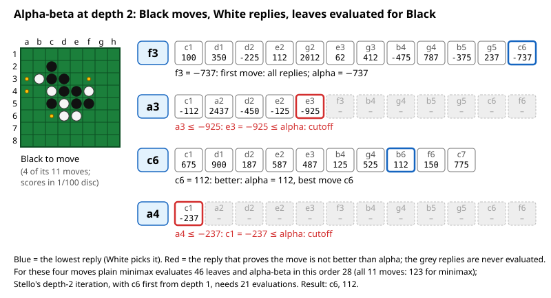
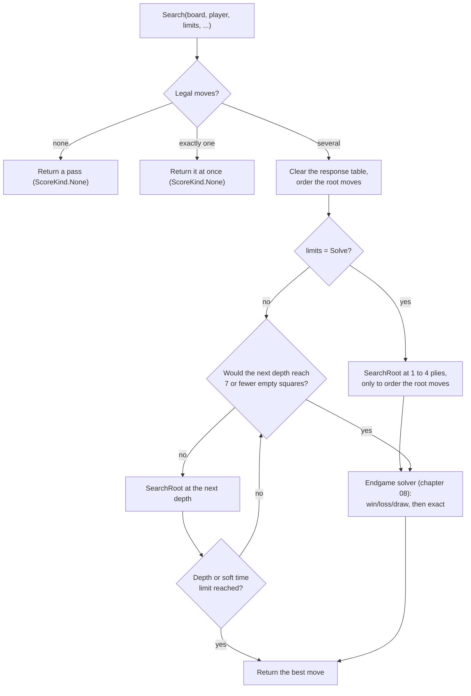
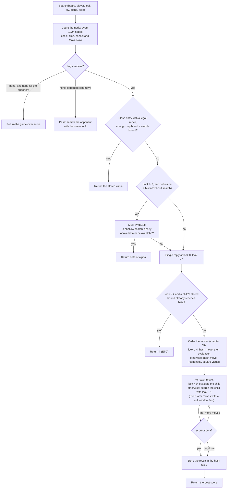
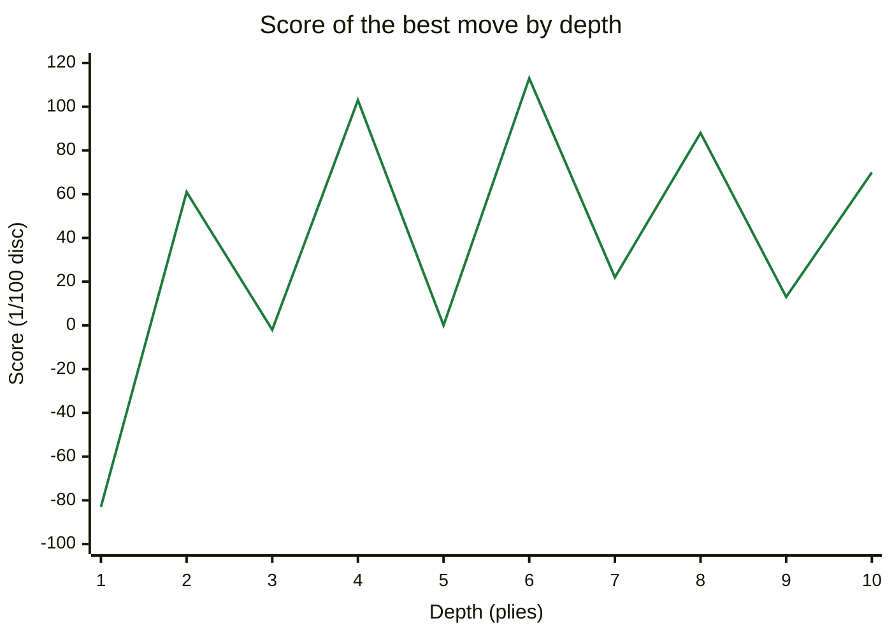

# 06 – Midgame search

[Back to the index](README.md)

## In short

To choose a move, the engine looks ahead: it tries its moves, the opponent's replies, its answers to those, and so on, and evaluates the positions at the end of each line with the pattern evaluation (chapter 04). The best move is the one that leads to the best position when both sides play their best. This is **minimax**; Stello writes it as **negamax** with **alpha-beta pruning**, which skips lines that cannot change the result. The search runs **iteratively deeper**: first 1 ply, then 2, then 3, until the time is used. Every node searches its first move with the full window and the others with a null window (**principal variation search**). It is helped by the hash table and its **enhanced transposition cutoff** (chapter 07), move ordering (chapter 05), an **extension** at the horizon and a **selective search**, Multi-ProbCut, that cuts off positions a shallow search shows to be clearly outside the interesting range, with an error model fitted on Stello's own searches. When the end of the game is near enough, the endgame solver takes over (chapter 08).

## Data structures

`SearchEngine` holds everything one search needs. An instance runs one search at a time; the app keeps one engine for the whole game, so the hash tables survive from move to move.

| Field | Contents |
|---|---|
| `_midgameTable`, `_endgameTable` | The two hash tables (chapter 07) |
| `_localTable` | The solver's small table of bounds (chapter 08) |
| `_ordering` | The move ordering with the response table (chapter 05) |
| `_pattern` | The pattern evaluation, `EvalWeights.Default` unless `SearchOptions.Pattern` gives another (chapter 04) |
| `_probCutErrors` | Multi-ProbCut's margin $t\,\sigma$ in 1/100 disc for each disc count and depth, or null when `SearchOptions.Selective` is off |
| `_inProbCut` | True during Multi-ProbCut's shallow search, which is not selective itself |
| `_clock`, `_hardLimitMs`, `_softTimePercent` | A `Stopwatch`, the hard time limit, and `SearchOptions.SoftTimePercent` (chapter 09) |
| `_nodes`, `_evaluations` | Counters, reported in `SearchInfo` and `SearchResult` |
| `_hashGetHeight`, `_hashPutHeight` | How far from the root the midgame hash table is used |
| `_cancel`, `_moveNow`, `_progress` | The two tokens and the progress callback of the running search |
| `_report…`, `_lastHeartbeatMs` | The last reported state, repeated as a heartbeat when no report was sent for 100 ms (chapter 09) |

| Constant | Value | Meaning |
|---|---|---|
| `Infinity` | 32 767 | Larger than any score |
| `RootWindow` | 32 664 | The root window is (−32 664, 32 664) |
| `WinScore` | 32 600 | A finished game scores ±(32 600 + disc difference) |
| `PatternUnitsPerDisc` | 100 | Scores are in 1/100 disc |
| `EndgameDistance` | 7 | Switch to the solver when the search would reach 7 or fewer empty squares |
| `SolveOrderingLooks` | 4 | In solve mode, 4 midgame iterations order the root moves first |
| `EvaluationOrderMinLook` | 4 | From `look` = 4 the moves are ordered by evaluation (chapter 05) |
| `MidgameEtcMinLook` | 4 | From `look` = 4 the children's hash entries are tried first (ETC, chapter 07) |
| `ProbCutMinLook` | 2 | Multi-ProbCut is tried from `look` = 2, a depth of 3 plies |
| `DefaultProbCutPercent` | 100 | Its t × 100: a cut needs the shallow search to be t = 1.0 standard deviations outside the window |
| `ProbCutPreCheckOffset` | 400 | 4 discs: the static evaluation must already be within 4 discs of that margin, and at least 1 disc beyond the bound, before the shallow search is tried |
| `ProbCutScoreLimit` | 32 000 | No Multi-ProbCut near won or lost scores |

**Scores** are in 1/100 disc from the point of view of the side to move: `EvaluateLeaf` converts the pattern evaluation's units (1/8 disc in the built-in file) to 1/100 disc and caps it at ±64 discs (±6 400) (chapter 04). A finished game scores ±(32 600 + disc difference), with the empty squares given to the winner, so every won game is better than any evaluation.

**Depth.** The code uses the C++ convention `look`: the remaining depth *after* the current move. A search with `look` = *n* looks *n* + 1 plies ahead, and the leaves are evaluated in the move loop of the node with `look` = 0.

## Algorithm

### Negamax with alpha-beta

In negamax, a position's score for the side to move is the maximum over its moves of the *negated* score of the position after the move (which is from the opponent's point of view):

$$\operatorname{score}(p) = \max_{m\ \in\ \text{moves}(p)} \big( -\operatorname{score}(p \cdot m) \big)$$

where $p \cdot m$ is the position after move $m$, and a position at the depth limit gets its evaluation. Alpha-beta passes a window (α, β) down the tree:

- α is the score the side to move is already sure of from an earlier move; a move that cannot beat α need not be searched exactly.
- β is the most the opponent will allow; as soon as a move reaches β, the opponent will avoid this position, so the other moves need not be searched: a **cutoff**.

A child is searched with the window (−β, −α). Stello's search is **fail-soft**: it returns the best score it found even when that is outside the window, which gives the hash table tighter bounds.

The picture shows a depth-2 search for Black in the midgame test position (the one used in [SearchEngineTests.cs](../../Stello.Net/Stello.Engine.Tests/SearchEngineTests.cs)). At this depth none of the search's extras is active: the root searches every move with the full window (`look` ≤ 2), there is no Multi-ProbCut (`look` < 2) and no enhanced transposition cutoff or evaluation ordering (`look` < 4), so it is plain alpha-beta. Each row is a black move with White's replies; the leaves are scored by the pattern evaluation for Black, in 1/100 disc, and White picks the lowest.

<!-- TODO (team lead, after the benchmark): the figure and its alt text below show Stello 1 numbers. Regenerate with Stello 2.0 and redraw images/alpha-beta-tree.svg: position TestGames.Play("f5 d6 c3 d3 c4 f4 c5 b3 c2 e6").Board, Black to move. For root moves a3, f3, c6, a4 in that order, with White's replies in square order (a1 … h8): the score of every reply's position for Black, EvaluateLeaf / PatternScore in 1/100 disc; then plain fail-soft alpha-beta over this order: each move's value, which replies are skipped after a cutoff, the number of leaves evaluated, and the leaf count of a full minimax. If the best move changes, pick four root moves that show both a new best and cutoffs. -->


<!-- TODO (team lead): the numbers in this paragraph (45 / 124 leaves, 21 evaluations, c6 and 61) are Stello 1's. Rerun: new SearchEngine().Search(that position, Player.Black, SearchLimits.FixedDepth(2), progress); take the leaf counts from the alpha-beta over the figure's order, and from the real search the evaluations of the depth-2 iteration (Evaluations of the last depth-2 SearchInfo minus that of the last depth-1 SearchInfo), the best move and the score. -->
With the root moves in this order and the replies in square order, alpha-beta evaluates 45 leaves instead of the 124 of a full minimax. In the real search, the depth-1 iteration has already moved the best move, c6, to the front, so α is 61 from the first move on and the other moves are refuted sooner; the replies are also tried in square-value order, because the response table holds nothing yet for a root move that has not been searched at this depth and the hash table is not read at ply 1 in a depth-2 iteration (chapter 05). The depth-2 iteration then needs only 21 evaluations. Both find c6 with score 61.

### The search as a whole

`SearchEngine.Search(board, player, limits, progress, cancellationToken, moveNowToken, onlyMoves)`:



With `onlyMoves`, only the given moves are searched, even a single one (used by book learning, chapter 11). A single legal move is not searched, unless the limit is `Solve` or `onlyMoves` is given. In solve mode the midgame iterations at 1 to 4 plies (`SolveOrderingLooks`, fewer if the position is too near the end) only order the root moves for the solver; their scores are not the result. If the time runs out or "Move Now" is used at any point, the search unwinds and returns the best move found so far (chapter 09).

### Iterative deepening

The loop runs `look` = 0, 1, 2, … as long as $\text{empties} - 1 - \text{look} > 7$, that is, as long as the search ends with more than 7 empty squares on the board. After each iteration it stops if the depth limit (fixed depth) or the soft time limit (the other modes) is reached. Searching depth 1, 2, 3, … sounds wasteful, but each iteration fills the hash table and reorders the root moves for the next one, and the deeper searches are so much bigger that the small ones hardly count. After each iteration the internal `IterationDone` callback, if set, gets the depth and the score; the trainer's `mpc` command uses it to record every iteration's score for the Multi-ProbCut fit.

### The root: principal variation search

`SearchRoot` searches every root move:

- The first move with the full window; the other moves, once the search is deeper than 3 plies (`look` > 2), with a **null window** (−α − 1, −α). A null-window search is fast because it only answers "better than α or not?". If a move turns out better, it is searched again with the full window. This is **principal variation search** (PVS), which replaces the C++ `zero_findmax`.
- After each root move, a `SearchInfo` is reported (depth, current move, best move, score, nodes, evaluations, time).
- Each move that becomes the new best is recorded; at the end they are moved to the front of the root list in that order (`MoveToFront`), so the next iteration starts with the latest best move (C++ `put_in_front`).

### One node

The private `Search(board, player, look, ply, previousMove, alpha, beta, out bestMove)`:



Some details:

- **Leaves are evaluated in the parent's loop.** When `look` is 0, the positions after each move are evaluated directly with the pattern evaluation (`EvaluateLeaf`, chapter 04), for the side to move there, and negated. This saves a function call per leaf, as in C++. Each evaluated leaf counts as a node and an evaluation.
- **Passes** do not use up depth: the opponent is searched with the same `look`.
- **Extension.** A position with only one legal move at the horizon (`look` = 0) is searched one ply deeper (`look` = 1), so a forced reply is not judged by a static evaluation. The result is still stored in the hash table with the original `look`.
- **The response table** is updated after every searched child (chapter 05).
- **Enhanced transposition cutoff** from `look` = 4 (`MidgameEtcMinLook`), where the children are within the hash table's read height: the children's hash entries are looked up before the moves are ordered; a child whose stored upper bound already refutes it ends the node ([chapter 07](07-transposition-table.md#use-in-the-midgame-search)).
- **The hash table** is read only at plies ≤ `look` − 1 and written only at plies ≤ `look` of the current iteration, the same heights as in C++; so it is used in the upper part of the tree, where each entry saves the most work. A hash move is only used if it is legal in the position (chapter 07).
- **PVS in every node.** The first move is searched with the full window, the others with a null window and again with the full window if they turn out better, as at the root. A node that already has a null window searches all its moves with it. The measurements behind this choice are in [chapter 23](23-phase-5-the-search.md).

### Selective search

Stello uses **Multi-ProbCut** (Buro), as Egaroucid does ([chapter 18](18-the-egaroucid-port.md)): a shallow search predicts the result of the deep one, and when the prediction is clearly outside the window, the deep search is skipped.

At a node with depth $d$ = `look` + 1 ≥ 3 (`TryProbCut`), after the hash table lookup and before the moves are generated into a list:

1. The shallow depth is about half, with the same parity (`ProbCutShallowDepth`): $s = 2\lfloor d/4 \rfloor + (d \bmod 2)$, so 3 → 1, 4 → 2, 7 → 3, 10 → 4, 13 → 7.
2. The error margin is $e = \lceil t \cdot \max(0.5,\ \sigma(n, s, d)) \cdot 100 \rceil$ in 1/100 disc, with $t$ = 1.0 (`DefaultProbCutPercent`) and $n$ the number of discs on the board. `ProbCutErrors` computes it once per engine for every disc count and depth.
3. **A cheap test first:** the static evaluation must be at least $\beta + \max(100,\ e - 400)$, that is, within 4 discs of the margin and at least 1 disc above β. Only then does a null-window search to depth $s$ test whether the position scores at least $\beta + e$. If so, the node returns β. The same is done below α: static evaluation at most $\alpha - \max(100,\ e - 400)$, then a test against $\alpha - e$, and the node returns α.
4. The shallow search is an ordinary node search (same ply, same previous move, the same hash table), but Multi-ProbCut is off inside it (`_inProbCut`).
5. Near won and lost scores it is not used: the cut above β is only tried when $\beta + e < 32\,000$, the cut below α only when $\alpha - e > -32\,000$ (`ProbCutScoreLimit`).

**The error model** comes from Stello's own searches. The trainer's `mpc` command searched 11,700 test positions (300 per disc count from 14 to 52) without selectivity at every depth up to min(13, empties − 8), and measured the spread of the deep result minus the shallow one. A weighted least-squares fit over those spreads gives, in discs, with $x = n / 64$:

$$\sigma(n, s, d) = 1.887 + 2.954\,x + 0.066\,x^2 - 0.675\,s + 0.278\,d$$

It is off by 10 % on average over the 117 measured cells. Typical values are 2–4 discs: the spread grows with the number of discs and shrinks as the shallow search gets closer to the deep one. For example, at 32 discs and depth 11 (shallow depth 5), σ ≈ 3.06 discs, so $e$ = 307. A node with β = 0 is then cut when the static evaluation is at least +1 disc (here $e - 400$ is negative, so the minimum of 1 disc applies) and the 5-ply null-window search scores at least +3.07 discs. The few positions where the deep search found a forced game end were left out of the fit, just as Multi-ProbCut leaves out such scores.

Because the margin comes from the measured errors, it is wide where the shallow search is unreliable (many discs, a large gap between $s$ and $d$) and narrow where it is reliable. How $t$ = 1.0 was chosen, and what Multi-ProbCut gained over the fixed-margin selective search it replaced, is told in [chapter 23](23-phase-5-the-search.md).

### Game over inside the search

When neither side can move, the node returns $\pm(32600 + d)$, where $d$ is the disc difference with the empty squares given to the winner, and 0 for a draw (`GameOverScore`).

## Worked example: iterative deepening

The midgame test position after `f5 d6 c3 d3 c4 f4 c5 b3 c2 e6`, Black to move, searched with `SearchLimits.FixedDepth(10)` (Release build, 25 September 2026; times depend on the machine):

```text
--------
--X-----
-OXX----
--OXXO--
--XOXX--
---OO---
--------
--------
```

<!-- TODO (team lead, after the benchmark): the table below holds Stello 1 numbers. Rerun in a Release build: new SearchEngine() (hashBits 19, SearchOptions.Default, so Multi-ProbCut on) .Search(TestGames.Play("f5 d6 c3 d3 c4 f4 c5 b3 c2 e6").Board, Player.Black, SearchLimits.FixedDepth(10), progress). For each depth 1–10 take the last SearchInfo with that Depth (reported after the last root move of the iteration): BestMove, Score, Nodes, Evaluations, Elapsed (ms), all totals since the start of the search. Update the date in the sentence above and the machine if it matters. -->
| Depth (plies) | Best move | Score | Nodes (total) | Evaluations (total) | Time (total) |
|---|---|---|---|---|---|
| 1 | c6 | −83 | 11 | 11 | 9 ms |
| 2 | c6 | 61 | 43 | 32 | 11 ms |
| 3 | b4 | −2 | 312 | 257 | 12 ms |
| 4 | c6 | 103 | 1 033 | 749 | 14 ms |
| 5 | c6 | 0 | 3 248 | 2 476 | 19 ms |
| 6 | b4 | 113 | 9 689 | 6 539 | 32 ms |
| 7 | c6 | 22 | 29 094 | 20 947 | 72 ms |
| 8 | c6 | 88 | 99 214 | 66 328 | 186 ms |
| 9 | c6 | 13 | 147 302 | 103 055 | 204 ms |
| 10 | c6 | 70 | 675 903 | 437 509 | 361 ms |

The counters and times are totals since the start of the search. The best move's score at each depth:

<!-- TODO (team lead): the chart's line is the Score column of the table above; replace it with the Stello 2.0 scores and adjust the y-axis range to them. -->


<!-- TODO (team lead): check that both points below still hold for the Stello 2.0 numbers; drop or reword the second if the scores no longer alternate. -->
Two things are typical:

- Each iteration costs a few times more than the previous one, so the earlier iterations are cheap.
- The score goes up and down between odd and even depths: at odd depths the leaves have White to move, at even depths Black, and a static evaluation judges a position differently depending on who is to move. This is the *odd-even effect*; comparing only odd or only even depths gives a steadier picture.

## Design notes

- **No stored game tree.** The C++ search kept a tree of up to 300 000 nodes to order moves between iterations (`findmax`, `findmax1`). The hash table and the root reordering give the same ordering with much less code. Reusing the tree after the opponent's move is gone too, but the hash table survives between moves, so most of the benefit remains.
- **PVS instead of the C++ restart trick.** `zero_findmax` restarted the root loop after the second improvement; standard PVS re-search gives the same result.
- **Exceptions instead of `longjmp`.** A time-out or "Move Now" throws a private `SearchAbortedException` from `CheckAbort`, caught in `Search`; cancel throws `OperationCanceledException`, which reaches the caller.
- **Deterministic.** With the same position and limits the search gives the same result every time (no randomness, stable sorting). Only time limits make results differ between runs.
- **Game-over scores** give the empty squares to the winner, the standard rule; C++ did not count them.
- **Selectivity from statistics.** The C++ selective search used a fixed margin. Multi-ProbCut's margin depends on the disc count and on both depths, and comes from measured errors, so it can be refitted when the evaluation or the search changes (`mpc`, and `SearchOptions.ProbCutPercent` to retune $t$).
- **No selectivity in the solver.** Multi-ProbCut stops where the solver takes over; the solver is exact. A selective endgame pass was tried and dropped ([chapter 23](23-phase-5-the-search.md)).

See [Stello porting documentation.md](../../Plans/Stello%20porting%20documentation.md), section 3.6.

## Where in the code

| File | Main members |
|---|---|
| [SearchEngine.cs](../../Stello.Net/Stello.Engine/SearchEngine.cs) | `Search` (public), `SearchRoot`, `Search` (private node search), `OrderByEvaluation`, `TryProbCut`, `ProbCutShallowDepth`, `ProbCutErrors`, `EvaluateLeaf`, `PatternScore`, `GameOverScore`, `StopIterating`, `CheckAbort`, `Report`, `MoveToFront`, `Play` |
| [Search/SearchOptions.cs](../../Stello.Net/Stello.Engine/Search/SearchOptions.cs) | The switches for experiments: `Pattern`, `SoftTimePercent`, `Selective`, `ProbCutPercent` |
| [SearchLimits.cs](../../Stello.Net/Stello.Engine/SearchLimits.cs), [SearchResult.cs](../../Stello.Net/Stello.Engine/SearchResult.cs) | The limits, `SearchInfo`, `SearchResult`, `ScoreKind` |
| [MpcCommand.cs](../../Stello.Net/tools/Stello.Trainer/MpcCommand.cs) | The trainer's `mpc` command: the data and the fit of Multi-ProbCut's error model |
| Egaroucid: [multi_probcut.hpp](../../Egaroucid-main/src/engine/multi_probcut.hpp) | The original Multi-ProbCut that `TryProbCut` follows |
| C++: [Minmax.cpp](../../Stello%20C++/BRAIN/Minmax.cpp), [Kontrol.cpp](../../Stello%20C++/BRAIN/Kontrol.cpp) | `findmax`, `findmax1`, `findmax2`, `zero_findmax`, `getcomputer` |

## Tests

- [SearchEngineTests.cs](../../Stello.Net/Stello.Engine.Tests/SearchEngineTests.cs): a pass when there is no legal move; a single legal move without search; at depth 9 Multi-ProbCut needs less than half the nodes of the plain search, with a score within 3 discs; the requested depth is reached (1, 4 and 7 plies); the same result twice; progress for every depth, and periodic progress during a long search; time per move and per game are kept; "Move Now" and cancel stop within 100 ms; an already cancelled search throws.
- [StrengthTests.cs](../../Stello.Net/Stello.Engine.Tests/StrengthTests.cs): at depth 4 the engine beats a random player and a greedy player.
- [EndgameTests.cs](../../Stello.Net/Stello.Engine.Tests/EndgameTests.cs): a fixed-depth search near the end switches to the solver and returns the exact score.

## Further reading

- [Alpha-Beta – Chess Programming Wiki](https://www.chessprogramming.org/Alpha-Beta): alpha-beta in negamax form, fail-soft and fail-hard.
- [Negamax – Wikipedia](https://en.wikipedia.org/wiki/Negamax): negamax with alpha-beta and with a transposition table, in pseudocode.
- [Fail-Soft – Chess Programming Wiki](https://www.chessprogramming.org/Fail-Soft) and [Null Window – Chess Programming Wiki](https://www.chessprogramming.org/Null_Window).
- [Principal Variation Search – Chess Programming Wiki](https://www.chessprogramming.org/Principal_Variation_Search).
- [Iterative Deepening – Chess Programming Wiki](https://www.chessprogramming.org/Iterative_Deepening) and [Odd-Even Effect – Chess Programming Wiki](https://www.chessprogramming.org/Odd-Even_Effect).
- [ProbCut – Chess Programming Wiki](https://www.chessprogramming.org/ProbCut) and [Buro (1995), ProbCut (pdf)](https://skatgame.net/mburo/ps/probcut.pdf): ProbCut and Multi-ProbCut, the statistical form of the selective search.
- [Writing an Othello program – Gunnar Andersson](http://radagast.se/othello/howto.html): "Searching", with alpha-beta, move ordering and selective search in Othello.

---

Previous: [05 Move ordering](05-move-ordering.md) · Next: [07 Transposition table](07-transposition-table.md)
