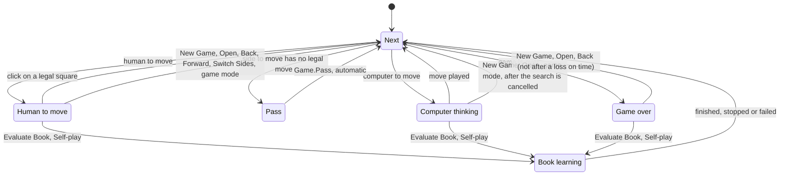
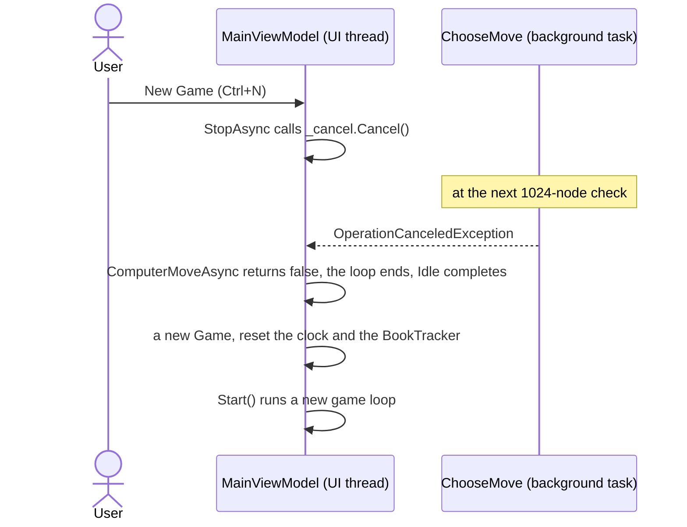
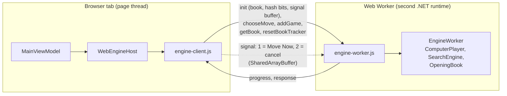
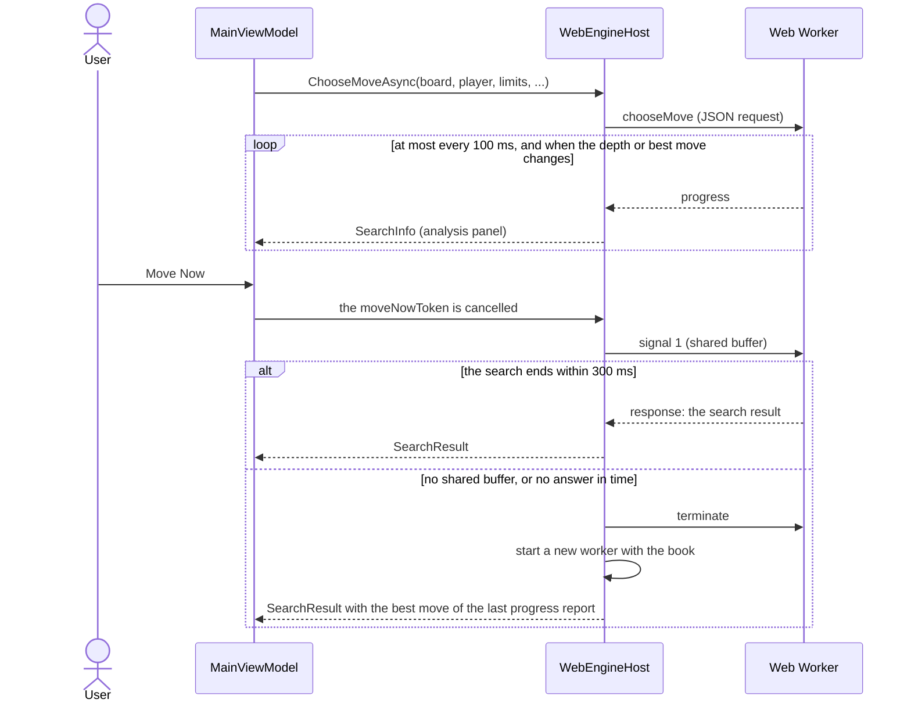
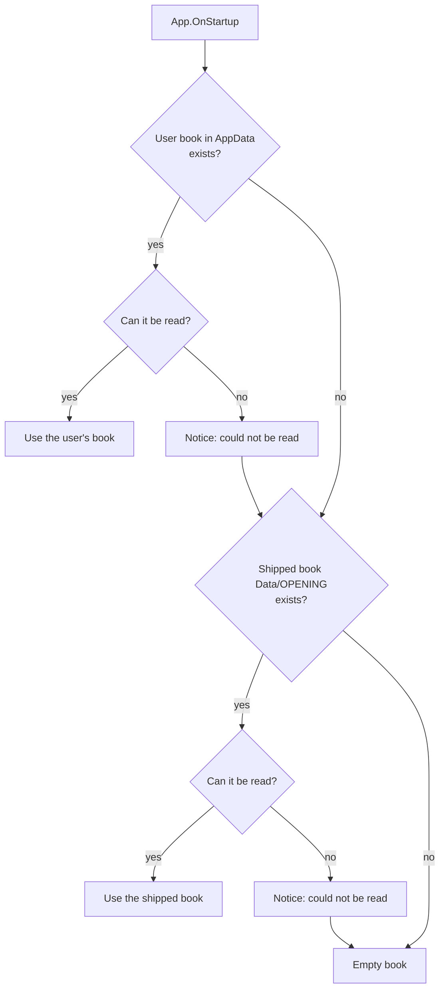

# 14 – App integration

[Back to the index](README.md)

## In short

The engine is a plain library: it knows nothing about windows, threads, clocks or files. Both apps, the WPF desktop app and the web app, drive it from one class, `MainViewModel` in `Stello.App`. It runs a **game loop** that plays passes and computer moves until the human is to move. It runs every search and every book-learning job through an **engine host**: on a background task in the desktop app, in a Web Worker in the browser, so the window stays responsive. It **stops the computer** before any command that changes the game. It turns the user's **settings** into `SearchLimits` and keeps the **computer's clock**. It also decides where the **opening book** is loaded from and saved to; the trained **evaluation** is built into the engine library itself. This chapter explains these parts; the layout of the windows and pages is in chapter 15.

## Data structures

### `MainViewModel`

The state that matters for the engine:

| Member | Contents |
|---|---|
| `_game` | The `Game` (chapter 13), including which colour the human plays (`Human`) |
| `GameMode` | `HumanVsComputer` (the default, the human plays Black), `ComputerVsHuman` or `HumanVsHuman` (two players); chosen in the web app's Game menu (`SetGameMode`). The enum also has `ComputerVsComputer`, which no menu offers |
| `_engine` | The `IEngineHost` that runs the searches and owns the opening book. In the desktop app it is `LocalEngineHost`, with the game's `ComputerPlayer` (its `SearchEngine`, the book and the `BookTracker`, chapter 10); in the browser it is `WebEngineHost` |
| `IsThinking`, `IsLearning` | True while a search or a learning job runs; they enable and disable commands |
| `Idle` | The task of the running game loop; it completes when the human is to move or the game is over |
| `Learning` | The task of the running learning job |
| `_cancel`, `_moveNow`, `_learningCancel` | The cancellation sources of the current search (two tokens, chapter 09) and of learning |
| `_searchId` | A number that goes up with each computer move, to recognise old progress reports |
| `Settings` | The `GameSettings`: mode, depth, seconds per move, minutes per game, opening book toggle, transposition table capacity |
| `_blackTimeLeft`, `_whiteTimeLeft`, `_timeLeftAtPly` | The player clocks, and their snapshot pairs before each ply so undo restores consumed time |
| `IsGameModified`, `IsStatusModified` | `IsGameModified` is set by Back against the computer, Switch Sides, a settings change after the first move and continuing after a timeout, and cleared by New Game, Open and a new game mode; `IsStatusModified` is `IsGameModified` in a game against the computer (chapter 15) |
| `Analysis` | The `AnalysisViewModel` that shows `SearchInfo` and `SearchResult` (chapter 09) |

The commands are generated by the MVVM Toolkit from methods marked `[RelayCommand]`, with a `CanExecute` method or property that decides when they are enabled. When `IsThinking` or `IsLearning` changes, the commands that depend on it are told to check again (`[NotifyCanExecuteChangedFor]`).

### Services

The view model reaches the engine, files and dialogs only through small interfaces, so each app can supply its own implementation and the tests can replace them:

| Interface | Desktop app | Web app | Does |
|---|---|---|---|
| `IEngineHost` | `LocalEngineHost` | `WebEngineHost` | Runs the searches and book learning; owns the book |
| `IBookStore` | `FileBookStore` | `LocalStorageBookStore` | Saves the learned book; appends to the self-play log |
| `ISettingsStore` | `JsonSettingsStore` | `LocalStorageSettingsStore` | Loads and saves `AppSettings` (game settings, analysis panel, window position) as JSON |
| `IDialogService` | `DialogService` | `BrowserDialogService` | Message boxes, file dialogs, the settings dialog, "Did Black win the game?" |
| `IGameFileService` | `GameFileService` | `BrowserGameFileService` | Opens and saves game files (`.stello`, `.txt`) |
| `ISoundService` | `NullSoundService` (no sound) | `BrowserSoundService` | Sounds synthesized by `SoundWaves` for a move, a pass, a win and a loss (chapter 15) |

In the desktop app, `BookLoader` (static) picks the book file at start-up, and `AppPaths` (static) holds all file locations. The web app keeps the settings and the learned book in the browser's local storage instead.

### Files

| File (`AppPaths`) | Location | Written |
|---|---|---|
| `SettingsFile` | `%AppData%\Stello\settings.json` | When a setting, the analysis panel or the window position changes |
| `UserBookFile` | `%AppData%\Stello\OPENING` | After book learning and after Add Game to Book |
| `SelfPlayLogFile` | `%AppData%\Stello\SELFPLAY` | One line per self-play game |
| `DefaultBookFile` | `Data\OPENING` next to the program | Never; it is the shipped master book |

Settings and the book are written to a temporary file first and then renamed over the old file, so a crash cannot leave half a file. Nothing depends on the current directory. Both book files are in the binary book format (chapter 10); a user book in the C++ format is still read, and is written in the binary format the next time it is saved.

### What the builds put in the apps

| Data | Source in the repository | How it gets into the apps |
|---|---|---|
| The evaluation weights (chapter 04) | [Stello.Net/Book/stello-eval.bin](../../Stello.Net/Book/stello-eval.bin) | `Stello.Engine.csproj` embeds it as the resource `Stello.Engine.stello-eval.bin`; `EvalWeights.Default` reads it on first use. Both apps (and the tools) get it with the engine DLL, with no file to load |
| The opening book (chapter 10) | [Stello.Net/Book/opening-book.bin](../../Stello.Net/Book/opening-book.bin), built by the book tool (chapter 12) | `Stello.Net.csproj` links it as `Data\OPENING`, copied next to the program. `Stello.Web.csproj` copies it to `wwwroot/data/OPENING.bin` before every build (target `CopyOpeningBook`; the copy is git-ignored), because the development server does not serve linked files |
| This documentation | `docs/brain/**` | `Stello.Web.csproj` copies it to `wwwroot/content/brain/` (target `CopyBrainDocs`), where the web app's Docs pages show it (Help menu, chapter 15) |
| The picture in the About box | `Stello.Net/Images/2026 Claus Pedersen.jpg` | The WPF app has it as a WPF resource (`Images\ClausPedersen.jpg`); the web build copies it to `wwwroot/images/claus-pedersen.jpg` (target `CopyAboutPicture`, git-ignored) |

The web app is published with ahead-of-time compilation to WebAssembly (`RunAOTCompilation` in Release, which needs the `wasm-tools` workload), because the engine is CPU-bound.

## Algorithm

### The game loop

`Start()` runs `RunAsync` and keeps its task in `Idle`. The loop refreshes the board, and then, depending on the position:

- **Pass** is never a command: when the side to move has no legal move, the loop passes for it and says so in the status panel; the notice stays until the human's next turn ("You had no legal move and passed.", "The computer had no legal move and passed.", or "Black had no legal move and passed." with two players).
- **Thinking** is `ComputerMoveAsync`: it asks the engine host for a move (`ChooseMoveAsync`, which runs `ComputerPlayer.ChooseMove` in the background) and plays the result. A move that took less than 250 ms (`ComputerDelayMs`, for example a book move) is played 250 ms after the search started, so it does not appear the instant the human has moved; Move Now skips the wait. If the search is cancelled, it plays nothing and the loop ends with "Stopped."; the command that cancelled it then starts a new loop.
- Every command that changes the game (New Game, Open, Back, Forward, Switch Sides, a new game mode, Add Game to Book, Evaluate Book, Self-play) first calls `StopAsync`, which cancels the search and waits for `Idle`. Then it changes the game and calls `Start()` again. So there is never more than one loop, and the game is never changed while the engine reads it.
- Against the computer, Back goes back to the previous position where the human is to move, skipping the computer's moves and passes, and Forward goes to the next such position or to the end; with two players they move one ply. Switch Sides gives the human the other colour, so the computer moves at once. After Open the human plays the side to move (except with two players). New Game and a new game mode ask "Abandon current match and start a new game?" while a game is under way.

### Which commands are enabled

| Command | Human to move | Computer thinking | Game over | Book learning |
|---|---|---|---|---|
| Click on a square | Plays it if legal, otherwise beeps | Beeps | Beeps | Beeps |
| New Game, Open | Yes | Yes, stops the search first | Yes | No |
| Switch Sides | Yes, against the computer | No | No | No |
| Back / Forward | If there is a move to go back / forward to | No | The same as for the human, except after a loss on time (disabled) | No |
| Move Now | No | Yes | No | No |
| Settings | Yes | Yes; the new settings count from the next computer move | Yes | No |
| Game mode (web Game menu) | Yes | Yes, stops the search first | Yes | – (no learning in the web app) |
| Save, Save As | Yes | Yes | Yes | Yes |
| Add Game to Book | Yes (at least two moves) | Yes, stops the search first | Yes | No |
| Evaluate Book, Self-play | Yes | Yes, stops the search first | Yes | No |
| Stop Learning | No | No | No | Yes |
| Analysis, About, Exit | Yes | Yes | Yes | Yes |

An asynchronous command is also disabled while it runs, for example while New Game waits for the search to stop (the MVVM Toolkit default). Exit cancels the search and learning without waiting (`Stop`). Back and Forward are not enabled while the computer thinks (`CanUndo` and `CanRedo` check `IsThinking`, and `IsThinking` re-evaluates both commands when it changes); take the move back after it is played, or use Move Now first.

### Threading

The engine is synchronous (chapter 01). The desktop host, `LocalEngineHost`, runs it with `Task.Run`, and the view model awaits the task on the UI thread:

- **Progress.** `ComputerMoveAsync` creates a `Progress<SearchInfo>` on the UI thread. `Progress<T>` posts every report to the thread where it was created, so the analysis panel is always updated on the UI thread. A report can be handled after its search has ended, so the callback first checks that the report's search id is still `_searchId` and that the computer is still thinking; if not, the report is dropped.
- **Result.** After `await`, the code is back on the UI thread: it sets the computer's clock to its value at the start of the search minus the search time (so the time is charged once), shows the result in the analysis panel and plays the move.
- **Stopping.** Move Now and cancel are the two tokens of chapter 09. This sequence shows New Game while the computer thinks (after the confirmation):

- **Book learning** (chapter 11) runs the same way in `LearnAsync`: `StopAsync`, then `IsLearning = true` (which disables the game commands), then `IEngineHost.LearnAsync`, which runs the learning job on `Task.Run` with its own `SearchEngine` and reports a `Progress<BookLearningProgress>` to the status panel. The book is shared with the game's `ComputerPlayer`, which is safe because the game loop does not run while learning runs. When the job ends (finished, stopped or failed), the book is saved, the `BookTracker` is reset, a summary is shown, and the game loop starts again.

### The engine in the browser

WebAssembly runs the page on one thread, so a search on the page would freeze it. The web app therefore starts a second .NET runtime in a **Web Worker** and runs the engine there: `EngineWorker` has its own `ComputerPlayer`, `SearchEngine` and copy of the book. `WebEngineHost` is the `IEngineHost` on the page side. It talks to the worker through two small JavaScript modules, with plain JSON messages (`EngineProtocol`), and it shares one 4-byte `SharedArrayBuffer` with the worker for the stop signal:

- **Starting.** `WebEngineHost` saves the book to bytes and starts the worker at once (`start`, then `init` with the book and 19 hash bits), so the worker is usually ready before the computer's first move. `ChooseMove` makes a new `ComputerPlayer` when the move's `HashBits` differ from the engine's (chapter 07).
- **Progress.** `ProgressPoster` posts a report at most every 100 ms, but always when the depth or the best move changes, so the page is not flooded.
- **Stopping.** The worker runs the search synchronously and reads no message until it is over, so a stop request cannot be a message. Move Now writes 1 and cancel writes 2 into the shared buffer (`signal`, with `Atomics.store`); the client clears it before each new request. Each time the search reports progress (at the latest about 100 ms after the last report, the search's heartbeat in `CheckAbort`, chapter 09), `ProgressPoster.Report` reads the buffer (`pollSignal`) and cancels the worker's own Move Now or cancel token. The search then stops exactly as in the desktop app, and the worker keeps its hash tables.
- **The fallback.** A `SharedArrayBuffer` exists only when the page is cross-origin isolated; [staticwebapp.config.json](../../Stello.Net/Stello.Web/wwwroot/staticwebapp.config.json) sends the headers `Cross-Origin-Opener-Policy: same-origin` and `Cross-Origin-Embedder-Policy: require-corp` for this. If there is no buffer, if the search has not ended 300 ms after the signal, or if a Move Now result cannot be read, the host **terminates the worker** and starts a new one with the book (`Restart`).

- **Move Now** normally plays the search's own result. After a restart it plays the best move from the last progress report, or the move being searched, or the first legal move if there was no report (`EngineProtocol.MoveNowResult`). **Cancel** throws `OperationCanceledException`, as in the desktop app, whether the worker stopped or was restarted.
- A restarted worker has an empty hash table and a fresh `BookTracker`. The page does not wait for it, and it is usually ready before the computer's next move.
- **Add Game to Book** runs in the worker; the changed book is then read back (`getBook`) and saved in the browser's local storage. Evaluate Book and Self-play are only in the desktop app (`SupportsLearning` is false).

### Settings and the clock

`GameSettings.ToLimits` turns the settings into the limits for the next computer move (chapter 09):

| Mode | Setting | Range | Default | `SearchLimits` |
|---|---|---|---|---|
| `FixedDepth` | `Depth` | 1–20 plies | 8 | `FixedDepth(Depth, UseOpeningBook, HashBits)` |
| `TimePerMove` | `SecondsPerMove` | 1–60 s | 5 | `TimePerMove(SecondsPerMove, UseOpeningBook, HashBits)` |
| `TimePerGame` (default) | `MinutesPerGame` | 1–60 min | 5 | `TimePerGame(remaining, UseOpeningBook, HashBits)` |

`GameSettings` also configures engine features:
- `UseOpeningBook` (`bool`, default `true`): enables or disables opening book lookups.
- `TranspositionTableEntries` (`int`, default `1_048_576`): the entries in each of the two hash tables (midgame and endgame, chapter 07), a power of two from 65 536 to 16 777 216; `HashBits` is $\log_2(\text{entries}) - 1$ (each slot holds two entries), so the default gives 19.
- When `HashBits` differs from the current engine's size, `LocalEngineHost` and `EngineWorker` make a new `ComputerPlayer` with a `SearchEngine` of the new size (and so a fresh `BookTracker`).

`GameSettings.Normalize` clamps the values into these ranges, rounds the table size up to a power of two (or uses the default if it is out of range), and replaces any other mode (including `Solve`) by the default mode. It is used when the settings are loaded and when the settings dialog closes.

In timed games (`TimePerGame`):
- Both Black and White start at `MinutesPerGame`. `ResetClock` sets both back to the full time on New Game, on Open, and when settings change.
- A 250 ms heartbeat runs down the active player's clock (`_blackTimeLeft` or `_whiteTimeLeft`). While the computer thinks this is only for display: after the search, `ComputerMoveAsync` sets its clock to the value at the start of the search minus the search time, so thinking time is charged once.
- Before each computer move, `_timeLeftAtPly[ply]` stores the `(Black, White)` remaining times. After `Undo` and `Redo`, `RestoreClock` restores both clocks to the stored snapshot.
- If the human runs out of time against the computer, a Yes/No dialog asks "You ran out of time! Do you want to continue playing?": Yes freezes the human's clock at 0:00 and sets `IsGameModified` (so `IsStatusModified` is true). No ends the game, as does the computer's clock (or either clock with two players) running out. `_lostOnTime` then makes `IsGameOver` true: the status reads "Black ran out of time. Game over, White won on time.", moves, Undo, Redo and Switch Sides are blocked, and New Game starts without asking.

### Loading the book

At start-up `App.OnStartup` loads the book with `BookLoader.Load(AppPaths.BookFiles)`, which tries the files in this order:

"Cannot be read" means an `IOException`, `UnauthorizedAccessException` or `InvalidDataException` (a damaged file, chapter 10); the notice is "The opening book <path> could not be read.". If no file can be used at all, the notice is "No opening book was found." The notice is shown in the status panel before "Your move.". The same `OpeningBook` object goes to the `ComputerPlayer` (with a `SearchEngine` of the default size, chapter 07) and to `LocalEngineHost` for book learning, which saves it through `FileBookStore` to the user's file. The shipped book is never overwritten, so deleting `%AppData%\Stello\OPENING` goes back to the master book. The web app's `StartupBook` loads the book it saved in local storage, or else downloads the shipped `data/OPENING.bin` (notices "The saved opening book could not be read." and "No opening book was found."); `Program.cs` waits for it before the first page is shown, because the engine host and the view model need the book.

## Worked example: the clock with Back and Forward

A run of `MainViewModel` with an empty book and 1 minute per game: the human (Black) plays f5, c3 and f3, and the computer replies d6, f4 and g5. Then Back is used twice and Forward twice. The times are from a Release build on 2026-09-25 and depend on the machine.

| Step | Ply | Computer's clock | Why |
|---|---|---|---|
| Start | 0 | 1:00.000 | `MinutesPerGame` = 1 |
| f5, the computer thinks 0.778 s and plays d6 | 2 | 0:59.222 | Stored `_timeLeftAtPly[1]` = 1:00.000 |
| c3, 0.953 s, f4 | 4 | 0:58.269 | Stored `[3]` = 0:59.222 |
| f3, 0.760 s, g5 | 6 | 0:57.508 | Stored `[5]` = 0:58.269 |
| Back | 4 | 0:58.269 | First stored ply ≥ 4 is 5 |
| Back | 2 | 0:59.222 | First stored ply ≥ 2 is 3 |
| Forward | 4 | 0:58.269 | First stored ply ≥ 4 is 5 |
| Forward | 6 | 0:58.269 | No stored ply ≥ 6, so the clock is not changed |

After Back, the computer gets back the time of the moves that were taken back, which is the point: it will play those positions again. The last row shows a side effect: after going Forward to a position after the computer's last move, the 0.760 s of g5 is not charged again. C++ behaves the same way: it stored the time for ply $p$ and $p + 1$ before each computer move (`timesleft` in [Kontrol.cpp](../../Stello%20C++/BRAIN/Kontrol.cpp)).

## Design notes

- **One loop, stopped before every change.** Because every command that changes the game waits for `StopAsync`, the engine never sees a game that changes under it, and there is no locking. The price is that a command during a long search waits until the next 1024-node check, which is well under a millisecond (chapter 09).
- **Two tokens.** Move Now must play a move and cancel must not, so they are separate tokens instead of one token with a flag (chapter 09).
- **Old progress reports.** The search id is needed because `Progress<T>` posts reports: one can arrive after the result, or after the next search has started. The order of reports and result relies on the UI thread's `SynchronizationContext`. Without one (for example in a console program), `Progress<T>` calls back on the thread pool, and a late report can overwrite the final analysis.
- **Services behind interfaces.** Files and dialogs are behind `IBookStore`, `ISettingsStore` and `IDialogService`, so `MainViewModelTests` run the real view model and the real engine with fakes and a temporary file.
- **Files in AppData.** C++ read and wrote `rev.cfg`, `OPENING` and `selfplay` in the current directory. The app keeps the shipped book read-only and writes only to `%AppData%\Stello`. See [Stello porting documentation.md](../../Plans/Stello%20porting%20documentation.md), phases 5 and 6.
- **Kept C++ behaviour.** Back re-enables the book (`BookTracker.Reset`), the human continues with the side to move after Open, and the clock is restored as with C++ `timesleft[]`, including the side effect in the worked example.

## Where in the code

| File | Main members |
|---|---|
| [MainViewModel.cs](../../Stello.Net/Stello.App/ViewModels/MainViewModel.cs) | `Start`, `RunAsync`, `ComputerMoveAsync`, `WaitForNaturalDelayAsync`, `StopAsync`, `Stop`, `Play`, `NewGame`, `Open`, `Undo`, `Redo`, `SwitchSides`, `SetGameMode`, `MoveNow`, `EditSettings`, `ResetClock`, `RestoreClock`, `HandleTimeoutAsync`, `LearnAsync` |
| [LocalEngineHost.cs](../../Stello.Net/Stello.App/Services/LocalEngineHost.cs) | `ChooseMoveAsync`, `ResetBookTracker`, `AddGameToBookAsync`, `LearnAsync`, `CreateLearner` |
| [WebEngineHost.cs](../../Stello.Net/Stello.Web/Services/WebEngineHost.cs) | `ChooseMoveAsync` (Move Now and cancel: the signal, then `Restart`), `StartAsync`, `AddGameToBookAsync`, `OnProgress` |
| [EngineWorker.cs](../../Stello.Net/Stello.Web/Worker/EngineWorker.cs) | `Init`, `ChooseMove`, `ResetBookTracker`, `AddGame`, `GetBook`; `ProgressPoster` (progress and the stop signal) |
| [EngineProtocol.cs](../../Stello.Net/Stello.Web/Worker/EngineProtocol.cs) | The JSON requests, results and progress reports; `MoveNowResult` |
| [engine-worker.js](../../Stello.Net/Stello.Web/wwwroot/js/engine-worker.js), [engine-client.js](../../Stello.Net/Stello.Web/wwwroot/js/engine-client.js) | The worker's message loop and `pollSignal`; the page side: `start`, `call`, `signal`, `terminate` |
| [StartupBook.cs](../../Stello.Net/Stello.Web/Services/StartupBook.cs), [Program.cs](../../Stello.Net/Stello.Web/Program.cs) | Loading the web app's book; wiring the web app's services |
| [staticwebapp.config.json](../../Stello.Net/Stello.Web/wwwroot/staticwebapp.config.json) | The cross-origin isolation headers |
| [AnalysisViewModel.cs](../../Stello.Net/Stello.App/ViewModels/AnalysisViewModel.cs) | `Update`, `FormatScore` |
| [GameSettings.cs](../../Stello.Net/Stello.App/Models/GameSettings.cs) | `Default`, `Normalize`, `ToLimits`, `GameTime`, `UseOpeningBook`, `TranspositionTableEntries`, `HashBits` |
| [EvalWeights.cs](../../Stello.Net/Stello.Engine/Evaluation/EvalWeights.cs), [Stello.Engine.csproj](../../Stello.Net/Stello.Engine/Stello.Engine.csproj) | `Default` (the built-in evaluation); the `EmbeddedResource` |
| [Stello.Net.csproj](../../Stello.Net/Stello.Net/Stello.Net.csproj), [Stello.Web.csproj](../../Stello.Net/Stello.Web/Stello.Web.csproj) | The linked book `Data\OPENING`; the targets `CopyOpeningBook`, `CopyBrainDocs`, `CopyAboutPicture` |
| [AppSettings.cs](../../Stello.Net/Stello.App/Models/AppSettings.cs) | `AppSettings`, `WindowPlacement` |
| [SoundWaves.cs](../../Stello.Net/Stello.App/Services/SoundWaves.cs) | `Create`: the sounds as 16-bit PCM WAV bytes |
| [BookLoader.cs](../../Stello.Net/Stello.Net/Services/BookLoader.cs) | `Load` |
| [AppPaths.cs](../../Stello.Net/Stello.Net/Services/AppPaths.cs) | `DataDirectory`, `SettingsFile`, `UserBookFile`, `SelfPlayLogFile`, `DefaultBookFile`, `BookFiles` |
| [FileBookStore.cs](../../Stello.Net/Stello.Net/Services/FileBookStore.cs) | `Save`, `AppendSelfPlayLog` |
| [JsonSettingsStore.cs](../../Stello.Net/Stello.Net/Services/JsonSettingsStore.cs) | `Load`, `Save` |
| [Home.razor](../../Stello.Net/Stello.Web/Pages/Home.razor) | Web page built from the shared GameShell components: menus, scoreboard, quick actions, mobile drawer (chapter 15) |
| [App.xaml.cs](../../Stello.Net/Stello.Net/App.xaml.cs) | `OnStartup`: wiring the book, engine, services and view model |
| [MainWindow.xaml.cs](../../Stello.Net/Stello.Net/MainWindow.xaml.cs) | `OnClosing`: stop and save the window position |
| C++: [MainFrm.cpp](../../Stello%20C++/MainFrm.cpp), [Kontrol.cpp](../../Stello%20C++/BRAIN/Kontrol.cpp) | `OnTilbage`, `OnFrem` and the other menu handlers; `getcomputer` (stores `timesleft`) |

## Tests

- [MainViewModelTests.cs](../../Stello.Net/Stello.Net.Tests/MainViewModelTests.cs):
  - the start position and the start-up notice;
  - the computer replies; an instant reply waits for the 250 ms delay, a slow one does not, and Move Now skips it; an illegal click and a click while thinking beep;
  - Back and Forward move between the human's turns; Switch Sides makes the computer move at once;
  - Move Now and New Game stop the search;
  - saving and opening a game, the side to move after Open, a damaged file, an automatic pass after Open, a finished game;
  - the settings change the clock, cancelling keeps them, the clock runs down in `TimePerGame` mode, and the computer's thinking time is charged once;
  - a timeout: declining to continue ends the game, continuing keeps it going, the computer's timeout ends it without asking, and New Game after a timeout starts without confirmation;
  - the pass notice in the status line, the two-player game-over text that names the winner, and the move count ("N moves");
  - settings, the analysis panel and the window position are saved, and a save failure is shown;
  - the book commands (chapter 11).
- [SettingsAndBookTests.cs](../../Stello.Net/Stello.Net.Tests/SettingsAndBookTests.cs): `JsonSettingsStore` (defaults, round trip, damaged file, values kept in range, write failure) and `BookLoader` (missing files skipped, fallback from a damaged user book, no book).
- [ViewModelTests.cs](../../Stello.Net/Stello.Net.Tests/ViewModelTests.cs): how scores are shown, `SettingsViewModel`, and `GameSettings.ToLimits` for each mode.
- [NewGuiFeaturesTests.cs](../../Stello.Net/Stello.Net.Tests/NewGuiFeaturesTests.cs): the move history and the sounds, Back and Switch Sides mark the game modified and New Game clears it, `SetGameMode`, the clock texts, the book and table settings of `SettingsViewModel`, and `ComputerPlayer` without the book when `UseOpeningBook` is off.

No test checks the clock restore on Back and Forward; the worked example above was a separate run.

## Further reading

- [Introduction to the MVVM Toolkit – Microsoft Learn](https://learn.microsoft.com/dotnet/communitytoolkit/mvvm/): the library behind `ObservableObject`, `[ObservableProperty]` and the commands.
- [RelayCommand attribute – Microsoft Learn](https://learn.microsoft.com/dotnet/communitytoolkit/mvvm/generators/relaycommand): generated commands, `CanExecute`, `NotifyCanExecuteChangedFor`, and why an async command is disabled while it runs.
- [Progress&lt;T&gt; class – Microsoft Learn](https://learn.microsoft.com/dotnet/api/system.progress-1): callbacks run on the `SynchronizationContext` captured when the object is created, or on the thread pool if there is none.
- [Cancellation in managed threads – Microsoft Learn](https://learn.microsoft.com/dotnet/standard/threading/cancellation-in-managed-threads): the cooperative cancellation model with `CancellationTokenSource` and `OperationCanceledException`.

---

Previous: [13 Game record](13-game-record.md) · Next: [15 GUI and settings](15-gui-and-settings.md)
