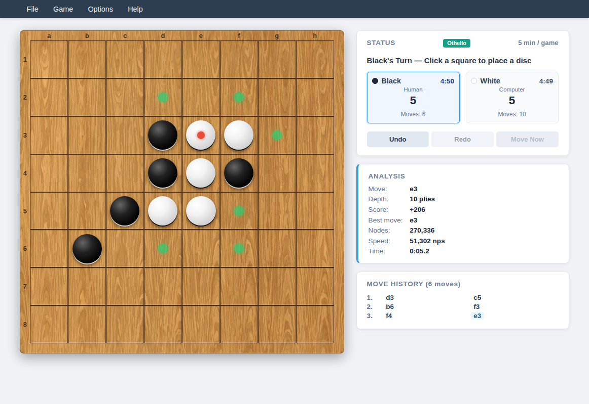
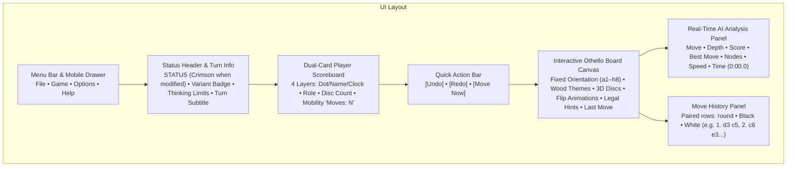
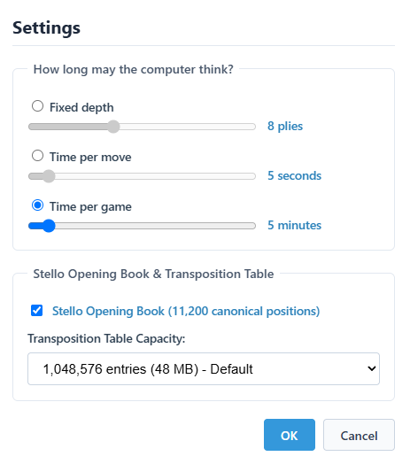
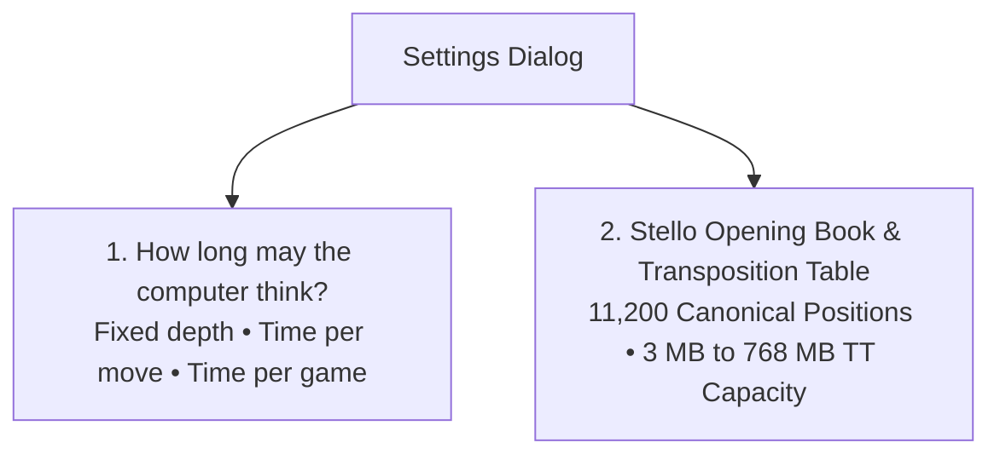

# 15 – GUI and settings

[Back to the index](README.md)

## In short

Stello features a unified, tournament-grade user interface across both **WPF desktop** and **Blazor WebAssembly** clients. Conforming to the universal tournament game GUI blueprint ([general-game-gui-specification.md](https://github.com/cjp-dev/GameShell/blob/main/docs/general-game-gui-specification.md), v1.1, kept in the shared GameShell library), the interface combines a warm wooden board aesthetic, a 4-layer dual-card player scoreboard, fixed board orientation, quick action controls, real-time AI telemetry, and synthesized procedural audio feedback.

This chapter documents the visual layout, navigation menus, settings dialog, competitive integrity status system, opening book and transposition table memory configurations, real-time search telemetry streaming engine, and full keyboard shortcut mappings.

---

## Graphical User Interface layout





### Modern Light Theme & Color Palette

Both desktop and web clients share a consistent palette designed for high contrast, clean typography, and tactile wooden board aesthetics:

| UI Element | Color Value | Description |
|---|---|---|
| **App Background** | `#FFFDF8` | Warm parchment / canvas background tone |
| **Card & Panel Background** | `#FFFFFF` / `#F8FAFC` | Elevated card surfaces with soft ambient drop shadows |
| **Border Stroke** | `#E2E8F0` / `#CBD5E1` | Subtle $1\text{ px}$ borders separating navigation, cards, and panels |
| **Primary Typography** | `#0F172A` / `#334155` | Deep slate gray text ensuring high readability |
| **Active Turn Highlight** | `#3498DB` / `#EFF6FF` | Sky-blue border and light tint highlighting the active player card |
| **Status Modified Notice** | `#E74C3C` | Crimson red text for `STATUS` indicating unranked/casual state |
| **Evaluation Score** | `#B45309` | Warm amber text displaying centipawn advantages and disc differentials |
| **Best Move Coordinate** | `#0284C7` | Blue accent text displaying the engine's current candidate move |
| **Legal Move Hints** | `#27AE60` | Soft translucent green circular markers indicating valid placement squares |
| **Last Move Indicator** | `#E74C3C` | Crimson central pip marking the most recently placed disc |

### Board Themes & Visual Appearance

The interface supports customization of board materials and piece rendering directly from the **Options** menu:

* **Board Textures:**
  * **Green Board:** Classic tournament felt / mat green surface.
  * **Golden Oak Board:** Warm natural oak wood grain.
  * **Reddish Wood Board:** Rich mahogany / cherry wood finish.
* **3D Pieces:** Toggles realistic spherical beveling, radial lighting gradients, and ambient disc drop shadows.
* **Animate Flips:** Toggles smooth CSS 3D rotational transitions when discs are captured and converted.

---

## Menu bar and navigation

The application header features a standardized 4-menu hierarchy providing structured access to all game operations and shortcuts:

### 1. File Menu
* **New Game (`Ctrl+N`):** Starts a new game session. If a match is actively underway, a confirmation prompt prevents accidental loss of progress. Resets clocks, clears undo/redo history, and sets Black for the opening move.
* **Open... (`Ctrl+O`):** Loads saved `.stello` or `.txt` game record files into the active session.
* **Save (`Ctrl+S`):** Saves the current game record to the active file path.
* **Save As...:** Exports the current match, complete with move history, to a `.stello` or `.txt` game file.
* *(Separator)*
* **Add Game to Book...:** Analyzes the active game record and merges its move sequence into the user opening book (available when at least 2 moves have been played).
* *(Separator)*
* **Exit:** Closes the desktop application (desktop client only).

### 2. Game Menu
* **vs Computer (Black):** Configures human vs computer play with the human playing Black (first move). Prompts confirmation if switching modes during an active match.
* **vs Computer (White):** Configures computer vs human play with the computer playing Black (makes opening move) and human playing White.
* **vs Human (Two players):** Hot-seat multiplayer mode where both Black and White are controlled locally.
* *(Separator)*
* **Switch sides:** Switches player roles between Black and White mid-match without resetting or rotating the board. If a match is underway, prompts confirmation, marks the game status modified (`IsStatusModified = true`), and triggers AI thinking if it becomes the computer's turn.
* *(Separator)*
* **Settings... (`F2`):** Opens the modal Game Settings dialog to configure engine thinking limits, opening book usage, and transposition table capacity.

### 3. Options Menu
* **Analysis (`Ctrl+A`):** Toggles the visibility of the real-time AI search analysis side panel.
* **Sound:** Toggles synthesized procedural audio feedback (disc clicks, flip rustles, pass tones, and victory fanfares).
* *(Separator)*
* **Green Board:** Activates the green tournament felt board style.
* **Golden Oak Board:** Activates the natural oak wood board style.
* **Reddish Wood Board:** Activates the reddish mahogany board style.
* *(Separator)*
* **3D Pieces:** Toggles realistic 3D disc rendering with radial gradients and drop shadows.
* **Animate Flips:** Toggles 3D disc flip animations during captures.

### 4. Help Menu
* **User guide (`F1`):** Opens this chapter directly, providing immediate access to interface instructions, settings explanations, and shortcut tables.
* **Rules & Documentation (`Shift+F1`):** Opens the complete Stello Architecture and Rules manual (at `/docs` in the web client, or online documentation for desktop).
* *(Separator)*
* **About Stello...:** Displays engine version, author photograph (Claus Pedersen), history of the C++ and C# implementations, the licence (GPL-3.0-only) and the address of the source code.

> [!NOTE] Dedicated Quick Action Buttons for Undo & Redo
> In accordance with the tournament GUI specification, Undo and Redo are provided via prominent **Quick Action buttons** beneath the scoreboard and via standard keyboard shortcuts (`Ctrl+Z` / `Ctrl+Y`), keeping the top menus streamlined and uncluttered.

### Responsive Mobile Navigation Drawer ($\le 768\text{px}$)
On mobile devices and narrow viewports ($\le 768\text{px}$), the horizontal desktop menu bar collapses into a compact header featuring the title (`Stello`) and a hamburger button (`☰`). Tapping the hamburger slides out an off-canvas navigation drawer on the right with touch targets $\ge 44\text{px}$, organizing all File, Game, Options, and Help actions cleanly. `Escape` or the 44 px `✕` button closes the drawer (`Escape` also closes an open desktop menu).

---

## Status header, dual-card scoreboard and quick actions

Located above the game board, the status board displays real-time match conditions, player clocks, disc counts, and immediate action controls:

```text
┌─────────────────────────────────────────────────────────────────┐
│ STATUS [Othello]                                     5 min / game
│ Black's Turn — Click a square to place a disc                   │
│                                                                 │
│ ┌─────────────────────────────┐   ┌───────────────────────────┐ │
│ │ ● Black             4:47    │   │ ○ White           4:40    │ │
│ │ Human                       │   │ Computer                  │ │
│ │ 5                           │   │ 5                         │ │
│ │ Moves: 6                    │   │ Moves: 8                  │ │
│ └─────────────────────────────┘   └───────────────────────────┘ │
│                                                                 │
│ [  Undo  ]           [  Redo  ]            [ Move Now ]         │
└─────────────────────────────────────────────────────────────────┘
```

### 1. Status Header & Competitive Integrity
* **Status Label (`STATUS`):** Normally displayed in neutral slate gray. When an unranked casual action occurs—such as taking back moves against the computer (`Undo`), switching sides mid-game, modifying engine settings during a match, or continuing past clock expiration—the `STATUS` text dynamically turns **crimson red (`#E74C3C`)**, visually indicating that competitive match integrity has been modified.
* **Variant Badge:** A rounded teal badge displaying `[Othello]`.
* **Thinking Limits Badge:** Summarizes the active AI constraint in the top-right corner (e.g., `5 min / game`, `5s / move`, or `8 plies`).
* **Turn Subtitle:** Announces the active turn (e.g., `Black's Turn — Click a square to place a disc`) or the end of the game (`Game over, you win: Black 42 – White 22.`, `Game over, the computer wins: …`, with two players `Game over, Black wins: Black 33 – White 31.`, `Game over, a draw: Black 32 – White 32.`, or on time `Black ran out of time. Game over, White won on time.`).

### 2. Dual-Card Player Scoreboard (4 Vertical Layers)
In Othello, Black always moves first. In adherence to the first-mover specification, the Black player card is positioned on the left as Player 1, followed by White on the right as Player 2.

Each player card is structured into 4 clear vertical layers:
1. **Layer 1 (Identity & Digital Clock):**
   * High-contrast circular swatch (`● Black` / `○ White`).
   * Digital countdown chess clock formatted as `m:ss` (e.g., `4:47`).
   * The active player's card is highlighted with a sky-blue border (`#3498DB`), a 2 px glow and a light background tint (`#EFF6FF`).
2. **Layer 2 (Role):** Identifies player controller type (`Human` or `Computer`).
3. **Layer 3 (Primary Metric):** Displays the total disc count owned by the player in prominent bold numerals.
4. **Layer 4 (Secondary Metric):** Real-time **Mobility** count (`Moves: 6`), displaying the exact number of legal moves currently available to this player.

### 3. Quick Action Buttons
Positioned directly beneath the dual player cards:
* **`[Undo]`:** Reverts the previous move (in human-vs-human) or rolls back both the computer and human move pair (in human-vs-computer). Clocks are refunded back to the exact snapshot recorded at that ply (`_timeLeftAtPly`). Disabled at Move 0, while the AI is thinking, and after a game lost on time.
* **`[Redo]`:** Re-applies the most recently undone move. Disabled while the AI is thinking and after a game lost on time.
* **`[Move Now]`:** Rendered when playing against the computer. While the AI is searching, pressing `[Move Now]` triggers cancellation and forces the engine to immediately play the best candidate evaluated up to that point.

### 4. Board Orientation (Fixed) & Visual Indicators
The $8 \times 8$ board orientation remains **strictly fixed** (`a1` in the top-left, `h8` in the bottom-right) regardless of whether the user plays Black or White or switches sides.
* **Legal Move Hints:** Translucent green circular markers highlight all squares where the active player can legally place a disc and execute flippable captures.
* **Last Move Marker:** A soft crimson central dot marks the exact square of the most recently placed disc.

### 5. Automatic Pass Handling
Unlike games where passing is optional, Othello rules dictate that passing is mandatory when a player has no legal moves while the opponent can still play. The Stello game loop detects this condition automatically, executes the pass without requiring manual button clicks, shows a notice in the status line that stays until the human's next turn (`"You had no legal move and passed."`, `"The computer had no legal move and passed."`, or in two-player games `"Black had no legal move and passed."`), and yields the turn to the opponent.

### 6. Timeout Continuation Safeguard
In timed matches (`TimePerGame`), if the human's clock reaches 0:00 against the computer, a Yes/No dialog asks *"You ran out of time! Do you want to continue playing?"*. **Yes** freezes the human's clock at 0:00 and lets play continue casually, marking the status modified (`#E74C3C`). **No** ends the game, and so does the computer's clock (or either clock in a two-player game) running out. The status then reads `Black ran out of time. Game over, White won on time.` (or vice versa); moves, Undo, Redo and Switch sides are blocked, and New Game starts without asking.

---

## Game Settings dialog

Accessed via **Game $\rightarrow$ Settings...**, the modal settings dialog lets players configure computer thinking limits, opening book usage, and transposition table memory.



The dialog is arranged into two distinct fieldset groups:



### 1. Computer Thinking Limits
* **Fixed depth:** Searches to an exact ply depth (slider: 1 to 20 plies, default **8 plies**), regardless of time taken.
* **Time per move:** Allocates a dedicated thinking window for every turn (slider: 1 to 60 seconds, default **5 seconds**). The engine employs a soft limit (two-thirds of the window) to cleanly conclude iterative deepening iterations before the hard limit interrupts.
* **Time per game:** Allocates a total chess clock bank per game (slider: 1 to 60 minutes, default **5 minutes**). The engine dynamically budgets remaining time across estimated remaining plies.

### 2. Stello Opening Book & Transposition Table
* **Stello Opening Book (11,200 canonical positions):** Checkbox controlling whether the engine queries the canonical opening book database before launching tree search. When checked, known book positions are played instantly. When unchecked, book lookups are bypassed and the engine searches every move from scratch.
* **Transposition Table Capacity:** Selects the number of entries in each of the two tables (the midgame heuristic table and the exact endgame solver table); the memory shown covers both:

| Entries Option | Hash Bits | Entries / Table | Combined Memory | Description |
|---|---|---|---|---|
| **65,536 entries (3 MB)** | 15 | 65,536 | $3.15\text{ MB}$ | Ultra-compact memory for low-resource environments |
| **262,144 entries (12 MB)** | 17 | 262,144 | $12.58\text{ MB}$ | Lightweight cache for fast mobile browsers |
| **1,048,576 entries (48 MB) - Default** | 19 | 1,048,576 | $50.33\text{ MB}$ | Tournament balance of speed and cache hit rates |
| **4,194,304 entries (192 MB)** | 21 | 4,194,304 | $201.33\text{ MB}$ | Deep tactical searches and endgame solving |
| **16,777,216 entries (768 MB)** | 23 | 16,777,216 | $805.31\text{ MB}$ | Maximum transposition table cache for 64-bit desktop |

#### Memory Calculation & Architecture
Each transposition table slot holds 2 entries (primary and replacement). Each entry occupies 24 bytes:
* 16 bytes for the position bitboards (`ulong Own`, `ulong Opponent`)
* 2 bytes for the evaluation score (`short Value`)
* 1 byte for search depth (`sbyte Depth`)
* 1 byte for cutoff bound type (`Bound`)
* 1 byte for best move coordinate (`sbyte Move`)
* 1 byte for aging tag (`byte Tag`)
* 2 bytes padding alignment

The total entries per table equals $2^{\text{hashBits} + 1}$ (the number in the option label). Because the search engine keeps two tables of that size—one for the heuristic midgame search and one for the exact endgame solver—the combined memory equals $2 \times 2^{\text{hashBits} + 1} \times 24\text{ bytes}$. The option labels give this in MiB ($2^{20}$ bytes); the Combined Memory column gives it in MB ($10^6$ bytes). When the capacity setting changes, the engine host dynamically reinitializes the engine with the requested hash size.

---

## Real-Time AI Analysis panel

When enabled via **Options $\rightarrow$ Analysis** (`Ctrl+A`), the telemetry sidebar streams real-time search statistics while the computer thinks:

```text
┌─────────────────────────────────┐
│ ANALYSIS                        │
├───────────────────┬─────────────┤
│ Move:             │ f4          │
│ Depth:            │ 10 plies    │
│ Score:            │ +239        │
│ Best move:        │ f4          │
│ Nodes:            │ 226.269     │
│ Speed:            │ 45.085 nps  │
│ Time:             │ 0:05.0      │
└───────────────────┴─────────────┘
```

### Telemetry Fields Explained

| Field | Description & Formatting |
|---|---|
| **Move** | The coordinate currently being searched at the root (e.g., `f4`, `d3`). |
| **Depth** | Current search depth in plies (e.g., `10 plies`), or `to the end (20 empty)` when the endgame is solved. Empty for a book move or when there is no search (a pass or a single legal move). |
| **Score** | Positional evaluation from the active player's perspective:<br/>• Positive (e.g. `+239`): Advantage for the engine.<br/>• Negative (e.g. `-150`): Advantage for the opponent.<br/>• Solved endgame: the final disc difference (e.g. `+4 discs`, `-2 discs`), or only `Win`, `Loss` or `Draw` when just the result is known.<br/>• `Book`: the move comes from the opening book. |
| **Best move** | Coordinate of the currently leading principal variation candidate (e.g., `f4`). |
| **Nodes** | Total board states evaluated during the search, formatted with thousands separators (`226.269`). |
| **Speed** | Search throughput in nodes per second (`nps`). |
| **Time** | Elapsed thinking duration in stopwatch format (`m\:ss\.f`, e.g. `0:05.0`). |

### Natural Feel Delay ($250\text{ ms}$)
Instant moves, such as opening-book moves and single legal moves, would otherwise appear the moment the human has moved. `MainViewModel` therefore plays a computer move no sooner than $250\text{ ms}$ (`ComputerDelayMs`) after the search started: a search that took $40\text{ ms}$ waits another $210\text{ ms}$, while a search that took longer than $250\text{ ms}$ is played at once. **Move Now** skips the wait. The Analysis panel shows the time of the search itself.

### Web Worker Engine Host in the Browser
In Blazor WebAssembly (`Stello.Web`), running deep searches directly on the main UI thread would block JavaScript execution and cause interface stutter. Stello isolates the entire engine within a dedicated **Web Worker**:
1. `WebEngineHost` transmits move requests as compact JSON messages to `engine-worker.js`.
2. The Web Worker executes `EngineWorker.ChooseMove` on its dedicated background thread.
3. Every $\le 100\text{ ms}$, the worker streams progress reports back to the UI thread to update the telemetry panel without triggering full board re-renders.
4. Pressing **Move Now** or cancelling sends a terminate signal, ensuring instantaneous UI responsiveness.

---

## Move History panel

Located below the analysis panel, the **Move History** card logs all played moves in chronological order:

```text
MOVE HISTORY (6 moves)
1. d3   c5
2. c6   e3
3. f3   f4
```

Each row is one round: the round number, Black's move and White's move (a pass is shown as `pass`). The newest move is highlighted and the list scrolls itself to it. When moves are taken back via `[Undo]`, the history trims back to the corresponding move.

---

## Procedural Sound System

Stello includes a built-in procedural audio generator (`SoundWaves`) utilizing the Web Audio API in the browser and Windows audio services in desktop:
* **Move Snap:** Crisp acoustic click when placing a disc.
* **Flip Rustle:** Soft multi-frequency rustle during disc captures.
* **Pass Tone:** Distinct double-clack acoustic tone signalling a mandatory pass.
* **Game Over Chimes:** Triumphant fanfare upon winning, descending chime upon defeat.

Because all audio waveforms are generated procedurally as 16-bit PCM WAV byte streams at runtime, no external `.mp3` or `.wav` asset downloads are required.

---

## Keyboard shortcuts reference

| Shortcut | Scope | Action |
|---|---|---|
| `Ctrl+N` | Global | New Game (with active game confirmation) |
| `Ctrl+O` | Global | Open saved game record (`.txt`) |
| `Ctrl+S` | Global | Save active game record |
| `Ctrl+A` | Global | Toggle **AI Analysis Panel** visibility |
| `Ctrl+Z` | Board | Undo previous move (refunds chess clock time) |
| `Ctrl+Y` | Board | Redo previously undone move |
| `Ctrl+M` | Engine | Force computer to play current best move (**Move Now**) |
| `F1` | Global | Open **User guide** (this chapter) |
| `Shift+F1` | Global | Open **Rules & Documentation** (full architectural manual) |
| `F2` | Global (web) | Open **Settings** |
| `Escape` | Global (web) | Close an open menu or the mobile drawer |

---

## Where in the code

| File | Component | Description |
|---|---|---|
| [`Home.razor`](../../Stello.Net/Stello.Web/Pages/Home.razor) | `Home` | Web page: Stello's menus, board styles and shortcuts, built from the shared [GameShell](https://github.com/cjp-dev/GameShell) components (`ShellLayout` with menu bar and mobile drawer, `StatusPanel`, `AnalysisPanel`, `MoveHistoryPanel`) |
| [`DialogHost.razor`](https://github.com/cjp-dev/GameShell/blob/main/src/GameShell/Dialogs/DialogHost.razor) | `DialogHost` | Shared modal dialog host (GameShell) for the About box, timeout confirmations and game notices |
| [`SettingsForm.razor`](../../Stello.Net/Stello.Web/Components/SettingsForm.razor) | `SettingsForm` | The Settings form, shown in the dialog host |
| [`AnalysisAdapter.cs`](../../Stello.Net/Stello.Web/Services/AnalysisAdapter.cs) | `AnalysisAdapter` | Shows the `AnalysisViewModel` in GameShell's 7-field analysis panel |
| [`MainViewModel.cs`](../../Stello.Net/Stello.App/ViewModels/MainViewModel.cs) | `MainViewModel` | Central orchestrator managing game flow, competitive integrity (`IsStatusModified`), clocks, and undo/redo |
| [`SettingsViewModel.cs`](../../Stello.Net/Stello.App/ViewModels/SettingsViewModel.cs) | `SettingsViewModel` | Data backing for thinking limits, opening book toggle, and transposition table capacity |
| [`AnalysisViewModel.cs`](../../Stello.Net/Stello.App/ViewModels/AnalysisViewModel.cs) | `AnalysisViewModel` | Observable ViewModel formatting depth, evaluation score, node counts, and elapsed search time |
| [`WebEngineHost.cs`](../../Stello.Net/Stello.Web/Services/WebEngineHost.cs) | `WebEngineHost` | Web Worker lifecycle manager, message serializer, and cancellation controller |
| [`EngineWorker.cs`](../../Stello.Net/Stello.Web/Worker/EngineWorker.cs) | `EngineWorker` | Web Worker search runner with dynamic engine resizing on hash bit changes |
| [`LocalEngineHost.cs`](../../Stello.Net/Stello.App/Services/LocalEngineHost.cs) | `LocalEngineHost` | Desktop background task runner for search and book operations |
| [`SoundWaves.cs`](../../Stello.Net/Stello.App/Services/SoundWaves.cs) | `SoundWaves` | Procedural 16-bit PCM WAV synthesized sound generator |
| [`MainWindow.xaml`](../../Stello.Net/Stello.Net/MainWindow.xaml) | `MainWindow` | WPF desktop application window and menu definitions |
| [`SettingsWindow.xaml`](../../Stello.Net/Stello.Net/Views/SettingsWindow.xaml) | `SettingsWindow` | WPF desktop modal settings dialog with sliders and capacity labels |

---

## Further reading

- Nielsen, J. (1994). *Usability Engineering*. Morgan Kaufmann (Visibility of system status and match integrity).
- Buro, M. (1997). *The Othello Match of the Year: Logistello versus Takeshi Murakami*. NEC Research Institute.
- World Othello Federation (WOF). *Official Tournament Rules and Time Control Specifications*.

---

Previous: [14 App integration](14-app-integration.md) · Next: [16 Glossary](16-glossary.md)

