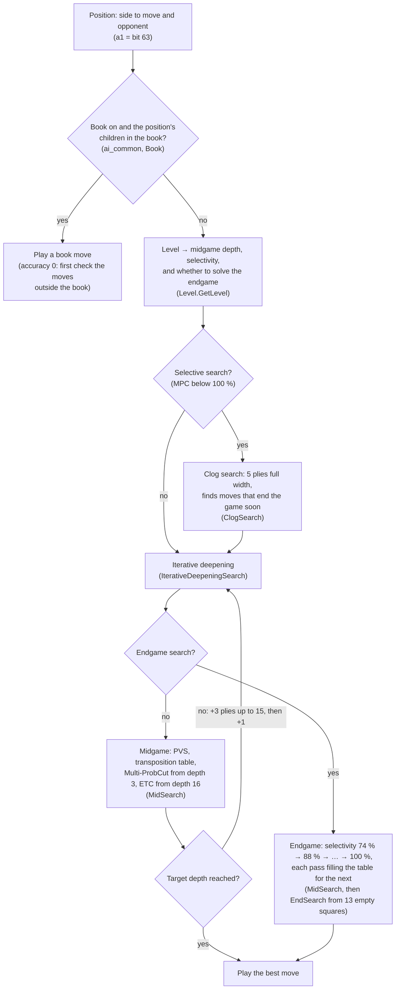

# 19 – The Egaroucid port

[Back to the index](README.md)

## In short

[Egaroucid](https://github.com/Nyanyan/Egaroucid) is a very strong open-source Othello program by Takuto Yamana. Its engine (version 7.9) has been ported to C# as the project [Egaroucid.Engine](../../Stello.Net/Egaroucid.Engine): board, pattern evaluation, midgame search, endgame search, time management and opening book lookup.

- **Why:** to compare Stello with a much stronger engine one part at a time (evaluation, midgame search, endgame), and to play matches between the two. What is learnt is the basis for Stello 2.0.
- **Exact:** on 1 thread the port gives the same evaluations, moves, values, depths and **node counts** as the C++ original. A C++ reference harness and test fixtures prove it.
- **Where it runs:** in the tools and tests only ([Stello.Benchmark](../../Stello.Net/tools/Stello.Benchmark) and [Egaroucid.Engine.Tests](../../Stello.Net/Egaroucid.Engine.Tests)). The WPF and web apps keep Stello's engine.

This chapter explains how the port is built, how it was proven exact, and how to run it. [Chapter 20](20-engine-comparison.md) gives what the comparison found. The working documents are [egaroucid-port-plan.md](../../Plans/egaroucid-port-plan.md) and [egaroucid-port-findings.md](../../Plans/egaroucid-port-findings.md).

## Licence

- **Stello is GPL-3.0-only** since the port (see [LICENSE](../../LICENSE)). Egaroucid is © Takuto Yamana, **GPL-3.0-or-later**, so Stello uses it under GPL version 3.
- **Every ported file** starts with `// SPDX-License-Identifier: GPL-3.0-only` and names its C++ original: "Ported from Egaroucid src/engine/…, © Takuto Yamana, GPL-3.0-or-later".
- **Egaroucid's source and resources are not in git.** The source goes in `Egaroucid-main/` in the repository root, which is git-ignored.
- **The training data is not in git either.** Its terms allow its use but forbid redistribution. It lives in the git-ignored folder `Traning data/` and is only used to measure evaluations.
- The credits are in [THIRD-PARTY-NOTICES.md](../../THIRD-PARTY-NOTICES.md) and [chapter 17](17-references.md#19-the-egaroucid-port-20-comparing-stello-with-egaroucid).

The resources the port reads, from `Egaroucid-main/bin/resources`:

| File | Size | What it holds |
|---|---:|---|
| `eval.egev2` | 38 MB | the pattern evaluation: 36.7 million weights |
| `eval_move_ordering_end.egev` | 0.5 MB | a small evaluation that orders moves in the endgame |
| `hash/hash25.eghs` … `hash27.eghs` | 2 MB each | the random numbers for the transposition table's hash codes |
| `book.egbk3` | 32 MB | the opening book: 1,302,322 positions |

## How Egaroucid finds a move

The driver is `Ai` ([Ai.cs](../../Stello.Net/Egaroucid.Engine/Ai.cs)), a port of `ai.hpp`. It follows the C++ chain `ai` → `ai_common` → `tree_search_legal` → `iterative_deepening_search`.



### Scores and the board

- **A position is `player` and `opponent`:** the side to move first, not black and white.
- **Squares are numbered a1 = bit 63 … h8 = bit 0**, the reverse of Stello's (chapter 02).
- **Values are whole discs** (−64 to +64) for the side to move. The evaluation tables are in 1/32 discs.
- **A move is played in place and undone afterwards** (`move` / `undo`). The 64 evaluation features are updated along with it.

### Levels

A level from 0 to 60 (`level.hpp`, [Level.cs](../../Stello.Net/Egaroucid.Engine/Level.cs)) gives:
- a midgame depth and a selectivity;
- from how many empty squares the level solves the endgame, and at which selectivity.

Level 60 solves the endgame exactly. The parity tests use levels 1, 5, 11, 15 and 21 on midgame positions, and level 60 on FFO positions. The benchmark's `level=` key and `--level` option choose a level.

### Multi-ProbCut

Multi-ProbCut ([MultiProbCut.cs](../../Stello.Net/Egaroucid.Engine/MultiProbCut.cs)) is Egaroucid's selective search, used from depth 3:
- A shallow search, at about half the depth (a third in the endgame), predicts the result of the deep one.
- If the prediction is far enough outside the window, the deep search is skipped.
- "Far enough" comes from a fitted error: a cubic of the number of discs and both depths, `mpc_error[7][65][61][61]`.
- There are 7 confidence levels: 74, 88, 93, 98, 99, 99.9 and 100 % (100 % means no selectivity).

### Iterative deepening

- **Depth steps:** +3 plies up to depth 15, then +1. There is no aspiration window.
- **The shown value is smoothed:** `round((0.9 × previous + 1.1 × new) / 2)`, with C's `round`.
- **The endgame climbs through the selectivities** 74 % → 88 % → … → 100 %. Each pass fills the transposition table for the next.

### The endgame in stages

| Empty squares | Search | File |
|---|---|---|
| More than 13 | the midgame code with the main transposition table, ETC and Multi-ProbCut | [MidSearch.cs](../../Stello.Net/Egaroucid.Engine/MidSearch.cs) |
| 11–13 | null-window search with a small local table (1,024 slots per number of empty squares); ordering by mobility (corners double) × 40 + the move-ordering evaluation × 12 | [EndSearch.cs](../../Stello.Net/Egaroucid.Engine/EndSearch.cs) |
| 7–10 | local table; ordering by quadrant parity and mobility | EndSearch.cs |
| 5–6 | squares alone in their region first, no other ordering | EndSearch.cs |
| 1–4 | special code (`last4` … `last1`), which checks neighbours before computing flips | EndSearch.cs |

A stability cutoff runs in every endgame node: if the stable discs already decide the window, the node stops.

### The opening book

[Book.cs](../../Stello.Net/Egaroucid.Engine/Book.cs) reads `book.egbk3` (`"DICUORAGE"`, version 3, then 25-byte records).
- **Each position is stored in its canonical orientation**, the smallest of the 8 symmetries, with its value in discs and the level it was searched at.
- **Choosing a move** (`get_random`): among the children in the book, the best one, drawn at random if several are equal (accuracy 0). Higher accuracies allow worse moves.
- **Leaving the book:** with accuracy 0, the moves that are not in the book get a null-window search against the best book value, and a full search if one of them beats it.

### Time modes

| Mode | C# entry point | How the time is used |
|---|---|---|
| Time per move | `Ai.SearchTimePerMove` | each move gets the fixed limit; used for matches against Stello's `time-ms` |
| Time per game | `Ai.SearchTimePerGame` | `calc_time_limit_ply` keeps a margin, plans the midgame moves, and gives up to 90 % of the clock when the endgame looks solvable |

In time mode, selectivity is 100 % up to depth 13 and 74 % beyond. Each iteration has a deadline (`SearchingFlag`).

## From C++ file to C# file

The C# files follow Egaroucid's names, so the two can be read side by side. The C# namespace is `Stello.Egaroucid`, and every type is internal: only the tests and the benchmark tool see them.

| C++ (`src/engine`) | C# ([Egaroucid.Engine](../../Stello.Net/Egaroucid.Engine)) | Main types and members |
|---|---|---|
| `ai.hpp`, `time_management.hpp` | [Ai.cs](../../Stello.Net/Egaroucid.Engine/Ai.cs) | `Search`, `SearchTimePerMove`, `SearchTimePerGame`, `AiCommon`, `TreeSearchLegal`, `IterativeDeepeningSearch`, `IterativeDeepeningSearchTimeLimit`, `CalcTimeLimitPly` |
| `bit_generic.hpp` | [Bits.cs](../../Stello.Net/Egaroucid.Engine/Bits.cs) | `Bits` |
| `board.hpp` | [Board.cs](../../Stello.Net/Egaroucid.Engine/Board.cs) | `Board` |
| `book.hpp`, `util.hpp` | [Book.cs](../../Stello.Net/Egaroucid.Engine/Book.cs) | `Book`, `BookValue` |
| `clogsearch.hpp` | [ClogSearch.cs](../../Stello.Net/Egaroucid.Engine/ClogSearch.cs) | `ClogSearch.FirstClogSearch` |
| `common.hpp` | [Common.cs](../../Stello.Net/Egaroucid.Engine/Common.cs) | `Common` |
| — (new) | [EgaroucidResources.cs](../../Stello.Net/Egaroucid.Engine/EgaroucidResources.cs) | `EgaroucidResources`: finds and loads the resource files once |
| `endsearch_common.hpp`, `endsearch_last_generic.hpp`, `endsearch_nws_last_generic.hpp`, `endsearch_nws.hpp`, `stability_cutoff.hpp`, `last_flip_generic.hpp` | [EndSearch.cs](../../Stello.Net/Egaroucid.Engine/EndSearch.cs) | `EndSearch` |
| `evaluate_common.hpp`, `evaluate_generic.hpp` | [Evaluate.cs](../../Stello.Net/Egaroucid.Engine/Evaluate.cs), [Patterns.cs](../../Stello.Net/Egaroucid.Engine/Patterns.cs) | `Evaluate`, `EvalSearch` (the incremental features); `Coord`, `Patterns` |
| `flip_generic.hpp`, `mobility_generic.hpp` | [Flip.cs](../../Stello.Net/Egaroucid.Engine/Flip.cs) | `Flip`, `Flip.CalcLegal` (`calc_legal`) |
| `hash.hpp` | [HashTables.cs](../../Stello.Net/Egaroucid.Engine/HashTables.cs) | `HashTables` |
| `level.hpp` | [Level.cs](../../Stello.Net/Egaroucid.Engine/Level.cs) | `Level.GetLevel` |
| `midsearch.hpp`, `midsearch_nws.hpp`, `transposition_cutoff.hpp` | [MidSearch.cs](../../Stello.Net/Egaroucid.Engine/MidSearch.cs) | `MidSearch` |
| `move_ordering.hpp` | [MoveOrdering.cs](../../Stello.Net/Egaroucid.Engine/MoveOrdering.cs) | `MoveOrdering` |
| `multi_probcut.hpp` | [MultiProbCut.cs](../../Stello.Net/Egaroucid.Engine/MultiProbCut.cs) | `MultiProbCut` |
| `search.hpp` | [Search.cs](../../Stello.Net/Egaroucid.Engine/Search.cs) | `Search`, `SearchResult`, `SearchingFlag`, `SearchContext` |
| `stability.hpp` | [Stability.cs](../../Stello.Net/Egaroucid.Engine/Stability.cs) | `Stability` |
| `transposition_table.hpp`, `endsearch_nws.hpp` (the local table) | [TranspositionTable.cs](../../Stello.Net/Egaroucid.Engine/TranspositionTable.cs) | `TranspositionTable`, `LocalTranspositionTable` |

**Not ported:**
- the multi-threaded search: `ybwc.hpp`, `thread_pool.hpp`, `parallel.hpp` and the parallel clog search (phase 6, postponed);
- the SIMD variants (`*_simd.hpp`, `flip_avx512.hpp`), because the port follows the Generic build;
- book editing, expansion and analysis (`book_enlarge.hpp`, `book_accuracy.hpp`) and the older book formats;
- the GUI's extras: human-like play (`human_like_ai.hpp`), XOT (`xot.hpp`) and local strategy (`local_strategy.hpp`);
- the extra pondering of time per game (`ai_get_values`, `ai_align_move_levels`, `request_more_time`).

## Proving the port exact

The rule was: **the port must give the same result as the C++ code, node for node**. A difference in one node count shows a difference in the search long before it shows in a move.

### The reference harness

[tools/Egaroucid.Reference](../../Stello.Net/tools/Egaroucid.Reference) builds the original C++ with plain g++ (about 35 s). See its [README](../../Stello.Net/tools/Egaroucid.Reference/README.md).

| File | What it does |
|---|---|
| `build.sh` | builds `bin/egaroucid-generic` (Egaroucid for Console) and `bin/egaroucid-ref` (the driver), and copies the resources to `bin/resources` |
| `reference.cpp` | a small driver that includes Egaroucid's engine unchanged: commands `eval`, `perft`, `search`, `book`, `mpc`, `random`, `book-walk` |
| `make-fixtures.sh` | writes all fixtures to `Egaroucid.Engine.Tests/Data/egaroucid` |

Two build flags matter:
- **`-DHAS_NO_AVX2`** builds the **Generic** code paths. The SIMD build counts endgame nodes differently (`last1_nws`), and the port follows Generic.
- **`-ffp-contract=off`** stops the compiler from fusing multiply and add in the Multi-ProbCut table, so the table matches .NET's arithmetic. A checksum of the whole table matches.

The driver calls `ai` with `use_multi_thread = false`, and clears the transposition table and the endgame's local table before each position. So no result depends on the position before it.

### The fixtures

The fixtures are small text files in [Egaroucid.Engine.Tests/Data/egaroucid](../../Stello.Net/Egaroucid.Engine.Tests/Data/egaroucid). Two runs of `make-fixtures.sh` give identical files once times are left out of the logs.

| Fixture | What it checks |
|---|---|
| `eval.txt` (2,150 positions from all 60 phases, FFO, and positions where a side must pass) | hash code, `mid_evaluate`, the move-ordering-end evaluation, stable discs, the 64 feature indices |
| `perft.txt` | perft from the start to depth 9 (3,005,288), and 30 positions at depth 5 |
| `mpc.txt` | the checksum of the Multi-ProbCut table |
| `book.txt` (221 positions) | the book value of the position and of every child |
| `search-midgame-level1/5/11/15/21.txt` | the 100 `midgame.txt` positions: move, value, depth, selectivity, nodes and clog nodes, with nodes per iteration |
| `search-ffo-level60.txt` | FFO #40–44 solved at level 60 |

The positions come from seeded random games, book walks, `midgame.txt` and the FFO file. None come from the training data, which may not be redistributed.

### What was proven

| Phase | Exactly equal to C++ |
|---|---|
| 2 Foundations | perft, hash codes, both evaluations, stable discs and all 64 features for the 2,150 positions; the incremental features equal a from-scratch computation along 200 random games, with passes and undos |
| 3 Search | all 500 midgame searches (levels 1, 5, 11, 15, 21) and FFO #40–44 at level 60: move, value, depth, selectivity, nodes and clog nodes, first time; FFO #40–49 with the same 520,296,918 nodes |
| 4 Book and time | the value and every child value of the 221 book positions |

On a mismatch, the nodes-per-iteration log shows which iteration first differs. Time mode can't be reproduced, so it is tested for behaviour: the limit is kept, and a stopped search still gives a legal move.

### The C++ quirks the port reproduces

Some C++ behaviour is surprising. Exact parity needs it, and the port comments each case.

- **`bit_around` is not the plain neighbourhood of a square.** It leaves out neighbours in directions too short to flip anything. A computed 3 × 3 neighbourhood would change the node counts. Lesson: copy every C++ table; don't recompute it.
- **`last3` reads the empty squares of the wrong board:** the 4-empty position, not the 3-empty board it is given.
- **ETC code is compiled into the depth ≤ 4 search.** The preprocessor reads the `constexpr` depths in an `#if` as 0. The ETC itself never runs there, but its "no flips: stop" test in the move loop does.
- **The endgame updates only the 16 move-ordering features.** The other 48 hold stale values, which nothing reads there.
- **The feature stack has 60 slots.** The port has one more, so tests can play whole games.
- **The value smoothing uses C's `round`,** which rounds halves away from zero. .NET must use `MidpointRounding.AwayFromZero`.
- **`ai()` gives no move when the side to move must pass:** no move, value 126, depth −1. Egaroucid's own callers pass first, and so does the match adapter.
- **The clog search has no time limit.** In time mode it always searches 5 moves deep: 25–190 ms on 1 thread, sometimes more than a whole 100 ms move. C++ hides this by searching the clog moves in parallel.
- **Leaving the book can take twice the time.** With accuracy 0, both the null-window search and the full search that may follow it get the whole time limit.

Two more facts shape the parity method rather than the code:
- **The console's single-threaded search still runs the parallel paths.** It always passes `use_multi_thread = true`, even with `-t 1`. Those paths sort moves with `std::sort`, whose order of equal moves depends on the C++ library. Hence the driver.
- **Hash numbers exist only for hash levels 25–27.** Any other level gets random numbers seeded by the clock, so searches can't be reproduced. The port supports only those three.

## Where the port deliberately differs

None of these changes a result; the parity tests check that.

| Difference | C++ | Port |
|---|---|---|
| Bit order | a1 = bit 63 | kept inside the port, so the C# reads like the C++. The match adapter `EgaroucidPlayer` reverses the 64 bits of Stello's board, and a move `policy` is Stello's square 63 − policy. A test plays 50 random games on both boards side by side. |
| Flips | lookup tables | rays and bit scans; the flipped discs are given by the rules |
| Weights | a second, colour-swapped copy of every table (147 MB) | **one table** (73.5 MB) and a second, colour-swapped view of the features |
| Globals | the transposition table, the local table (`thread_local`) and the stop flag | a `SearchContext` object, one per engine |
| Transposition table size | 2^25 + 2 slots | the same for parity (about 800 MB in C#); smaller tables use the lower bits of the hash code, for matches |
| Book | all record fields, editing, older formats | value and level only; play only |
| Book's random choice | seeded from the clock | **a seeded `Random`**, so games and matches can be repeated |
| Time mode, iterations | each iteration in its own thread | on the calling thread, with a flag that checks its deadline every 256 reads (a timer thread came up to 260 ms late under load) |
| Time mode, stopping | an outer stop does not end the current iteration | Move Now also ends it: the iteration's flag has the outer flag as its parent |
| Time mode, always a move | can return no move if stopped early | a level-1 search gives the move |
| Time per game | extra pondering with 38 or more empty squares and at least 2 s | left out (about 400 C++ lines) |

**The match adapter** ([EgaroucidPlayer.cs](../../Stello.Net/tools/Stello.Benchmark/EgaroucidPlayer.cs)) also:
- passes by itself, because of the pass quirk;
- keeps the transposition table through a game, as Egaroucid's GUI does, and clears it before the next;
- reports a book move as `Book`, an exact endgame at 100 % as `Exact`, and everything else as `Heuristic`, including selective endgame searches. Match reports therefore count those in Egaroucid's midgame depth.

## Running it

### The resources

The port looks for its resources in this order:
1. the folder in the environment variable **`EGAROUCID_RESOURCES`**, if it is set;
2. otherwise **`Egaroucid-main/bin/resources`** in the repository root, found by walking up from the program's folder.

If they are not found, the tool stops with a message that says where to put them. There is no command-line option for the folder; use the environment variable.

### In the benchmark tool

`engine=egaroucid` on a match side, or `--engine egaroucid` for a benchmark, chooses the port ([chapter 18](18-measuring-the-engine.md)):

```text
dotnet run -c Release --project Stello.Net/tools/Stello.Benchmark -- <command> [options]

match --a engine=stello-v1,time-ms=100 --b engine=egaroucid,time-ms=100
match --a engine=stello-v1,time-ms=500,book=on --b engine=egaroucid,time-ms=500,book=on
solve-bench --engine egaroucid --to 49
mid-bench --engine egaroucid --mpc 74
mid-bench --engine egaroucid --level 21
```

| Side key or option | Meaning for Egaroucid |
|---|---|
| `level=L` | a fixed level 1–60 instead of a time limit (`depth` is for Stello only) |
| `time-ms`, `game-s` | time per move, time per game |
| `hash-bits=21` | the transposition table has 2^21 slots (the default), the same memory as Stello's default (48 MB) |
| `book=on` | use Egaroucid's book (off by default) |
| `book-acc=0` | the book accuracy; 0 plays one of the best book moves |
| `seed=1` | seeds the book's choice anew every game |
| `--mpc 74` … `--mpc 100` | `mid-bench` only: the selectivity of a fixed-depth search (100 = none, the default) |

`eval-compare`, `make-exact` and `mid-quality` also use the port; [chapter 20](20-engine-comparison.md#reproducing-the-results) shows them.

### Tests

```text
dotnet test Stello.Net/Egaroucid.Engine.Tests
```

- **Without the resources the tests are skipped,** not failed (`EgaroucidFact`). A fresh clone without Egaroucid still passes.
- **The normal run checks 12 positions per search fixture.** `EGAROUCID_FULL_PARITY=1` runs every fixture position, in about 4 minutes.
- **Rebuilding the fixtures** needs g++ with C++20: `build.sh`, then `make-fixtures.sh` in `tools/Egaroucid.Reference`.

## Status

- **Done (phases 0–5):** licence, reference harness, foundations, single-threaded search, time management and book, and the comparison with Stello ([chapter 20](20-engine-comparison.md)).
- **Single-threaded only.** The parallel paths throw `NotSupportedException`, and the transposition table has no locks.
- **Phase 6 (YBWC multi-threading) is postponed.** It can be resumed later. The work continues with Stello 2.0 in [improve-stello-strength-plan.md](../../Plans/improve-stello-strength-plan.md).

Speed on 1 thread, from the findings:

| What | C# port | C++ Generic | Stello |
|---|---:|---:|---:|
| perft 11 from the start (212,258,800 leaves) | 0.61 s | 1.35 s | — |
| FFO #40–49, exact (520,296,918 nodes) | 28.2 s | about 19.4 s | 369 s |
| 100 `midgame.txt` positions, level 21 (1,449,749,430 nodes) | 180 s | about 161.5 s | — |
| Loading the evaluation and hash numbers | 0.11 s | about 1.4 s (start-up incl. other tables) | — |
| Loading the book (1,302,322 positions) | 0.22 s | — | — |

The port is 1.45× slower than C++ in the endgame and 1.12× in the midgame, and solves FFO #40–49 13× faster than Stello.

## Where in the code

| File | Main members |
|---|---|
| [Ai.cs](../../Stello.Net/Egaroucid.Engine/Ai.cs) | `Search`, `SearchTimePerMove`, `SearchTimePerGame`, `AiCommon`, `TreeSearchLegal`, `IterativeDeepeningSearch` |
| [Search.cs](../../Stello.Net/Egaroucid.Engine/Search.cs) | `Search` (the search state), `SearchContext`, `SearchingFlag`, `SearchResult` |
| [EgaroucidResources.cs](../../Stello.Net/Egaroucid.Engine/EgaroucidResources.cs) | `FindDirectory`, `Load`, `EnvironmentVariable` |
| [EgaroucidPlayer.cs](../../Stello.Net/tools/Stello.Benchmark/EgaroucidPlayer.cs) | `ChooseMove`, `ToEgaroucid`, `ToSquare`, `ToStello`, `ReverseBits` |
| [BenchSearcher.cs](../../Stello.Net/tools/Stello.Benchmark/BenchSearcher.cs) | `Create` (`--engine`, `--mpc`, `--level`) |
| [reference.cpp](../../Stello.Net/tools/Egaroucid.Reference/reference.cpp) | the C++ reference driver |

## Tests

| File | What it checks |
|---|---|
| [FoundationTests.cs](../../Stello.Net/Egaroucid.Engine.Tests/FoundationTests.cs) | coordinates, perft, stability, features, hash codes and evaluations against the fixtures; incremental features against from-scratch ones |
| [SearchParityTests.cs](../../Stello.Net/Egaroucid.Engine.Tests/SearchParityTests.cs) | the Multi-ProbCut table, and the midgame (levels 1–21) and FFO (level 60) searches, node for node |
| [BookAndTimeTests.cs](../../Stello.Net/Egaroucid.Engine.Tests/BookAndTimeTests.cs) | book values, the book's choice at accuracy 0, the pass quirk, the time limits and stopping |
| [MatchAdapterTests.cs](../../Stello.Net/Egaroucid.Engine.Tests/MatchAdapterTests.cs) | the bit conversion along random games, side parsing, a match against Stello, Stello 1 at the same depth playing like Stello, repeatable book moves |

---

Previous: [18 Measuring the engine](18-measuring-the-engine.md) · Next: [20 Comparing Stello with Egaroucid](20-engine-comparison.md)
