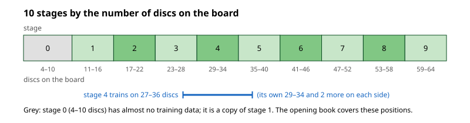
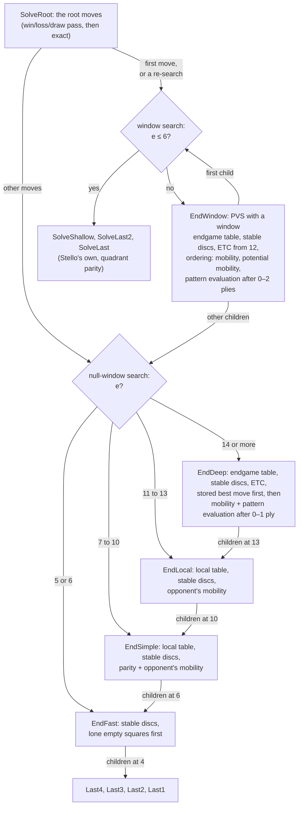

# 21 – Stello 2: the pattern evaluation and the new endgame solver

[Back to the index](README.md)

## In short

Stello 2.0 keeps Stello's midgame search ([chapter 06](06-midgame-search.md)) and replaces the two parts that [chapter 20](20-engine-comparison.md) found weakest:

- **The evaluation** is now a **pattern evaluation**: 15 patterns of squares in 62 places on the board, with one trained weight for every way the squares can be filled, in 10 stages of the game. The weights were trained by Stello's own C# trainer on 500 million positions from Egaroucid's training data. The file is 0.99 MB. Its error on held-out games is **5.47 discs**, against 12.14 for Stello 1's evaluation and 5.05 for Egaroucid's.
- **The endgame solver** is adapted from Egaroucid. The last 13 empty squares use Egaroucid's code; above that a new null-window search runs on Stello's transposition table, ordered by the pattern evaluation. FFO #40–49 take **47.1 s**, against 369 s for Stello 1 and 25.6 s for the Egaroucid port.

The result:

- Stello 2 scores **91 % against Stello 1** (+400 Elo at 100 ms per move, +393 at 500 ms).
- Against the Egaroucid port it scores 59.5 % at 100 ms (+67) and 38.2 % at 500 ms (−84).
- Unlike Stello 1, it plays better when it gets more time.

The old engine is kept, frozen, as **Stello 1** in [Stello.Engine.V1](../../Stello.Net/Stello.Engine.V1). The tools play it to measure every change against the same baseline. Chapters [04](04-evaluation.md) and [08](08-endgame-solver.md) describe Stello 1's evaluation and solver.

The working documents are [improve-stello-strength-plan.md](../../Plans/improve-stello-strength-plan.md) and [improve-stello-strength-findings.md](../../Plans/improve-stello-strength-findings.md). All numbers in this chapter come from the findings.

## Why

The comparison with the Egaroucid port ([chapter 20](20-engine-comparison.md#what-explains-the-difference)) showed:

- **The evaluation was the main cause of the gap.** Stello 1's error was 11.1 discs against Egaroucid's 4.0 (on `eval-compare`'s sample), and its best scale drifted 5-fold over the game. With 20 times more thinking time, Stello 1's moves hardly improved.
- **The endgame solver was 14 times slower** than Egaroucid's.

The user's order for Stello 2.0 was therefore:

1. a new evaluation, trained on Egaroucid's data and small enough for the web (about 1 MB);
2. Egaroucid's endgame solver, adapted to Stello;
3. only then the search (phase 5, [below](#what-comes-next)).

The evaluation had to come first: the new solver's ordering above 13 empty squares needs a good, fast evaluation.

## The engines

| Name | Project | Match side | What it is |
|---|---|---|---|
| Stello 1 | [Stello.Engine.V1](../../Stello.Net/Stello.Engine.V1) | `engine=stello-v1` | The engine before 2.0 (commit a261a6d), frozen as the baseline |
| Stello 2 | [Stello.Engine](../../Stello.Net/Stello.Engine) | `engine=stello` (the default) | The engine of the apps |
| Egaroucid | [Egaroucid.Engine](../../Stello.Net/Egaroucid.Engine) | `engine=egaroucid` | The C# port of Egaroucid 7.9 ([chapter 19](19-the-egaroucid-port.md)), the reference |

Stello 1 and Stello 2 share the board, the moves, the limits, the results and the opening book code. Stello 2's midgame search, move ordering, transposition table and time control are Stello 1's, unchanged.

## The pattern evaluation

### What a pattern is

A **pattern** is a fixed list of squares, for example the second row a2–h2. Each square is empty, own (the side to move) or the opponent's. So a pattern of $n$ squares can be filled in $3^n$ ways, and the evaluation has one **weight** for each of them. A weight is a number of discs: how much that filling of the squares is worth for the side to move.

The filling is read as a number in base 3, the **index**:

$$i = \sum_{k=0}^{n-1} d_k \cdot 3^{k}, \qquad d_k = \begin{cases} 0 & \text{empty} \\ 1 & \text{own disc} \\ 2 & \text{opponent's disc} \end{cases}$$

The first square of the list is the lowest digit. For example, the diagonal pattern d1 c2 b3 a4 with an own disc on d1, c2 empty, an opponent's disc on b3 and an own disc on a4 has the digits 1, 0, 2, 1 and the index $1 + 0 \cdot 3 + 2 \cdot 9 + 1 \cdot 27 = 46$.

The evaluation of a position is the sum of the weights of all patterns in all their places:

$$E(p) = \sum_{f=1}^{62} w_{s(p)}\big[\text{shape}(f),\ i_f(p)\big]$$

where $f$ runs over the 62 **features** (one pattern in one place), $i_f(p)$ is the feature's index in position $p$, and $s(p)$ is the stage of the position (below).

### Places, symmetries and folding

The board has 8 symmetries: the identity, three rotations and four mirrors. [Symmetry.cs](../../Stello.Net/Stello.Engine/Evaluation/Symmetry.cs) numbers them by three bits:

- bit 0 mirrors the columns (a ↔ h);
- bit 1 mirrors the rows (1 ↔ 8);
- bit 2 mirrors in the a1–h8 diagonal (a2 ↔ b1).

A pattern is written once, in its **canonical place**. Its other places are the same squares turned by a symmetry. The row a2–h2 also stands for the 7th row and the b and g columns: 4 places. Instead of a list of squares per place, the code turns the whole position by the symmetry and reads the canonical squares. So all places of a pattern share **one table of weights**, and every place learns from the data of all four.

Some symmetries map a pattern onto itself in another order. The row a2–h2 read backwards is h2–a2. Then two indices describe the same situation and must have the same weight. An own disc on a2 alone (index 1) and an own disc on h2 alone (index $3^7 = 2187$) are such a pair. **Folding** makes them one weight: for every index, `PatternShape.Fold` gives the smallest index of its group, and only those **representatives** are trained and stored. About half of the raw indices fold away in symmetric patterns.

### The patterns


[Patterns.cs](../../Stello.Net/Stello.Engine/Evaluation/Patterns.cs) defines three sets:

| Set | Patterns | Features | Weights per stage (folded) | Used for |
|---|---:|---:|---:|---|
| `classic11` | 11: rows 2–4, diagonals of 4–8 squares, edge + 2 X-squares, 2 × 5 corner, 3 × 3 corner (Logistello / Edax-like) | 46 | 113,877 | The first model and the experiments |
| `plus15` | `classic11` + Egaroucid's triangle, corner + block, cross and edge + y | 62 | 233,676 | **Stello 2's evaluation** |
| `egaroucid16` | Egaroucid 7.9's 16 patterns | 64 | 320,193 | An experiment |

The four shapes from Egaroucid all have 10 squares in a corner area. They see combinations the classic set misses: a corner with the squares on its two edges and the diagonal at once, or an edge with the two squares in front of it.

### Stages

A pattern is worth different amounts at different times in the game. An own disc on an edge is often a weakness early and a strength late. So the weights are trained separately for **stages**: ranges of the number of discs on the board.



- `EvalWeights.EvenStages(10)` cuts 4 to 64 discs into 10 nearly equal parts of 6 or 7 disc counts.
- **A stage is trained on its own disc counts and 2 more on each side** (`--smooth 2`), and validated on its own only. So neighbouring stages share data and agree better, and the sparse early stages get more data.
- **Stage 0 (4–10 discs) is a copy of stage 1.** The training data has almost no positions with fewer than 12 discs, because its games start after at least 8 random moves. The opening book covers these positions anyway.

### Reading the indices fast

`PatternShape.Index` reads a pattern from two bitboards without a loop over its squares:

- **The squares of one row** are in one byte of the bitboard: a mask and a shift get them.
- **The squares of one diagonal** are gathered into the top byte by one multiplication with `0x0101_0101_0101_0101`. Each square lands on a different bit, without carries; the constructor checks this for every pattern.
- **A table turns each byte into base-3 digits.** The index is `Digits[own byte] + 2 × Digits[opponent byte]`, summed over the parts.
- A shape that is neither one row nor one diagonal is read in parts, one per row. `egaroucid16` has diagonals with extra squares, read in up to 8 parts, and that made it slow.

This needs no BMI2 or AVX2 instructions, so it runs at the same speed in WebAssembly. The evaluation is computed from scratch for every position (the boards are immutable): **3.3 million evaluations per second** on 1 thread. Egaroucid instead updates its indices move by move.

### Training

The trainer is the console tool [Stello.Trainer](../../Stello.Net/tools/Stello.Trainer). The machine has no GPU and no Python libraries, so it is written in C# and runs on all CPU cores.

**The data.** Egaroucid's training data ([chapter 17](17-references.md#21-stello-2-the-pattern-evaluation-and-the-new-endgame-solver)) is free to use for training, but its terms forbid redistribution. It is not in the repository. It lives in the git-ignored folder `Traning data/`.

- **`convert`** turns it into 17-byte records (own discs, opponent's discs, final score) in `Traning data/stello-bin`, one file per split and disc count. That folder is git-ignored too.
  - `0001`: 25.5 M positions with final scores (Egaroucid's self-play), all kept.
  - `v0002`: 52 M games of Egaroucid against Edax. Each game is replayed, the random opening moves are dropped, and each position gets the game's final disc difference for its side to move. They are thinned to about 10 M positions per disc count.
  - In total 499.5 M positions, 8.0 GB: 479.6 M for training, 10.0 M for validation and 10.0 M for testing. The split is by game (2 % validation, 2 % test), so the positions of one game stay together.
  - It takes 1 m 53 s on 24 cores. The output is the same whatever the number of workers (checked by its SHA-256).
- **`train`** fits one stage after the other:
  - **The target** is the final disc difference for the side to move, and **the loss** is the mean squared error.
  - **The step** is full-batch Adam ($\beta_1 = 0.9$, $\beta_2 = 0.999$) on the mean residual of each weight: the sum of the errors of the positions where the weight appears, divided by how often it appears. A small prior pulls rarely seen weights towards zero.
  - **Early stopping:** when the validation error has not improved for `--patience` loops, the rate is halved and training goes on from the best weights so far. It stops at the loop limit or when the rate has fallen to 1/64 of its start. The weights that were best on validation are kept.
  - **Rare weights are zeroed:** a weight seen fewer than `--min-appear` times in the training data is set to 0 at the end. About half of all weights are never seen at all.
  - **The output:** the weights are rounded to 1/`--units` disc as 16-bit integers and written as an evaluation file.
  - One stage of 8 M positions converges in 300–500 loops, about 30 s on 24 cores.
- **`report`** gives a model's error on the test split per number of empty squares, next to Stello 1's evaluation (with a fitted scale) and the Egaroucid port.
- **`size`** shows how small a model's weights compress with coarser units.

What the training showed:

- **The model does not overfit.** Training and validation errors are equal (5.90 against 5.90 in stage 7). More data would not help; more patterns might.
- **The rate hardly matters.** 0.05 with 1,000 loops and 0.2 with 300 give the same 5.903. A stronger prior (20) is slightly worse.
- **The test split is harder than `eval-compare`'s sample.** Most test positions come from the Egaroucid–Edax games, whose results are noisier than Egaroucid's self-play at level 17. On it, Egaroucid's own error is 5.05 discs (3.96 on `eval-compare`'s sample).

### Experiments: stages, rare weights and pattern sets

All with 1 M training positions per disc count. The error is on the test split, in discs (mean absolute error / root mean squared error).

**Stages and rare weights** (`classic11`, 1/16 disc):

| Stages | Rare weights | File | Test error |
|---:|---|---:|---:|
| 10 | kept | 0.81 MB | 5.59 / 7.44 |
| 15 | kept | 1.5 MB (1/32 disc, file version 1) | 5.55 / 7.40 |
| 15 | zeroed below 10 appearances | 0.97 MB | 5.55 / 7.41 |
| 20 | kept | 1.52 MB | 5.53 / 7.38 |
| 30 | kept | 2.20 MB | 5.51 / 7.36 |

- From 10 to 30 stages the error falls by only 0.08 discs, while the file grows 2.7 times. Training on ±2 disc counts already lets neighbouring stages share their data.
- Zeroing the weights seen fewer than 10 times costs nothing and makes the file a third smaller.
- So the budget of about 1 MB is better spent on more patterns than on more stages.

**Pattern sets** (10 stages, rare weights zeroed below 10):

| Set | File | Test error | Evaluations per second |
|---|---:|---:|---:|
| `classic11` | 0.68 MB | 5.59 / 7.45 | 4.65 M |
| `plus15` | 1.28 MB | 5.46 / 7.28 | 3.72 M |
| `egaroucid16` | 1.62 MB | 5.37 / 7.16 | 2.17 M |

Matches with the same search, 1,180 games each:

| Match | 100 ms per move | 500 ms per move |
|---|---:|---:|
| `plus15` against `classic11` | 50.7 % (48.1–53.4), +5 | **53.2 % (50.6–55.8), +22** |
| `egaroucid16` against `classic11` | 49.4 % (47.0–51.9), −4 | — |

- **Accuracy matters more as the search gets deeper.** At 100 ms the better accuracy of `plus15` and its slower evaluation cancel out. At 500 ms it wins, at about the same depth (13.4 against 13.6).
- **`egaroucid16` is too slow** in this implementation, because its long diagonal patterns are read in many parts.

**`plus15` within about 1 MB:**

| Variant | File | Test error |
|---|---:|---:|
| 10 stages, zeroed below 10, 1/16 disc | 1.28 MB | 5.46 / 7.28 |
| 10 stages, zeroed below 30, 1/16 disc | 1.09 MB | 5.47 / 7.30 |
| 8 stages, zeroed below 10, 1/16 disc | 1.06 MB | 5.49 / 7.32 |
| 10 stages, zeroed below 10, 1/8 disc | 1.16 MB | 5.46 / 7.28 |
| **10 stages, zeroed below 30, 1/8 disc: chosen** | **0.99 MB (990,568 bytes)** | **5.47 / 7.31** |

The chosen model is [Stello.Net/Book/stello-eval.bin](../../Stello.Net/Book/stello-eval.bin) ([report](../../Plans/benchmark-results/v2-p2-eval-p15-s10-m30-u8.md)). For comparison, on the same test split Stello 1's evaluation has 12.14 / 15.46 and Egaroucid's 5.05 / 6.90 (16 patterns, 60 stages, trained on more data). Training with 3 M positions per disc count ran out of memory and was not needed, since the training and validation errors were already equal.

### The file

[EvalWeights.cs](../../Stello.Net/Stello.Engine/Evaluation/EvalWeights.cs) reads and writes the file (version 2). It is gzip-compressed; inside, all numbers are little-endian:

| Part | Contents |
|---|---|
| Magic | `STELLOEV` |
| Version | u16, 2 |
| Pattern set | u8 length and the ASCII name (`plus15`) |
| Stages | u8 (10) |
| Stage of each disc count | 65 × u8, for 0 to 64 discs |
| Units per disc | u16 (8: weights in 1/8 disc) |
| Weights | per stage: one i16 per representative of every pattern, **minus the same weight of the stage before**, written as all low bytes and then all high bytes |

- **Stage differences** are small numbers, because neighbouring stages are alike.
- **High bytes after low bytes:** most high bytes are 0 or 0xFF, so they compress well. For 15 stages of `classic11` in 1/32 disc this made the file 1.27 MB instead of 1.5 MB.
- **Only representatives are stored.** `Read` expands them to full tables of raw indices again with `PatternShape.Fold`, so the search needs no folding.

The file is built into `Stello.Engine` as an embedded resource and read on first use (`EvalWeights.Default`). Every app and tool has it without loading a file, and the browser downloads it inside the engine assembly. That assembly is now 1.15 MB (1.03 MB compressed), about 1 MB more than before. The trained weights may be shipped; they are credited in [THIRD-PARTY-NOTICES.md](../../THIRD-PARTY-NOTICES.md).

### How the search uses it

- **Leaves.** `EvaluateLeaf` returns the pattern evaluation converted to **1/100 disc**: the sum of weights × 100 / 8. Heuristic scores in the search, in progress reports, in the GUI and in the book are in this unit. A finished game still scores ±(32 600 + discs).
- **The endgame solver's ordering** above 13 empty squares, in whole discs (below).
- **Not in the midgame move ordering.** That is still the hash move, the response table and the square values ([chapter 05](05-move-ordering.md)).
- **The selective search** ([chapter 06](06-midgame-search.md#selective-search)) keeps its formula. Its margin of 50 is now half a disc.

**Tuning the old search to the new evaluation** (100 ms per move, 1,180 games each, against the defaults):

| Change | Score | Elo |
|---|---:|---:|
| Selective margin \|β\| × 25 % + 50 (default 50 % + 50) | 49.4 % (47.0–51.7) | −4 |
| Margin 50 % + 100 | 50.1 % (47.8–52.4) | +1 |
| Margin 25 % + 25 | 48.3 % (45.9–50.7) | −12 |
| A fixed margin of 2 discs (0 % + 200) | 51.7 % (49.2–54.1) | +11 |
| No "dangerous corner" extension | 49.4 % (47.2–51.6) | −4 |

- **None is significant.** The selective search stays as it is until phase 5 replaces it with a fitted Multi-ProbCut.
- **The "dangerous corner" extension** ([chapter 04](04-evaluation.md#dangerous-corner-moves)) was the only part of the search that still read Stello 1's edge tables. It was worth nothing with the new evaluation, so it was removed together with the old evaluation.

## The new endgame solver

### When it runs

When the solver starts has not changed ([chapter 08](08-endgame-solver.md#when-the-solver-runs)):

- In the normal modes, the solver takes over when the next midgame iteration would end with 7 or fewer empty squares (`EndgameDistance`).
- Solving still starts with the **win/loss/draw pass** (window −1, 1) and then, if there is time, finds the **exact score** in the window that is still possible. Solving exactly at once with a full window was slower: 50.0 s against 45.6 s on FFO #40–49.
- `SolveRoot` still does principal variation search at the root and reports progress after every root move.

**New in solve mode** (`SearchLimits.Solve`): before solving, a **4-ply midgame search** (iterations 1 to 4) orders the root moves. In games, the midgame iterations come first anyway.

### The layers

The routine that searches a position depends on the number of empty squares $e$ and on the window. Every null-window search returns a **fail-soft** bound: a score above α is a lower bound, at or below α an upper bound.



Each layer searches its children one empty square lower, so a null-window search moves down the chain. A null-window search of a position with 4 or fewer empty squares at once (only possible near the root) uses `SolveShallow`.

### The last 13 empty squares: Egaroucid's

This part is adapted from the port's [EndSearch.cs](../../Stello.Net/Egaroucid.Engine/EndSearch.cs), which is node for node Egaroucid's `endsearch_nws.hpp` and its helpers ([chapter 19](19-the-egaroucid-port.md)). It needs no midgame evaluation.

- **`Last4` … `Last1`:** special code for the last 4 squares. `Last1` counts the flips of the last square without playing it. A square alone in its region is tried first.
- **`EndFast` (5–6 squares):** the moves on **lone empty squares** (no empty neighbour) first, then the others. No move list is sorted.
- **`EndSimple` (7–10 squares):** moves ordered by parity (a square in a quadrant with an odd number of empty squares gets a bonus) and by the opponent's mobility after the move, with corners counted twice.
- **`EndLocal` (11–13 squares):** ordered by the opponent's mobility only. Egaroucid adds a small 4-pattern ordering evaluation here; Stello does not (see [What was tried](#what-was-tried-and-dropped)).
- **The local table** ([LocalTable.cs](../../Stello.Net/Stello.Engine/Endgame/LocalTable.cs)) serves `EndSimple` and `EndLocal`: one row of 1,024 slots per number of empty squares, each with a position and a lower and upper bound. Before ordering, the children are looked up: a stored bound may already decide the node, or show that a child fails low. A child with at most one reply is searched at once, because it is cheap and often decides the node.
- **The stable-disc cutoff** ([StableDiscs.cs](../../Stello.Net/Stello.Engine/Endgame/StableDiscs.cs)): the opponent's stable discs cap the best possible score at $64 - 2 \cdot \text{stable}$. If that cap is at or below α, the node fails low without a search. It is only tried when α is high enough for it to work (`StabilityThreshold`).
- **The wipe-out test:** a move that takes all of the opponent's discs wins 64–0 at once.

### The half-turn trick

Egaroucid numbers the squares the other way round: in its bitboards, bit 63 is a1; in Stello's, bit 0 is a1 ([chapter 02](02-board-and-squares.md)). Reversing the 64 bits maps square $i$ to $63 - i$, which turns the board **half a turn** (a1 ↔ h8, h1 ↔ a8).

Othello is the same after a half turn, and so is every table in the solver: the flip directions, the neighbour masks, the quadrants, the corners and the stable edges. So the adapted code works directly on Stello's bitboards, and the move numbers it returns are Stello's. Nothing is converted. [EndgameBits.cs](../../Stello.Net/Stello.Engine/Endgame/EndgameBits.cs) holds the adapted flips, legal moves and small tables; a test checks that they equal Stello's own.

### Above 13 empty squares: new, shaped like Egaroucid's

Above 13 empty squares, Egaroucid's solver is its midgame search, ordered by its 38 MB evaluation. Stello rebuilds that part on its own transposition table and its pattern evaluation ([SearchEngine.Endgame.cs](../../Stello.Net/Stello.Engine/Endgame/SearchEngine.Endgame.cs)):

- **Null-window searches with fail-soft bounds** (`EndDeep`), stored in Stello's endgame transposition table ([chapter 07](07-transposition-table.md)) with the number of empty squares as depth. At principal-variation nodes, `EndWindow` searches with a window and PVS: the first move with the window, the others with a null window and a re-search if they turn out better.
- **The stored best move first.** `EndDeep` searches the hash move before it spends time ordering the others; if it already fails high, nothing else is needed.
- **Enhanced transposition cutoff (ETC)** from 12 empty squares: the positions after each move are looked up in the table first. A stored bound may already prove a cutoff, or show that a move fails low so it need not be searched.
- **Move ordering** (Egaroucid's weights from `move_ordering.hpp`):
  - in `EndDeep`: the opponent's weighted mobility (twice the moves plus the corner moves) and the pattern evaluation of the child, in discs, after a 1-ply search from 16 empty squares;
  - in `EndWindow`: also the opponent's potential mobility, and a search of up to 2 plies.
- **The stable-disc cutoff** as in the lower layers.
- **Stopping:** every 1,024 nodes the solver checks the time and the tokens and sends a progress report. The web app's Stop and Move Now depend on those reports ([chapter 14](14-app-integration.md)).

### What made it fast

`solve-bench`, FFO #40–44, all correct:

| Version | Nodes | Time |
|---|---:|---:|
| First working version | 151 M | 10.5 s |
| No pattern evaluation in the ordering at 11–13 empty squares | 179 M | 7.9 s |
| … and ETC from 12 instead of 16 empty squares | 173 M | 7.6 s |
| … and in solve mode a 4-ply midgame search first, to order the root moves | 94 M | 4.1 s |
| Egaroucid port, for comparison | 84 M | 4.0 s |

**The root order matters most.** Without the short midgame search, #43 took 94 M nodes instead of 33 M.

### What was tried and dropped

- **The pattern evaluation in the ordering at 11–13 empty squares.** It saves about 20 % of the nodes, but each node becomes about 40 % slower.
- **The midgame table's best moves as hash moves in the solver,** where the endgame table has none: FFO #40–44 took 6.9–10.6 s instead of 4.1 s. The endgame ordering is better than a shallow midgame search's choice.
- **Other depths for the ordering search** (1 ply from 14, 16, 18 or 20 empty squares) changed the time by under 15 %.
- **Exact at once** instead of win/loss/draw first: slower (above).

## Measurements

All on 1 thread, on the Intel i7-12850HX laptop VM of [chapter 20](20-engine-comparison.md#how-it-was-measured). Matches have 1,180 games from the 590 start positions, no books, with 95 % intervals.

### The evaluation (phase 2 gate)

Stello 2 with `stello-eval.bin` in the old search, with Stello 1's solver, selective margin and corner extension:

| Match | Score | Elo | Discs per game | Midgame depth (Stello 2 / other) |
|---|---:|---:|---:|---:|
| Against Stello 1, 100 ms | **90.9 %** (89.3–92.5) | **+400** | +15.1 | 11.10 / 10.38 |
| Against Stello 1, 500 ms | **90.6 %** (89.0–92.2) | **+393** | +12.7 | 13.08 / 12.34 |
| Against Egaroucid, 100 ms | **59.5 %** (57.0–62.1) | **+67** | +1.9 | 11.40 / 8.62 |
| Against Egaroucid, 500 ms | 38.2 % (35.9–40.5) | −84 | −2.1 | 13.36 / 13.52 |

Reports: [100 ms](../../Plans/benchmark-results/match_v2-p2-eval-vs-v1-100ms.md) and [500 ms](../../Plans/benchmark-results/match_v2-p2-eval-vs-v1-500ms.md) against Stello 1; [100 ms](../../Plans/benchmark-results/match_v2-p2-eval-vs-egaroucid-100ms.md) and [500 ms](../../Plans/benchmark-results/match_v2-p2-eval-vs-egaroucid-500ms.md) against Egaroucid.

`mid-quality` ([chapter 20](20-engine-comparison.md#midgame-quality-mid-quality)): the discs a move loses against perfect play, on 300 positions, lower is better ([result](../../Plans/benchmark-results/v2-p2-mid-quality.md)):

| ms/move | Stello 1 | Stello 2 | Egaroucid | Stello 1 − Stello 2 | Stello 2 − Egaroucid |
|---:|---:|---:|---:|---:|---:|
| 50 | 1.59 ± 0.31 | 1.33 ± 0.30 | 1.18 ± 0.30 | +0.26 ± 0.36 | +0.15 ± 0.26 |
| 200 | 1.59 ± 0.33 | 0.91 ± 0.22 | 0.94 ± 0.24 | +0.68 ± 0.36 | −0.03 ± 0.21 |
| 1000 | 1.39 ± 0.30 | 0.68 ± 0.18 | 0.54 ± 0.18 | +0.71 ± 0.30 | +0.14 ± 0.19 |

- **Stello 2 gets better with time** (1.33 → 0.91 → 0.68 discs lost), as Egaroucid does. Stello 1 hardly does (1.59 → 1.39).
- At 50 ms the difference to Stello 1 is inside its margin: in 50 ms both engines are mostly at the same shallow depth.
- **At 100 ms Stello 2 beats the Egaroucid port.** Egaroucid's 38 MB evaluation is slow to compute, and at 100 ms it only reaches depth 8.6. At 500 ms the depths are equal, and Egaroucid's better evaluation and search are worth about 84 Elo. Phase 5 goes after that gap.
- The evaluation alone is worth more than the whole gap between Stello 1 and Egaroucid at 100 ms (Egaroucid scored 87.1 % against Stello 1 there).

### The solver (phase 3 gate)

`solve-bench --to 49`, FFO #40–49 exactly ([result](../../Plans/benchmark-results/v2-p3-solve-bench-40-49.json)):

| Engine | Time | Nodes |
|---|---:|---:|
| Stello 1 | 369 s | 7.41 G |
| **Stello 2** | **47.1 s** | **1.10 G** (23 M nodes per second) |
| Egaroucid port | 25.6 s | 0.52 G |

- All scores and moves are correct. Stello 2 is 7.8 times faster than Stello 1 and 1.8 times slower than the port, within the gate of about 2 times.
- The slow positions are #45 (11.1 s), #48 (12.0 s) and #49 (16.3 s).

**Matches, the new solver against Stello 1's,** both with the pattern evaluation:

| Time per move | Score | Elo | First solve (empty squares, old → new) |
|---:|---:|---:|---:|
| 100 ms | 49.7 % (47.5–51.9) | −2 | 18.8 → 19.4 |
| 500 ms | 51.1 % (49.2–53.0) | +8 | 20.7 → 21.2 |

Reports: [100 ms](../../Plans/benchmark-results/match_v2-p3-endgame-new-vs-classic-100ms.md), [500 ms](../../Plans/benchmark-results/match_v2-p3-endgame-new-vs-classic-500ms.md).

**The solver is much faster, but the games hardly change.** The search only starts solving after its midgame iterations reach empty squares − 8, so the faster solver starts only about half a square earlier. Egaroucid solves selectively from 24–28 empty squares (Multi-ProbCut at 74 %, then 88 … 100 %). That is phase 5, item 5. The new solver matters most for analysis, solve mode and longer time controls.

### In the browser

Eight positions from Stello 2's games, with 20 and 22 empty squares, were opened in the web app (Blazor WebAssembly, AOT Release build, headless Chromium, 60 s per move, no book), and the computer played the move. Time to the move:

| | 20 empty squares | 22 empty squares |
|---|---:|---:|
| Stello 2, local AOT build | 0.1–0.3 s | 0.6–1.3 s (6.5–23 M nodes) |
| Stello 1, the live site | 0.3–0.7 s | 1.1–4.5 s (10–60 M nodes) |

- All scores are the same.
- In the browser Stello 2 runs at 8–22 M nodes per second, about native speed. Most of the gain comes from needing fewer nodes.

## The GUI

- **Heuristic scores are shown in discs with one decimal:** a search score of 123 (1/100 disc) is shown as `+1.2 discs` ([chapter 15](15-gui-and-settings.md#telemetry-fields-explained)).
- Exact scores are whole discs (`+12 discs`); `Win`, `Loss`, `Draw` and `Book` are unchanged.
- The About box describes the pattern evaluation and the solver and credits Egaroucid. Its version text, "Stello Version 2.0", came with the C# port and is unchanged.

## The opening book

- **`OpeningBook.EngineVersion` is 3.** So `recalc` ([chapter 12](12-book-tool.md#recalculating-the-leaves-recalc)) searches every leaf that is not exact again with Stello 2: 8,397 of 11,613 leaves; the 3,216 exact ones are kept.
- **The new heuristic values are in 1/100 disc.** Solved values stay ±(32 600 + discs).
- **The book is being recalculated** with Stello 2, 60 s per position as for Stello 1's book, on a second computer, so it does not disturb timed matches. A first try with 30 s already reached depth 17–18, as deep as Stello 1's recalculation got in 60 s. The run can be stopped and continued. Its results are not known yet.
- **`Book/opening-book-stello1.txt` keeps the old book** for Stello 1's match sides (`engine=stello-v1,book=on`). Stello 2's sides use `opening-book.txt`.
- The worked example of book learning ([chapter 11](11-book-learning.md#worked-example-learning-on-an-empty-book)) now has Stello 2's values.

## Stello 1, the frozen baseline

[Stello.Engine.V1](../../Stello.Net/Stello.Engine.V1) is a copy of the engine at commit a261a6d, under the namespace `Stello.Engine.V1`:

- **What is copied:** `SearchEngine`, `Search/*` (move ordering, time control, transposition table), `Evaluation/*` (the evaluator and the edge tables of [chapter 04](04-evaluation.md)) and `ComputerPlayer`. Its solver is the one of [chapter 08](08-endgame-solver.md).
- **What is shared:** board, moves, limits, results and the opening book code. Stello 1 reaches the internal `Bitboards` through `InternalsVisibleTo`.
- **Who uses it:** only the tools and tests. The apps use `Stello.Engine`.
- **Proof that it is the same engine:** on all 100 `midgame.txt` positions at depth 8 and on FFO #40–44, it gives the same moves, scores, depths and node counts as the engine at a261a6d. `StelloV1Tests` keeps checking 32 recorded searches ([Data/stello-v1-signatures.txt](../../Stello.Net/Stello.Engine.Tests/Data/stello-v1-signatures.txt)), so the copy cannot drift. A match of the copy against the engine it was copied from scored 51.8 % (49.5–54.1), not significant.

### How to compare engines

The benchmark tool ([chapter 18](18-measuring-the-engine.md)) plays all three engines:

```text
dotnet run -c Release --project Stello.Net/tools/Stello.Benchmark -- <command> [options]
```

| What | Command |
|---|---|
| Stello 2 against Stello 1, 100 ms | `match --a engine=stello-v1,time-ms=100,name=stello1 --b time-ms=100,name=stello2` |
| Stello 2 against Egaroucid, 500 ms | `match --a engine=egaroucid,time-ms=500,name=egaroucid --b time-ms=500,name=stello2` |
| A new evaluation file against the built-in one | `match --a time-ms=100,name=default --b time-ms=100,eval=<file>,name=new` |
| The endgame | `solve-bench --to 49`, `solve-bench --engine stello-v1 --to 49`, `solve-bench --engine egaroucid --to 49` |
| Midgame speed | `mid-bench --engine stello`, `mid-bench --engine stello-v1`, add `--eval <file>` for another Stello 2 evaluation |
| Midgame quality | `mid-quality --engines stello,stello-v1,egaroucid`, or `--sides "<side>;<side>"` for match sides with their own keys |

- **Side keys for Stello 2:** `eval=<file>` (another evaluation file; `default` is the built-in one), `sel-margin=` and `sel-percent=` (the selective search's margin, 50 and 50 % by default). They are not allowed for Stello 1 or Egaroucid.
- **Gone:** `eval=classic`, `danger=` and `endgame=` (and `--endgame`) were the switches of phases 2 and 3. They went with the old evaluation and solver, which only Stello 1 has now. To play the old evaluation or solver, play `engine=stello-v1`.
- **`eval-compare`** measures Stello 1's evaluation against Egaroucid's ([chapter 20](20-engine-comparison.md#evaluation-eval-compare)). A trained model is measured with the trainer's `report` instead:

```text
dotnet run -c Release --project Stello.Net/tools/Stello.Trainer -- report --model Stello.Net/Book/stello-eval.bin
```

The trainer's defaults are those of the first model (`classic11`, 15 stages, 1/32 disc). The chosen model used `--set plus15 --stages 10 --units 8 --min-appear 30` with 1 M positions per disc count (`--max-per-discs 1000000`). Its exact rate and loop count are not recorded; the rate hardly matters (above).

## What comes next

Phase 4 releases Stello 2.0 in the apps: the engine switch is done, and the recalculated book and the release checks follow. Then phase 5 improves the search, as 2.x releases. Each change sits behind a `SearchOptions` switch and must win a 1,180-game match against the best Stello 2 so far (or, for a pure speed change, be faster on `mid-bench` / `solve-bench` with no loss in a match). The order follows the expected gain:

1. **Time use:** Stello starts no new iteration after 2/3 of the time and so uses about 313 of 500 ms. An estimate of the next iteration's cost should decide instead.
2. **PVS throughout**, and a transposition table with bounds and two moves, cleared by importance instead of two tables.
3. **Multi-ProbCut** with an error model fitted on Stello 2's own shallow and deep searches, in place of the fixed selective margin.
4. **Move ordering by a shallow search**, and ETC in the midgame.
5. **A selective endgame** (solve earlier at 74 % → 100 %), and a clog search with a depth or time limit.
6. **Checking the moves outside the book** when leaving it.
7. Optional: **Lazy SMP or YBWC** (more threads).

Two smaller ideas from phase 3: a small, fast move-ordering table for 11–13 empty squares like Egaroucid's, and starting the solver from an estimate of its time instead of a fixed distance.

## Design notes

- **The search was kept, the knowledge replaced.** The evaluation and the solver changed; the midgame search did not. So the +400 Elo are the evaluation's, measured in the same search, and phase 5 can measure each search change on its own.
- **About 1 MB, chosen by numbers.** The budget came from the web app. The experiments showed that more stages buy little, while four more patterns buy accuracy that pays off at longer times.
- **From scratch, not incremental.** Stello's boards are immutable, and computing all indices with shifts, one multiplication per diagonal and byte tables gives 3.3 M evaluations per second. Incremental updates would need a mutable board in the search.
- **Portable.** No BMI2 or AVX2, so the evaluation and the solver run in WebAssembly at about native speed.
- **Built in.** The plan was a separate weights file, linked into WPF and fetched by the web app beside the book. An embedded resource gives every app and tool the same bytes with no loading code.
- **Adapted, not ported.** The last 13 squares are Egaroucid's code on Stello's bitboards; above 13 squares the search is written on Stello's table and evaluation. The win/loss/draw pass, the root PVS, the progress reports and Stello's own shallow solver for principal-variation nodes are kept.
- **Licence.** The adapted files carry `SPDX-License-Identifier: GPL-3.0-only` and name their Egaroucid originals (© Takuto Yamana, GPL-3.0-or-later). The training data is not shipped; the trained weights are, and are credited in [THIRD-PARTY-NOTICES.md](../../THIRD-PARTY-NOTICES.md).

## Where in the code

| File | Main members |
|---|---|
| [Symmetry.cs](../../Stello.Net/Stello.Engine/Evaluation/Symmetry.cs) | `Apply`, `MapSquare`, `MirrorColumns`, `Transpose` |
| [Patterns.cs](../../Stello.Net/Stello.Engine/Evaluation/Patterns.cs) | `PatternShape` (`Index`, `SlowIndex`, `Placements`, `Fold`, `Representatives`), `PatternSet` (`Classic11`, `Plus15`, `Egaroucid16`, `Indices`) |
| [EvalWeights.cs](../../Stello.Net/Stello.Engine/Evaluation/EvalWeights.cs) | `Evaluate`, `EvenStages`, `Default` (the built-in file), `Load`, `Read`, `Write` |
| [Stello.Engine.csproj](../../Stello.Net/Stello.Engine/Stello.Engine.csproj) | The embedded resource `Book/stello-eval.bin` |
| [SearchEngine.cs](../../Stello.Net/Stello.Engine/SearchEngine.cs) | `Search` (the solve-mode ordering, the two passes), `SolveRoot`, `EvaluateLeaf`, `PatternScore`, `SolveShallow`, `SolveLast2`, `SolveLast` |
| [SearchEngine.Endgame.cs](../../Stello.Net/Stello.Engine/Endgame/SearchEngine.Endgame.cs) | `SolveChild`, `EndNull`, `EndWindow`, `EndDeep`, `OrderingValue`, `EndLocal`, `EndSimple`, `EndFast`, `Last4` … `Last1`, `StabilityCut` |
| [EndgameBits.cs](../../Stello.Net/Stello.Engine/Endgame/EndgameBits.cs) | `Flips`, `LegalMoves`, `LoneEmpties`, `Parity`, `WeightedMoves`, `PotentialMobility`, the stability thresholds |
| [StableDiscs.cs](../../Stello.Net/Stello.Engine/Endgame/StableDiscs.cs), [LocalTable.cs](../../Stello.Net/Stello.Engine/Endgame/LocalTable.cs) | Stable discs; the local table of 7–13 empty squares |
| [SearchOptions.cs](../../Stello.Net/Stello.Engine/Search/SearchOptions.cs) | `Pattern`, `SelectiveMargin`, `SelectivePercent`: the switches for experiments |
| [tools/Stello.Trainer](../../Stello.Net/tools/Stello.Trainer) | `ConvertCommand`, `TrainCommand` (`Fit1`, `FoldedIndex`), `ReportCommand`, `SizeCommand`, `TrainingData` |
| [Stello.Engine.V1](../../Stello.Net/Stello.Engine.V1) | Stello 1: `SearchEngine`, `Evaluation/Evaluator.cs`, `Evaluation/EdgeTables.cs`, `V1MatchPlayer` |
| [MatchCommands.cs](../../Stello.Net/tools/Stello.Benchmark/MatchCommands.cs), [BenchSearcher.cs](../../Stello.Net/tools/Stello.Benchmark/BenchSearcher.cs) | The `engine=`, `eval=`, `sel-margin=` and `sel-percent=` keys; `--engine` and `--eval` |
| [AnalysisViewModel.cs](../../Stello.Net/Stello.App/ViewModels/AnalysisViewModel.cs) | `FormatScore`: scores in discs |

## Tests

In [Stello.Engine.Tests](../../Stello.Net/Stello.Engine.Tests):

- [PatternTests.cs](../../Stello.Net/Stello.Engine.Tests/PatternTests.cs):
  - the symmetries map squares and whole boards as documented;
  - the sets have the expected features and folded sizes;
  - every index equals reading the squares one by one;
  - the folded weights give the same sum for all 8 symmetric positions;
  - a file written and read gives the same evaluation, and other files are rejected.
- [EndgameTests.cs](../../Stello.Net/Stello.Engine.Tests/EndgameTests.cs):
  - FFO #40–44;
  - minimax on small endgames and on the last 1–4 squares;
  - the 112 positions of the endgame.c suite;
  - a fixed-depth search near the end switches to the solver;
  - the solver agrees with Stello 1's on 30 positions with 14–18 empty squares;
  - Move Now during a solve of FFO #49 answers within 100 ms.
- [EndgameBitsTests.cs](../../Stello.Net/Stello.Engine.Tests/EndgameBitsTests.cs): the flips, the legal moves and the final score equal Stello's own, and stable discs are never flipped in random games.
- [StelloV1Tests.cs](../../Stello.Net/Stello.Engine.Tests/StelloV1Tests.cs): Stello 1 still gives its recorded searches.
- [EvaluatorTests.cs](../../Stello.Net/Stello.Engine.Tests/EvaluatorTests.cs): Stello 1's evaluator ([chapter 04](04-evaluation.md#tests)).
- [BookLearnerTests.cs](../../Stello.Net/Stello.Engine.Tests/BookLearnerTests.cs): the worked example of chapter 11, with Stello 2's values.

## Further reading

- [Technical explanation – Egaroucid](https://www.egaroucid.nyanyan.dev/en/technology/explanation/): Egaroucid's pattern evaluation, its training with Adam, move ordering, the endgame search and the last-squares code.
- [Training data – Egaroucid](https://www.egaroucid.nyanyan.dev/en/technology/train-data/): the data Stello 2's evaluation was trained on, and its terms.
- [Kingma and Ba (2014): Adam: A Method for Stochastic Optimization – arXiv](https://arxiv.org/abs/1412.6980): the optimiser the trainer uses.
- [Writing an Othello program – Gunnar Andersson](http://radagast.se/othello/howto.html): "Position evaluation" introduces pattern-based evaluation.
- [Logistello – Michael Buro](https://skatgame.net/mburo/log.html): Buro's program, which brought trained pattern evaluation and Multi-ProbCut to Othello.
- [Enhanced Transposition Cutoff – Chess Programming Wiki](https://www.chessprogramming.org/Enhanced_Transposition_Cutoff) and [Null Window – Chess Programming Wiki](https://www.chessprogramming.org/Null_Window).
- [Edax on GitHub](https://github.com/abulmo/edax-reversi): another strong pattern-based engine, with a fast bitboard solver.

---

Previous: [20 Comparing Stello with Egaroucid](20-engine-comparison.md) · Next: [Index](README.md)
